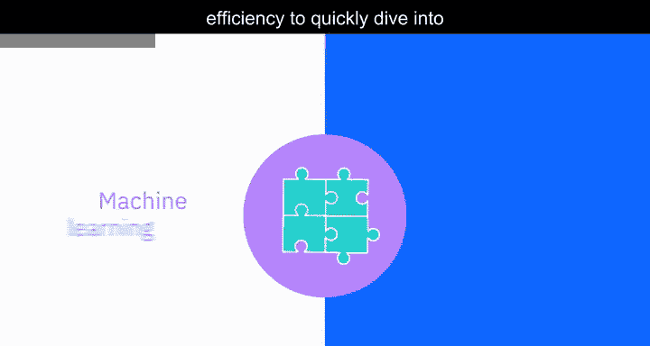
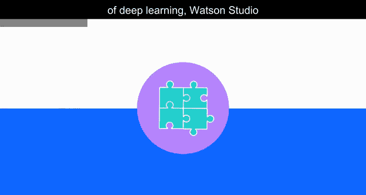
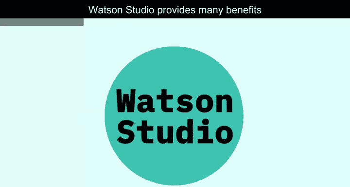
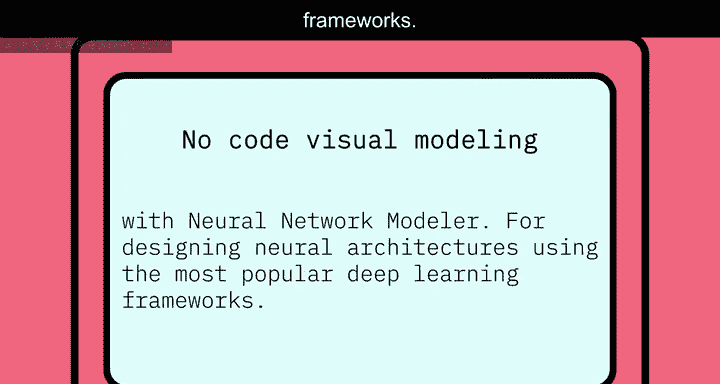
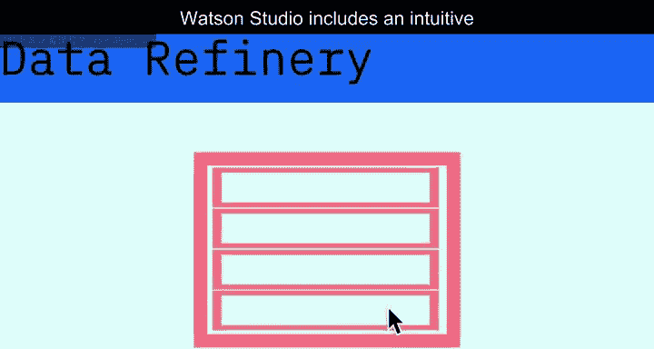
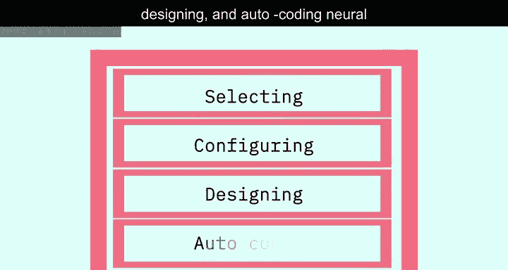
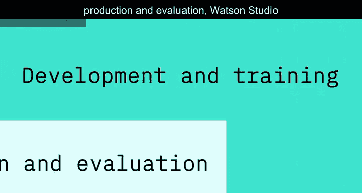
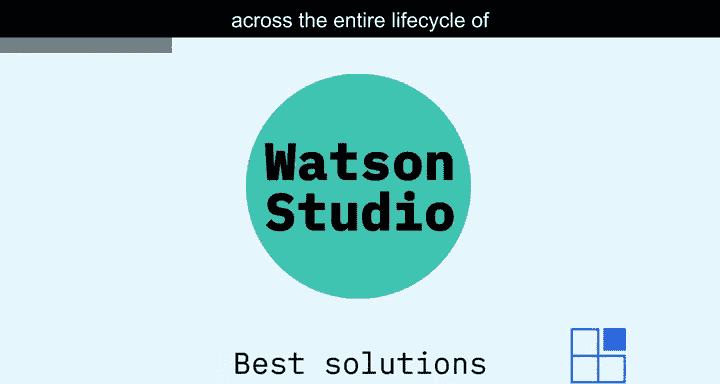

# IBM数据科学专业证书课程2：《数据科学工具》open-source-tools-for-data-science（中英字幕） - P30：29_IBM Watson Studio简介.zh_en - GPT中英字幕课程资源 - BV1np4y1V7Sn

🎼Every business wants to work smarter， and to do that。

 you need to tap into your company's greatest resource。 Your data。

 but extracting the full value out of your data isn't always an easy process。 First。

 you end up juggling an incredibly large and complex collection of tools that are used for finding and cleaning data。

 analyzing and generating visualizations of that data。

 and using the data to build and deploy machine learning models。😊，🎼And to make matters worse。

 these tools are often a time drain to individually manage and can be difficult to integrate into your system。

 which can really slow down the workflow。

But not anymore using Watson Studio， you can simplify your data projects with a streamlined process that allows you to extract value and insights from your data to help your business get smarter。

 faster， it delivers an easy to use collaborative data science and machine learning environment for building and training models。

 preparing and analyzing data and sharing insights all in one place。

🎼Watson Studios easy to create visualizations and drag and drop code put the power of database decision making into the hands of any member of your organization with no need for IT assistance and if you need access to open source tools the environment offers some of the most popular and powerful ones available Waatson Studio's single environment also creates a workflow that's incredibly efficient so data scientists can share assets and work to solve problems within the system rather than starting from scratch every time a new issue arises and developers can use that efficiency to quickly dive into building machine learning and deep learning algorithms In fact。

 in the area of deep learning， Watson Studio supports some of the most popular frameworks and can deploy that deep learning onto the latest GPUs to help accelerate modeling by making it easier to use the environment built in neural network modeler also helps you build models with the simplified graphical interface even if you don't have the dedicated resources to build a model from scratch。

Watson Studio can help you get started with modeling templates for areas such as visual recognition。

 language classification， and other tools from IBM Watson Services。

Because Watson Studio is seamlessly integrated with the IBM Watson Knowledge catalog。

 and intelligentent Aset discoveryy tool， you can transform data and models into trusted enterprise resources and collaborate with confidence without compromising compliance security or access control。

Watson Studio provides many benefits for organizations helping to infuse AI into the business and drive innovation。

You can train Watson Studio with embedded AI services， including Watson Vi recognition。

 you can customize your models and deploy them as APIs or core ML by using open source tools like Jupiter Notes。

 Anaconda and RSt Watson Studio supports most popular code libraries as well as No code visual modeling with neural network modeler。

For designing neural architectures using the most popular deep learning frameworks。

In Watson's Studio， you can interactively discover。

 cleanse and transform your data using data refinery It helps you understand the quality and distribution of your data with built in charts and statistics and provides visualized results through interactive dashboards Watson Studio includes an intuitive drag and droprop interface that enables a nonprogramr to speed up the bottle building process by visually selecting。

 configuring， designing and autoco neural networks。

From development and training to production and evaluation。

 Watson Studio tracks your models over time to ensure you have the best performance for any given task using the best solutions across the entire life cycle of your machine learning models。

