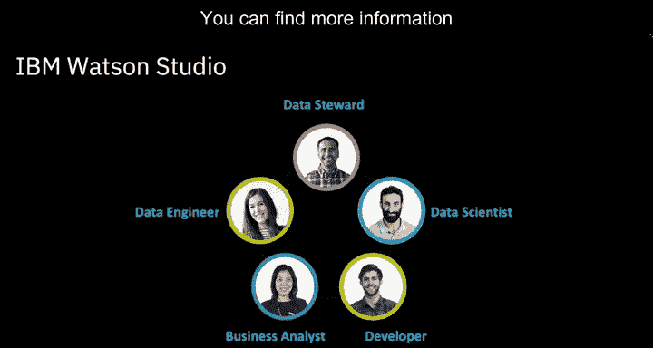
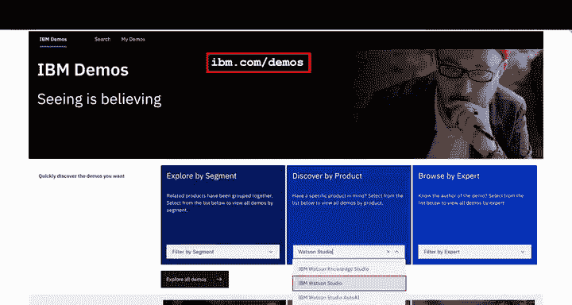
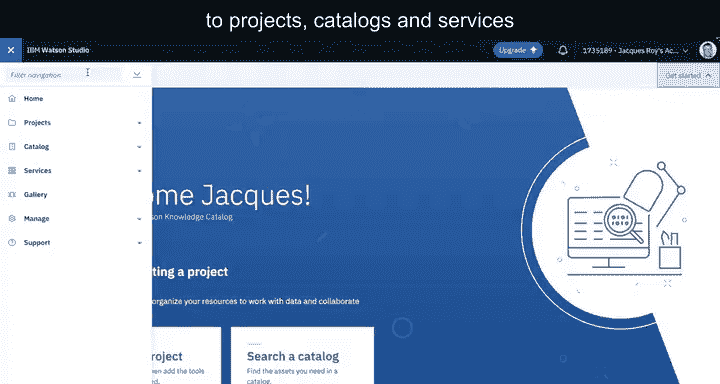
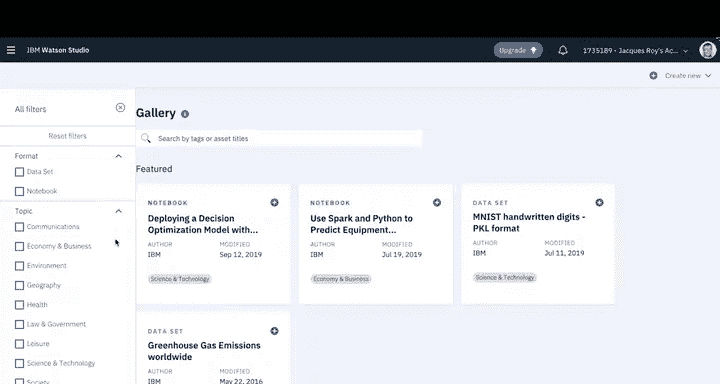
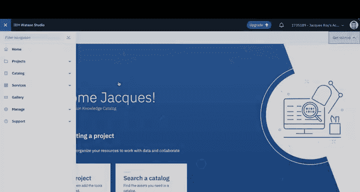
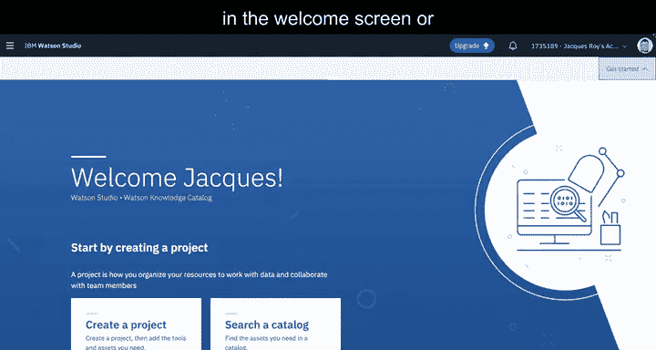
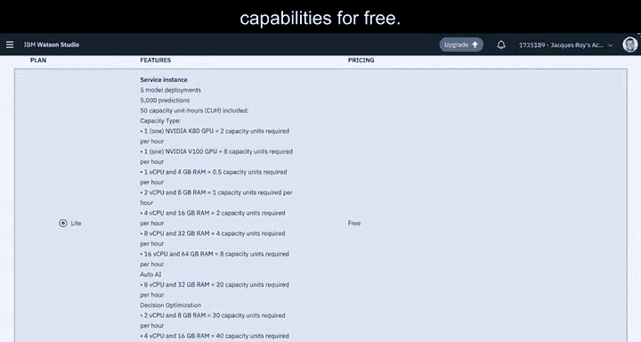

# IBM数据科学专业证书课程2：《数据科学工具》open-source-tools-for-data-science（中英字幕） - P31：30_Watson Studio导论.zh_en - GPT中英字幕课程资源 - BV1np4y1V7Sn

Watson Studiodue is an integrated platform of tools。

 services and data that helps companies accelerate their shift to become data driven organizations。

You can start with a free account to explore its capabilities。Data science is a team sport。

 We have different types of people interested in the insights that data science can provide。

This includes business analysts， data engineers， data stwards， data scientists and developers。

Data needs to be located and cleans。 Model have to be created， tested， monitored and updated。

 All this requires teamwork。 For this reason， Watson Siu was built as a collaborative platform。

 a community of like minded people。There is a lot to cover in this introduction。

 and we will only scratch a surface。 You can find more information on the digital technical engagement site at IBM dot com slash demos。

😊。

Once you are logged in， you may see the Get started welcome screen。

You can minimize the screen by clicking on the get started button in the upper right。

One importanted item that is easy to miss is the hamburger button in the upper left。

It gives you direct access to projects， catalogs and services， among other things。

The gallery is particularly interesting。 it is a collection of assets including tutorials， notebooks。

 data sets， articles and papers from multiple sources。New assets are constantly added。

Asstets can be searched using filters for type， language， technology， topics and so on。

Their results can be sorted by features or by date。

Manage gives you quick access to specific areas to manage。 Finally。

 we have integrated support and documentation in the Watson environment。As mentioned earlier。

 the project is a center of the collaboration。 It is very simple to create a project。

 You click create a project in the Wecome screen or new project。

 and either create an empty project or one from an existing one。

Then you give it a name， possibly at a description， and you are ready to go。At the project level。

 we also have a menu of options。It starts with the overview where you can see basic information on the project。

This tab also includes a read me section where you can give more details on what the project is about。

The next one is assets， where you can see the data assets， models。

 notebooks and other assets that are part of the project。

You can go to add specific assets using the Add to project drop down menu at the top of the screen。

We won't go into all of those menu items， but one important one to know is connection。

This allows you to access data that comes from outside Watson Studio。As you can see。

 it includes a lot of data services from IBM， but also quite a few from third parties such as Amazon and Microsoft。

Going back to our project， I'd like to point out the environment section。

One important tool for data exploration， data manipulation and model creation is a notebook。

Depending on the amount of work that needs to be done， we have a choice of resource allocation。

 We can also tailor the environment to include additional libraries。

 so we have a complete environment from the start。I want to point out two more selections from the top menu。

 access control and settings。The access control allows you to control collaborators and their permissions and more。

In the setting section， you can， among other things， add services。 For example。

 you click on the add service drop down menu， select Watson and add the machine learning service。

You have the choice to add an existing service you may have created earlier in another project or create a new one。

Note that most services include a light free version。

 this means that you can experiment with all sorts of capabilities for free。

