# IBM数据科学专业证书课程2：《数据科学工具》open-source-tools-for-data-science（中英字幕） - P32：31_创建Watson Studio账户.zh_en - GPT中英字幕课程资源 - BV1np4y1V7Sn

This video shows you how to try out IB。M。 Watson， for free。

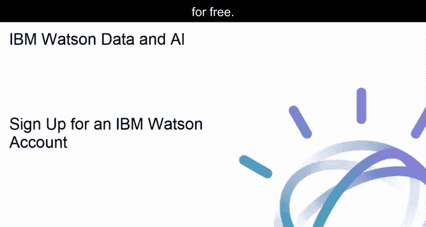

IBM Watson gives you access to IBM Watson Studio， IBM Watson Knowled catalog， the data refinery。

 Ma and deep learning， visual recognition models， dashboards and stream flows。At datapltform。clo。

ivVM。 com， you can sign up for a free trial。When you sign up for an IBM Watson account。

 you are automatically signed up for a free IBM Cloud account。

Here you see the Watson applications that will be provisioned。 IBM Watson Studio and IbiM。

 Watson Knowled catalog。If you already have an IBM Cloud account。

 then use your IBM ID to sign up for IBM Watson。Otherwise， type your email address。

 which will be used to create an IBM cloud account for you。

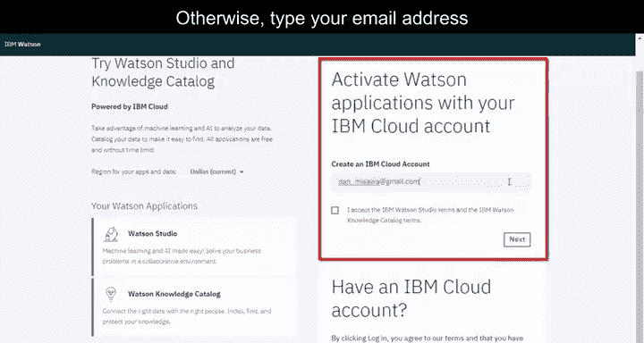

On the next screen， you are redirected to the IBM Cloud registration page。

 where you need to provide the typical basic information for an account。

 Then click createate account。

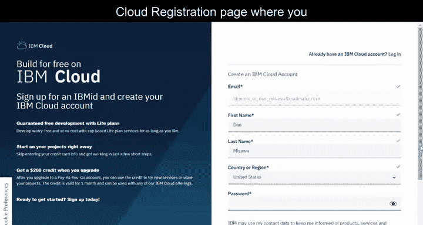

Now， check your email and confirm your account。

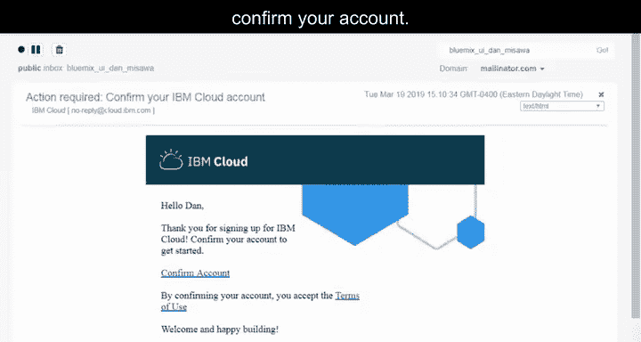

Now that you've registered for IBM Cloud， you can use those same credentials to sign in。

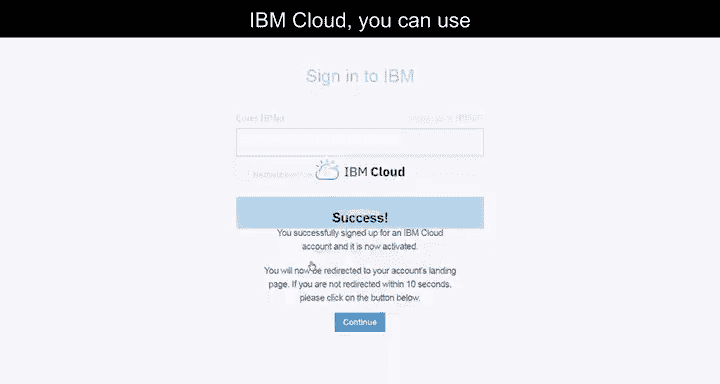

Next， you'll see the process create the IBM Watson Use account using your IBM Cloud credentials。

 and finally， you'll see that your account was successfully created。

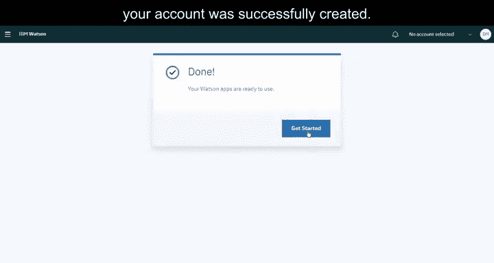

This IBM account has only one associated IBM Cloud account and one resource group。

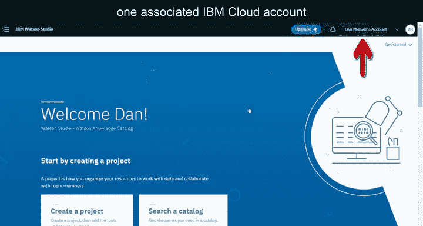

If you have more than one associated account or one account with multiple resource groups。

 then during the Watson Studio account set up， you'll see this screen giving you the option to select an account and resource group to use。

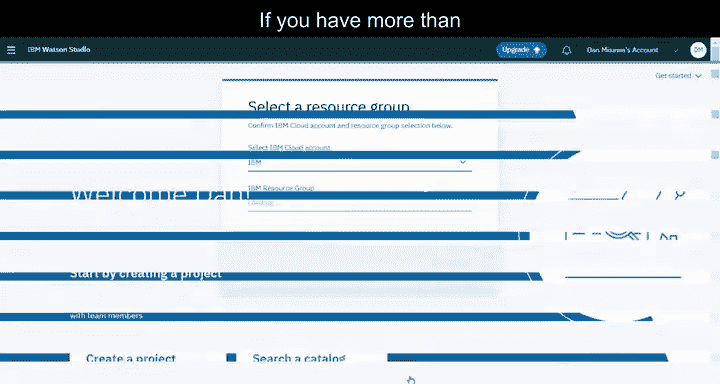

IBM Cloud uses resource groups as a way for you to organize your account resources in customizable groupings so that you can quickly assign users access to more than one resource at a time。

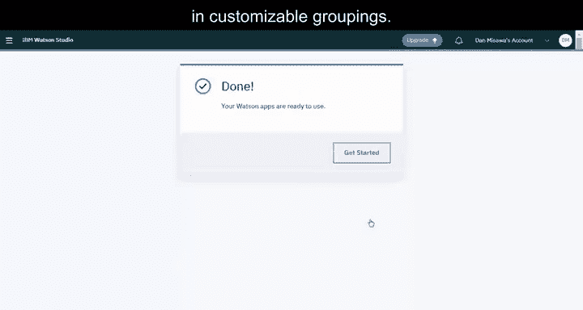

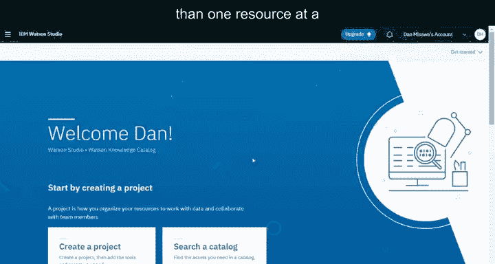

View the settings to verify the applications and services that are provisioned。

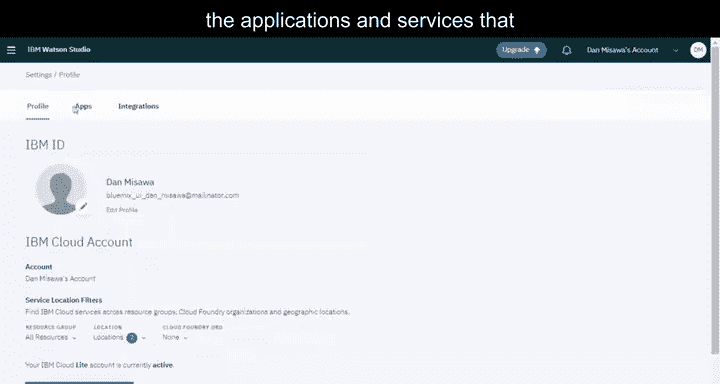

Now you're ready to start working in IBM Watson。