# IBM数据科学专业证书课程2：《数据科学工具》open-source-tools-for-data-science（中英字幕） - P33：32_Watson Studio中的Jupyter Notebook（上）.zh_en - GPT中英字幕课程资源 - BV1np4y1V7Sn

This video covers the basics for working with Jupiter notebooks in Watson Studio。

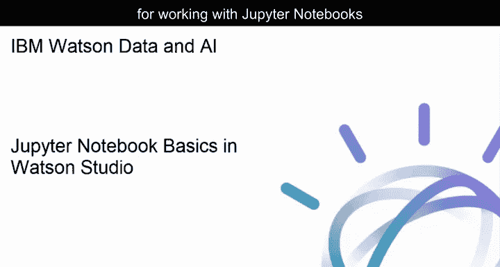

Start in a Watson Studio project and add to the project， a notebook。

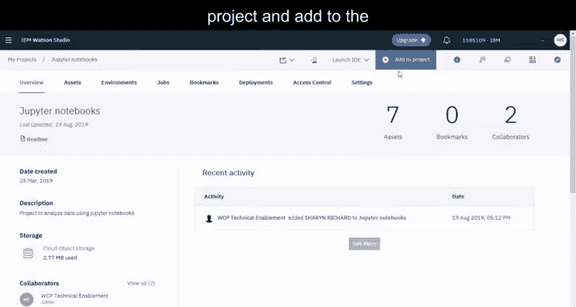

Just provide a name in a description。

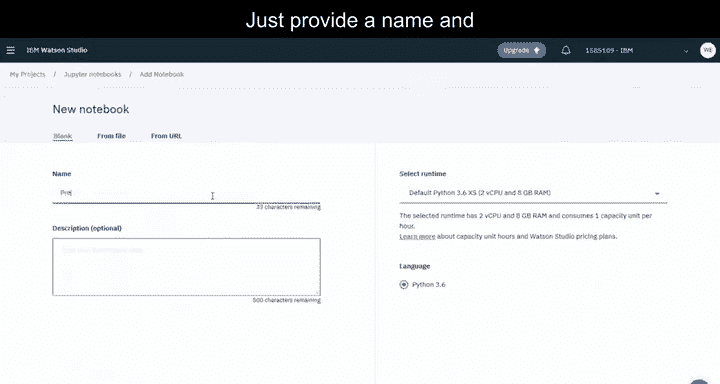

And create the notebook。Let's first load a file so you have some data to work with。

From the file slide out panel， browse to select the file。After the file is added to the project。

 it's available to work with in this notebook。

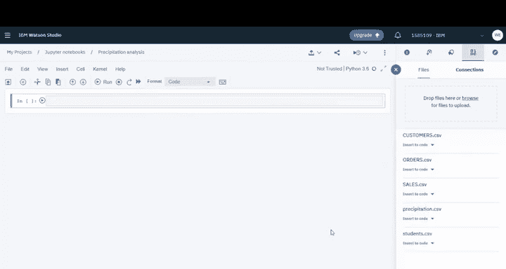

Just click insert to code and insert a panda's data frame。Before running the notebook。

 it's a best practice to insert a cell at the top to describe what the notebook does。

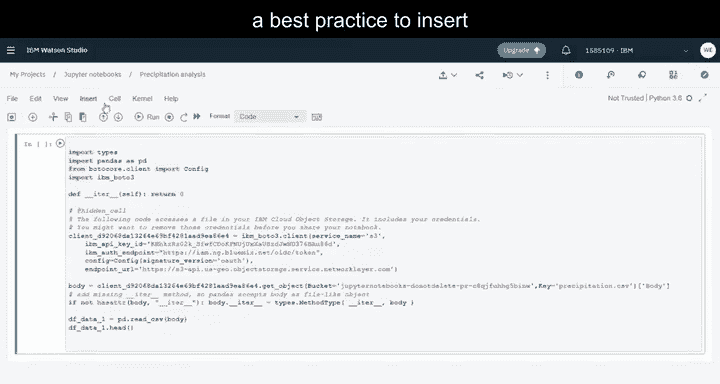

Change the cell type to mark down。 So this cell will not be treated as code。

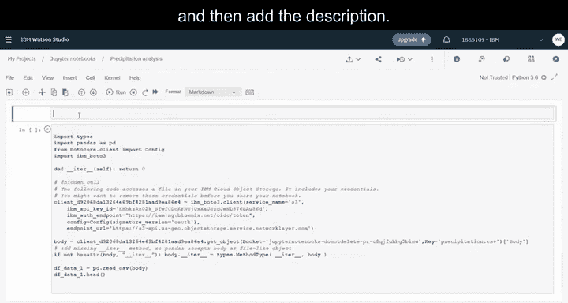

And then， add the description。Now， you're ready to run the notebook。

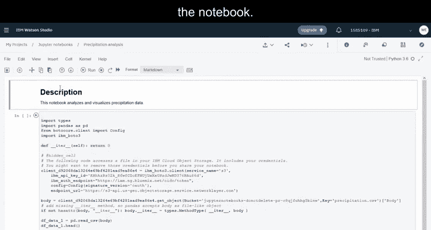

The inserted code loads the data set into a data frame using your credentials for your cloud object storage instance。

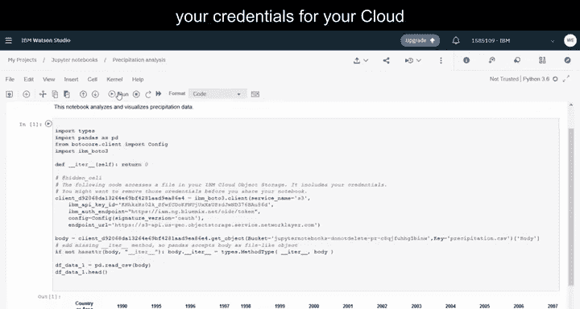

And then displays the first five rows of the data set。Before returning to the project。

 save the notebook。On the assets tab， you'll find the notebook。

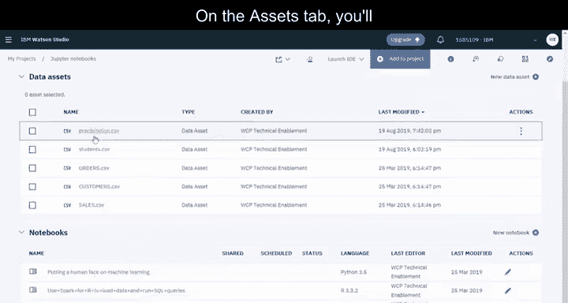

If you open the notebook， it will be in read only mode。

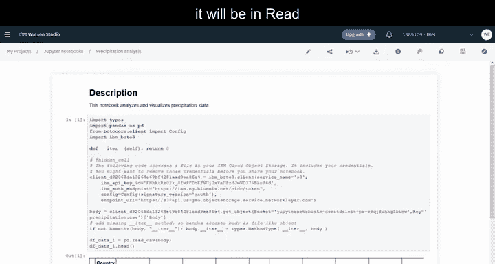

But you can edit the notebook， and make changes。

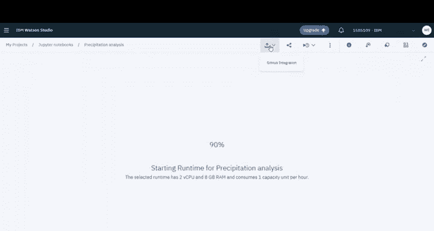

For example， you can access the info panel and change the name of the notebook。

And on the environment tab， you could change the environment used to run the notebook book。

As well as stop or restart the runtime environment。

If you'd like to share a read only version of the notebook， you can do that from here。

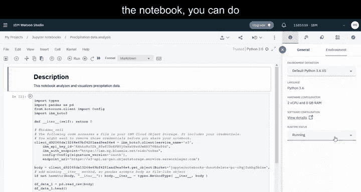

You can select how much of the content you'd like to share and how you want to share the notebook。

 either through a link or social media。

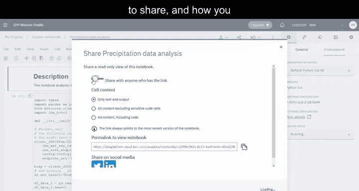

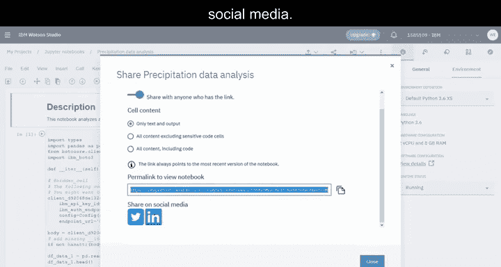

If you'd like to schedule the notebook to run at a different time， you can create a job。

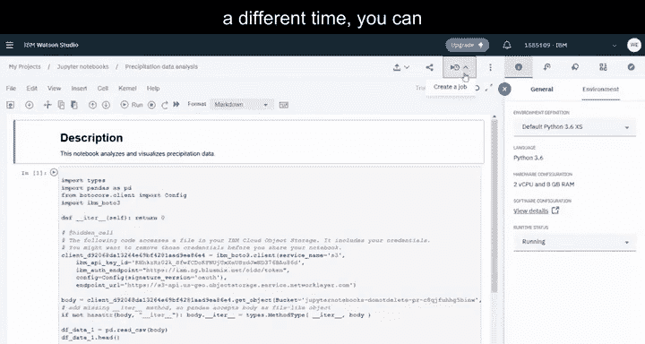

Just provide a name for the job。And select the scheduling options。

Like specifying a date for the job to run。And whether you'd like the job run to repeat。

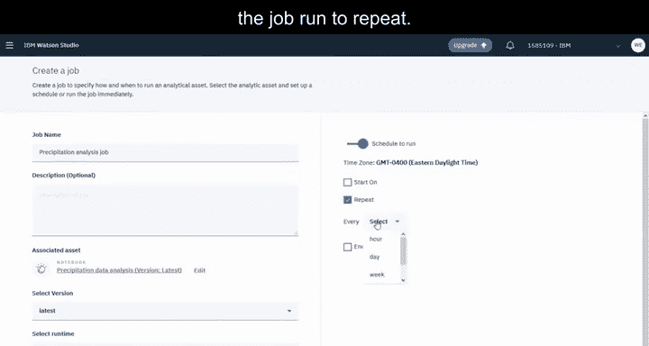

After you create and run the job。

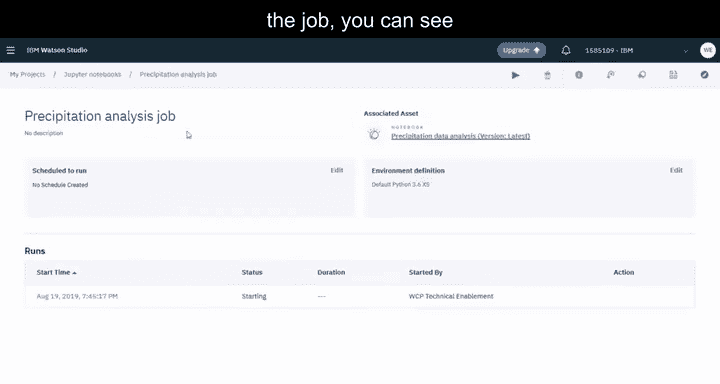

You can see the status on the jobs tab in the project。

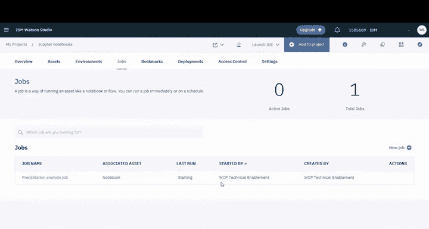