# IBM数据科学专业证书课程2：《数据科学工具》open-source-tools-for-data-science（中英字幕） - P34：33_Watson Studio中的Jupyter Notebook（下）.zh_en - GPT中英字幕课程资源 - BV1np4y1V7Sn

This video shows you how to create a Jupiter notebook。

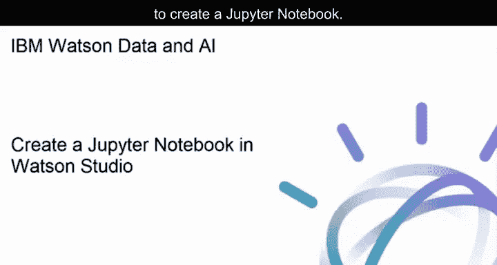

Let's start by adding a data asset to the project。You can either browse to select files。

Or drag files into the panel。

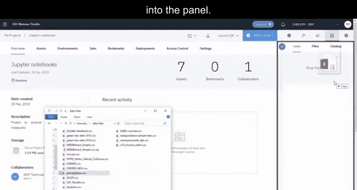

Great。Now， the data file is uploaded to object storage and available as a data asset in this project。

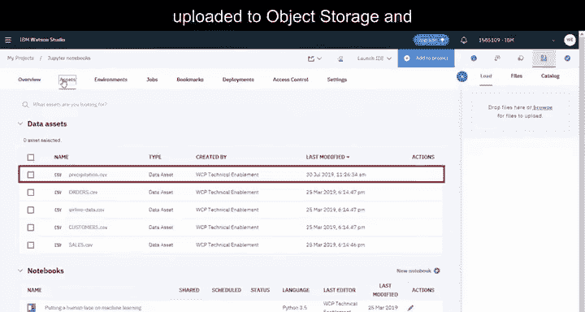

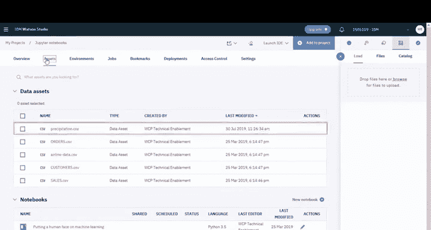

Next， create a notebook。Provide a name。 and a description。

And then select the run time to use when running this notebook。

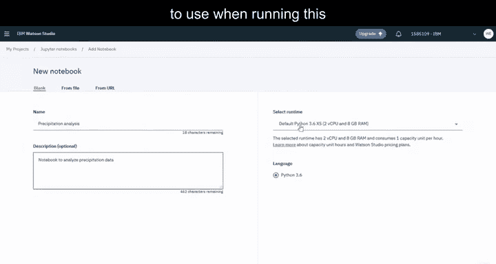

Here you see the environments you can use。 You'll learn more about environments later。 So for now。

 just select the default Sp Python environment and verify the language and Sp version。

 When you're ready， create the notebook。😊。

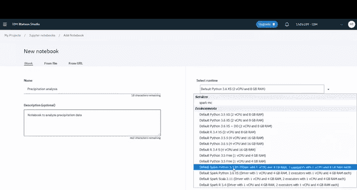

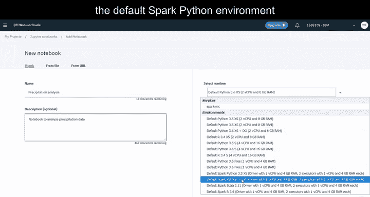

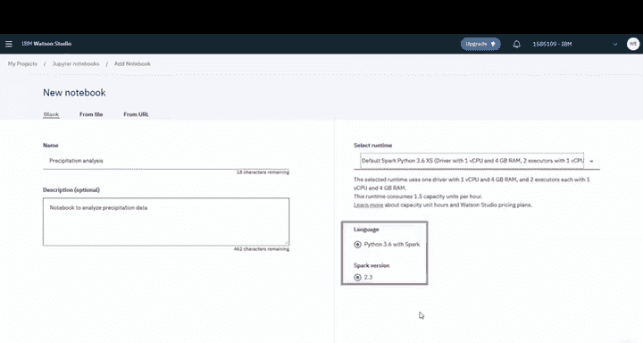

Now， wait while the runtime environment is instantiated。Once the environment is ready。

 in the notebook， access the data sources and locate the file。😊。

Click inserts to code and choose how you want to insert the data。

The choices in this drop down box are dependent upon the language used in this notebook and the file type。

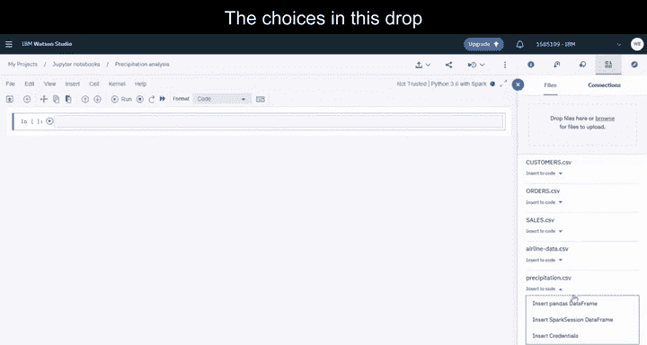

Notice that the inserted code includes the credentials you'll need to read the data file from the object storage instance。

When you run the code， the first five rows display。

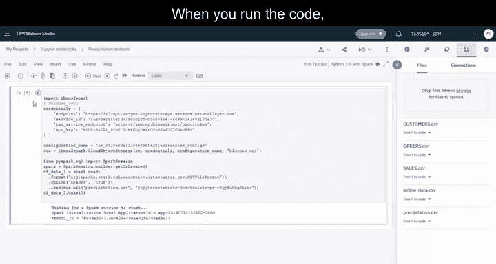

Now， let's take a closer look at environments on the Envis tab。

 you can define the hardware size and software configuration for the runtime associated with Watson studio tools such as notebooks。

😊，You can see that there is one active environment run time。

 namely the run time being used by the notebook you just created。

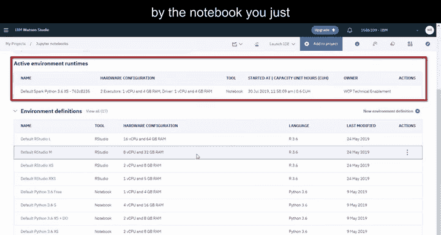

And here are the other default environments。You can view any of the default environments to see a summary of the configuration。

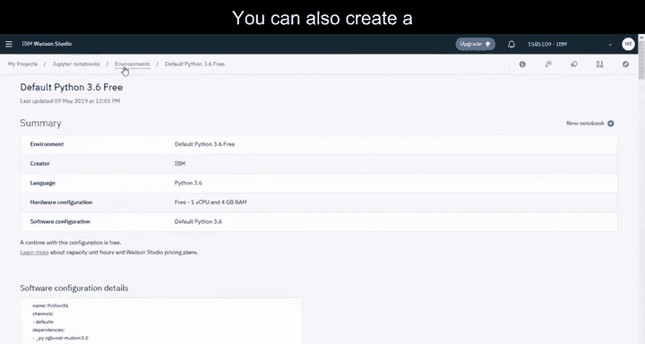

You can also create a new environment definition。First， provide a name in a description。

If you select Spk for the type， you'll see some additional configuration options。 In this case。

 just accept the defaults and choose Scala for the software version。

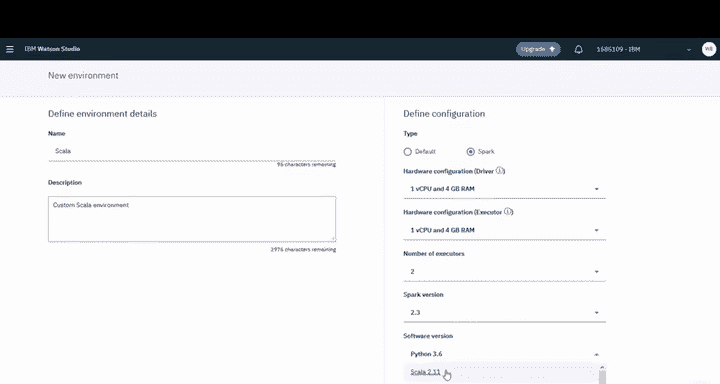

When you're ready， create the new environment。😊，The environment is ready for you to use。

 with a notebook。

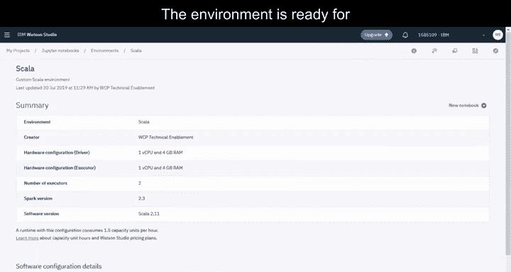

To switch a notebook to use a different environment， you need to first stop the kernelel。

Then you can change the environment。

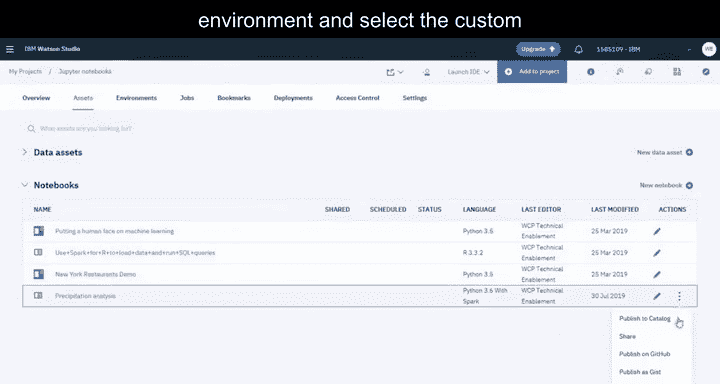

And select the custom environment you just created。And associate that with the note book。Now。

 open the notebook in edit mode and wait for the new environment to be instantiateated。

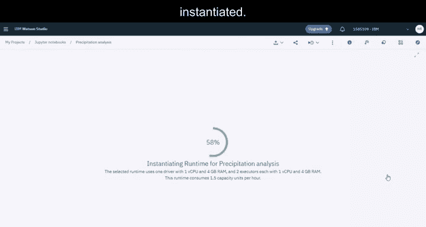

Since this notebook was last saved using a different kernel， you need to set the new kernel。

Let's delete the existing cell。

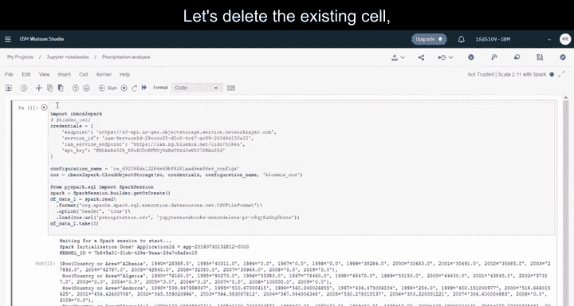

Locate the source data file。

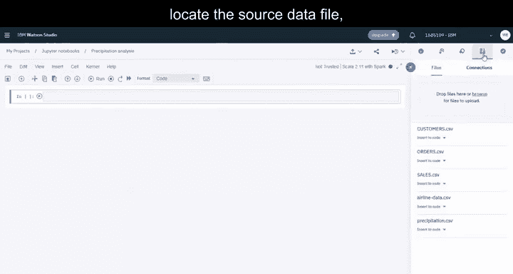

And insert a Sp session data frame。

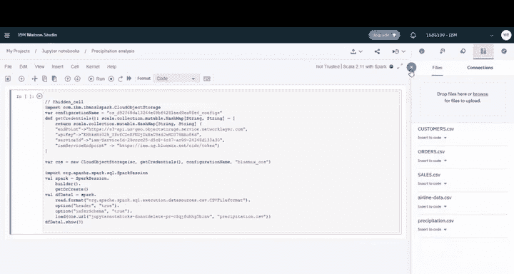

When you run the code， the first five rows display。

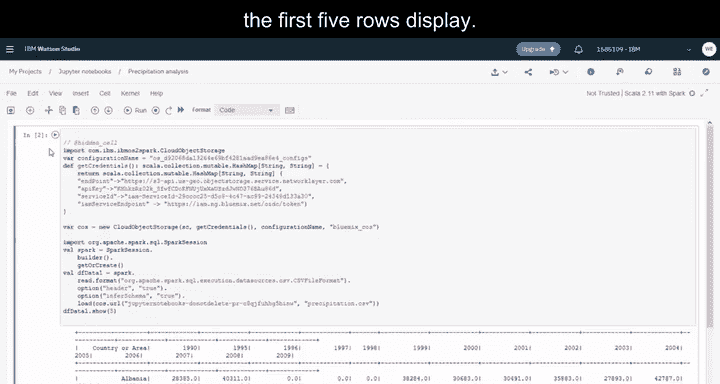

Now， you're ready to explore the community and find sample notebooks and data sets to get started。

 analyzing data。😊。