# IBM数据科学专业证书课程2：《数据科学工具》open-source-tools-for-data-science（中英字幕） - P35：34_GitHub与Watson Studio集成.zh_en - GPT中英字幕课程资源 - BV1np4y1V7Sn

This video shows you how to connect your IBM Watson studio account with your Github account。

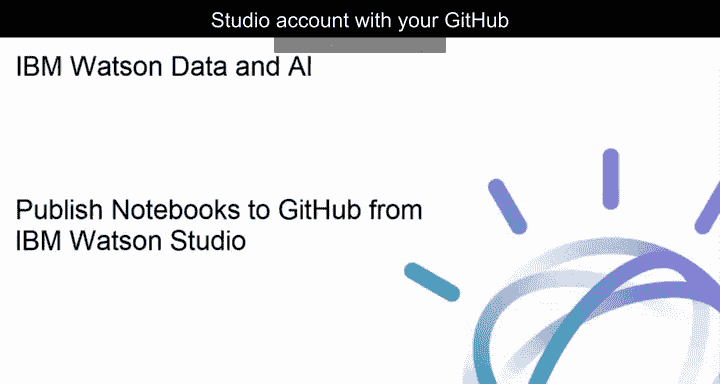

In Watson Studio， navigate to your profile settings。

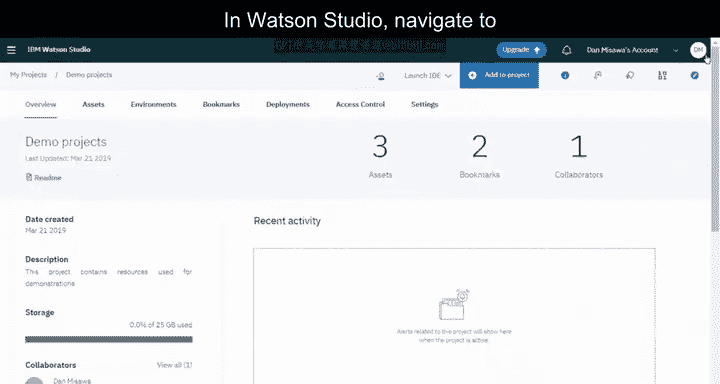

On the integrations tab， visit the link to generate a Github personal access token。

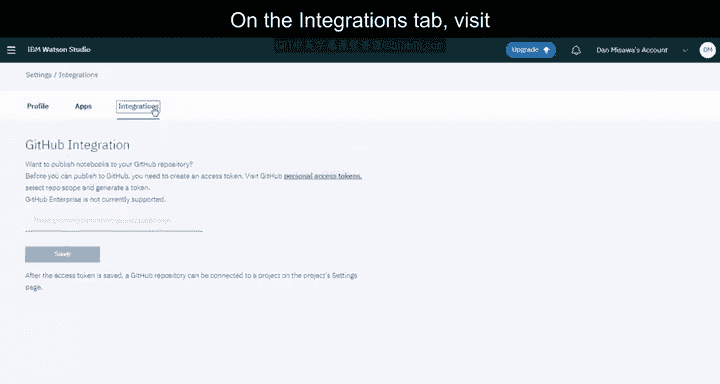

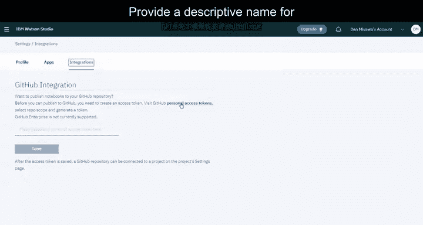

Provide a descriptive name for the token and select the repo scope。Then， generate the token。

Copy the token。Returned to the Gitthub integration settings， and paste the token。

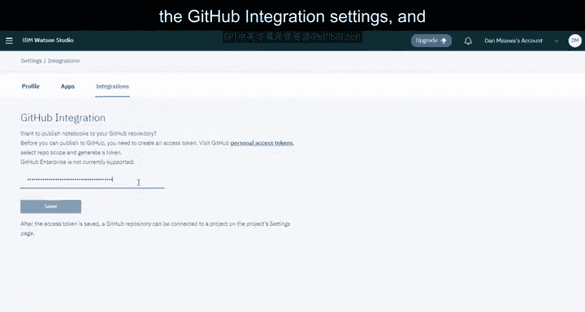

The token is validated when you save it to your profile settings。

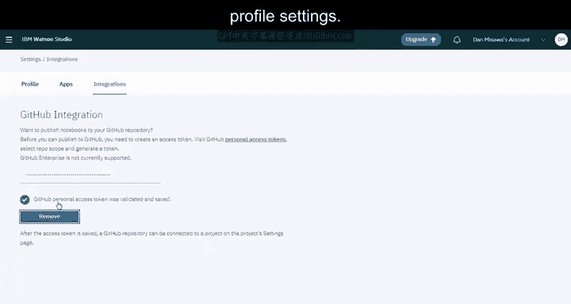

Now， navigate to your projects。 You enable Github integration at the project level on the settings tab。

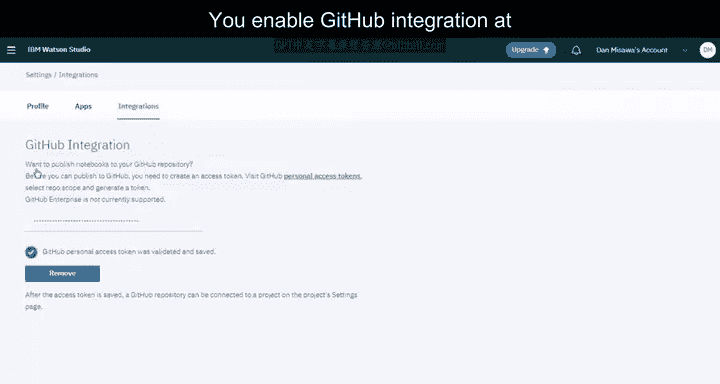

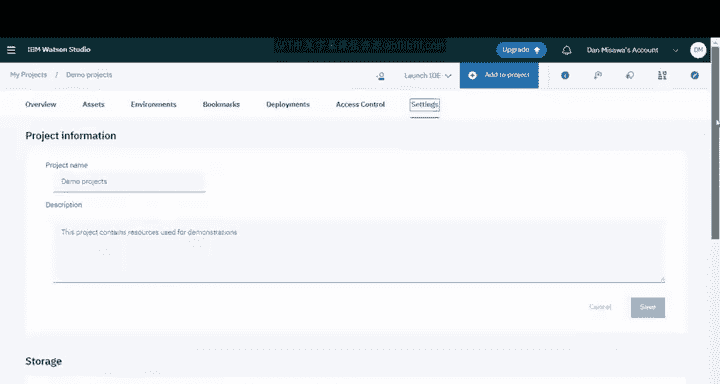

Simply scroll to the bottom and paste the existing Github repository URL。 Once the URL is validated。

 click connect。

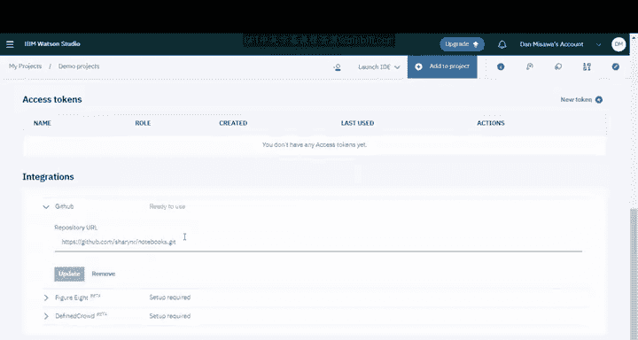

Now， go to the assets tab。And open the notebook you want to publish。

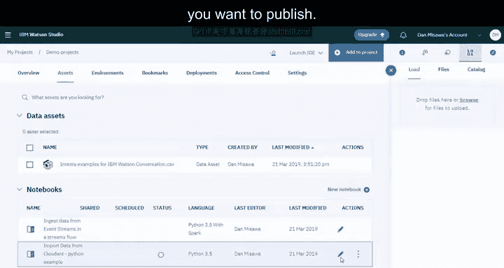

Notice that this notebook has the credentials replaced with X's。

 It's a best practice to remove or replace credentials before publishing to Gitthub。

So this notebook is ready for publishing。You can provide the target path。

 along with a commit message。 You also have the option to publish content without hidden code。

 which means that any cells in the notebook that begin with the hidden cell comment will not be published。

 When you're ready， click publish。The message tells you that the notebook was published successfully and provides links to the notebook。

 the repository and the commit。Let's take a look at the commit。So， there's the commit。

And you can navigate to the repository to see the published notebook。Lastly。

 you can publish as a gist。 Gists are another way to share your work on Github。

 Every gist is a git repository， so it can be forked and cloned。 There are two types of gs。

 public and secret。If you start out with a secret gist， you can convert it to a public gist later。

 And again， you have the option to remove hidden cells。

So that's the basics of Watson Studio's Github integration。

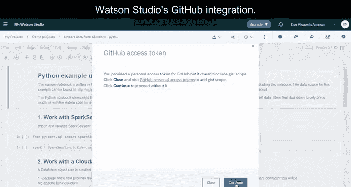