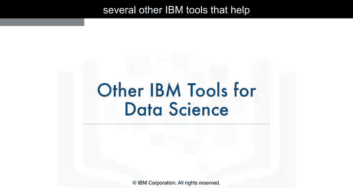
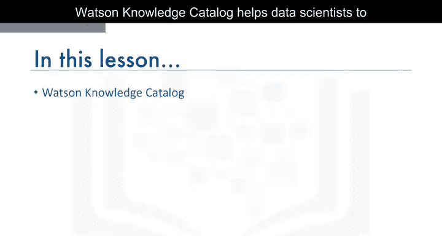
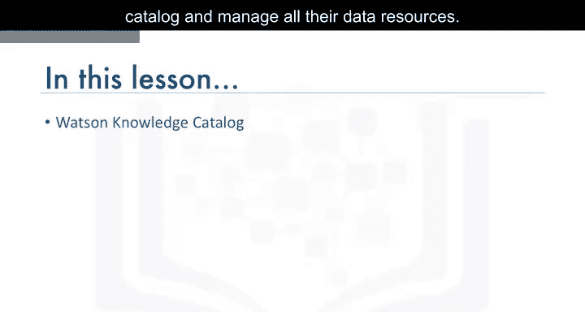
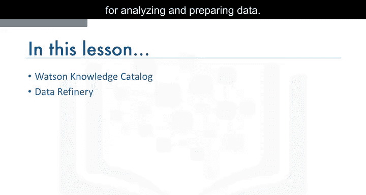
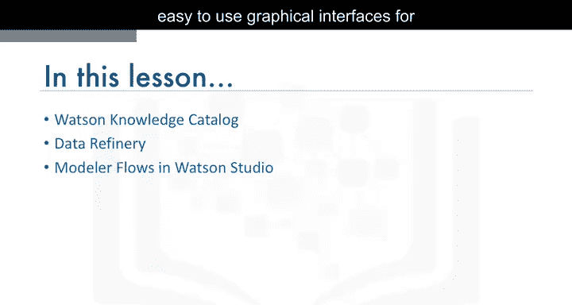
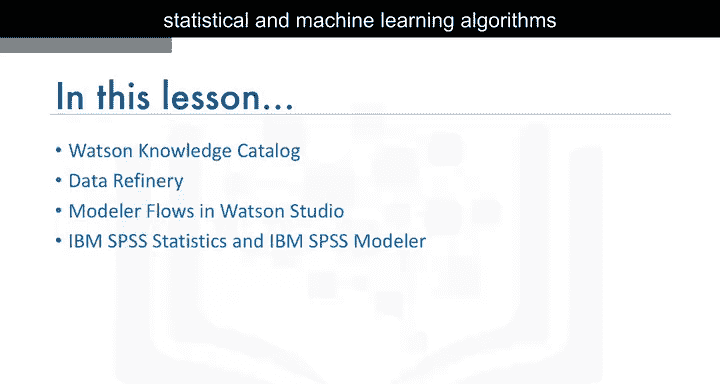
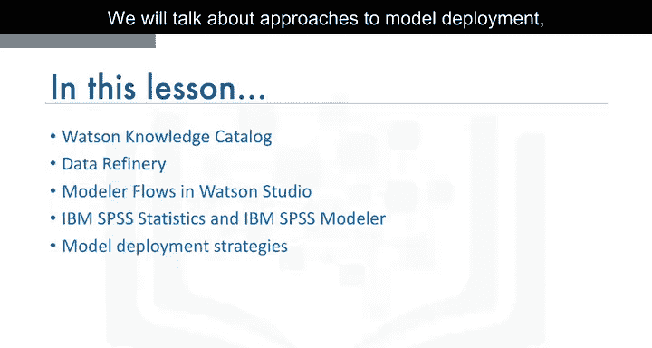
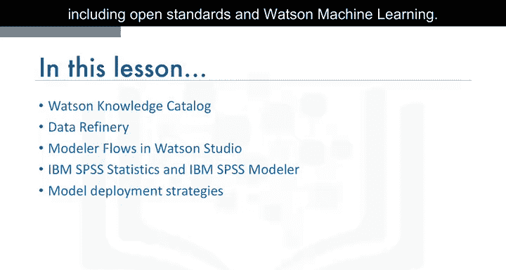
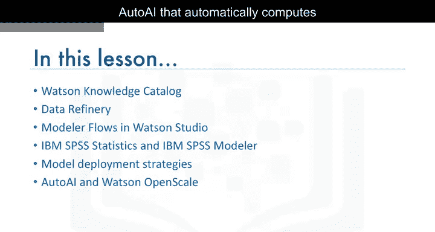
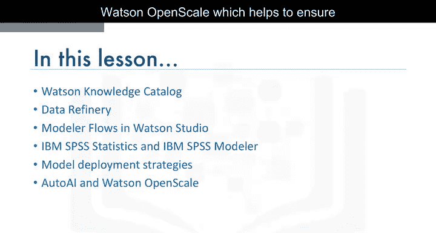

# IBM数据科学专业证书课程2：《数据科学工具》open-source-tools-for-data-science（中英字幕） - P36：35_其他IBM数据科学工具.zh_en - GPT中英字幕课程资源 - BV1np4y1V7Sn

嗯。In this video， we will look at several other IBM tools that help data scientists in their day to day work。

Watson Knowledge Ca helps data scientists to catalog and manage all their data resources。

Data Refry provides graphical tools for analyzing and preparing data。

SPSS based products include easy to use graphical interfaces for wide varieties of statistical and machine learning algorithms and data transformations We will talk about approaches to model deployment。

 including open standards and Watson machine learning。

Newer features of Watson Studio include Auto AI that automatically computes the best data pipeline and Watson Open scale。

 which helps ensure fairness and explainability of the models。

