# IBM数据科学专业证书课程2：《数据科学工具》open-source-tools-for-data-science（中英字幕） - P37：36_IBM Watson知识目录.zh_en - GPT中英字幕课程资源 - BV1np4y1V7Sn

Most organizations have huge amounts of data stored in many forms in various locations。

 finding relevant data quickly and connecting disparate data sources can be challenging and time consuming。

Watson Knowledge catalog unites all information assets into a single metadata rich catalog based on Watson's understanding of relationships between assets and how they're being used and socialized among users in existing projects。

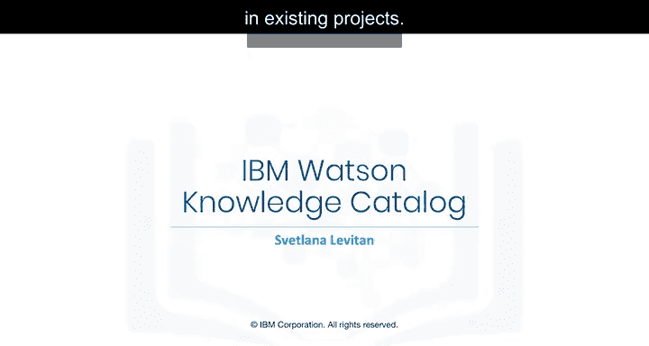

Let's have a look at the overview of different tool categories that we've previously discussed。

Watson Knowledge catalog corresponds to data assets management， code asset management。

 data management， and data integration and transformation。

Watson Knowledge catalog is a data catalog that is integrated with an enterprise data governance platform。

 it also merges the analytics capabilities of Watson Studio。

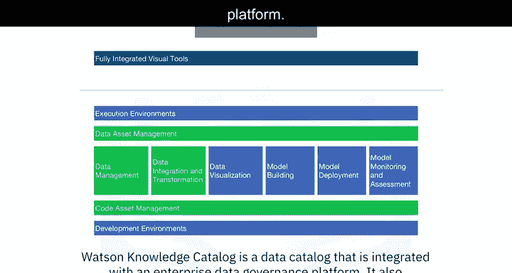

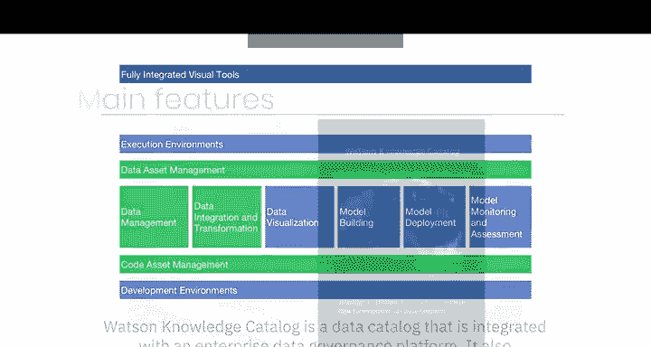

The data catalog assists data scientists to easily find， prepare， understand。

 and use the data as needed。

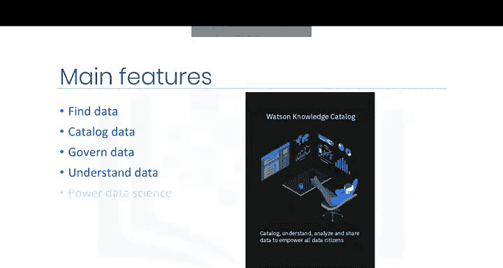

Watson Knowledge catalogta protects data from misuse and enables the sharing of assets with automated dynamic masking of sensitive data elements。

 data profile visualizations， built in charts and statistics help users to understand data assets。

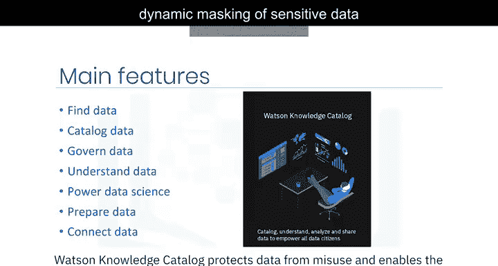

Semless integration with Watson' Studio helps data citizens to drive production of their data in a suite of powerful machine learning tools。

Users can interactively discover， cleanse and prepare data with a built in data refinery。

Possible connections to more than 30 IBM and third party data sources help to catalog and use your data in the original locations。

IBM Watson Knowledge catalog has various deployment choices on IBM Cloud and can be run anywhere with IBM Cloudpack for data The latter is a fully integrated data and AI platform built on Red Hat Openshift containerb it can be deployed easily into any public or private cloud or other enterprise platforms。

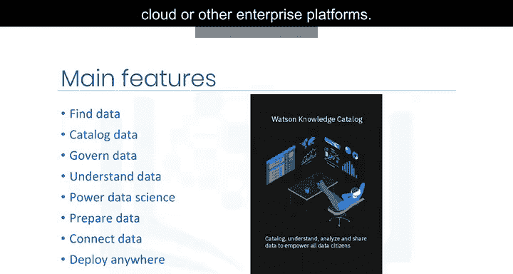

A catalog contains metadata about the contents of assets and how to access them and a set of collaborators who need to use the assets for data analysis。

The metadata is stored in an encrypted IBM Cloud objectject storage instance。

Any data that you want to store the cloud， you can upload to the cloud object storage of your choice and then specify that object storage when you create the catalog。

This split between where the data's metadata is stored and the actual location of the data is important。

 It means that you can keep your data wherever it is。

 You don't need to move it into the catalog because the catalog only contains metadata。

 You can have the data in on premises data repositories in other IBM Cloud services like Cloudant or DV to oncloud。

In non IBM cloud services like Amazon or Azure。In streaming data services or even dark data sources like Pds。

Included in the metadata is how to access the data asset。 In other words。

 the location and credentials。 That means that anyone who is a member of the catalog and has sufficient permissions can get to the data without knowing the credentials or having to create their own connection to the data。

Since the new catalog is empty， let's take a look at an existing catalog on the browse assets tab。

 you can see recommendations， highly rated assets and recently created assets。

 as well as a list of all the assets。😊，You can type a search term to find assets。

And you can filter by asset type， such as data asset or notebook。

Or filter by tags that were assigned to the asset when it was added to the catalog。

When you view an asset， you get a preview of the data and other information like a description。

 ratings， tags， where the source is located and any classifications。On the access tab。

 those with permission can add members to view this particular asset。

And the review tab shows reviews and lets you contribute a review。

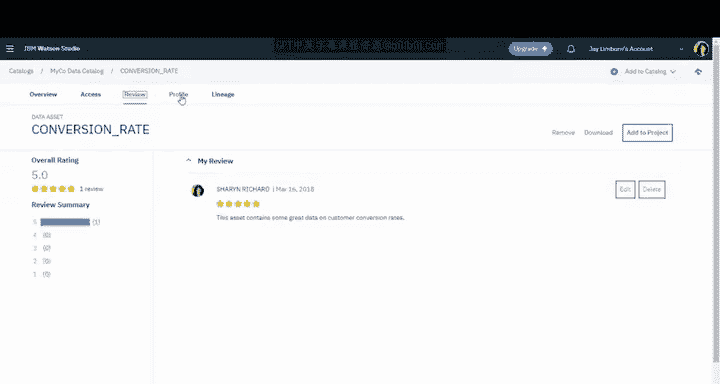

When assets are added to a catalog with data policies enabled。

 Watson Know catalog automatically profiles and classifies the content of the asset based on the values in those columns。

 The profile tab contains more detailed information about the inferred classifications。

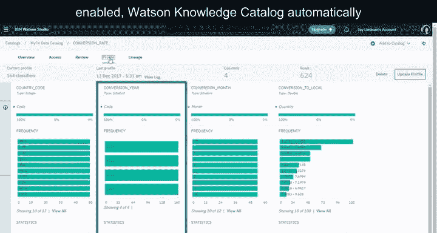

You can see the other possibilities for classifying each column and the confidence scores for those other possibilities。

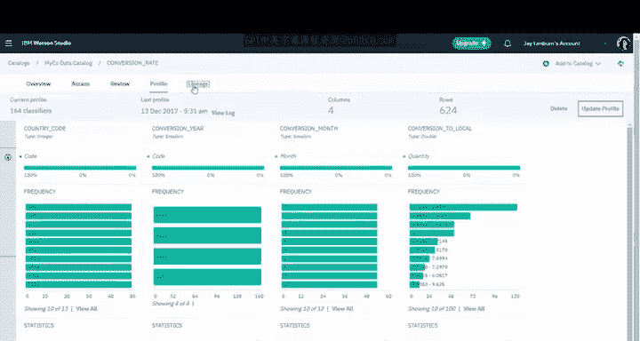

On the lineage tab， you'll see the various events that Watson Knowledge catalog has captured that occurred in the life cycle of this data asset。

 allowing you to trace what's happened to the asset since it was created。On the access control tab。

 you can see the current list of catalog members。 You can also add members。

 which is pretty similar to adding collaborators in a project。

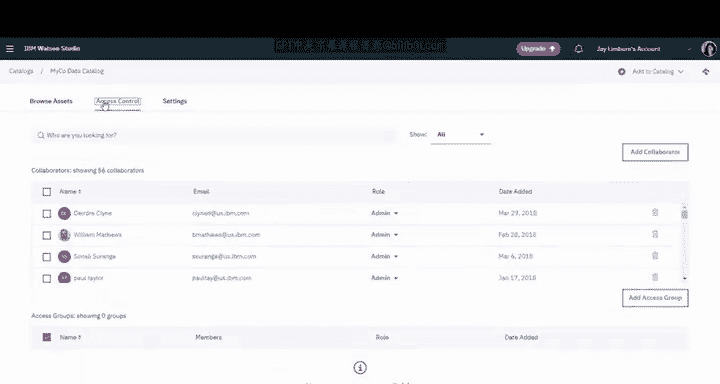

Most catalog members will likely have the editor role。 The viewer role is intentionally restricted。

 and only a select few users will have the admin role。

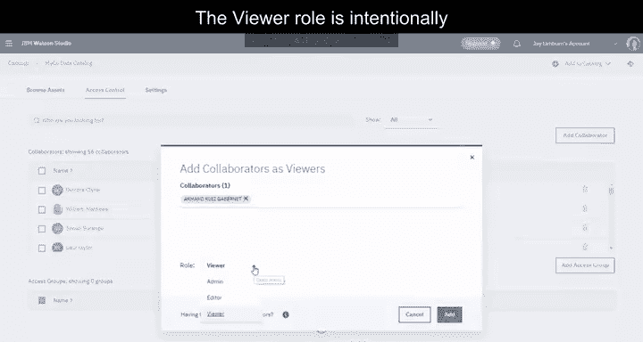

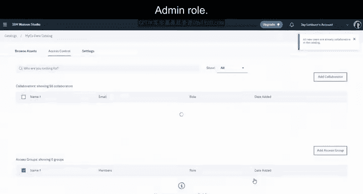

Watson Knowledge catalog includes capabilities to automatically mask sensitive data according to your organization's governance policies。

 For example， you can see in the diagram that the first name。

 last name and gender data in the data set have been masked。

You've learned how IBM Watson Knowledge catalogtalog can help organizations deal with their numerous data and other assets。

 In the next video， we'll look at data refinery， a powerful tool for analyzing and preparing data。

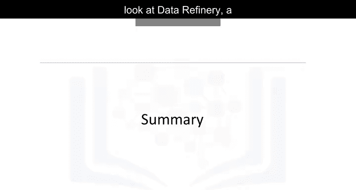