# IBM数据科学专业证书课程2：《数据科学工具》open-source-tools-for-data-science（中英字幕） - P39：38_Watson Studio中的SPSS建模流程.zh_en - GPT中英字幕课程资源 - BV1np4y1V7Sn

In this video， we will take a look at an easy to use graphical way to build machine learning models and pipelines SPSS Modeller Flows is a part of Watson Studio。

 which was inspired by another product IBM SPSSS modeller will'll discuss that product in a later unit。

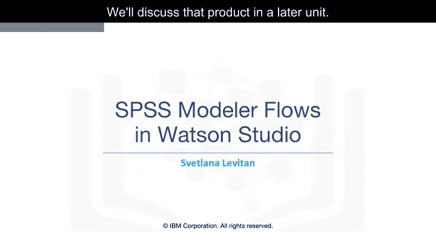

Let's have a look again at the overview of different tool categories Moular flows include some data management capabilities。

 as well as tools for data preparation， visualization and model building。

 all flows are created using a drag and drop editor and consist of nodes of various types with data flowing from one node to the next。

 according to their connections。

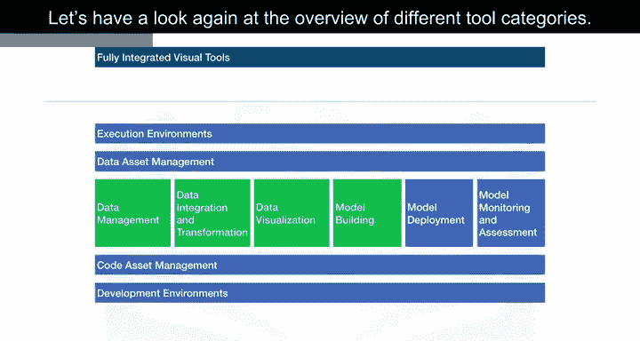

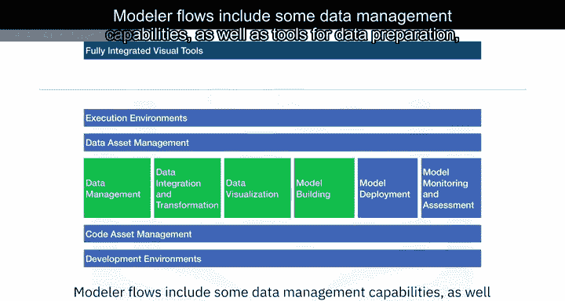

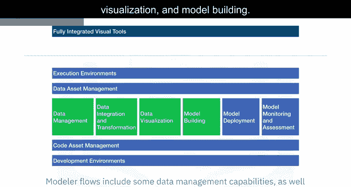

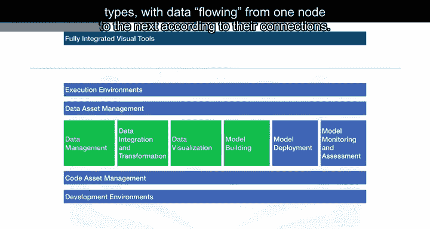

A sample model or flow shown here includes two data source nodes shown in purple on the left。

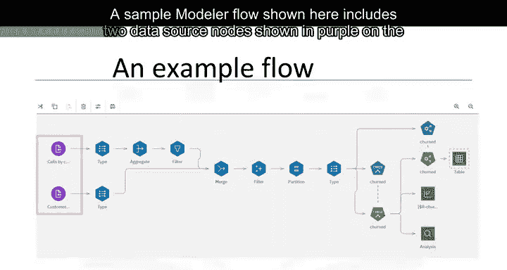

Type aggregate， filter， merge， filler and partition nodes in the middle。

 two model building nodes shown in Pentagons。

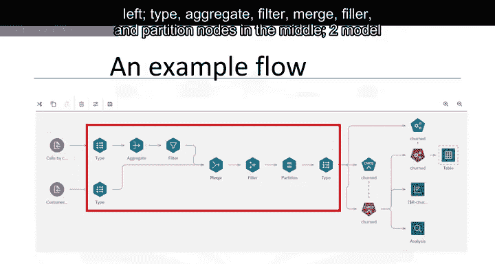

Once a flow is executed and the models are built， the upside down Pentagon model nuggets are created。

 they can be used to see information about the models and to get predictions for new data。

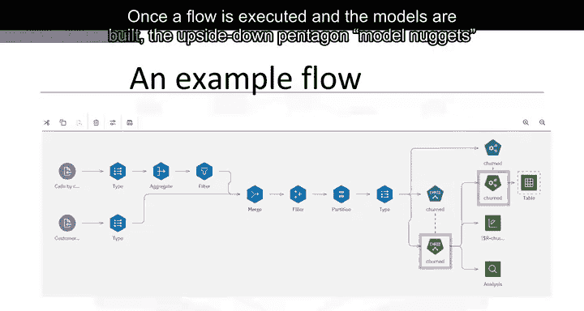

And the three green square nodes on the right provide model evaluation information in the form of tables and charts。

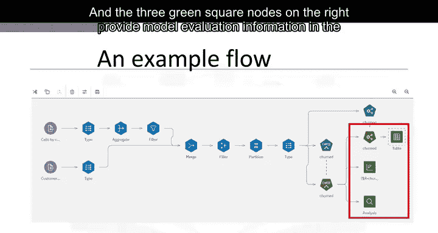

You can build your SPSS modeler flows by dragging different types of nodes from the left。

 the part of the screen called the palette to the canvas， the main part of the screen。

 Each flow starts with one or more data sources located in the import group and can include some or all other types of nodes。

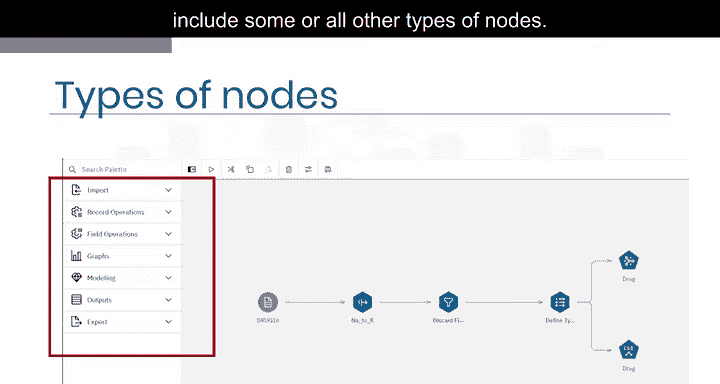

Watson Studio provides some sample flows to help new users in the drug study example shown here。

 we are using a small artificial data set。The target variable is a categorical field drug that has five categories。

 and there are several predictor variables。 This flow creates a new derived field by dividing the values of one of the predictors by values of another and at the end builds a small neural network model and a decision tree model。

 when a user clicks the run button on the top panel denoted by a triangle。

 The flow is executed and the model build。 This is reflected in the new Pentagon nodes called model nuggets that display under each model node。

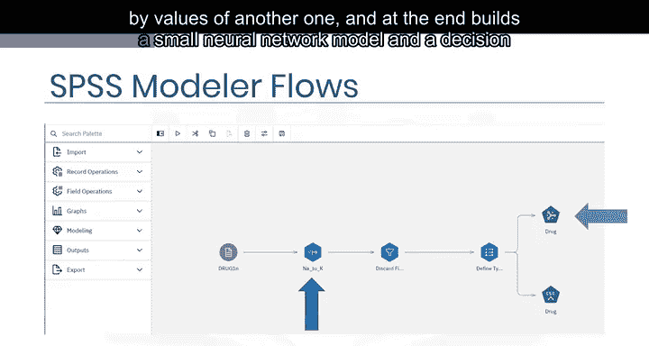

If you click on the three dots in the upper right corner of one of those nodes and select View model。

 you will see various types of model information by connecting new data sources to the model nugget。

 you can get predictions on new data the first window in the model viewer shows model accuracy and related measures such as precision and recall this toy data example enabled us to get perfect accuracy。

 which is normally not the case with real life data。

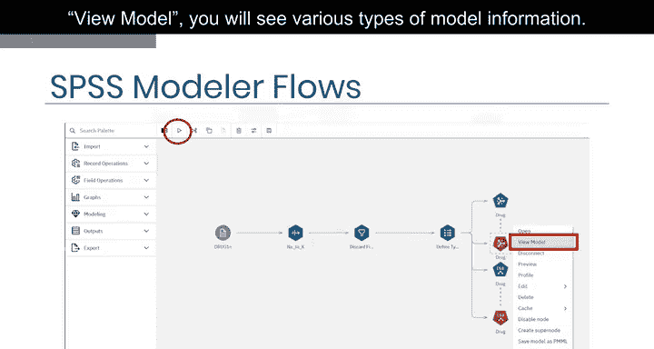

The confusion matrix view shows how model predictions on the training data matched the observed target values。

Once again， in this toy example， all cases were classified correctly。

 we can also look at model information which displays a table that tells us more about the details of the model。

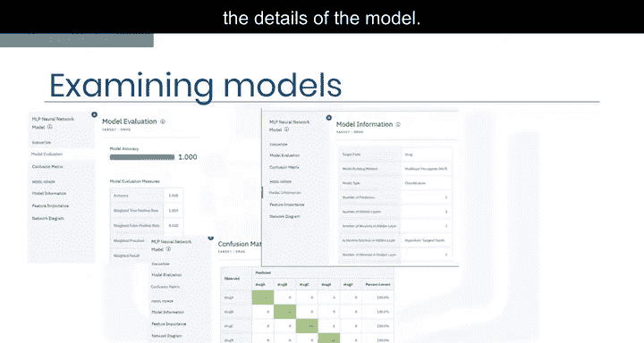

Feature importance displays a diagram that indicates the relative predictive strength of various model inputs。

Finally， the network diagram gives a visual representation of the neural network model we built。

On the left is the input layer with units corresponding to each continuous predictor and each category of the categorical predictors。

 plus a bias unit that is usually present in each layer of a neural network。In the middle。

 we see a hidden layer with seven units or neurons and a bias unit。

On the right is the output layer with five units corresponding to the five target categories。

Controls on the right and bottom of the diagram enables some interactive exploration of the model。

 the colors of the connections between the units indicate the values of the weights on those connections。

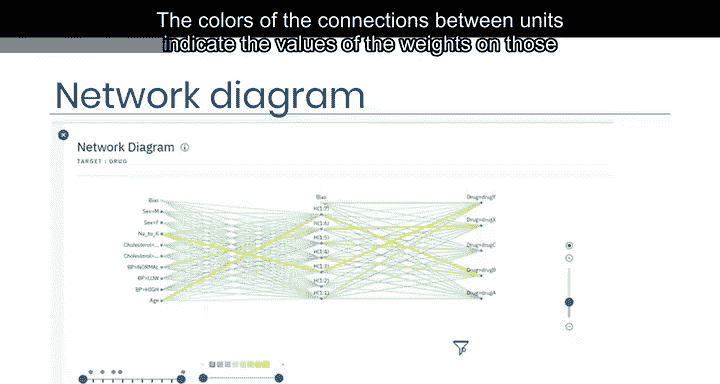

We can also look at the decision tree model built using the C5 algorithm。

A model information table and feature importance chart appear as before。

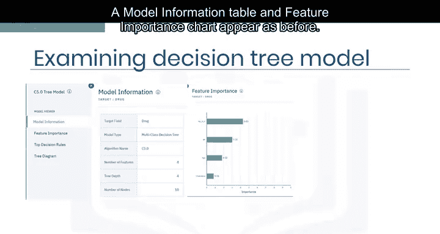

Additionally， a top decision rules table is displayed decision tree models are popular because they have a special structure that makes it easy to explain predictions or extract decision rules。

The tree diagram is also displayed。On the left side of the canvas。

 we see a part of the model palette that can be used in the flows at the top are autoclassifier and autonumeric nodes that can be used for categorical and continuous targets respectively。

Those nodes will build several kinds of models and pick the best one based on a certain criterion Later。

 we will talk about the auto AI feature of Watson Studio。

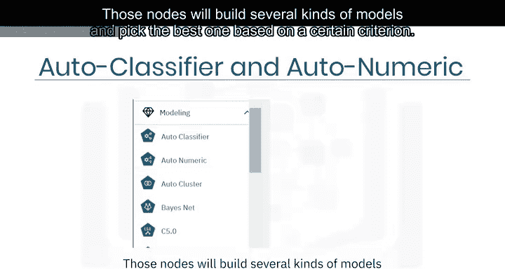

AutoAI takes this capability to the next level by automatically finding not only the best model。

 but an entire data pipeline， which includes various data transformations。

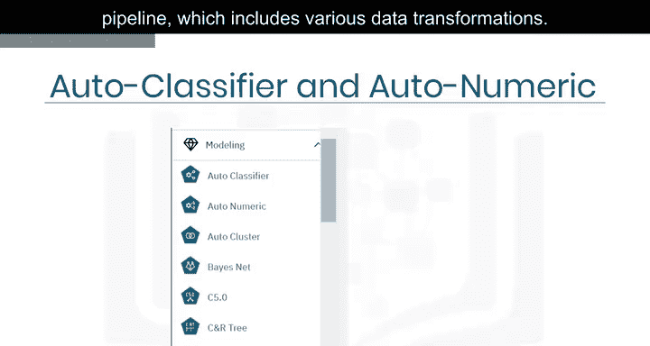

In this video， you've learned how modeller flows in Watson Studio can help analysts to create powerful machine learning pipelines using a graphical interface without the need to write any code。

This feature was based on IBM SPSS modeler Next， after completing a lab to give you hands on experience with this powerful technology。

 we will take a look at two other IBM products that can be used for data science。

 IBM SPSS modeler and IBM SPSS statistics。

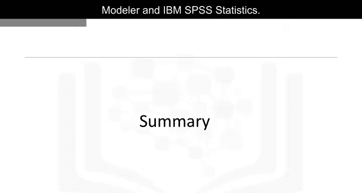