# IBM数据科学专业证书课程2：《数据科学工具》open-source-tools-for-data-science（中英字幕） - P3：2_Python语言导论.zh_en - GPT中英字幕课程资源 - BV1np4y1V7Sn

In this video， we will review the high level features of the Python programming language。

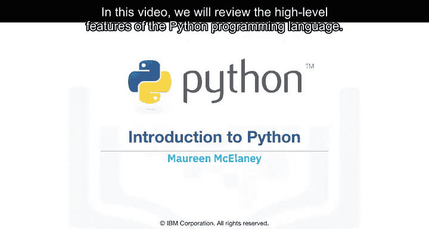

Python is a powerhouse language， it is by far the most popular programming language for data science。

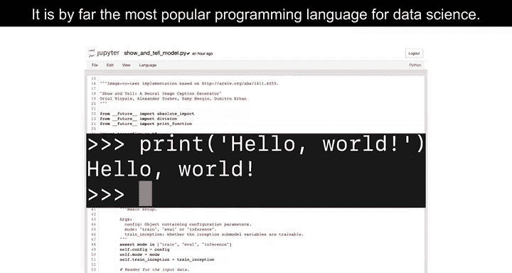

According to the 2019 Caggal Data Science and Machine Learning surveyve，75% of the over 10。

000 respondents from around the world reported that they use Python on a regular basis。

 Glasddoor reported that in 2019， more than 75% of data science positions listed。

 included Python in their job descriptions。 When asked which language and aspiring data scientists should learn first。

 most data scientists say Python。

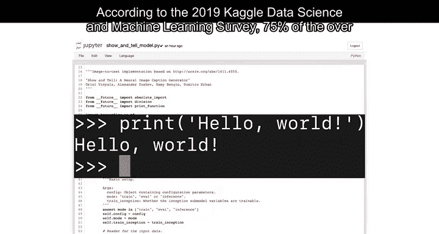

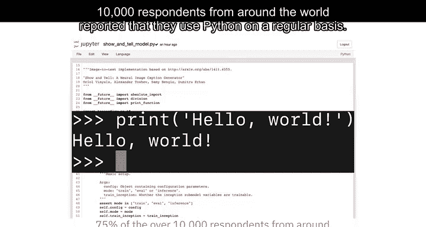

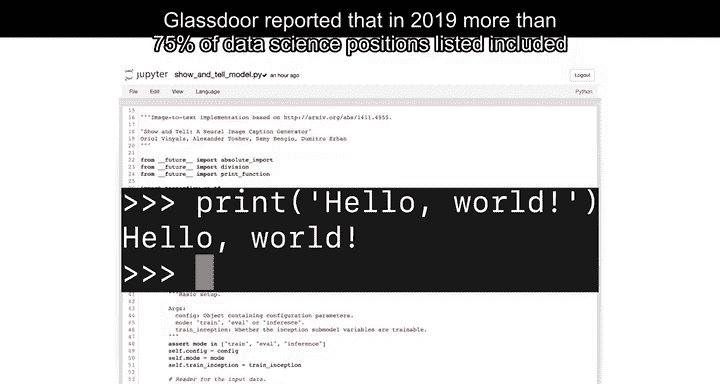

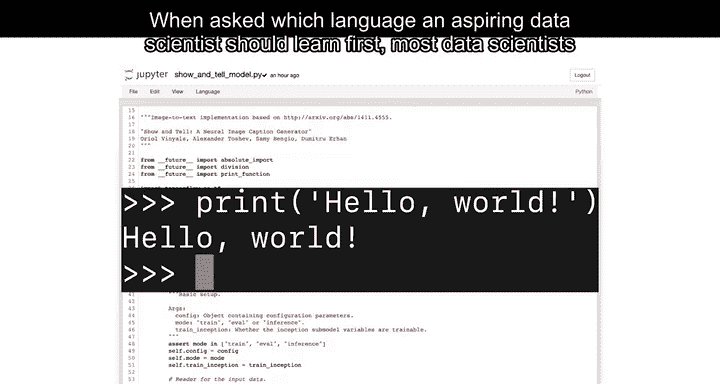

You're probably thinking why on earth is Python so popular， Well。

 let's start with the people who use Python。

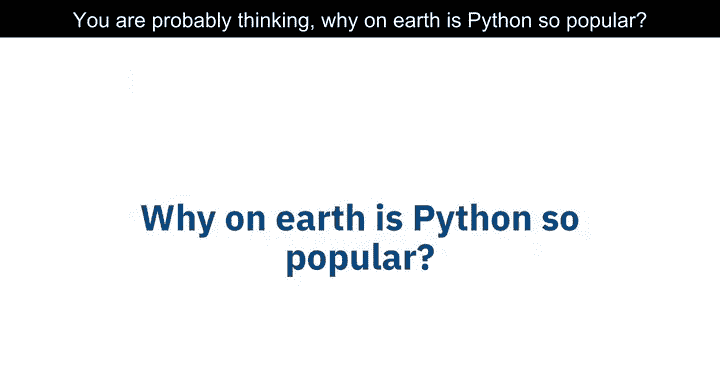

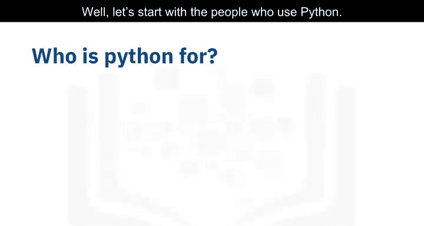

If you already know how to program， then Python is great for you because it uses clear。

 readable syntax。 You can do many of the things you are used to doing in other programming languages。

 but with Python， you can do it with less code。

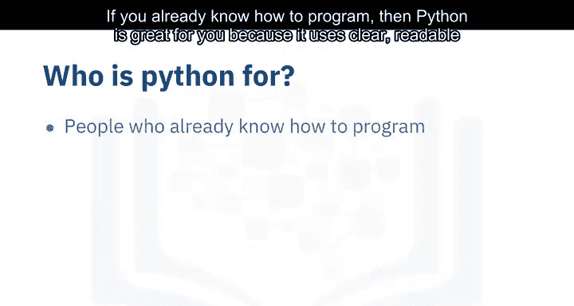

If you want to learn to program， it's also a great starter language because of the huge global community and wealth of documentation。

 In fact， several different surveys in 2019 found that over 80% of data professionals worldwide use Python。

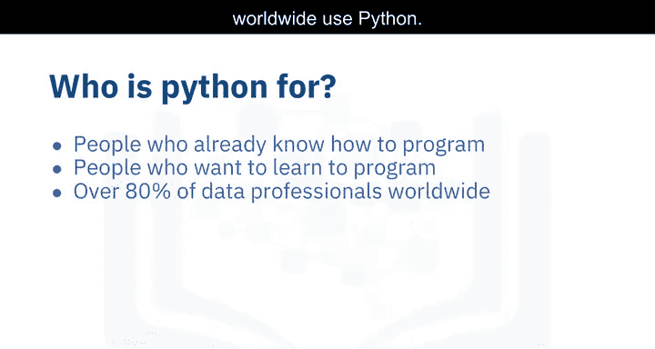

Python is useful for many situations， including data science， AI and machine learning。

 web development， and IoT devices like the Raspberry Pi。

Large organizations that use Python heavily include IBM， Wikipedia， Google， Yahoo， CEN， NASA。

 Facebook， Amazon， Instagram， Spotify， and Redddit。

Python is a powerful general purpose programming language that can do a lot of things。

 it is widely supported by a global community and shepherded by the Python Software Foundation。

Python is a high-leve general purposese programming language that can be applied to many different classes of problems it has a large standard library that provides tools suited to many different tasks including but not limited to databases。

 automation， web scraping， text processing， image processing。

 machine learning and data analytics for data science。

 you can use Python scientific computing libraries such as pandas， NPI，siPI and Maplot Lib。

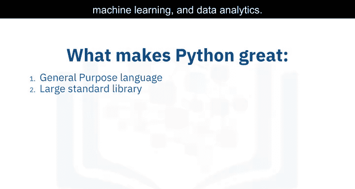

For artificial intelligence， it has tensorflow， pie torch， Kius， andsyit learn。

Python can also be used for natural language processing NLP， using the natural language toolkit。

 NLTK。Another great selling point is the Python community。

 which has a well documented history of paving the way for diversity and inclusion efforts in the tech industry as a whole。

The Python languageguage has a code of conduct executed by the Python Software Foundation that seeks to ensure safety and inclusion for all in both online and inperson Python communities。

 There are also communities like PyLadies that seek to create spaces for people interested in Python to learn in safe and inclusive environments。

 PyLadies is an international mentorship group with a focus on helping more women become active participants and leaders in the Python Open source community。

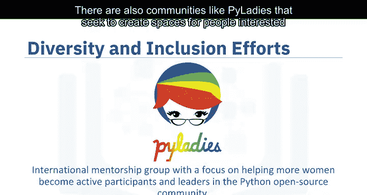

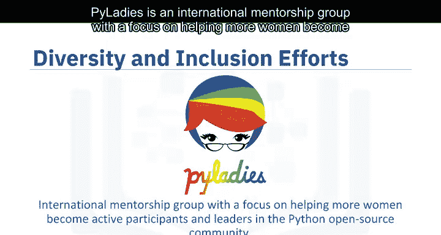