# IBM数据科学专业证书课程2：《数据科学工具》open-source-tools-for-data-science（中英字幕） - P40：39_IBM SPSS建模工具.zh_en - GPT中英字幕课程资源 - BV1np4y1V7Sn

In this lesson， we will discuss two products that are very helpful for data scientists。

 Both came to IBM with the SPSS acquisition in 2009。 first is IBM SPSSS modeler。

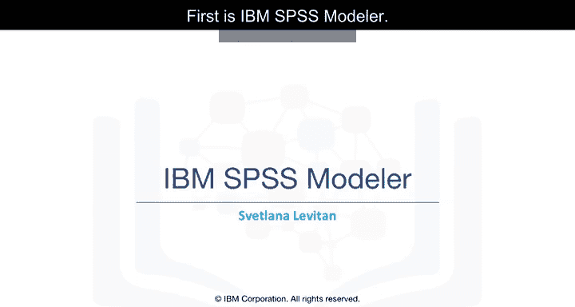

Let's review the different tool categories we discussed previously。

 IBM SPSS modeler includes data management capabilities and tools for data preparation。

 visualization， model building and model deployment。

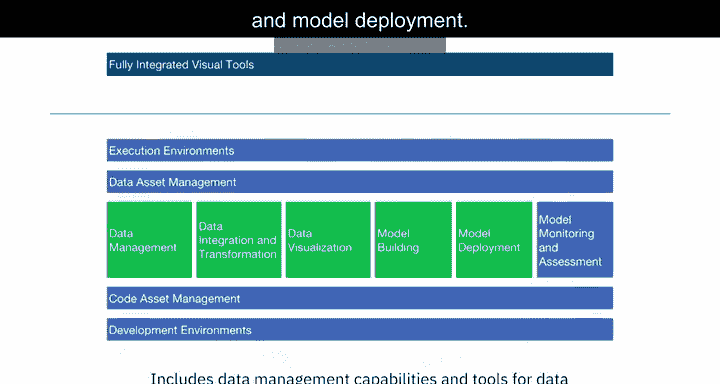

The product was created by integral Solutions Lited in the United Kingdom in 1994 and was originally called Clementine。

It was acquired by a company called SPSS in 1998， and SPSS was in turn acquired by IBM in 2009。

SPSSS modeler is a data mining and text analytics software application It's used to build predictive models and conduct other analytics tasks。

It has a visual interface that enables users to leverage statistical and data mining algorithms without programming。

One of its main goals from the beginning was to create complex predictive modeling pipelines that are easily accessible。

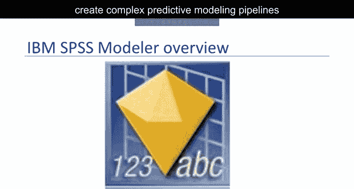

A sample model or stream shown here includes one round data source node。

 three triangular graph nodes， one hexagonal node for computing a new variable。

 and a square node for an output table below the canvas。

 we can see the rich node palette with separate tabs for data sources， record and field operations。

 graphs， models， output， and so on。Nodes in different tabs have different shapes。

 with pentagons used for modeling nodes。

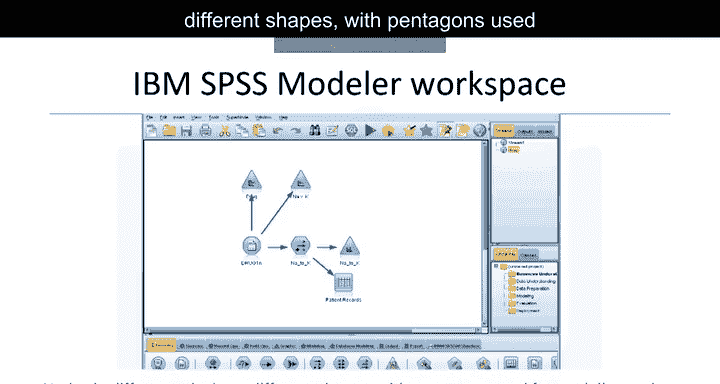

Let's examine the sample stream that comes as an example with the product。

 It starts with a data set of telecommunications records。

 and the goal is to build a model to predict which customers are about to leave the service。

 otherwise known as churnern。The data source is shown by the round node on the left side。

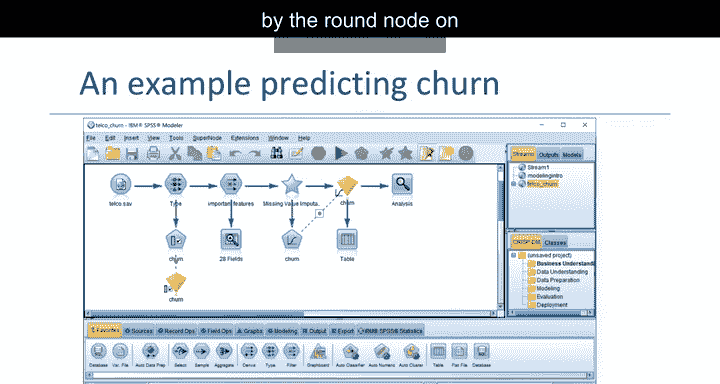

A hexagon type node typically follows a data source node， and it enables us to specify roles， target。

 predictor or none and measurement levels such as continuous nominal or flag for all variables。

 The term flag is used to denote a variable with two categories。

 one of which can be considered positive and the other negative。 In this example。

 the measurement level for the churn field is set to flag， and the role is set to target。

 All others are set as predictors and inputs。 The original data set has many fields。

 and some of them are not relevant to the target variable。

 So we first need to decide which fields are more useful as predictors。

 There is a feature selection modeling node that helps to do this。

 After the stream with a feature selection node is executed。

 a yellow model nugget gets created below it in the flow diagram using that nugget， we can generate。

😊，A filter node that filters out the variables that are not good predictors for the target。

The data audit node located below the filtering node， shows various properties of the data。

 such as numbers of outliers in each variable and the percentage of valid values。

 It can also help to create a special node for missing value imputation。

 that is replacing missing values of a variable with some valid values that can be selected based on domain knowledge here。

 variable log tool has greater than 50% missing values。 and we will specify a value。

 the mean to replace them。

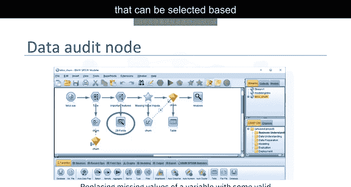

A super nodeode in modeler is a special node that is not found in the palette。

 but is created by the user with special functions included in it。

The data audit node enables us to create a super node for imputing missing values。

 It is shaped as a star and shown on the right of the screen。😊。

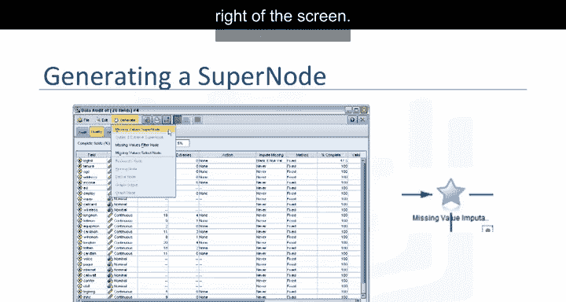

Finally， we attach the logistic regression model node to the stream and click run。

 another model nugget appears， and by clicking it， we can see various model information and other output。

😊。

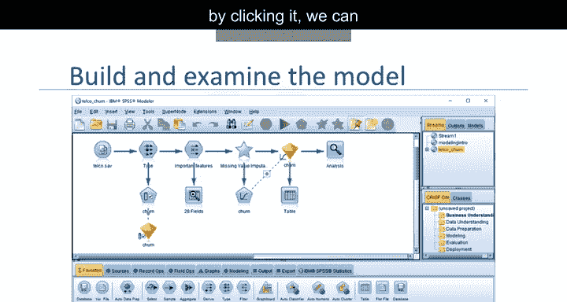

In the output window that opens when we click on the model nugget。

 the summary tab shows the target inputs and some model building settings based on certain advanced output settings that were specified before the model was built。

 We can also see a classification table accuracy and some other generated outputs for the model。

 Note that these results are based on training data only。

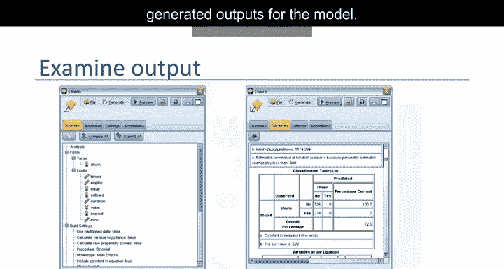

To assess how well the model generates to other real world data。

 you should always use a partition node to hold out a subset of records for the purposes of testing and validation。

Then in the model setup screen， select the Use Partition data checkbox。

 This will help detect and avoid model overfitting。

Overfitting is defined as having significantly higher accuracy on the training data。

 data used for training the model than on test or unseen data。

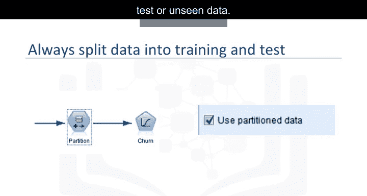

The yellow model nugget added earlier can also be used to compute predictions。

 also called scores on the original data or on a new data source。

 All we need to do is to connect the data source in question to the nugget。

 Make sure it has the predictor variables used in the model and create an output to a table or other structure for storing the scores。

 We can also specify settings for scoring inside the model nugget。

Note that if the model was built on transformed predictor data。

 the same data transformation steps would be applied to the new data before it can be scored by the model。

 The analysis node is the final node in the string。 It attaches to a model nugget， and when executed。

 it will compute some model evaluation metrics， such as a confusion matrix and accuracy。

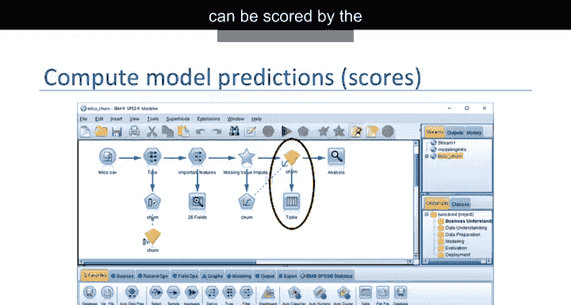

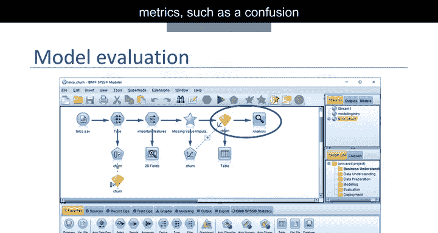

In this example， we've only looked at a logistic regression model。

IBM SPSS modeler offers a rich modeling palette that includes many classification， regression。

 clustering， association rules and other models。 It also contains large selections of data source types。

 data transformations， graphs and output nodes， and we haven't even talked about text analytics。

 entity resolution and many other features of the product that can be extremely helpful to data scientists。

 We could create an entire course on IBM SPSS modeler alone。😊。

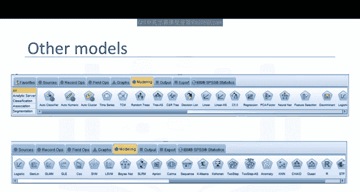

You've learned how IBM SPPSS modeler helps analysts to create powerful machine learning pipelines using graphical interface Next。

 we will talk about the original SPPSS product now called IBM SPSS Staistics。

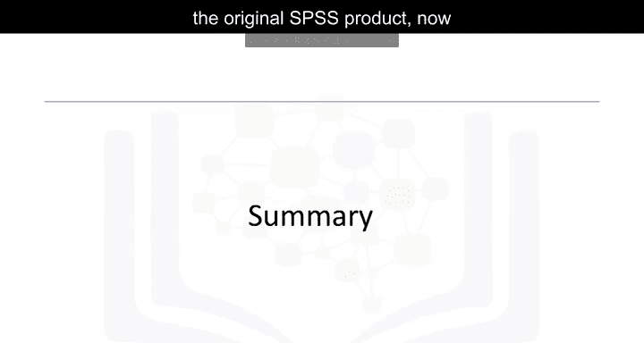