# IBM数据科学专业证书课程2：《数据科学工具》open-source-tools-for-data-science（中英字幕） - P41：40_SPSS统计分析.zh_en - GPT中英字幕课程资源 - BV1np4y1V7Sn

IBM SPSS statistics evolved from an original product that was released in 1968。

 that product was called Statistical Package for Social Sciences or SPPSS。

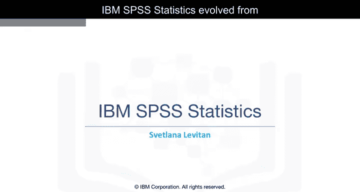

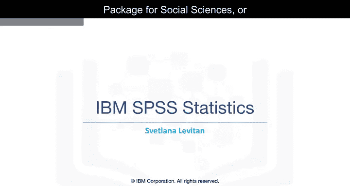

IBMSSPSS Staistics is a statistical and machine learning software application and is widely used in academia。

 government agencies， and large enterprises。It's used to build predictive models。

 perform statistical analysis of data and conduct other analytic tasks。 It has a visual interface。

 which enables users to leverage statistical and data mining algorithms without programming。

 although the interface is very different from modeler。 As you can see。

 the main section of the screen looks very much like a spreadsheet。

 It displays data and allows manual editing。 This particular small data set called employee data was created some time ago and does not represent real people。

 It is shipped with the product for use in demos and tutorials。 at the bottom of the screen。

 we can see two tabs， data view and variable view。In the variable view。

 we can see and edit information about all variables， including names， labels， data types。

 and measurement levels。We can also specify labels of values of categorical variables and missing values。

At the top of the data window is a menu under file。 If you select import data。

 you will see a list of a wide variety of data formats that you can import。

 The product uses its own data file format with the extension dot SV。

 That saves all the information about the variables we just saw in variable view。

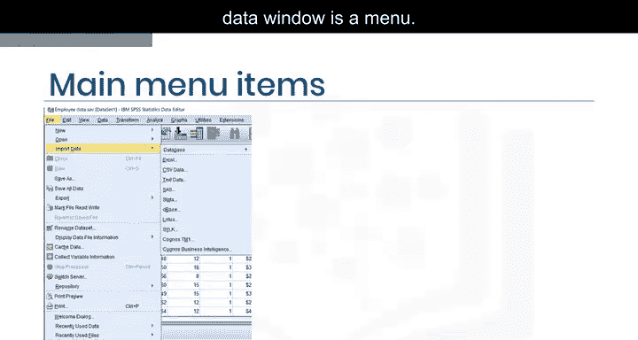

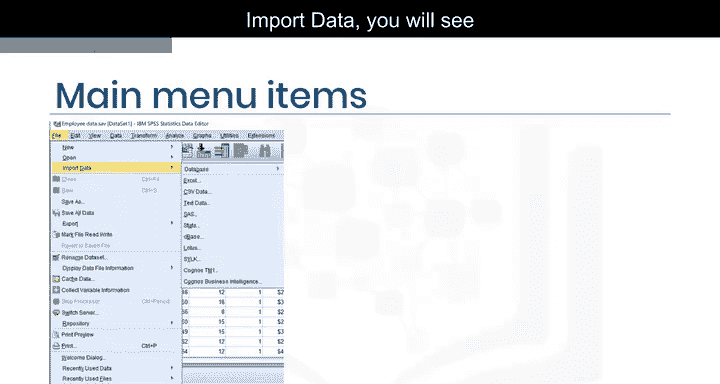

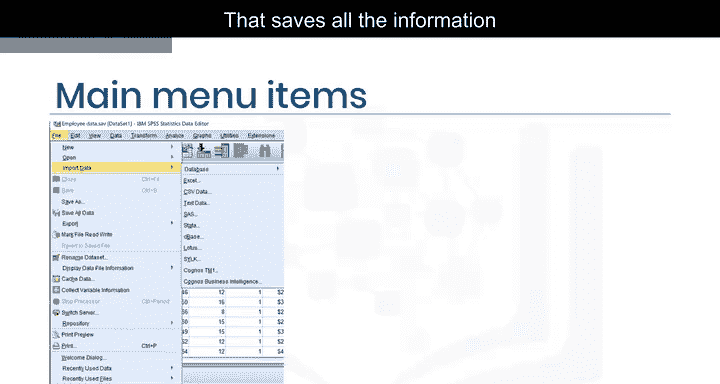

The menu enables importing from and exporting to many other formats。

Under data， you'll find an extensive menu of possible data operations。

 Note that data validation can be performed using user definedfined rules that specify the expected behavior of variable values。

 For example， if the date and month are kept in separate columns， the date cannot exceed 31。

 but for February， the date can't exceed 29。A special rule can therefore be created and applied during data validation。

 Additionally， you can enable some checks such as percentage of missing values in a record or in the field。

 When you click the Trans menu item， you'll find a variety of available data transformations。

Under compute variable， you can write a formula for a new variable based on existing variables。

 You can use any of the main mathematical and statistical functions available in the product。

 You also have the option to use automatic data preparation， similar to modeler。In the analyze menu。

 you will see many types of statistical and machine learning analysis Under regression。

 there are a variety of regression related models， there are other kinds of regressions that appear separately on the analyze menu。

 including General linear model， generalized linear models， mixed models and log linear。

Now let's build a decision tree model on the data。For this exercise。

 we'll try to predict the employment category field based on other fields in the analyze menu。

 select Classify and then tree in the decision tree window。

 we can specify the dependent variable employment category and use most other fields except ID and B date as predictors or independent variables。

 Usually the ID variable should not be used as a predictor because it will not help with new cases。

 and the birth date does not seem to be a useful predictor in this example either。

We'll select Exive shade as our growing method， although there are also three other options available。

Click the validation button to open the decision tree validation window here we select split sample validation to make sure we test the model on new data。

 click OK in the decision tree window to generate the output including the tree diagram shown here。

 a classification table is also displayed that shows how well the model works on training and test data。

 In this case， the accuracy is 91。2% on training data and only 85。6% on test data。

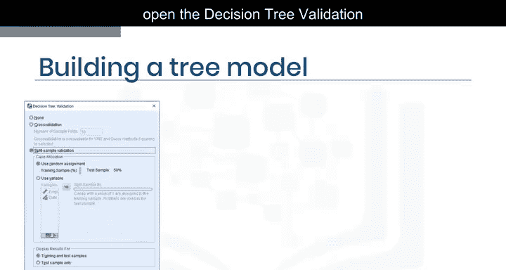

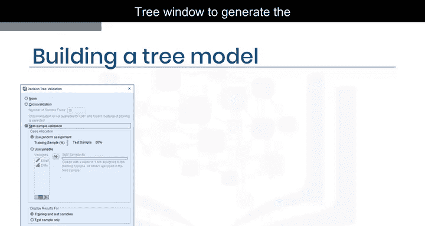

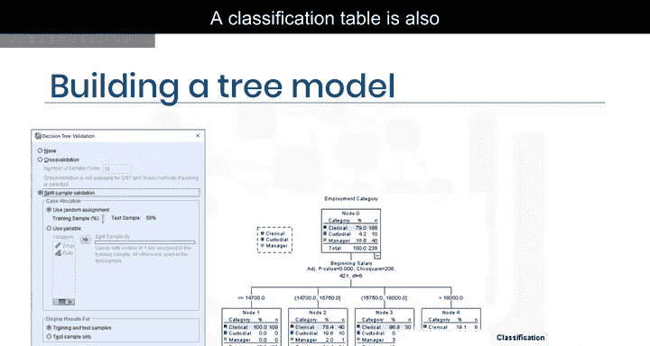

Which means the model does not generalize to new data very well。

It's possible that by using different models， we can get better results。

Let's move to the next menu item when you clickGs， you'll open a versatile chart builder in addition to several other options。

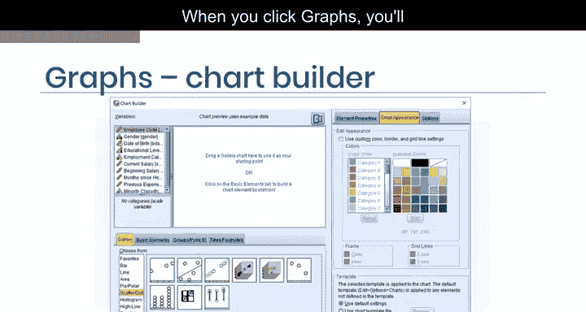

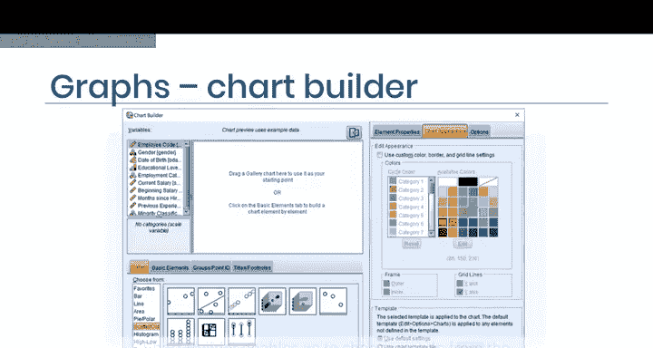

The chart builder enables us to choose a style from the gallery and drag required fields onto the canvas。

 select colors， and choose from other options。

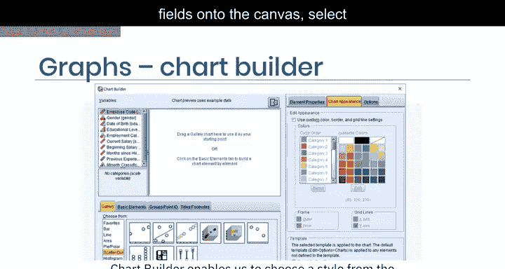

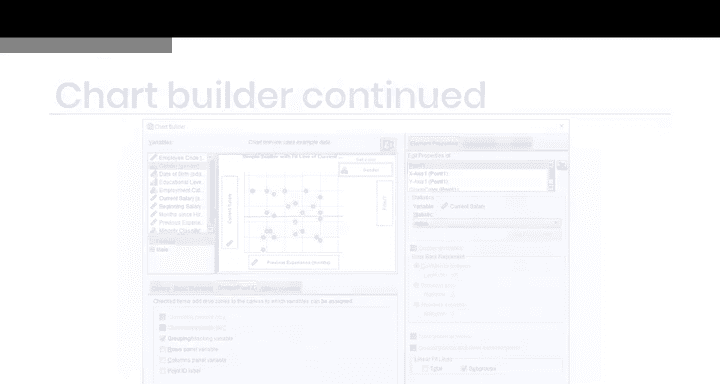

Here's an example after we drag the previous experience， current salary。

 and gender variables to the corresponding slots to define the access and colors for the dots on the chart。

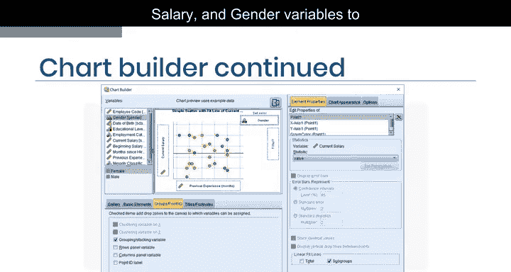

The plot in the canvas is not based on real data。 This example simply gives you an idea of what to expect。

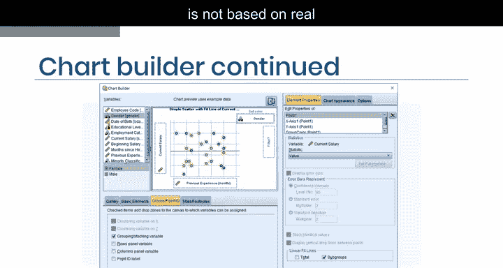

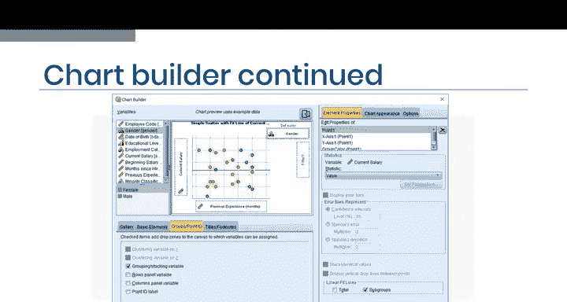

Here is the real plot obtained from the data that we've been using。

 It shows different colored dots for gender and regression lines that show the relationship of the current salary to previous experience for each gender Throughout IBM SPSS Stas。

 you'll see a paste button When you click the paste button instead of executing the task right away。

 the application will open another window called the syntax editor Here。

 you can see the code called synyntax pasted for you。

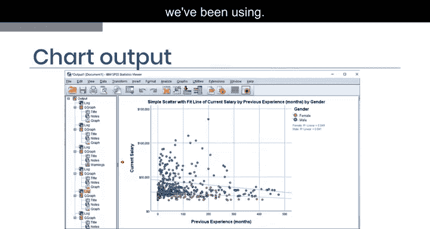

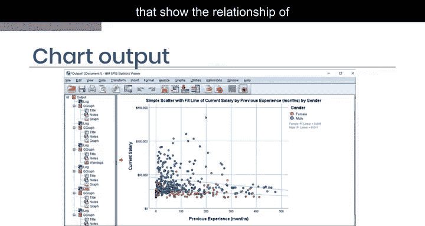

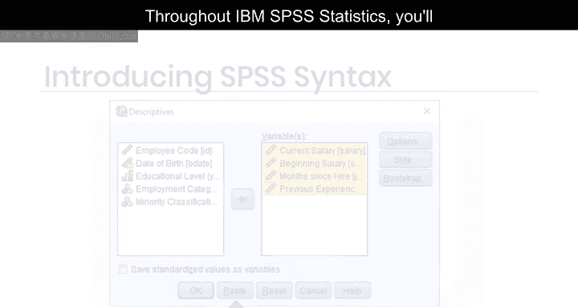

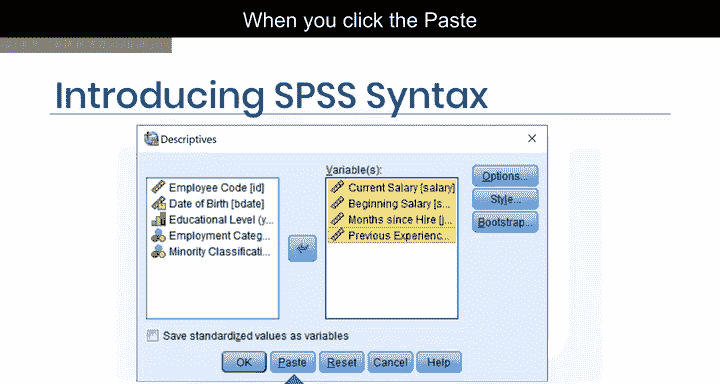

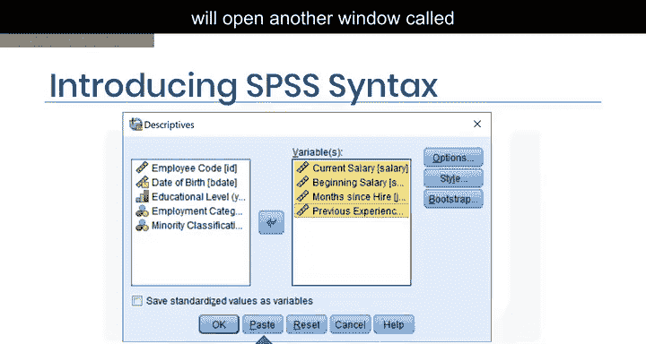

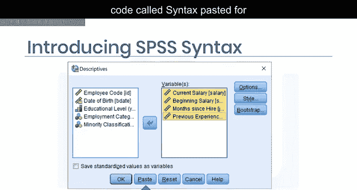

SPSSS syntax is a special programming language， for example。

 here is the code for the decision tree we just built。Once we have the syntax， we can execute it。

 manually edit it， store it for later use， or send it to other users of IBM SPSS statistics。

Experienced SPPSS users can write the code from scratch。

 while others might prefer to have it generated by the graphical interface。Remember。

 the option to paste syntax is available throughout the program。

If the syntax is generated by all the steps in a data analytics process， opening the data set。

 applying any data transformations， building models。

 and then saved as a syntax file with the extension。PS。

 it's similar to saving a stream in IBMSPSS modeler。However。

 one important difference is that it does not allow for an easy way of scoring new records with the model we'll talk about different ways to deploy models in the next section。

You've learned how IBMSSPSSS statistics helps data scientists to analyze their data using many statistical and machine learning techniques。

 using a graphical user interface we can create complicated analysis that can be saved in the form of syntax and reused later Next we'll talk about predictive model deployment。

 an important part of the overall data science lifecycle。

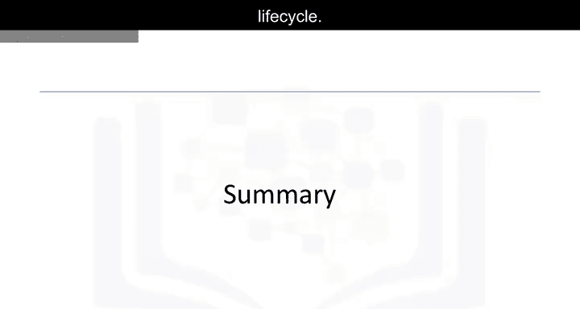