# IBM数据科学专业证书课程2：《数据科学工具》open-source-tools-for-data-science（中英字幕） - P42：41_Watson机器学习模型部署.zh_en - GPT中英字幕课程资源 - BV1np4y1V7Sn

So far we've talked about building machine learning models and pipelines in most practical applications。

 the return on investment is obtained when the model or pipeline is put into production where it is used to get predictions or scores for the new cases Let's look back at our overview of different tool categories。

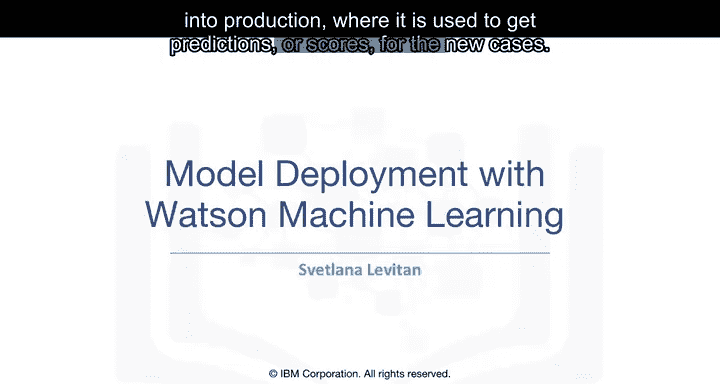

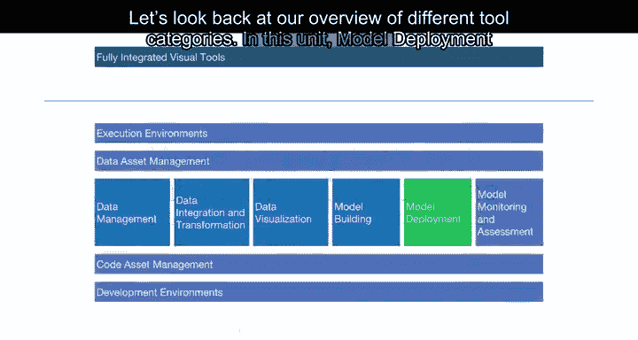

In this unit， model deployment is our focus。 Suppose you worked hard to create the best possible machine learning model and the data preparation pipeline for it。

 How will you deploy your models， in many practical scenarios。

 models are built and deployed by different teams using different programming。

 and perhaps human languages。 The teams will use different computing and data storage environments。

 and it might prove difficult to translate your program and the associated data preparation and postpro steps from one environment to the other。

😊。

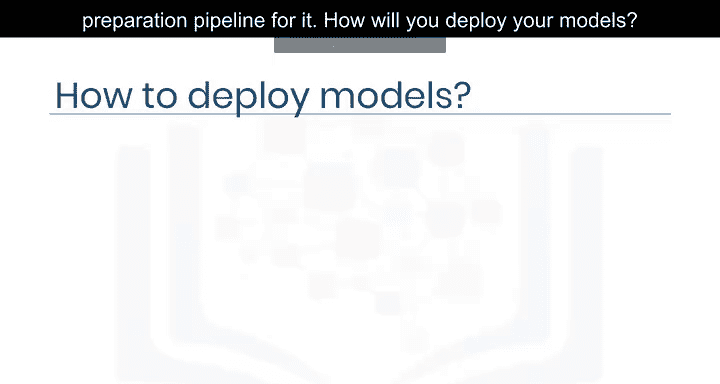

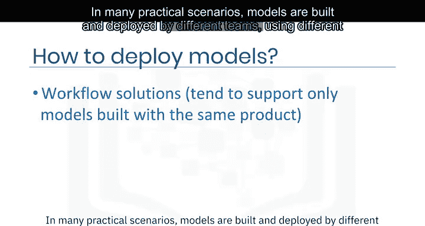

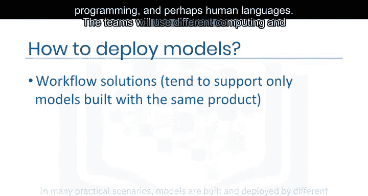

Currently， there are several approaches you can use to solve this problem， some commercial。

 some open source， yet each one typically supports only a subset of all possible models from building them to deploying。

 so a user gets locked into a specific framework。

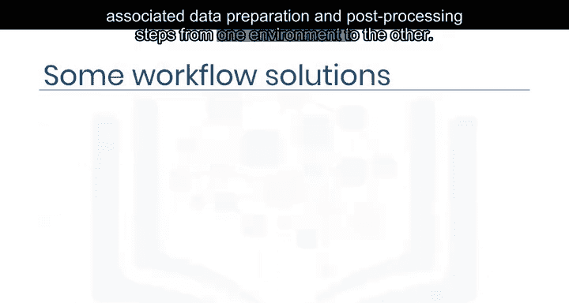

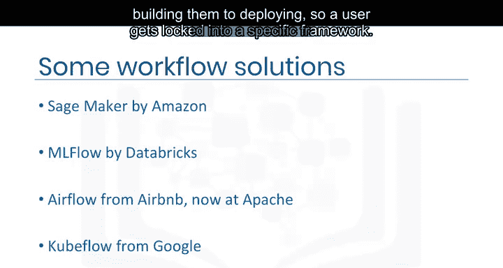

Open standards for model deployment are designed to support model exchange between a wider variety of proprietary and open source models。

 predictive model markup language or PMmL was the first such standard based on XML。

 It was created in the 1990s by the data mining group。

 a group of companies working together on the open standards for predictive model deployment。

 IBM and SS were among the founding members of the data mining group。

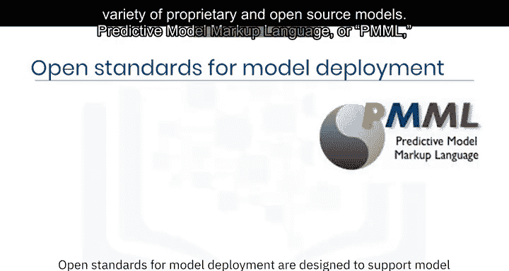

PMML 4。4 was recently released。 It includes 17 statistical and machine learning models and many data transformations built in functions。

 ways to combine multiple models together and other features。 This standard is widely known and used。

 The products we looked at earlier， Watson Studio， IBM SPSS statistics， IBM SPSS modeler。

 enable users to export most models in PMmL。In 2013。

 a demand for new standard grew one that did not describe models and their features。

 but rather the scoring procedure directly， and one that was based on J rather than X M L。

 This LED to the creation of portable format for analytics or PFA PFA is now used by a number of companies and open source packages。

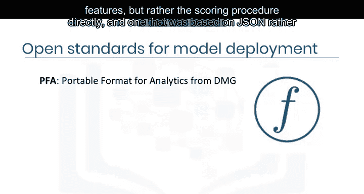

After 2012， deep learning models became widely popular。

 yet PM M L and PFA did not react quickly enough to their proliferation。

 The need for a standard intermediate representation was amplified by the wide variety of emerging deep learning frameworks and specialized hardware。

In 2017， Microsoft and Facebook created and open sourced open neuralural network Exchange or Onyx。

 originally created from neural networks。 This format was later extended to support traditional machine learning as well。

There are currently many companies working together to further develop and expand onyx。

 and a wide range of products and open source packages are adding support for it。

Watson Ma learning is IBM's commercial offering designed for model deployment。

 It supports deployment of models built with most open source packages。

 as well as those expressed in PMmL or Onyx。 It also supports deployment of IBM SPSS modeler streams and modeler flows from Watson Studio。

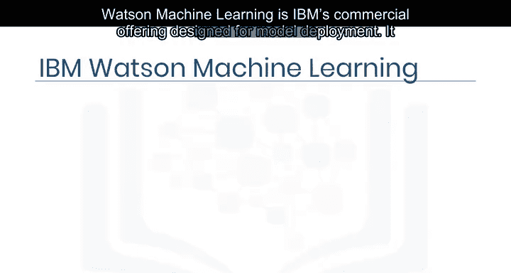

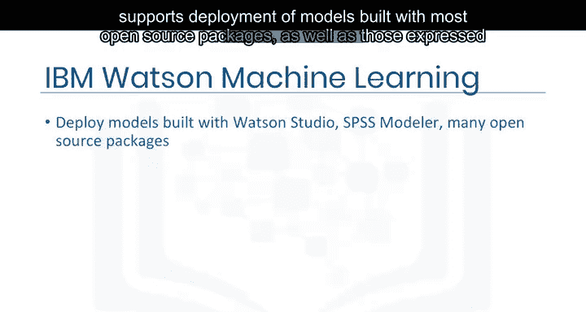

Deployment can be done using a graphical interface or Python code and can be for online scoring through a rest API or batch scoring。

Watson Machine Learning helps integrate a deployed model into applications in the form of code snippets in several programming languages。

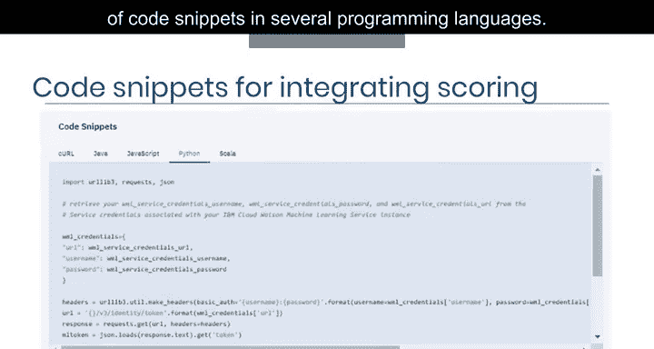

In this video you've learned how open standards and Watson Mach learning can help users to deploy their models into various application Next we'll talk about AutoAI and Open scale。

 two advanced Watson Studio features that help to further simplify a data scientist's work。

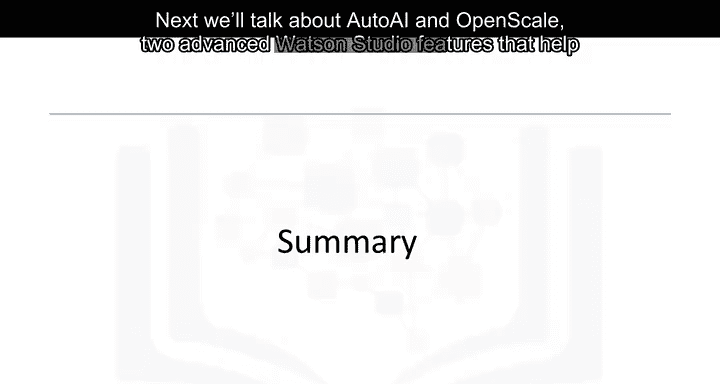