# IBM数据科学专业证书课程2：《数据科学工具》open-source-tools-for-data-science（中英字幕） - P43：42_Watson Studio自动AI.zh_en - GPT中英字幕课程资源 - BV1np4y1V7Sn

In earlier sections， we saw how IBM SPPSS modeler， and Watson Studio modeler flows allow you to graphically create a stream or flow that includes data transformation steps and machine learning models。

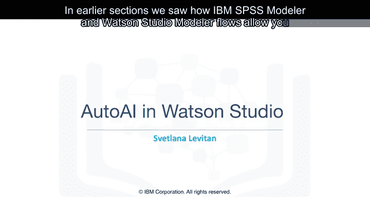

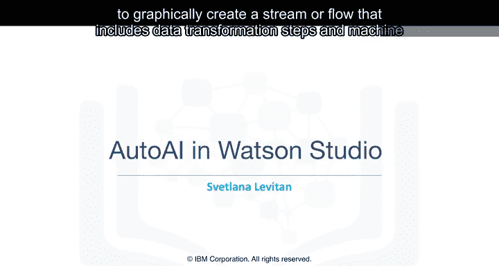

Such sequences of steps are called data Pis or ML pipelines。

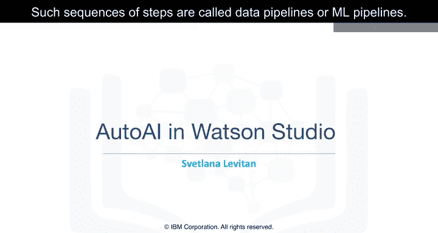

This section examines a feature of Watson's Studio that helps to automate the creation of machine learning pipelines。

 this allows data scientists to produce results much faster and to focus on more creative work。

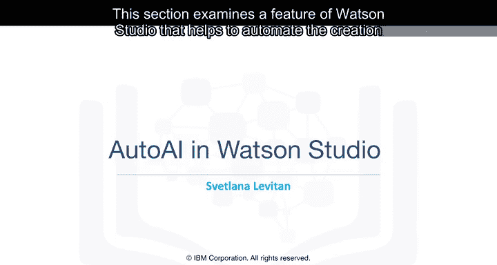

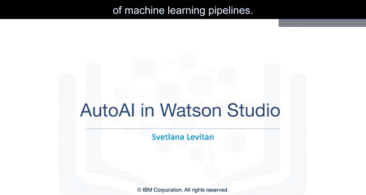

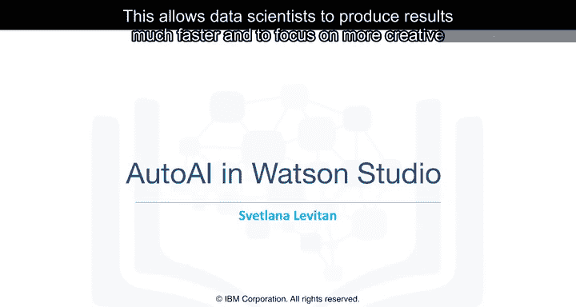

There is currently a shortage of qualified data scientists。

 Many operations that a data scientist typically performs are repetitive and time consuming。

 therefore， automating some of that repetitive work will help free up both new and experienced data scientists to do the important work that they are trained to do。

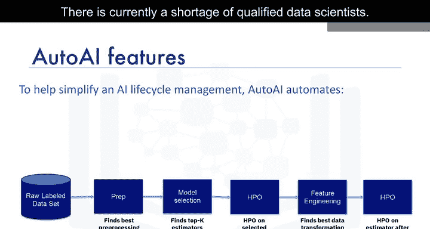

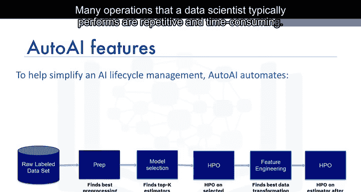

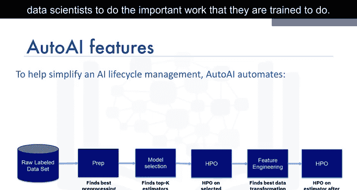

The autoAI system was developed by IBM research experts in collaboration with IBM distinguishued engineer and two time Cale Grahammaster Jean Francois Puget。

 it provides a graphical interface to create and deploy machine learning models with real time visualizations。

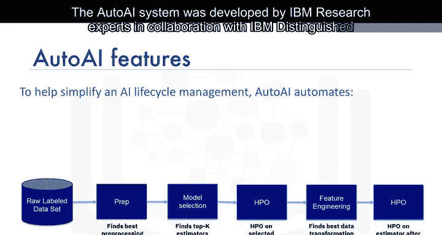

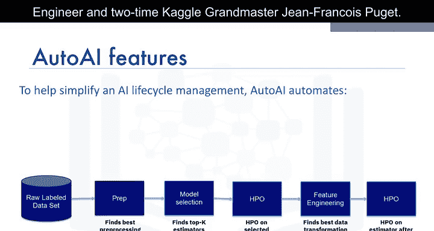

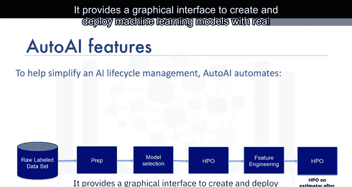

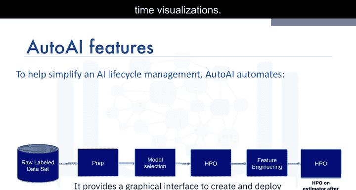

Auto AI automatically performs typical machine learning steps such as data preparation。

 model selection， feature engineering， hyperparameter optimization。

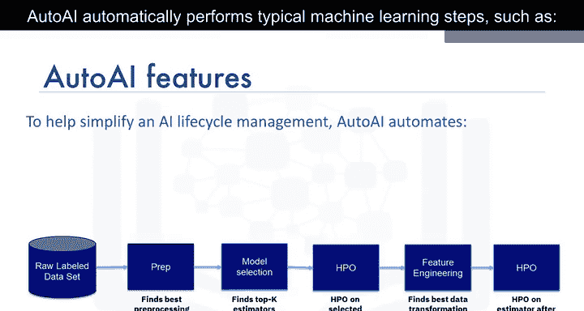

Users can view the progress on the graphical interface。

This example shows the training of a model to predict whether or not a customer is likely to buy a tent from an outdoor equipment store。

We start with structured data in this historical data， there are four feature or predictor columns。

 gender， the customer's gender， age， the customer's age， marital status， married。

 single or unspecified and profession， the general category of the customer's profession。

 such as hospitality or sales or simply other。The model will learn to predict the value for the Is tent column that is whether or not the customer bought a tent。

After we choose Is tent as the column to predict， autoAI analyzes the data and determines that the is Tt column contains true/lash falsese information。

 making this data suitable for a binary classification model。

 the default metric for a binary classification is ROC/ AUC。

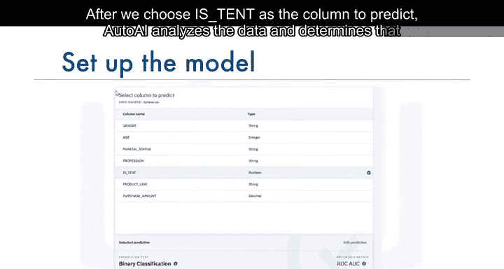

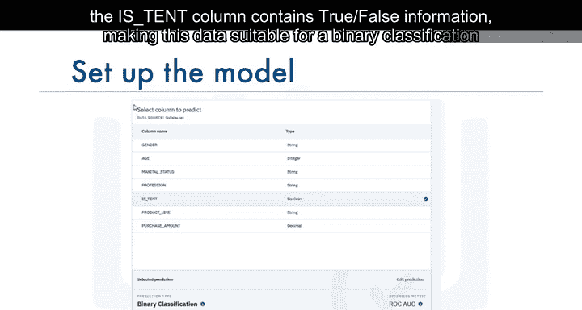

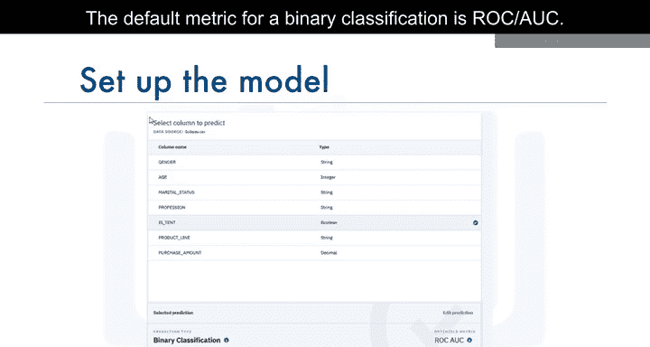

After we click Run experiment， an infographic shows the process of building the pipelines as the model trains。

 once the pipeline creation is complete， we can view and compare the ranked pipelines in a leaderboard。

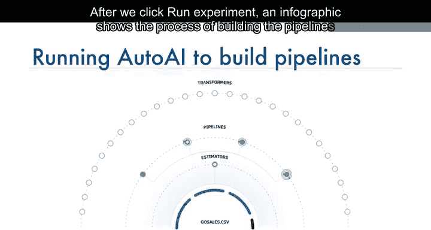

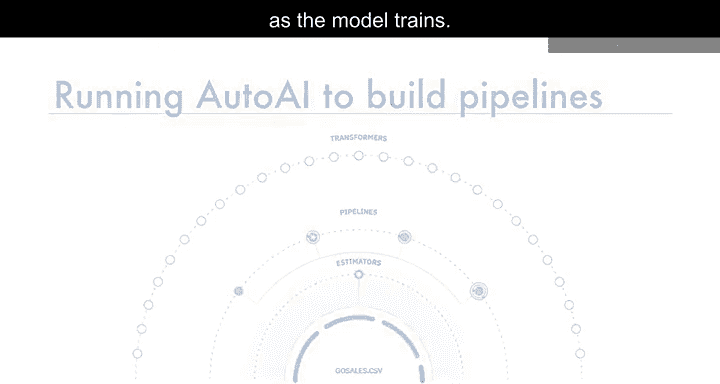

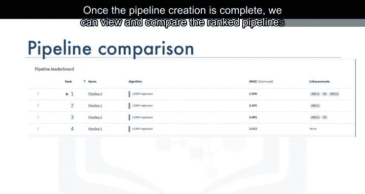

The pipelines for the sample binary classification model are quite uniform because of the underlying sample data。

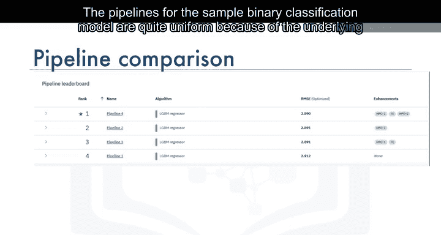

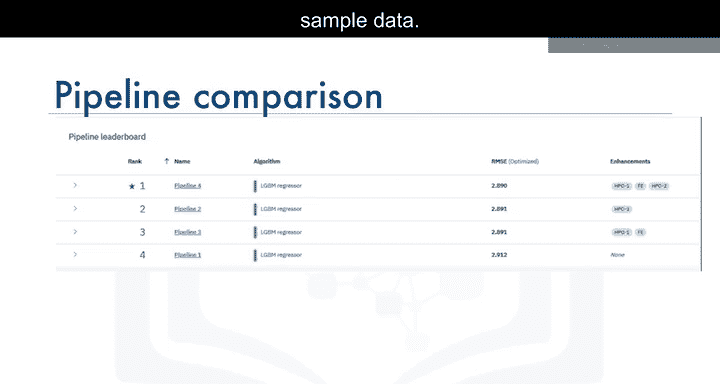

To see pipelines in action， rerun the experiment as a regression experiment to predict purchase amount。

 That experiment gives better variation in the resulting pipelines。😊。

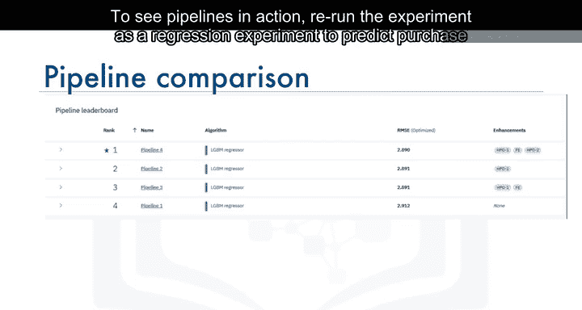

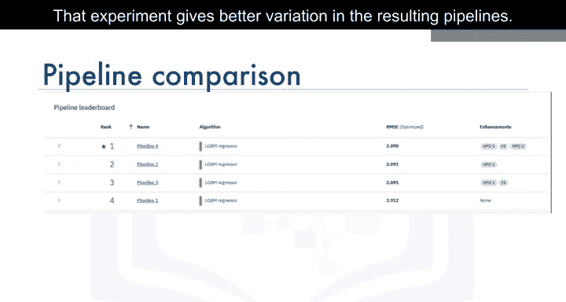

After clicking pipeline comparison， we can see how the pipelines differ on various measures of model quality The pipelines can be saved as machine learning assets in the Watson Studio project then they can be deployed and tested Currently autoAI is available only for classification and regression models there is a plan to add time series model support in the future In this unit you have learned how autoAI automates typical data science tasks and helps get better performing data pipelines more quickly while also simplifying pipeline deployment into production in Watson machine learning。

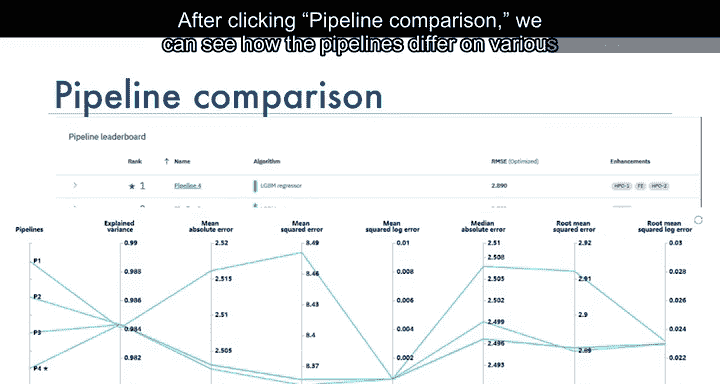

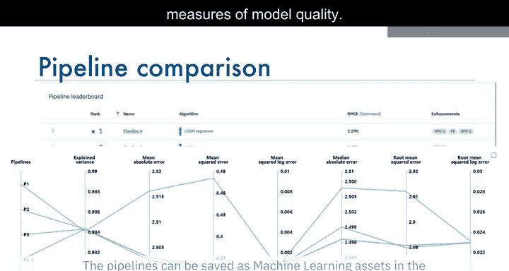

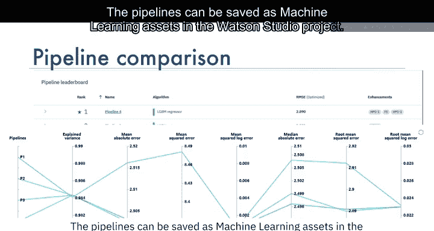

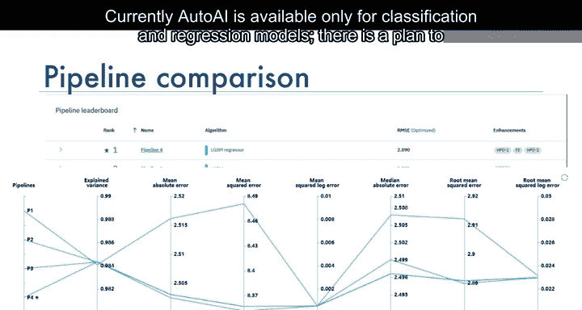

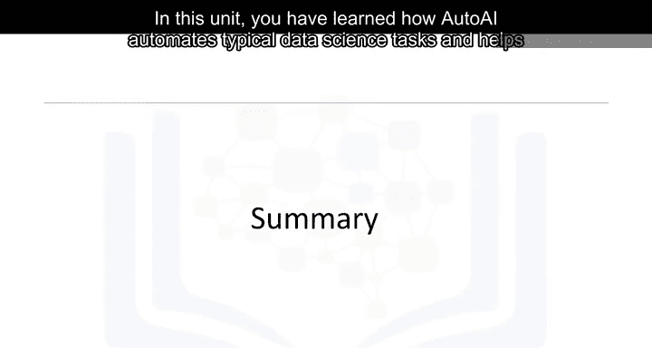

In the next section， we will discuss Watson Open Sc， which helps to ensure that your models are fair。

 explainable， and up to date。

