# IBM数据科学专业证书课程2：《数据科学工具》open-source-tools-for-data-science（中英字幕） - P44：43_IBM Watson公平性监测.zh_en - GPT中英字幕课程资源 - BV1np4y1V7Sn

This video examines the feature of Watsons Studio that helps to ensure fairness and explainability of machine learning pipelines。

 as well as monitor their performance after deployment。

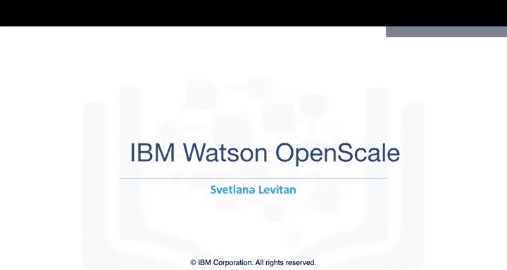

IBM Watson Open scale is a product that includes several important features。

 it can test the model and its predictions for fairness and apply ways to overcome bias。

 it can also help to provide explanations for model predictions that are often hard to get but are necessary for compliance in some application areas。

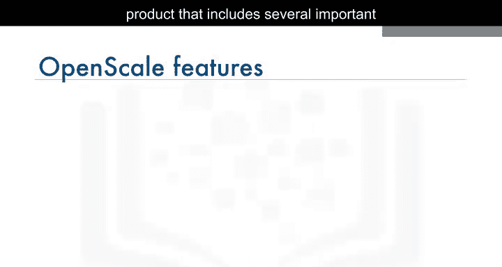

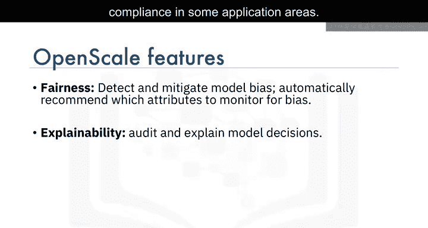

It monitors the model performance and can detect its deterioration or model drift over time。

 it can alert the users when drift is detected and explain which predictors are causing it。

We can specify criteria under which the model gets automatically retrained on fresh data。

 it also helps to measure how the model helps the business。

The attributes to monitorit for bias are automatically recommended based on prior experience。

 they can be edited as needed。

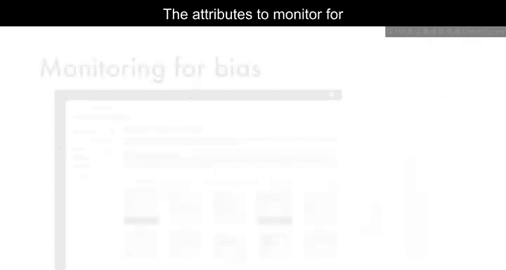

🎼Open scale then keeps track of model predictions for the specified groups and checks the bias in the predictions。

 Use need to know that their AI models are fair， but the data their models were trained on can include unwanted biases。

 which may unintentionally be included in the resulting models。

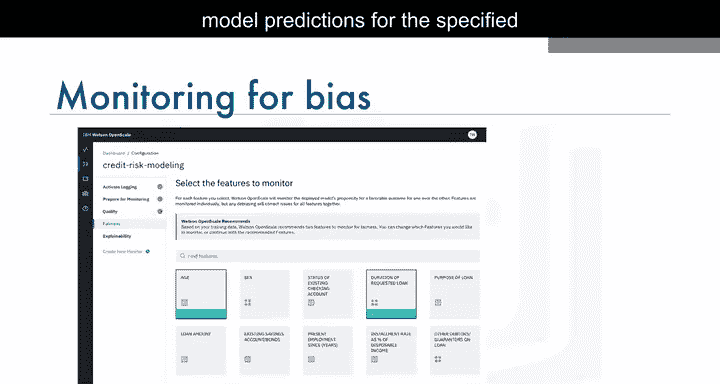

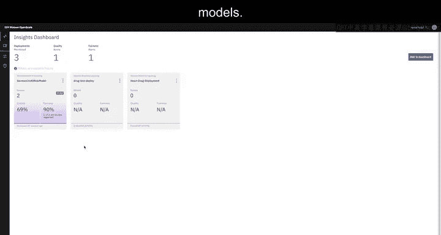

IBM Watson Openscale can detect bias when a model is in production and not just when it's being built。

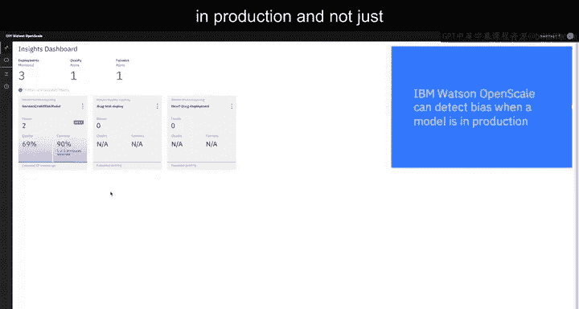

In this demo of Watson Open Sc， we'll monitor a credit risk model which has been trained to determine whether or not someone is eligible for a loan based on a variety of different features。

 such as their credit history， age， and their number of dependents。After launching Open scale。

 we can see a few highlighted metrics for the monitored model。

 such as its quality and fairness score。

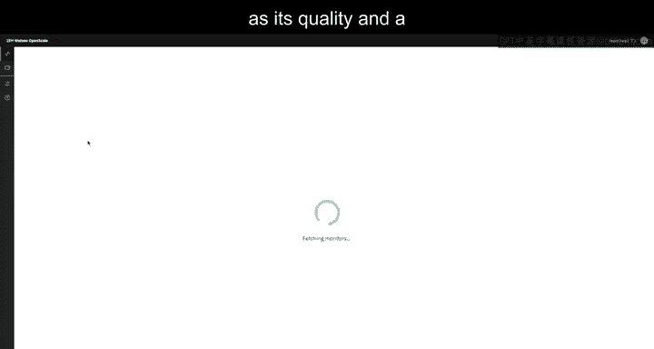

What Open scale does is measure a model's fairness by calculating the difference between the rates at which different groups。

 for example， women versus men receive the same outcome。

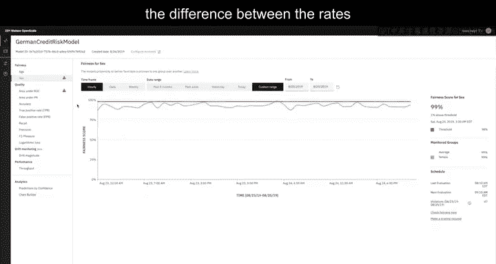

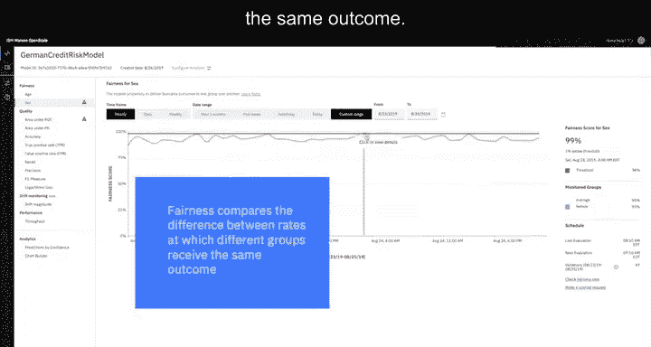

A fairness value below 100% means that the monitored group receives an unfavorable outcome more often than the reference group。

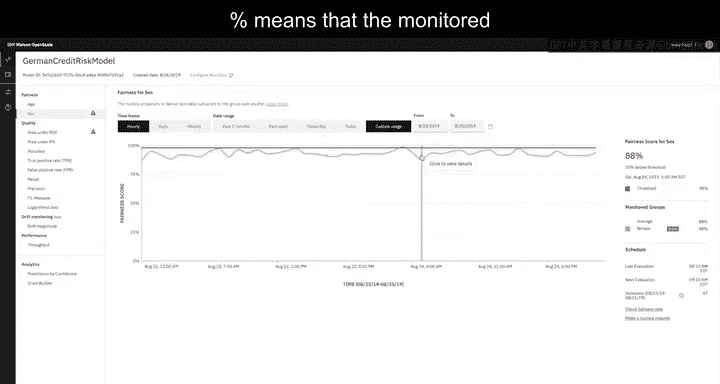

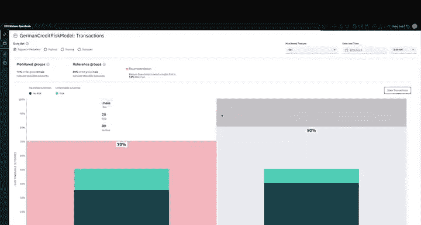

In this case， we see that women are receiving the no risk outcome or getting approved for loans at a lower rate than men。

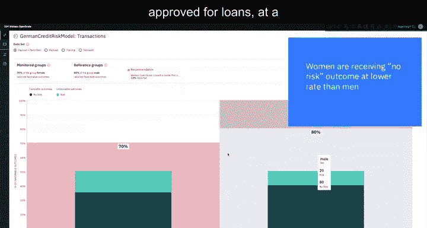

Open scale enables the inspection of each model's training data。

 and this reveals that there was more training data for men than women。

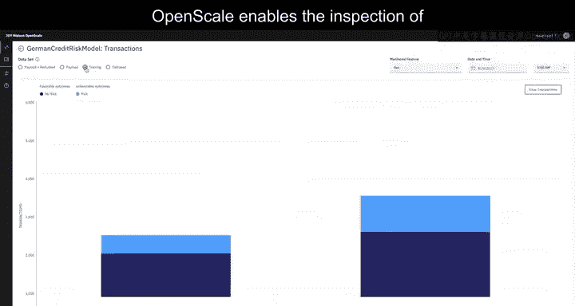

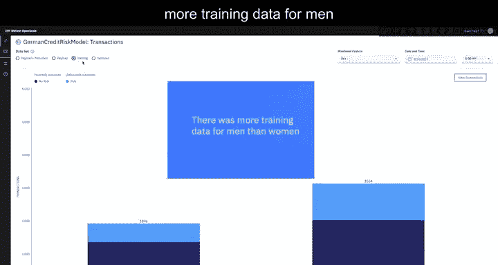

🎼This can give some insight as to why the model exhibits bias against women who apply for loans Data scientists can use this information to improve the model。

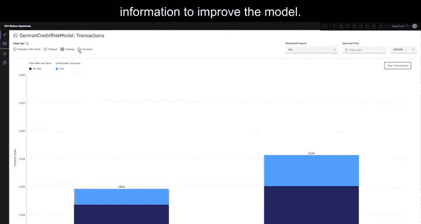

Now detecting bias is one thing， Open scale can also mitigate it by creating a Dbias model that runs alongside the monitor network。

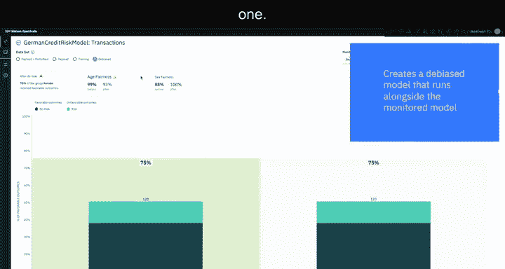

In this case， the Dbias model is 12% more fair than the production model。

🎼The Dbias model has been trained to detect when your production model will make a bias prediction so that you can isolate the specific transactions that resulted in the bias for each of these transactions。

 Watson Openscale will flip the monitored value in a record to the reference value in this case。

 from female to male and leave all other data points in that record the same。

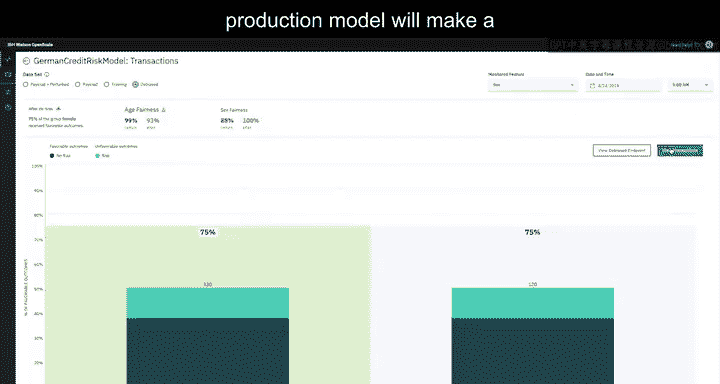

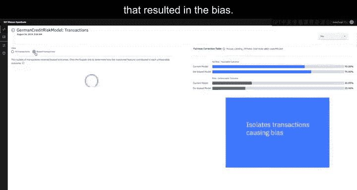

If this changes the prediction from GrP to no risk。

 then the Dbiased model will surface the no risk outcome as the debied results。

This is just one of the ways that Wason Open Sc helps you ensure that your models are fair。

 explainable and compliant， wherever your model was built or is running。

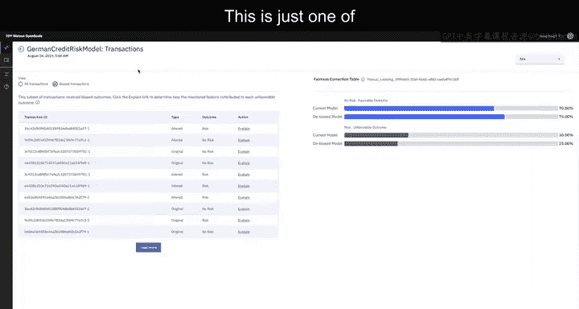

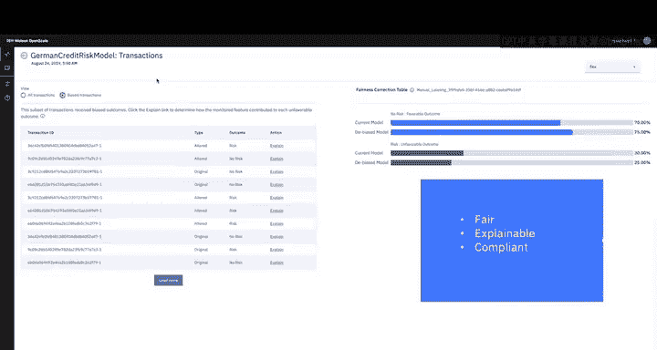

Insurance underwriters can use machine learning and open scale to more consistently and accurately assess claims risk。

 ensure fair outcomes for customers， and explain AI recommendations for regulatory and business intelligence purposes Why does AI model arrive at a given recommendation or prediction users and customers want an explanation and with most models providing this information is not an easy task？

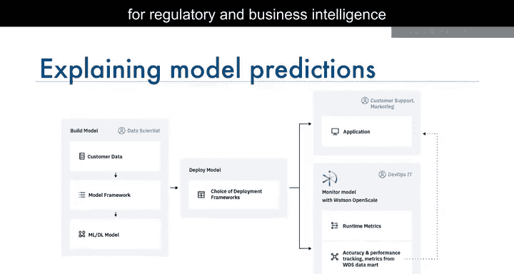

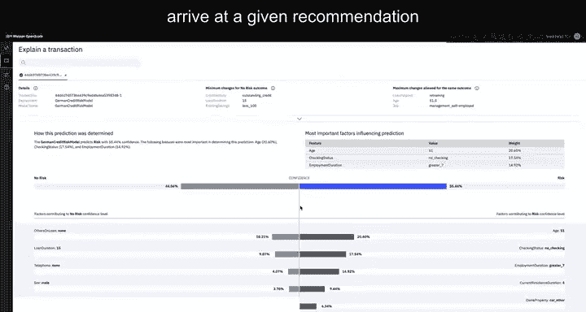

IBM Watson Open scale explains predictions in business friendly language this credit application for instance。

 was predicted to be at risk。

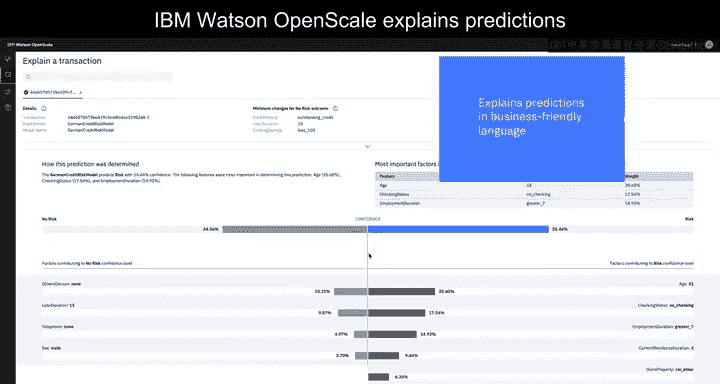

🎼Open scale determines the features which contributed positively or negatively to that prediction and spells them out The explanation is presented visually。

As well as in a sentence based text summary in order to ensure maximum clarity。

Using proprietary IBM research technology， Open scale also generates a contrastive explanation。

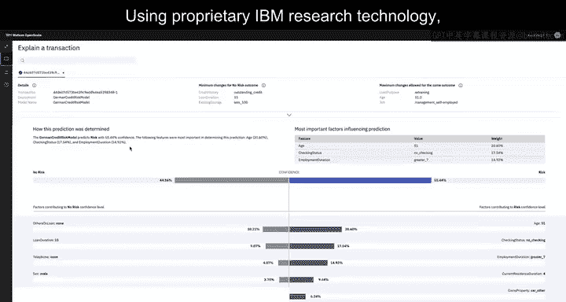

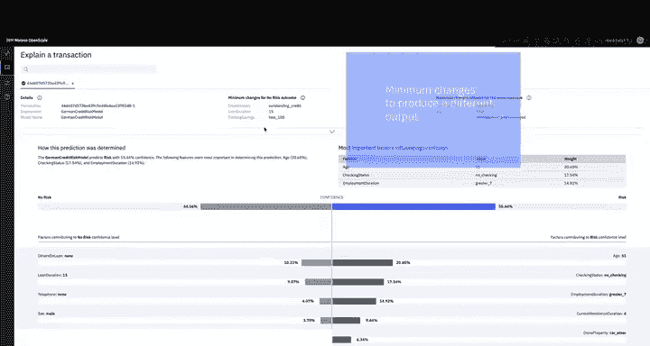

Here we see the minimum changes to this input record， which would produce a different output。

 changing the prediction from risk to no risk。

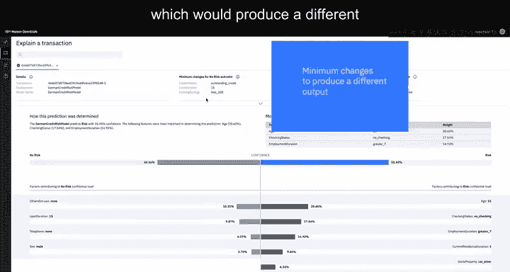

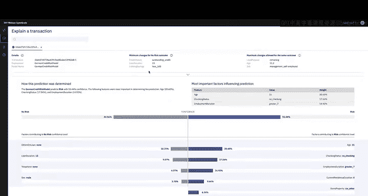

The explanations provided by Watson Open Sc can help organizations comply with regulations such as the Fair Credit Reporting Act and GDPR。

 which give customers the right to ask for reasons why their applications were denied。

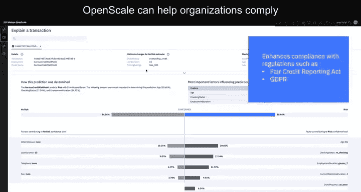

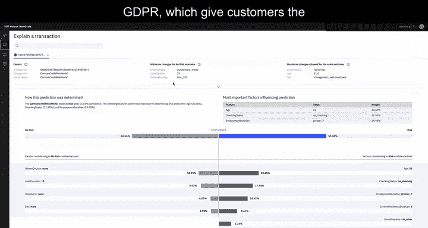

🎼Before an AI model is put into production， it must prove it can make accurate predictions on test data。

 a subset of its training data。 However， over time。

 production data can begin to look different than training data causing the model to start making less accurate predictions。

 This is called drift。IBM Watson Open scale， monitors a model's accuracy on production data and compares it to accuracy on its training data。

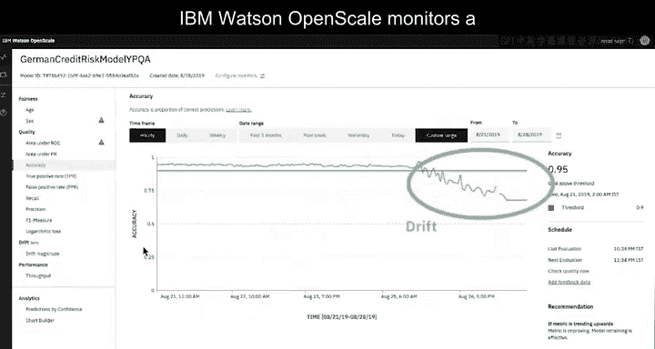

When the difference in accuracy exceeds a chosen threshold， Open scale generates an alert。

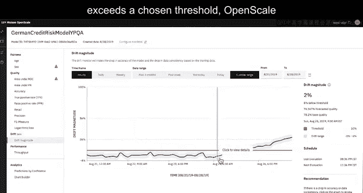

🎼Whils an open scale reveals which transactions cause drift and identifies the top transaction features responsible。

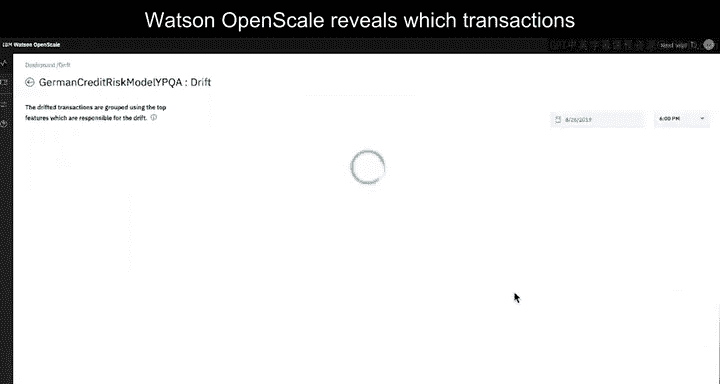

For instance， 25% of the transactions causing drift in this loan approval model were problematic because of these features。

 which contained data crucially different from the training data。

The transactions causing drift can be sent for manual labeling and used to retrain the model so that its predictive accuracy does not drop at runtime。

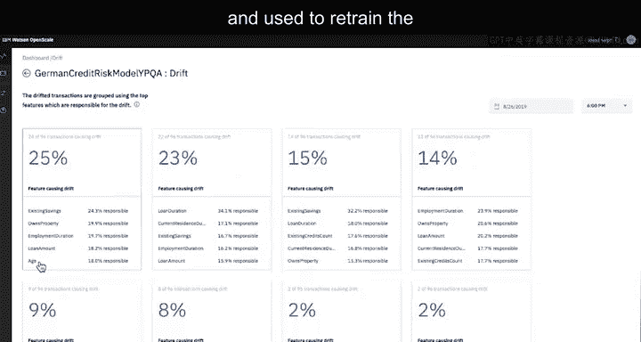

Watts an open scale not only helps identify Dr， but also highlights its root cause and provides transactions which can be turned into training data useful in fixing drift。

It gives you the insight you need to ensure that your models will consistently deliver the results you want over time。

🎼For instance， the retrained version of the model， but based on the recommendations made by Watson Open Sc。

 started making accurate recommendations， alleviating the drift。

This is just one of the ways that Watson Open Sc helps you ensure your models are fair。

 explainable and compliant， wherever your model was built or is running。

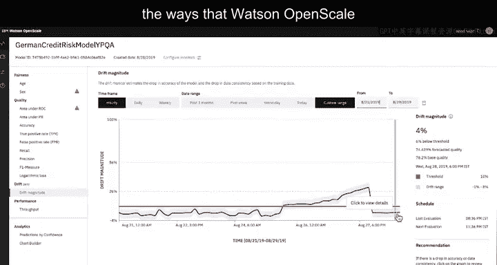

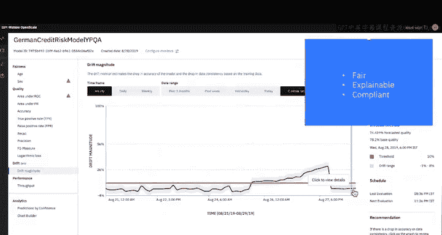

In this video， you have learned how Open scale ensures fairness and explainability of models and monitors for model drift in production。

This completes the model on IBM products for data scientists。 Good luck on the quizzes。😊。

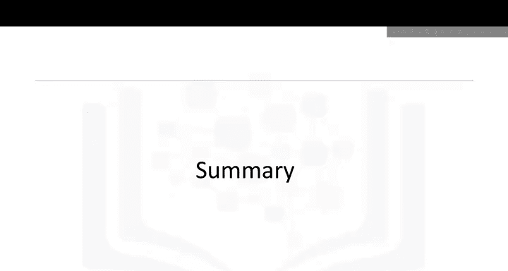