# IBM数据科学专业证书课程2：《数据科学工具》open-source-tools-for-data-science（中英字幕） - P4：3_R语言导论.zh_en - GPT中英字幕课程资源 - BV1np4y1V7Sn

In this video， we will give a brief overview of the R programming language after our last video on Python。

 where we discussed its wide adoption， you might be wondering why on earth you should consider learning any other language。

 Well， according to the results of the 2019 Caagle data science survey which had over 10000 respondents from around the world learning up to three languages can increase your salary and R has a lot to offer you like Python R is free to use。

 but it's a new project instead of being open source。

 It's actually free software So if Python is open source and R is free software。

 what's the difference Well， both open source and free software commonly refer to the same set of licenses。

 many open source projects use the new general public license， for example。😊。

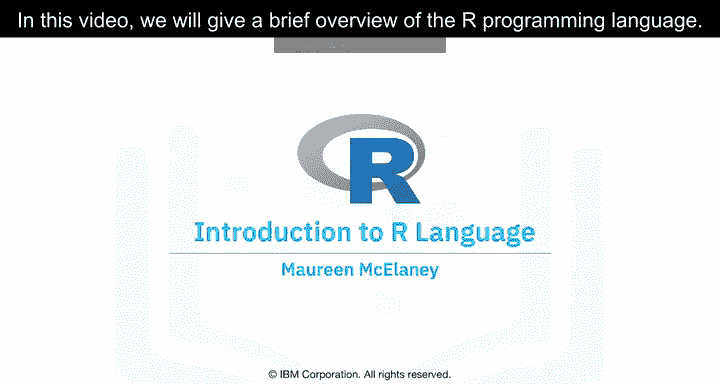

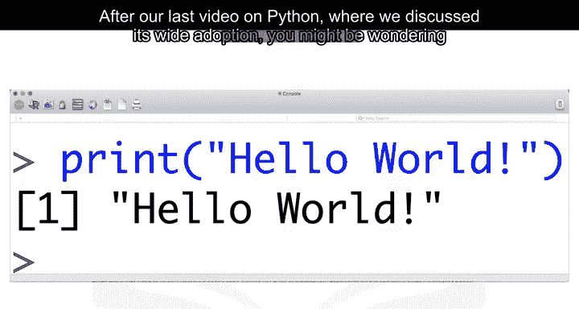

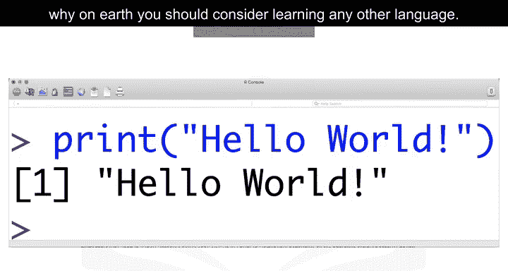

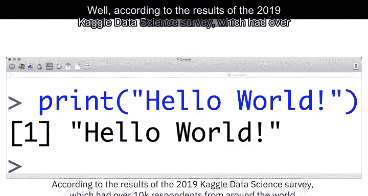

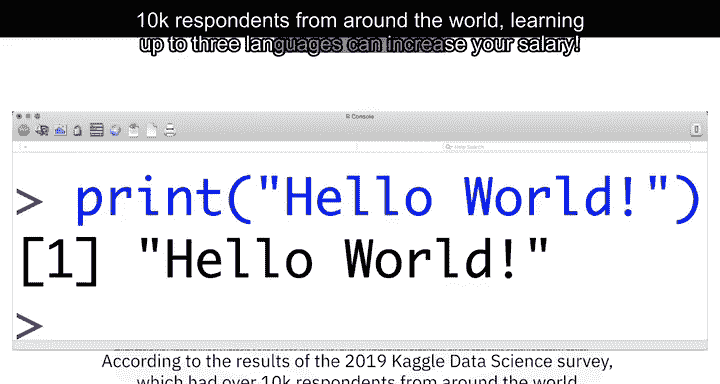

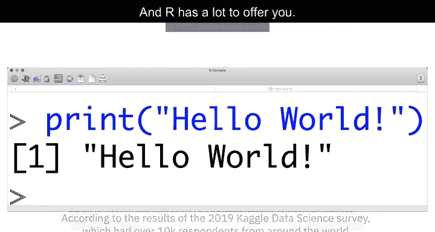

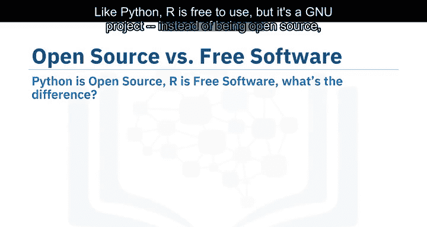

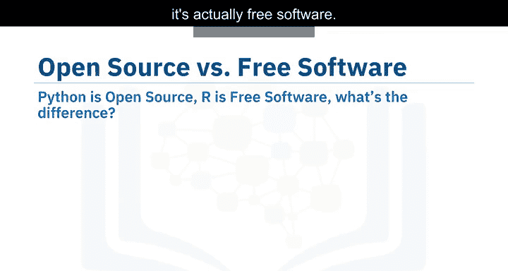

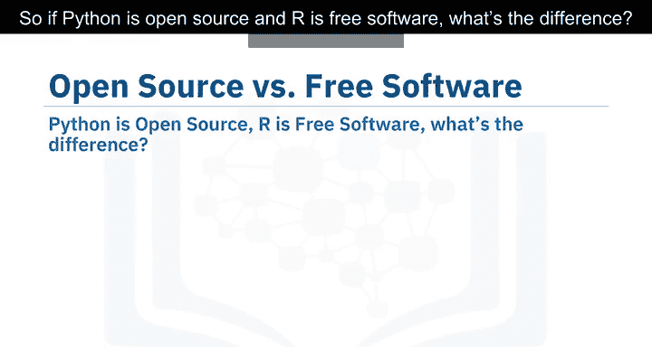

Both open source and free software support collaboration， in many cases。

 but not all these terms can be used interchangeably。 The Open source Iniative。

 O S I Champions Open source， While the Free Software Foundation， FSF defines free software。

Open source is more business focused， while free software is more focused on a set of values。

Back to why you should learn R， because it's a free software project。

 you can use the language in the same way that you contribute to open source。

 and it allows for public collaboration and private and commercial use Plus R is another language supported by a wide global community of people passionate about making it possible to use the language to solve big problems。

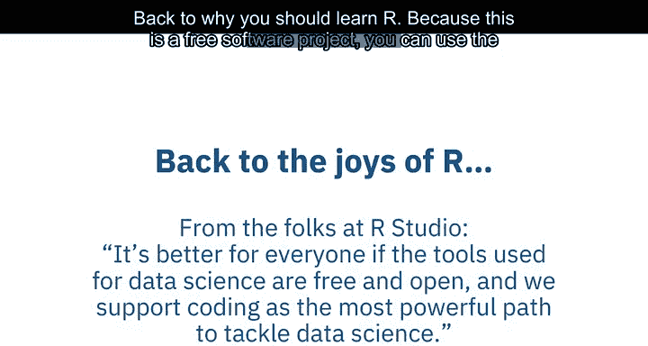

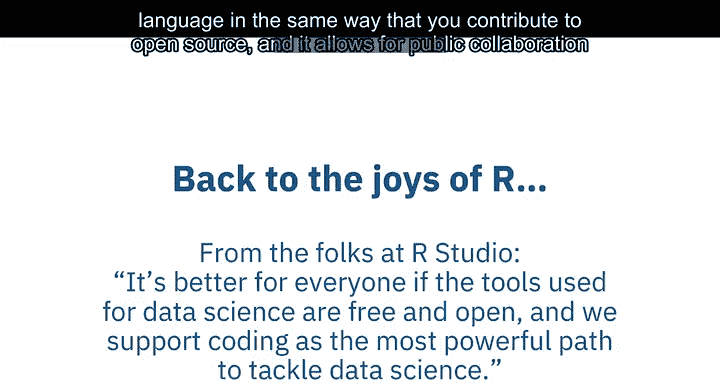

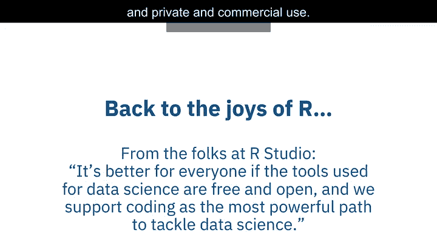

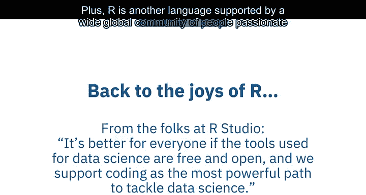

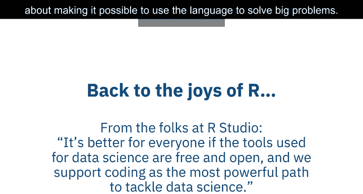

Who is R4 It's most often used by statisticians， mathematicians and data miners for developing statistical software。

 graphing and data analysis， the language's array oriented syntax makes it easier to translate from math to code。

 especially for someone with no or minimal programming background。

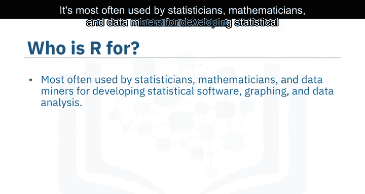

According to Kagggel's data science and machine learning survey。

 most folks learn R when they're a few years into their data science career。

 but it remains a welcoming language to those who don't have a software programming background。

R is popular in academia， but companies that use R include IBM， Google， Facebook， Microsoft。

 Bank of America， Ford， Tech Crurunch， Uber and Trulia。

R has become the world's largest repository of statistical knowledge as of 2018， R has more than 15。

000 publicly released packages， making it possible to conduct complex exploratory data analysis R integrates well with other computer languages such as C++ Java C。

 dotnet and Python， common mathematical operations such as matrix multiplication work straight out of the box。

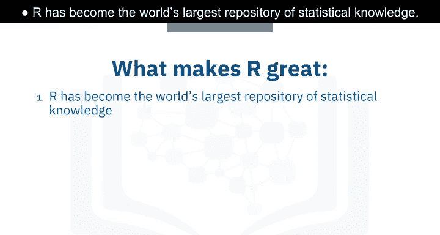

R has stronger object oriented programming facilities than most statistical computing languages。

There are many ways to connect with other R users around the globe， communities such as user YR。

 Saturdays and RLadies are all great to connect with。

 and you can also check out the R project website for R conferences and events。

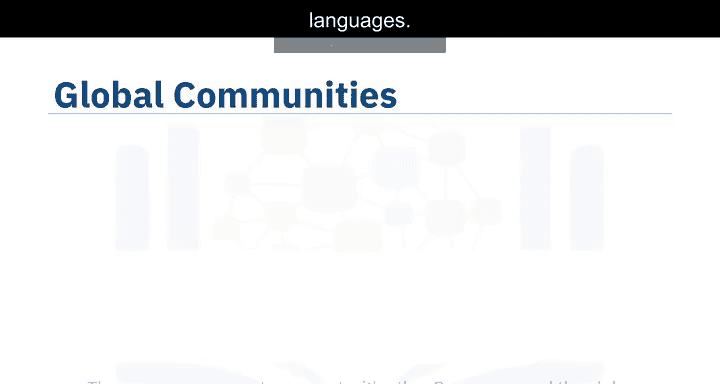

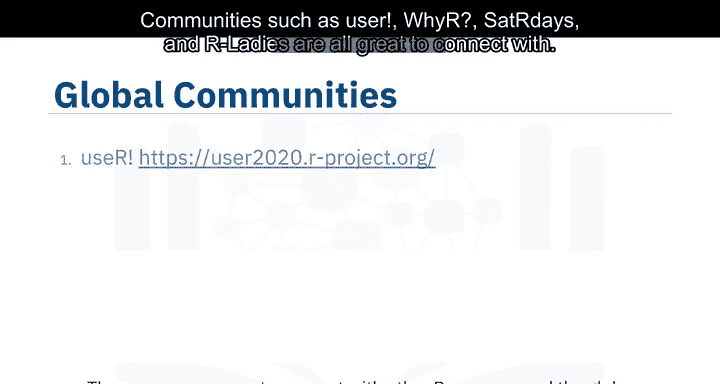

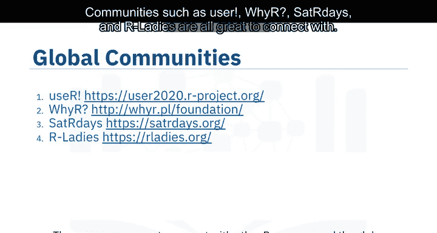