# IBM数据科学专业证书课程2：《数据科学工具》open-source-tools-for-data-science（中英字幕） - P5：4_SQL语言导论.zh_en - GPT中英字幕课程资源 - BV1np4y1V7Sn

In this video， we'll take a high level look at SQL。

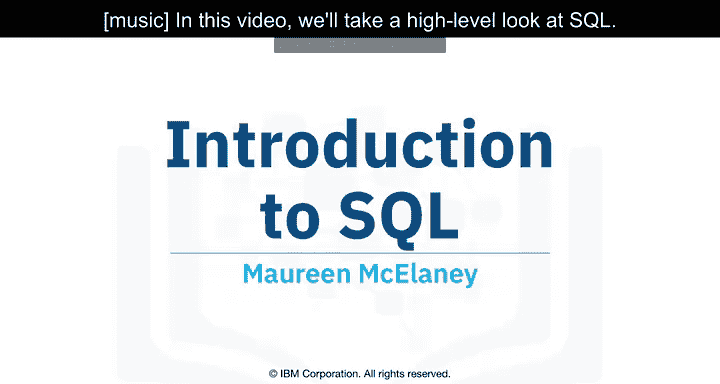

SQL is a bit different from other languages we've covered so far。 First off。

 it's formerly pronounced SQL， although some people say SQL。

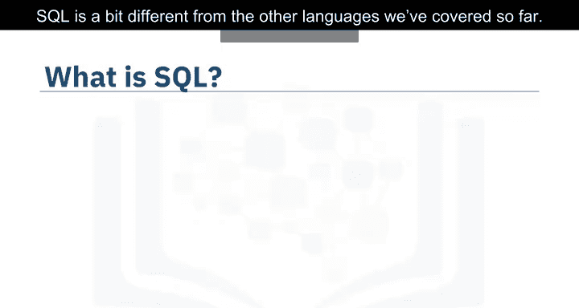

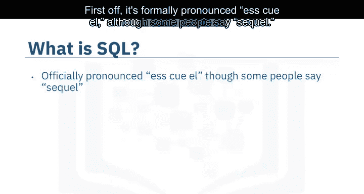

While the acronym stands for structured query language。

 many people do not consider SQL to be like other software development languages because it's a nonprocedural language and its scope is limited to querying and managing data。

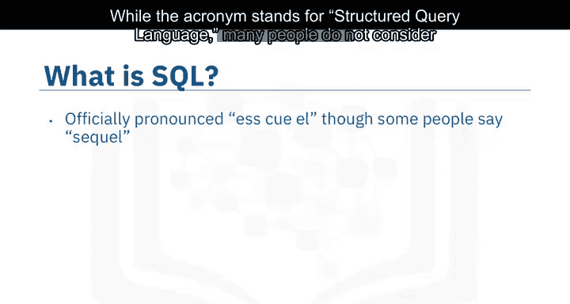

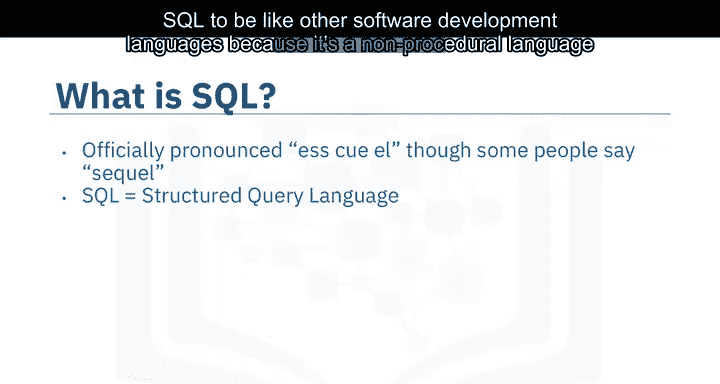

While it is not a data science language per se， data scientists regularly use it because it's simple and powerful。

Another couple of neat facts about SQL。 It's much older than Python and R by about 20 years。

 having first appeared in 1974， and SQL was developed at IBM。

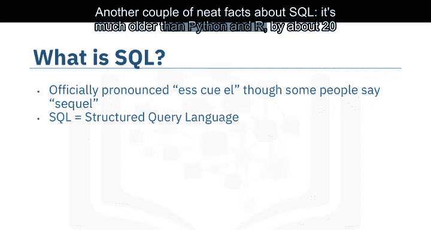

This language is useful in handling structured data。

 that is the data incorporating relations among entities and variables。

SQL was designed for managing data in relational databases Here you see a diagram showing the general structure of a relational database。

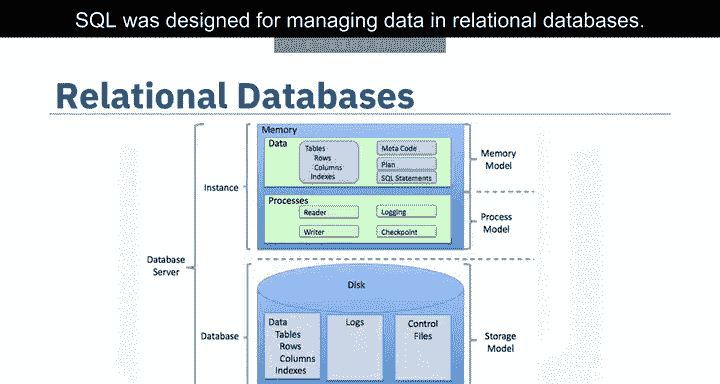

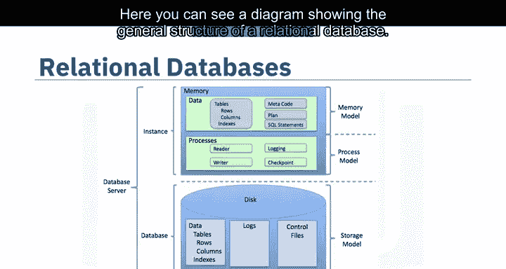

A relational database is formed by collections of two dimensional tables， for example。

 datas and Microsoft Excel spreadsheets。

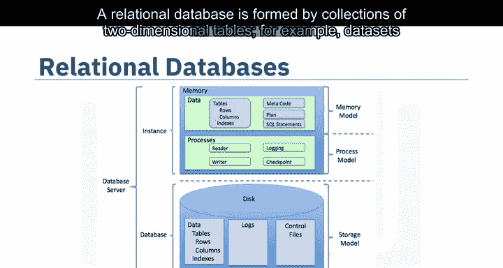

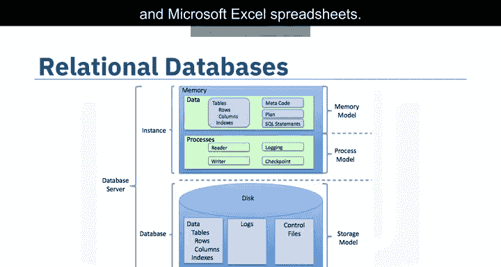

Each of these tables is then formed by a fixed number of columns and any number of rows。

 but even though SQL was originally developed for use with relational databases。

 because it's so pervasive and easy to use， SQL interfaces for many no SQL and big data repositories have also been developed。

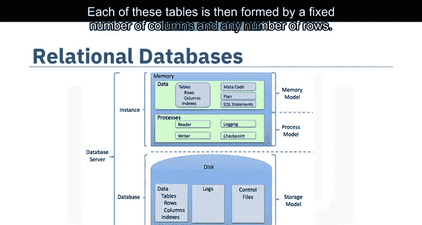

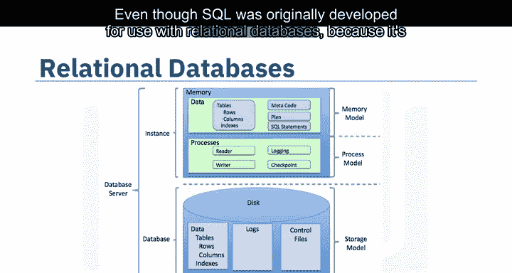

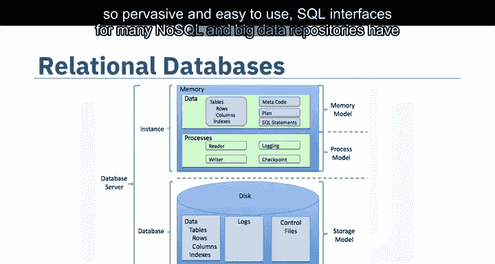

The SQL language is subdivided into several language elements including clauses， expressions。

 predicates， queries and statements， so what makes SQL great？

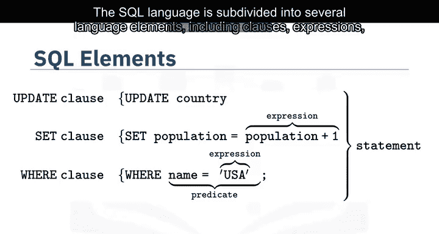

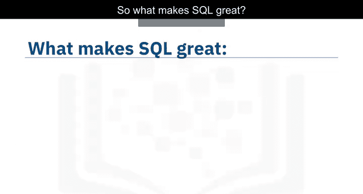

Knowing SQL will help you do many different jobs in data science。

 including business and data analyst， and it's a must in data engineering。

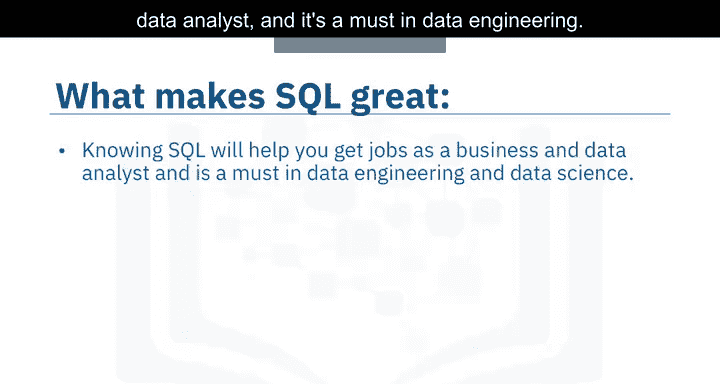

When performing operations with SQL， you access the data directly。

 there's no need to copy it beforehand。 this can speed up workflow executions considerably。

SQL is the interpreter between you and the database。

 SQL is an American National Standards Institute or AsI standard。

 which means if you learn SQL and use it with one database。

 you will be able to easily apply that SQL knowledge to many other databases。

There are many different SQL databases available， including My SQL， IM DB2， PostgresQL。

 Apache Open Office B， SQL， Oracle， Maria DB， Microsoft SQL Ser and more。

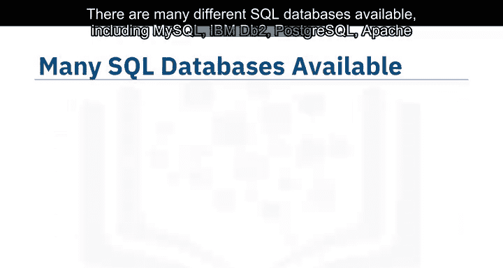

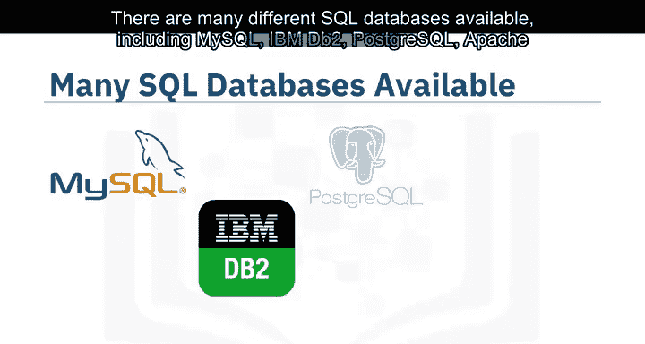

The syntax for the SQL you write might change a little bit based on the relational database management system you're using。

If you're looking to learn SQL， you might be best serve to focus on a specific relational database and then plug into the community for that specific platform。

 There are many great introductory courses on SQL available。

