# IBM数据科学专业证书课程2：《数据科学工具》open-source-tools-for-data-science（中英字幕） - P6：5_其他编程语言.zh_en - GPT中英字幕课程资源 - BV1np4y1V7Sn

So far we've reviewed Python R and SQL in this video。

 we will review some other languages that have compelling use cases for data science。

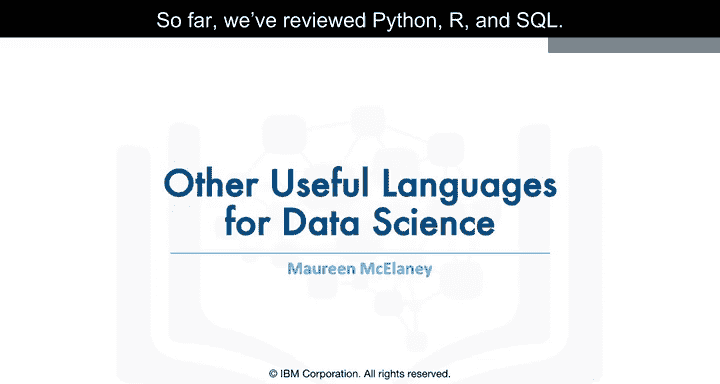

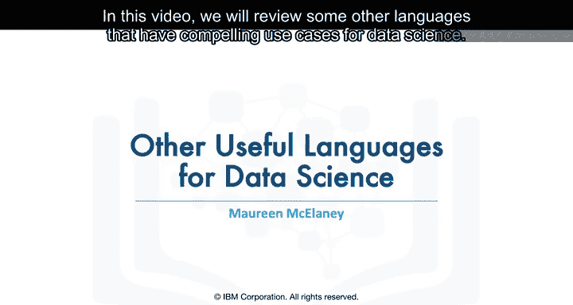

Okay， so indisputably Python R and SQL are the three most popular languages that data scientists use。

 but there are many， many other languages that are worth your time when considering which language to use to solve a particular data science problem。

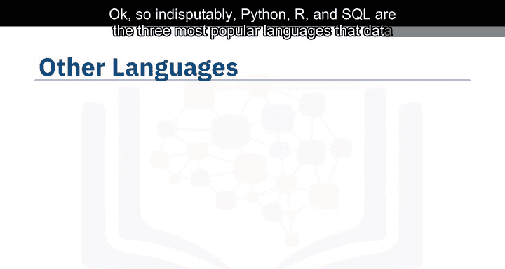

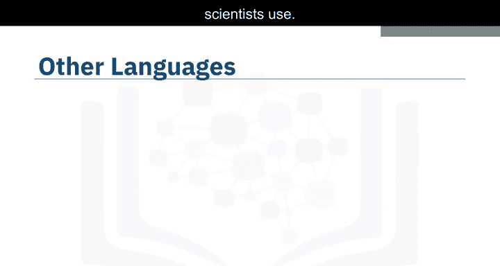

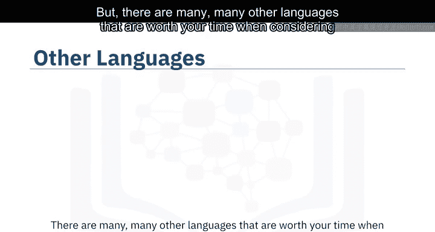

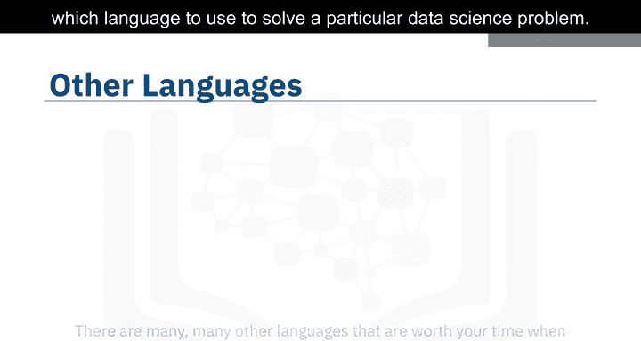

Scala， Java， C++ and Julia are probably the most traditional data science languages on this slide。

 but Javascript， PhP， Go， Ruby， visual， basicsic and others have all found their place in the data science community as well。

 I won't dive as deeply into each of these languages， but I'll mention some notable highlights。

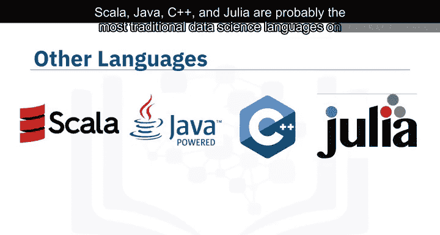

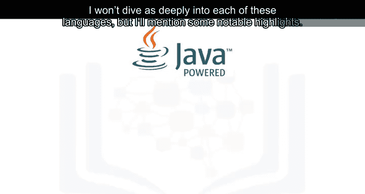

Java is a tried and true general purpose， object oriented programming language。

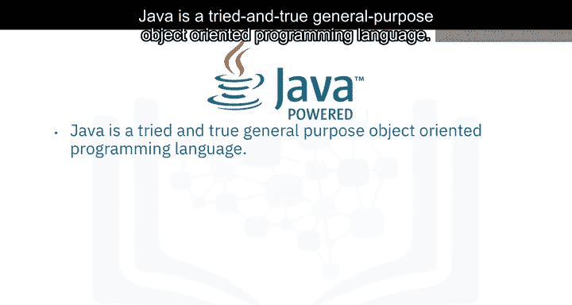

It's been widely adopted in the enterprise space and is designed to be fast and scalable。

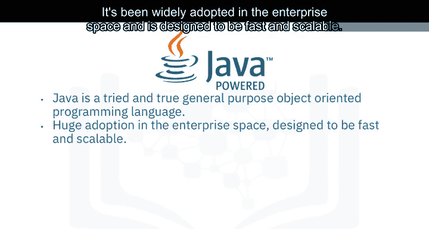

Java applications are compiled to Btecode and run on the Java virtual machine or JVM。

 Some notable data science tools built with Java include WCCca for data mining， Java M。

 which is a machine learning library， Apache ML Lib。

 which makes machine learning scalable and Deep learning 4J for deep learning。

Apache Hadoop is another Java built application， it manages data processing and storage for big data applications running in clustered systems。

ScaalA is a general purpose programming language that provides support for functional programming and a strong static type system。

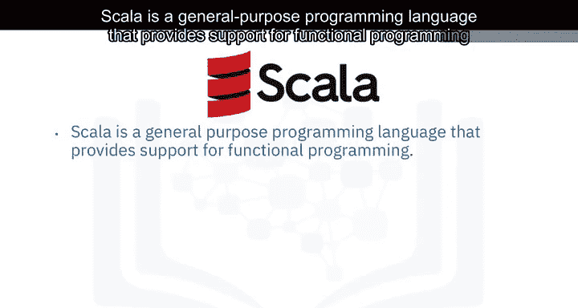

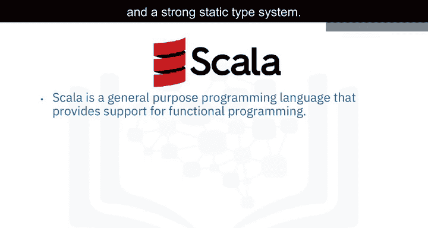

Many of the design decisions in the construction of the scholar language were made to address criticisms of Java。

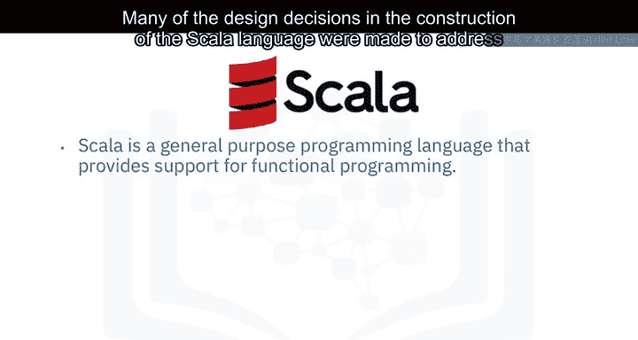

Scala is also interoperable with Java as it runs on the JVM。

 the name Scala is a combination of scalable and language。

 This language is designed to grow along with the demands of its users。

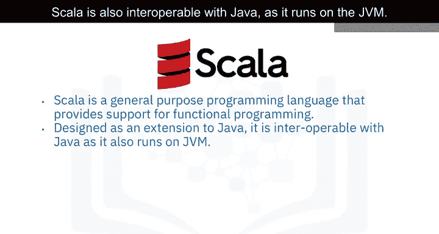

For data science， the most popular program built using Scala is Apache Spark Spark is a fast and general purpose cluster computing system。

 it provides APIs that make parallel jobs easy to write and an optimized engine that supports general computation graphs。

Spark includes Shark， which is a query engine， ML Lib for machine learning。

 Gra X for graph processing and Sp streaming。 Apache Spark was designed to be faster than Hadoop。

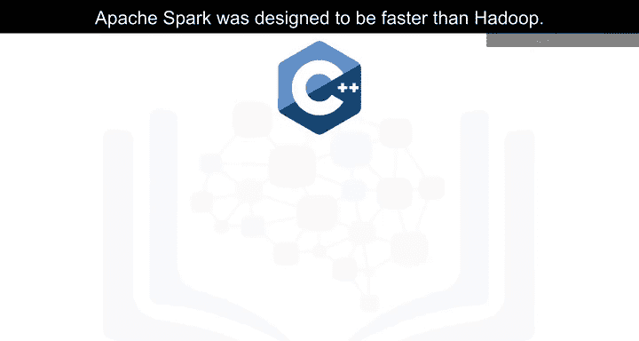

C++ is a general purpose programming language， it is an extension of the C programming language or C with classes。

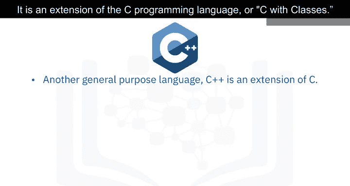

C++ improves processing speed， enables system programming。

 and provides broader control over the software application。

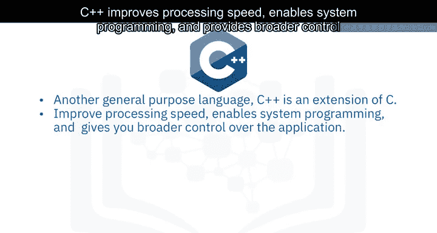

Many organizations that use Python or other high level languages for data analysis and exploratory tasks still rely on C++ to develop programs that feed that data to customers in real time。

For data science， a popular deep learning library for dataFlow called TensorFlow was built with C++。

 but while C++ is the foundation of TensorFlow， it runs on a Python interface so you don't need to know C++ to use it。

Mongo DB， a no SQL database for big data management， was built with C++。

Cafe is a deep learning algorithm repository built with C++ with Python and MATlab bindings。

A core technology for the World W web JavaScript is a general purpose language that extended beyond the browser with the creation of nodede JS and other serverside approaches JavaScript is not related to Java language。

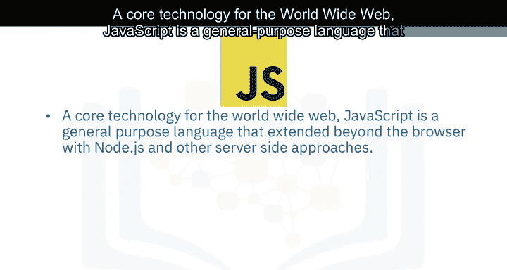

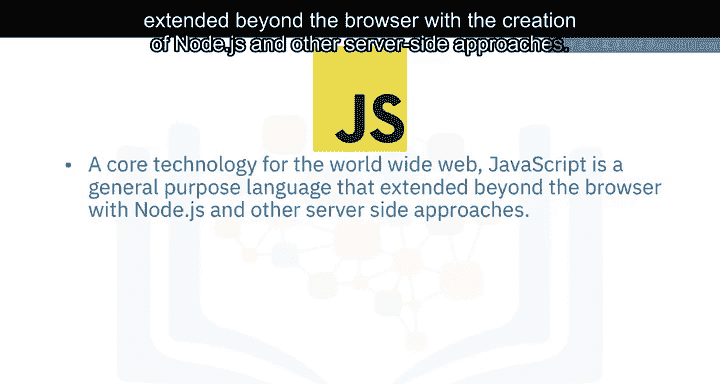

For data science， the most popular implementation is undoubtedly Tensorflow JS。

TensorF JS makes machine learning and deep learning possible in nodede JS， as well as in the browser。

TensorFlow JS was also adopted by other open source libraries， including Brain JS and Maine Learn JS。

The RJS project is another great implementation of JavaScript for data science。

RJS has rewritten linear algebra specifications from the R language into Typecr。

This rewrite will provide a foundation for other projects to implement more powerful math based frameworks like Numpy and Sci Pi of Python。

Typecrt is a superet of JavaScript。Julia was designed at MIT for high performance numerical analysis and computational science。

 it provides speedy development like Python or R while producing programs that run as fast as C or forran programs。

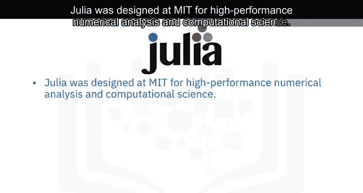

Julia is compiled， which means that the code is executed directly on the processor as executable code。

 it calls C， go， Java， MATLb， R， Fortran and Python libraries， and has refined parallelism。

The Julia language is relatively new， having been written in 2012。

 but it has a lot of promise for future impact on the data science industry。

Julia Db is a particularly useful application of Julia for data science。

 It's a package for working with large， persistent data sets。

That's as far as we'll dig into the many languages that are used to solve data science problems。

 If you have experience with a particular language。

 I recommend you do a web search to see what might already be possible in terms of using it for data science。

 You might be surprised at the possibilities。

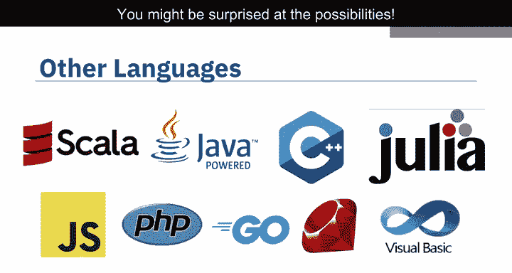