# IBM数据科学专业证书课程2：《数据科学工具》open-source-tools-for-data-science（中英字幕） - P7：6_数据科学工具分类.zh_en - GPT中英字幕课程资源 - BV1np4y1V7Sn

Open source tools are available for various data science tasks In this video。

 we'll have a look at the different data science tasks。 In subsequent videos。

 we'll walk through the most commonly used open source tools for those tasks。

 The most important tools are covered throughout this course。

 data management is the process of persisting and retrieving data。

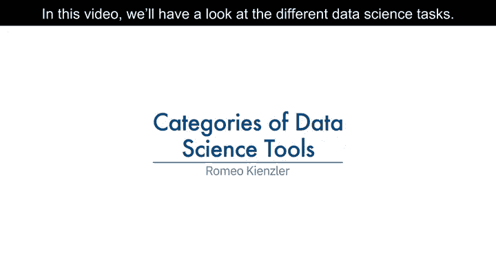

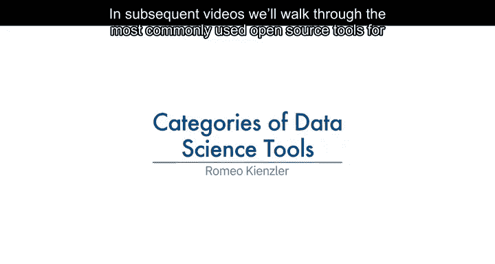

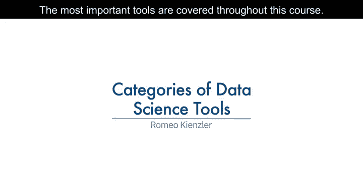

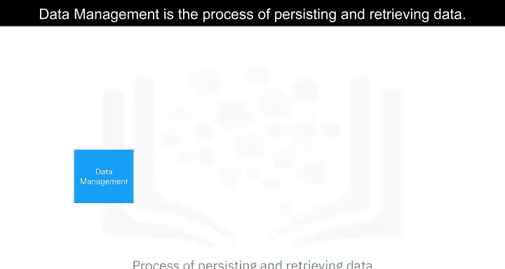

Data integration and transformation， often referred to as extract transformform and load。

 or ETL is the process of retrieving data from remote data management systems。

 transforming data and loading it into a local data management system is also part of data integration and transformation。

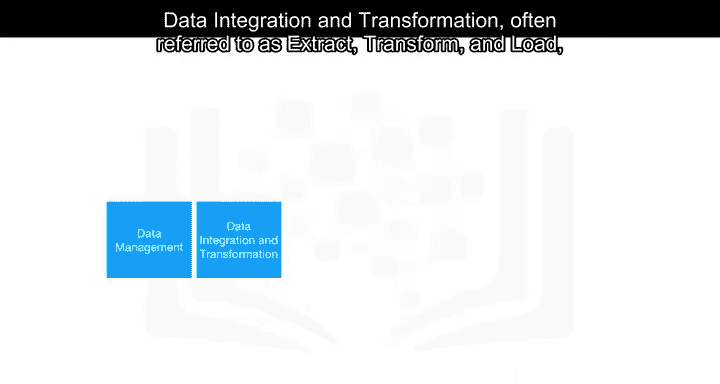

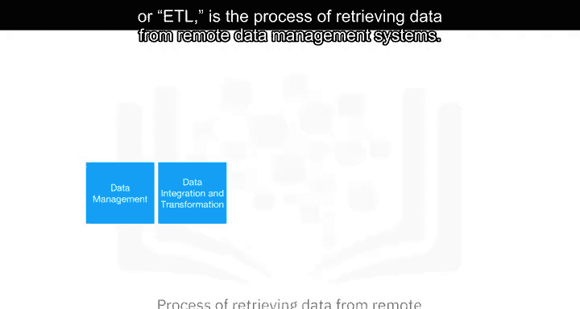

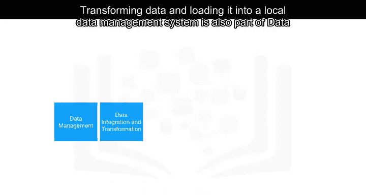

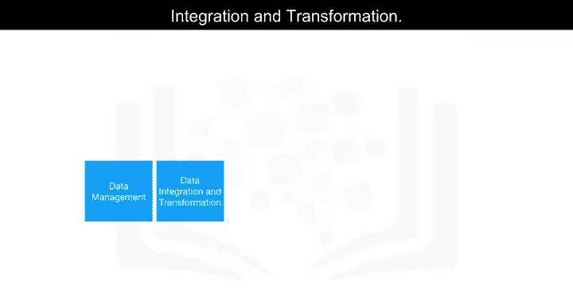

Data visualization is part of an initial data exploration process。

 as well as being part of a final deliverable。

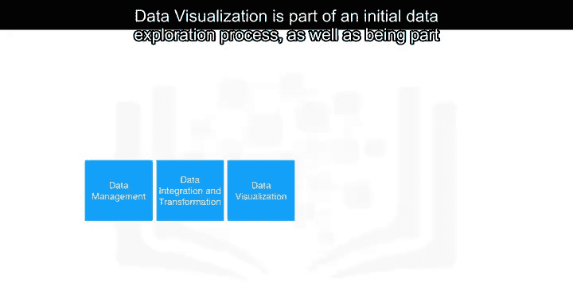

Model building is the process of creating a machine learning or deep learning model。

 using an appropriate algorithm with a lot of data。

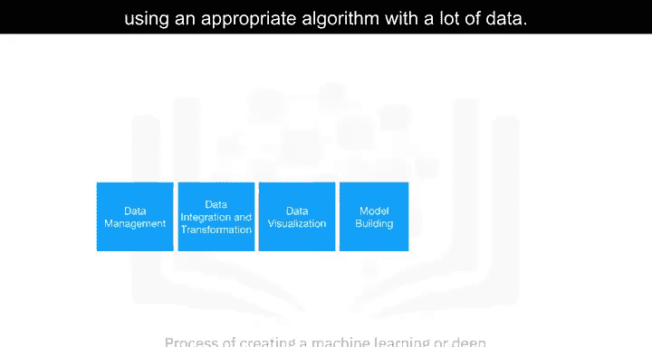

Model deployment makes such a machine learning or deep learning model available to third party applications。

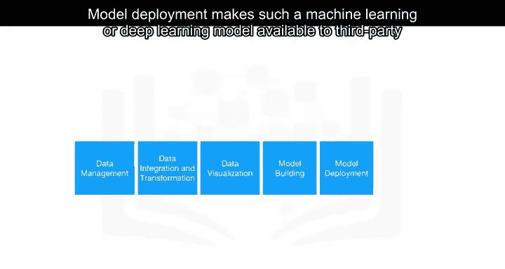

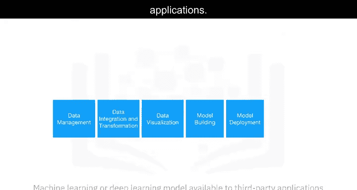

Model monitoring and assessment ensures continuous performance quality checks on the deployed models。

 These checks are for accuracy， fairness and adversarial robustness。

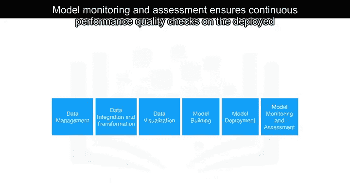

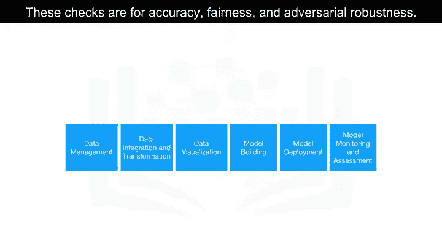

Code asset management uses versioning and other collaborative features to facilitate teamwork。

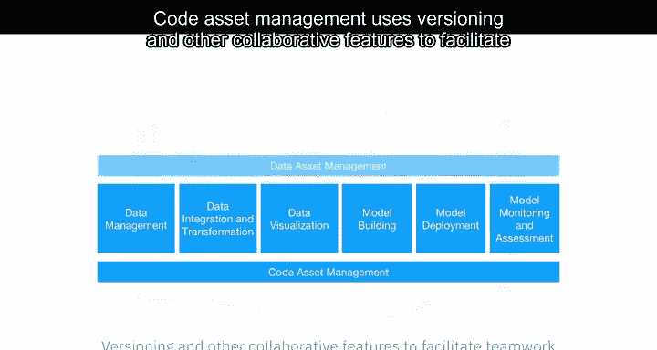

Data asset management also supports replication， backup， and access rights management。

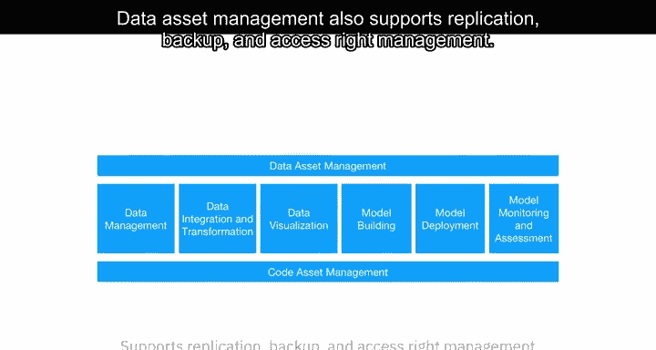

Development environmentments， commonly known as integrated development environmentments or IDEs。

 are tools that help the data scientists to implement， execute， test， and deploy their work。

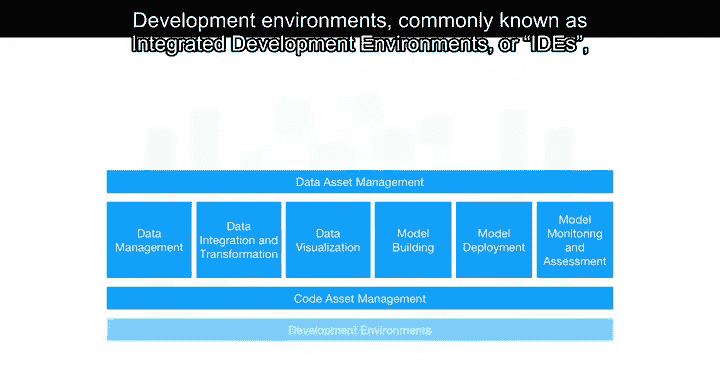

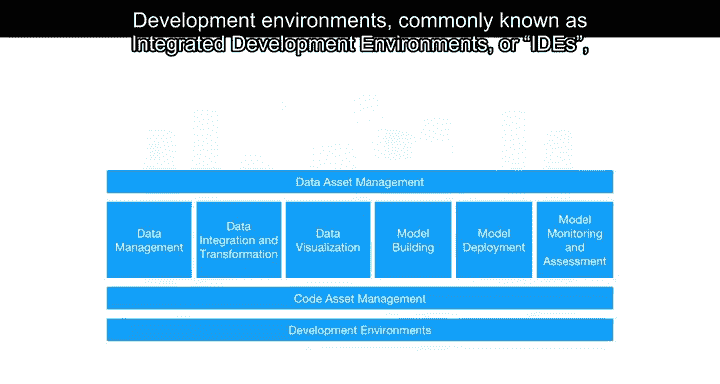

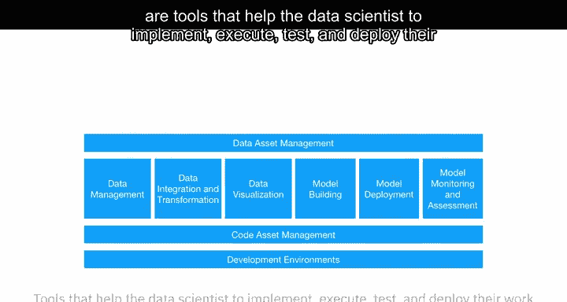

Execution environments are tools where data processing。

 model training and deployment take place Finally， there is fully integrated visual tooling available that covers all the previous tooling components。

 either partially or completely。

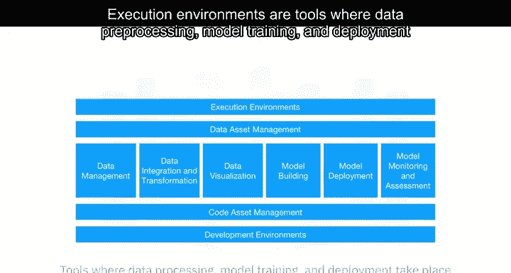

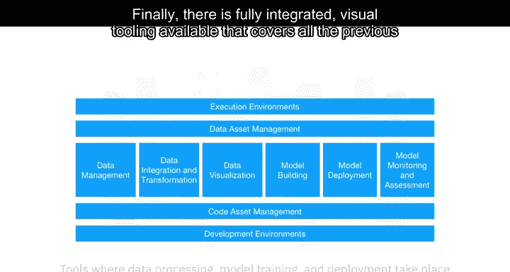

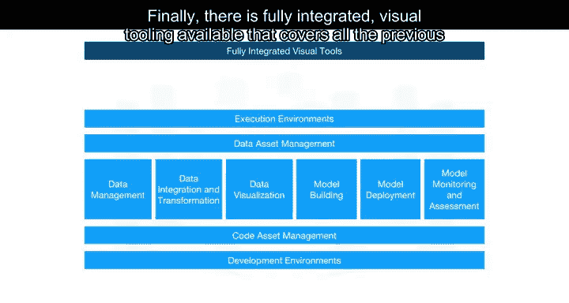

This concludes this video in the next video we'll start looking at open source tools for data science tasks。

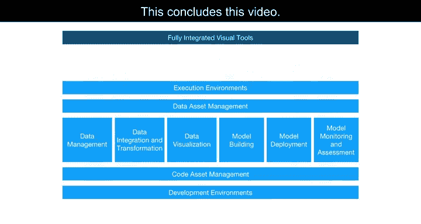

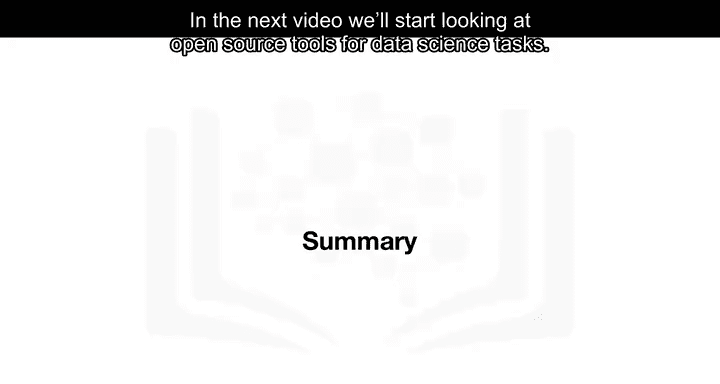