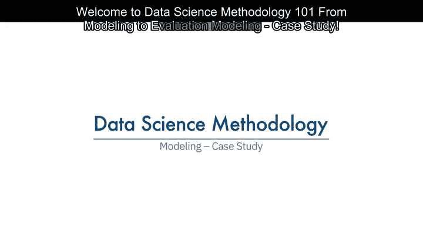
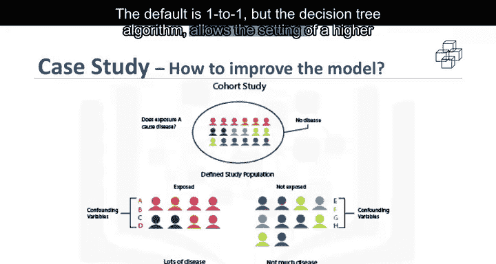

# IBM数据科学专业证书课程3：《数据科学方法论》data-science-methodology（中英字幕） - P10：9_建模案例研究.zh_en - GPT中英字幕课程资源 - BV18P411475T

Welcome to Data Science Methology 101 from modeling to evaluation， modeling， case study。

Modeling is the stage in the data science methodology where the data scientist has the chance to sample the sauce and determine if it's bang on or in need of more seasoning。

Now， let's apply the case study to the modeling stage within the data science methodology Here we'll discuss one of the many aspects of model building。

 In this case， parameter tuning to improve the model。

With a prepared training set， the first decision tree classification model for congestive heart failure readmission can be built。

We are looking for patients with high risk readmission。

 so the outcome of interest will be congestive heart failure readmission equals yes。

In this first model， overall accuracy in classifying the yes and no outcomes was 85% cent。

This sounds good， but it represents only 45 per cent of the yes。

The actual readmissions are correctly classified， meaning that the model is not very accurate。

The question then becomes， how could the accuracy of the model be improved in predicting the yes outcome。

For decision tree classification， the best parameter to adjust is the relative cost of misclassified yes and no outcomes。

Think of it like this When a true non readmission is misclassified and action is taken to reduce that patient's risk。

 the cost of that error is the wasted intervention。 A statistician calls this a type 1 error。

 or a false positive。But when a true readmission is misclassified and no action is taken to reduce the risk。

 then the cost of that error is the readmission and all its attended costs。

 plus the trauma of the patient。This is a type 2 error or a false negative。

So we can see that the cost of the two different kinds of misclassification errors can be quite different。

For this reason， it's reasonable to adjust the relative weights of misclassifying the yes and no outcomes。

The default is one to one， but the decision tree algorithm allows the setting of a higher value for yes。

For the second model， the relative cost was set at 9 to 1。 This is a very high ratio。

 but gives more insight to the model's behavior。This time。

 the model correctly classified 97 per cent of the yes。

 but at the expense of a very low accuracy on the no， with an overall accuracy of only 49 per cent。

 This was clearly not a good model。The problem with this outcome is a large number of false positives。

 which would recommend unnecessary and costly intervention for patients who would not have been readmitted anyway。

Therefore， the data scientist needs to try again to find a better balance between the yes and no accuracies。

For the third model， the relative cost was set at a more reasonable 4 to1。 This time。

68% cent accuracy was obtained on only yes， called sensitivity by statisticians and 85% cent accuracy on the no called specificity with an overall accuracy of 81% cent。

This is the best balance that can be obtained with a rather small training set through adjusting the relative cost of misclassified。

 yes and no outcomes parameter。A lot more work goes into the modelling， of course。

 including iterating back to the data preparation stage to redefine some of the other variables so as to better represent the underlying information and thereby improve the model。

This concludes the modeling section of the course in which we applied the case study to the modeling stage within the data science methodology。

