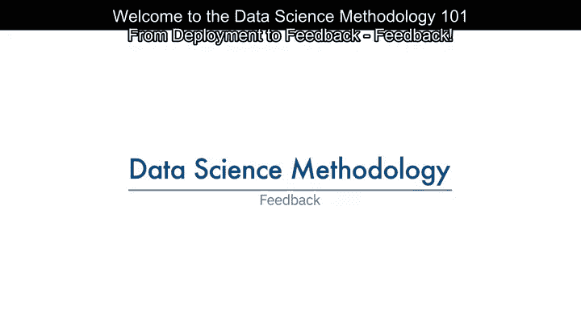
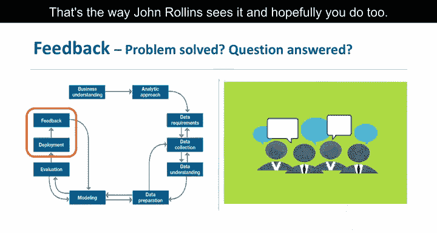
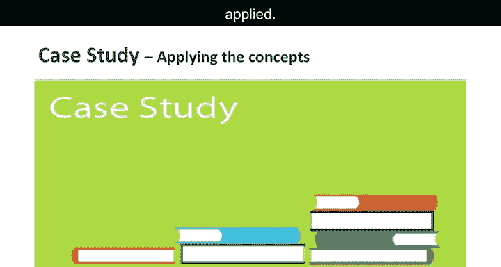

# IBM数据科学专业证书课程3：《数据科学方法论》data-science-methodology（中英字幕） - P13：12_反馈机制.zh_en - GPT中英字幕课程资源 - BV18P411475T

Welcome to Data Science Meology 101 from deployment to feedback feedback。

Once in play， feedback from the users will help to refine the model and assess it for performance and impact。

The value of the model will be dependent on successfully incorporating feedback and making adjustments for as long as the solution is required。

Throughout the data science methodology， each step sets the stage for the next。

 Ma the methodology cyclical ensures refinement at each stage in the game。

The feedback process is rooted in the notion that the more you know。

 the more that you'll want to know。 That's the way John Rollins sees it。 And hopefully， you do， too。

Once the model is evaluated and the data scientist is confident it'll work。

 it's deployed and put to the ultimate test， actual real time use in the field。

So now let's look at our case study again to see how the feedback portion of the methodology is applied。

The plan for the feedback stage included these steps。 First。

 the review process would be defined and put into place with overall responsibility for measuring the results of the flying to risk model of the congestive heart failure risk population。

 Clinical management executives would have overall responsibility for the review process。Second。

 congestive heart failure patients receiving intervention would be tracked and their readmission outcomes recorded。

Third， the intervention would then be measured to determine how effective it was in reducing readmissions。

For ethical reasons， congestive heart failure patients would not be split into controlled and treatment groups。

 Instead， readmission rates would be compared before and after the implementation of the model to measure its impact。

After the deployment and feedback stages， the impact of the intervention program on readmission rates would be reviewed after the first year of its implementation。

Then the model would be refined based on all the data compiled after model implementation and the knowledge gained throughout these stages。

Other refinements included， incorporating information about participation in the intervention program and possibly refining the model to incorporate detailed pharmaceutical data。

If you recall， data collection was initially deferred because the pharmaceutical data was not readily available at the time。

But after feedback and practical experience with the model。

 it might be determined that adding that data could be worth the investment of effort and time。

We also have to allow for the possibility that other refinements might present themselves during the feedback stage。

Also， the intervention， actions and processes would be reviewed and very likely refined as well。

 based on the experience and knowledge gained through initial deployment and feedback。Finally。

 the refined model and intervention actions would be redeployed。

 with the feedback process continued throughout the life of the intervention program。

This is the end of the feedback portion of this course。 Thanks for watching。

