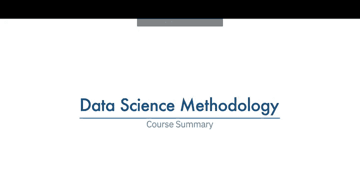
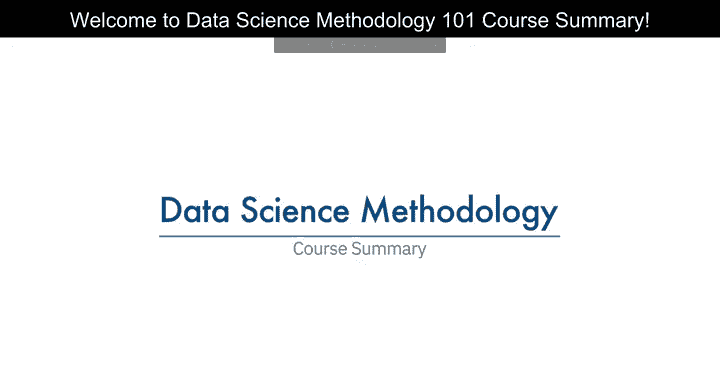
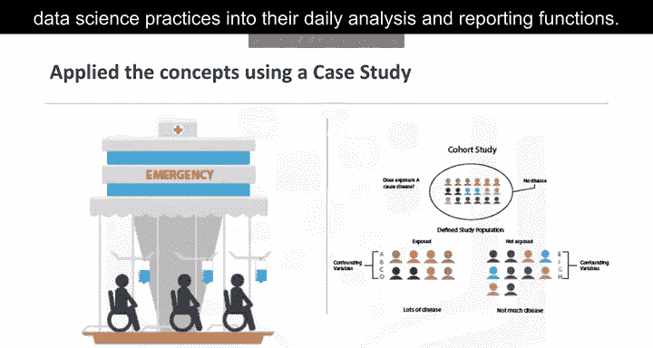
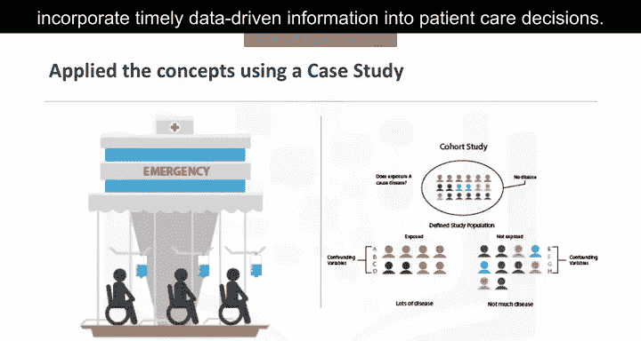

# IBM数据科学专业证书课程3：《数据科学方法论》data-science-methodology（中英字幕） - P14：13_课程总结.zh_en - GPT中英字幕课程资源 - BV18P411475T

Welcome to Data Science Methology 101 Co summaryary。

We've come to the end of our story， one that we hope you'll share。

 You've learned how to think like a data scientist。

 including taking the steps involved in tackling a data science problem and applying them to interesting。

 real world examples。These steps have included forming a concrete business or research problem。

 collecting and analyzing data， building a model and understanding the feedback after model deployment。

In this course， youve also learned methodical ways of moving from problem to approach。

 including the importance of understanding the question， the business goals and objectives。

 and picking the most effective analytic approach to answer the question and solve the problem。

You've also learned methodical ways of working with the data。

 specifically determining the data requirements， collecting the appropriate data。

 understanding the data， and then preparing the data for modeling。

You've also learned how to model the data by using the appropriate analytical approach based on the data requirements and the problem you're trying to solve。

Once the approach was selected， you learn the steps involved in evaluating and deploying the model。

 getting feedback on it， and using that feedback constructively so as to improve the model。

Remember that the stages of this methodology are iterative。

 This means that the model can always be improved for as long as the solution is needed。

 regardless of whether the improvements come from constructive feedback or from examining newly available data sources。

Using a real case study， youll learn how data science methodology can be applied in context toward successfully achieving the goals that were set out in the business requirement stage。

You also saw how the methodology contributed additional value to business units by incorporating data science practices into their daily analysis and reporting functions。

The success of this new pilot program that was reviewed in the case study was evident by the fact that physicians were able to deliver better patient care by using new tools to incorporate timely data driven information into patient care decisions。

And finally， you learned in a nutshell the true meaning of a methodology。

That its purpose is to explain how to look at a problem。

 work with data in support of solving the problem and come up with an answer that addresses the root problem by answering 10 simple questions methodically。

 we've taught you that a methodology can help you to solve not only your data science problems。

 but also any other problem。Your success within the data science field depends on your ability to apply the right tools at the right time。

 in the right order to address the right problem。And that is the way John Roowland sees it。

We hope you've enjoyed taking the data science methodology course and found it to be a valuable experience。

 one that you'll share with others。And of course， we also hope that you'll review and take other data science courses in the data science fundamentalamentals learning path。

Now， if you're ready and up to the challenge， please take the final exam。Thanks for watching。

