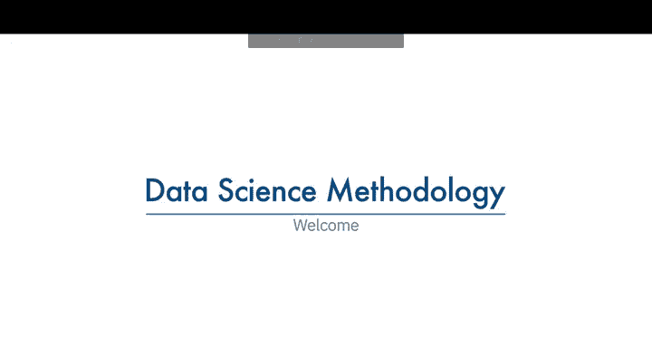
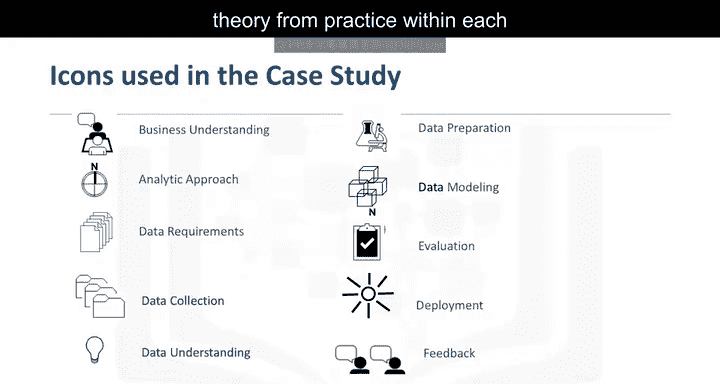
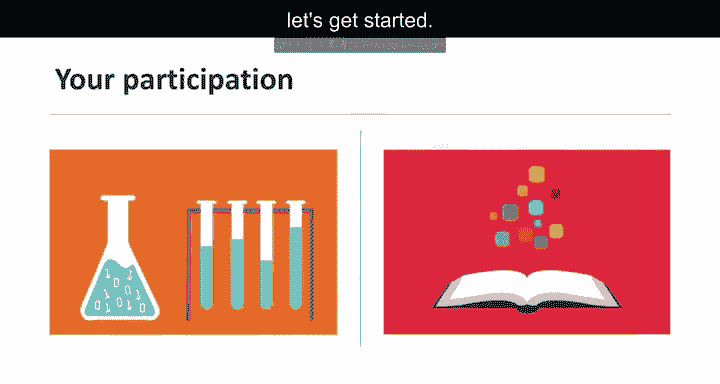

# IBM数据科学专业证书课程3：《数据科学方法论》data-science-methodology（中英字幕） - P1：0_课程导论.zh_en - GPT中英字幕课程资源 - BV18P411475T

Welcome to Data Science Methology 101。

This is the beginning of a story， one that you'll be telling others about for years to come。

 It won't be in the form you experience here， but rather through the stories you'll be sharing with others as you explain how your understanding of a question resulted in an answer that changed the way something was done。

Despite the recent increase in computing power and access to data over the last couple of decades。

 our ability to use the data within the decision making process is either lost or not maximizeimd as all too often。

 we don't have a solid understanding of the questions being asked and how to apply the data correctly to the problem at hand。

Here is a definition of the word methodology。 It's important to consider it because all too often there's a temptation to bypass methodology and jump directly to solutions。

 Doing so， however， hinders our best intentions in trying to solve the problem。

This course has one purpose， and that is to share a methodology that can be used within data science to ensure that the data used in problem solving is relevant and properly manipulated to address the question at hand。

The data science methodology discussed in this course has been outlined by John Rawlins。

 a seasoned and senior data scientist currently practicingrac at IBM。

This course is built on his experience and expresses his position on the importance of following a methodology to be successful。

In a nutshell， the data science methodology aims to answer 10 basic questions in a prescribed sequence。

As you can see from this slide， there are two questions designed to define the issue and thus determine the approach to be used。

 Then there are four questions that will help you get organized around the data you'll need。

 And finally， there are four additional questions aimed at validating both the data and the approach that gets designed。

Please take a moment now to familiarize yourself with the 10 questions as they'll be vital to your success。

This course is comprised of several components。 There are five modules。

 each going through two stages of the methodology， explaining the rationale as to why each stage is required。

Within the same module， a case study is shared that supports what you've just learned。

There's also a hands on lab which helps to apply the material。 And finally。

 there are three review questions to test your understanding of the concepts。When you're ready。

 take the final exam。The case study included in the course highlights how the data science methodology can be applied in context。

It revolves around the following scenario。There's a limited budget for providing health care to the public。

 Hospital readmissions for reoccurring problems can be seen as a sign of failure in the system to properly address the patient condition prior to the initial patient discharge。

 The core question is， what is the best way to allocate these funds to maximize their use in providing quality care。

As you'll see， if the new data Science pilot program is successful。

 it will deliver better patient care by giving physicians new tools to incorporate timely data driven information into patient care decisions。

The case study sections display these icons at the top right hand corner of your screen to help you differentiate theory from practice within each module。

A glossary of data science terms is also provided to assist with clarifying key terms used within the course。

While participating in the course， if you come across some challenges or have some questions。

 then please explore the discussion and wki sessions。So now that you're all set。

 adjust your headphones and let's get started。

