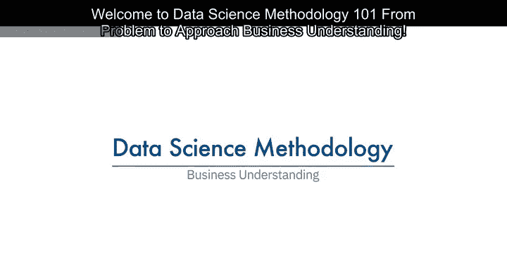
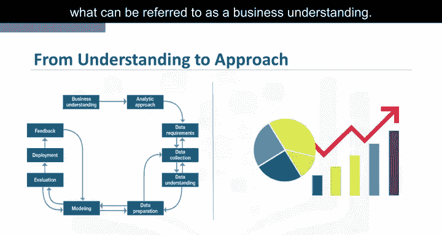
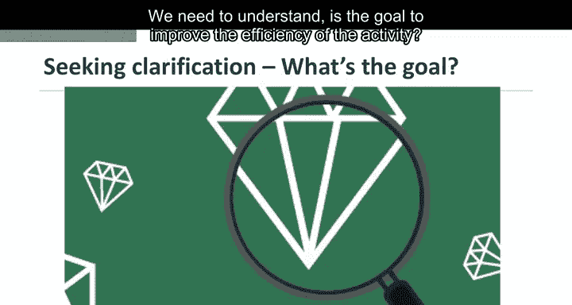
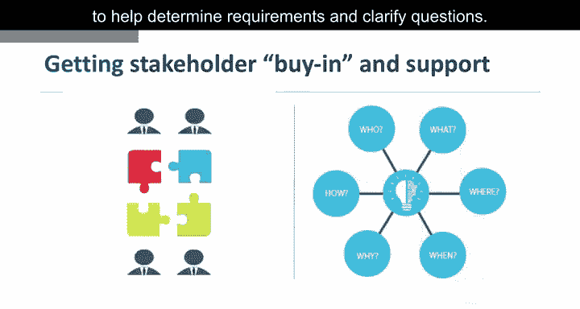
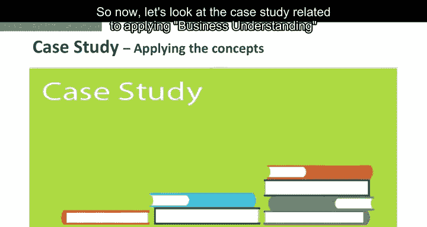
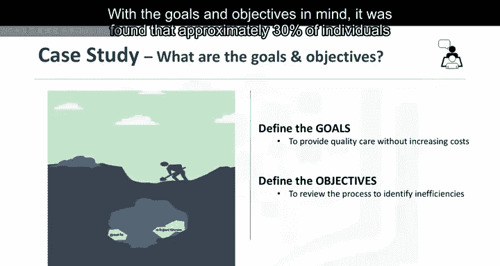
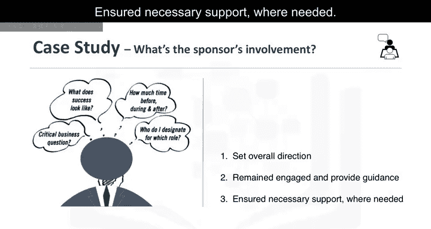
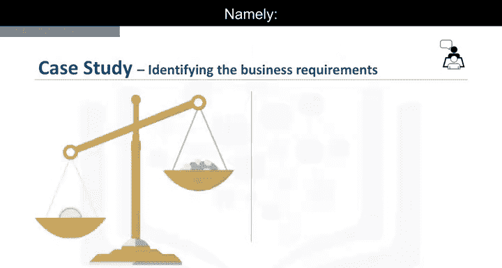

# IBM数据科学专业证书课程3：《数据科学方法论》data-science-methodology（中英字幕） - P2：1_业务理解.zh_en - GPT中英字幕课程资源 - BV18P411475T

Welcome to data Science methodology 101 from problem to approach， business understanding。

Has this ever happened to you， You've been called into a meeting by your boss who makes you aware of an important task。

 one with a very tight deadline that absolutely has to be met。

You both go back and forth to ensure that all aspects of the tasks have been considered。

 and the meeting ends， with both of you confident that things are on track。Later that afternoon。

 however， after you've spent some time examining the various issues at play。

 you realize that you need to ask several additional questions in order to truly accomplish the task。

Unfortunately， the boss won't be available again until tomorrow morning。Now。

 with a tight deadline still ringing in your ears， you start feeling a sense of uneasiness。

 So what do you do， Do you risk moving forward or do you stop and seek clarification。

Data science methodology begins with spending the time to seek clarification。

 to attain what can be referred to as a business understanding。

Having this understanding is placed at the beginning of the methodology because getting clarity around the problem to be solved allows you to determine which data will be used to answer the core question。

Roawin suggests that having a clearly defined question is vital because it ultimately directs the analytic approach that will be needed to address the question。

All too often， much effort is put into answering what people think is the question。

 And while the methods used to address that question might be sound。

 they don't help to solve the actual problem。Establishing a clearly defined question starts with understanding the goal of the person who's asking the question。

For example， if a business owner asks， how can we reduce the cost of performing an activity。

 we need to understand is the goal to improve the efficiency of the activity or is it to increase the business's profitability。

Once the goal is clarified， the next piece of the puzzle is to figure out the objectives that are in support of the goal。

By breaking down the objectives， structured discussions can take place where priorities can be identified in a way that can lead to organizing and planning on how to tackle the problem。

Depending on the problem， different stakeholders will need to be engaged in the discussion to help determine requirements and clarify questions。

So now let's look at the case study related to applying business understanding。

In the case study， the question being asked is， what is the best way to allocate the limited health care budget to maximize its use in providing quality care。

This question is one that became a hot topic for an American healthcare care insurance provider。

As public funding for readmissions was decreasing， this insurance company was at risk of having to make up for the cost difference。

 which could potentially increase rates for its customers。

Knowing that raising insurance rates was not going to be a popular move。

 the insurance company SAT down with the health care authorities in its region and brought in IBM data scientists to see how data science could be applied to the question at hand。

Before even starting to collect data， the goals and objectives needed to be defined After spending time to determine the goals and objectives。

 the team prioritized patient readmissions as an effective area for review。

With the goals and objectives in mind， it was found that approximately 30 per cent of individuals who finish rehab treatment would be readmitted to a rehab center within one year and that 50 per cent would be readmitted within five years。

After reviewing some records， it was discovered that the patients with congestive heart failure were at the top of the readmission list。

 It was further determined that a decision tree model could be applied to review the scenario to determine why this was occurring。

To gain the business understanding that would guide the analytics team in formulating and performing their first project。

The IBM data scientist proposed and delivered an onsite workshop to kick things off。

The key business sponsor's involvement throughout the project was critical in that the sponsor set over all direction。

 remained engaged and provided guidance and ensured necessary support where needed。Finally。

 four business requirements were identified for whatever model would be built， namely。

 predicting readmission outcomes for those patients with congestive heart failure。

 predicting readmission risk。

Understanding the combination of events that LED to the predicted outcome and applying an easy to understand process to new patients regarding their readmission risk。

This ends the business understanding section of this course。 Thanks for watching。

