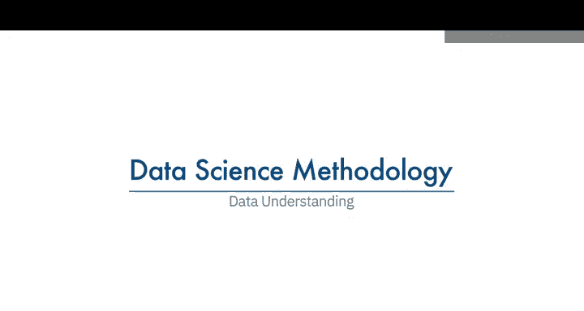
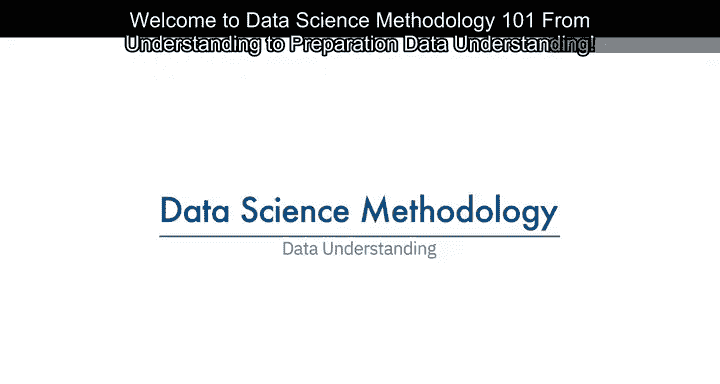
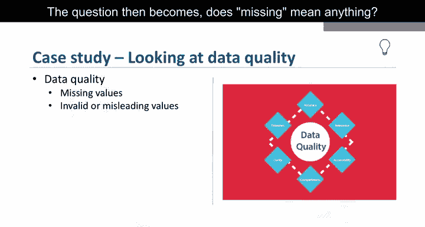
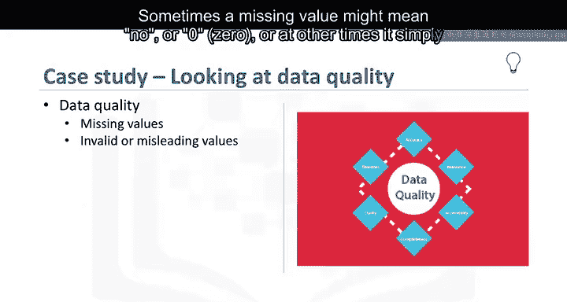
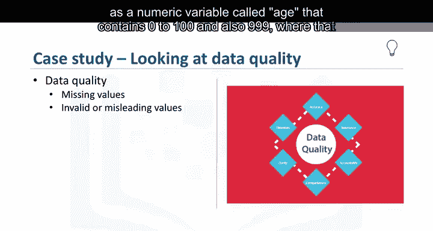
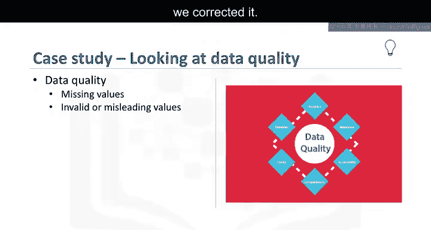
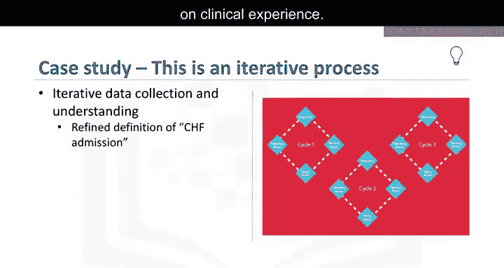

# IBM数据科学专业证书课程3：《数据科学方法论》data-science-methodology（中英字幕） - P6：5_数据理解.zh_en - GPT中英字幕课程资源 - BV18P411475T

Welcome to data Science Meology 101， from understanding to preparation， data understanding。

Data understanding encompasses all activities related to constructing the data set。Essentially。

 the data understanding section of the data size methodology answers the question。

 Is the data you collected representative of the problem to be solved。

 Let's apply the data understanding stage of our methodology to the case study we've been examining。

In order to understand the data related to congestive heart failure admissions。

 descriptive statistics needed to be run against the data columns that would become variables in the model。

First， these statistics included Hearst， Uniivariates， and statistics on each variable such as mean。

 median， minimum， maximum and standard deviation。Second。

 pairwise correlations were used to see how closely certain variables were related and which ones。

 if any， were very highly correlated， meaning that they would be essentially redundant。

 thus making only one relevant for modelling。Third。

 histograms of the variables were examined to understand their distributions。

Histograms are a good way to understand how values or variable are distributed and which sorts of data preparation may be needed to make the variable more useful in a model。

 For example， for a categorical variable that has too many distinct values to be informative in a model。

 the histogram would help them decide how to consolidate those values。The Uniivevariate。

 statistics and histograms are also used to assess data quality。

From the information provided， certain values can be recoded or perhaps even dropped if necessary。

 such as when a certain variable has missing values。

The question then becomes， does missing mean anything， Sometimes a missing value might mean no or 0。

 or at other times， as simply means we don't know。

Or if a variable contains invalid or misleading values。

 such as a numeric variable called age that contains 0 to 100， and also 9，9，9。

 where that triple 9 actually means missing， but would be treated as a valid value unless we corrected it。

Initially， the meaning of congestive heart failure admission was decided on the basis of a primary diagnosis of congestive heart failure。

But working through the data understanding stage revealed that the initial definition was not capturing all of the congestive heart failure admissions that were expected based on clinical experience。

This meant looping back to the data collection stage and adding secondary and tertiary diagnoses and building a more comprehensive definition of congestive heart failure admission。

This is just one example of the interactive processes in the methodology。

The more one works with the problem and the data， the more one learns， and therefore。

 the more refinement that could be done within the model。

 ultimately leading to a better solution to the problem。

This ends the data understanding section of this course。Thanks for watching。

