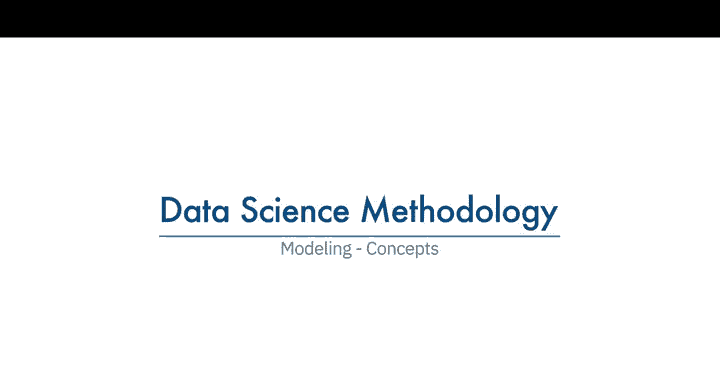
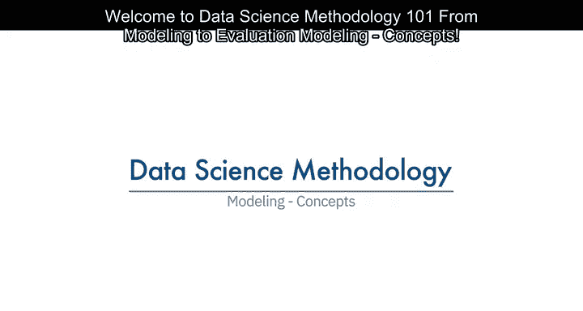
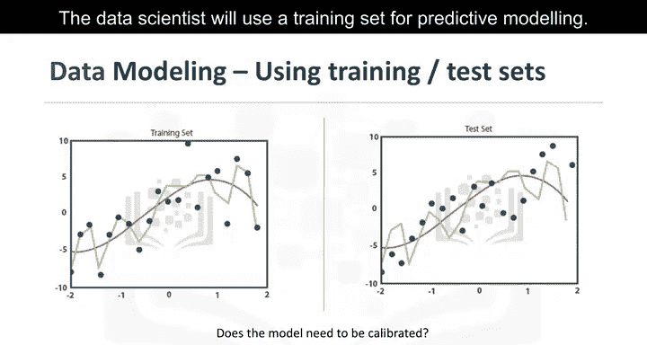
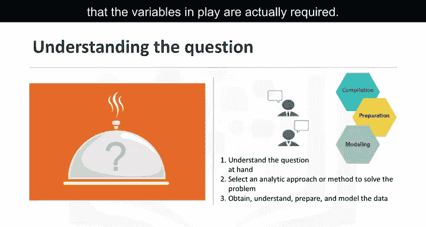
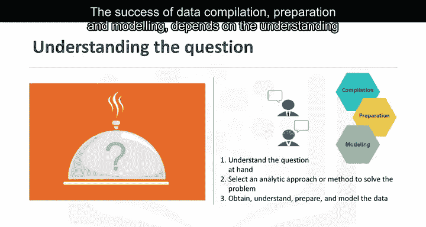
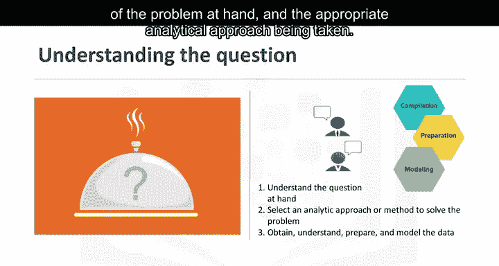
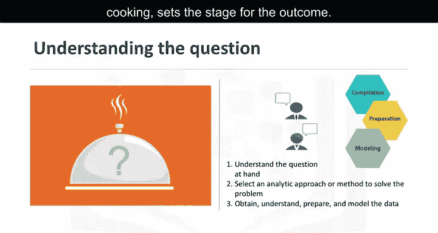
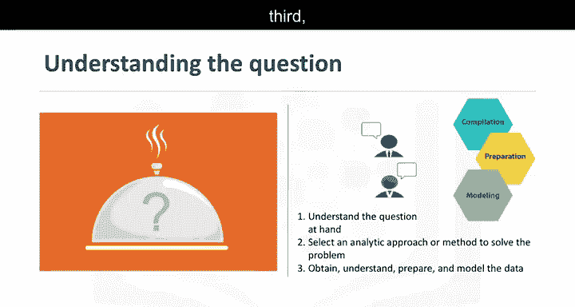
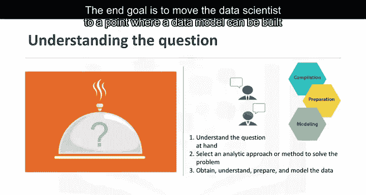

# IBM数据科学专业证书课程3：《数据科学方法论》data-science-methodology（中英字幕） - P9：8_建模概念.zh_en - GPT中英字幕课程资源 - BV18P411475T

Welcome to Data Science Meology 101， from modeling to evaluation， modeling concepts。

Moodeling is the stage in the data science methodology where the data scientist has the chance to sample the sauce and determine if it's bang on or in need of more seasoning。

This portion of the chorus is geared towards answering two key questions。 First。

 what is the purpose of data modeling， And second， what are some of the characteristics of this process。

Data modeling focuses on developing models that are either descriptive or predictive。

An example of a descriptive model might examine things like if a person did this。

 then they're likely to prefer that。A predictive model tries to yield yes or no or stop go type outcomes。

These models are based on the analytic approach that was taken。

 either statistically driven or machine learning driven。

The data scientist will use a training set for predictive modeling。

A training set is a set of historical data in which the outcomes are already known。

The training set acts like a gauge to determine if the model needs to be calibrated。 In this stage。

 the data scientists will play around with different algorithms to ensure that the variables in play are actually required。

The success of data compilation， preparation and modeling depends on the understanding of the problem at hand and the appropriate analytical approach being taken。

The data supports the answering of the question and like the quality of the ingredients in cooking sets the stage for the outcome。

Constant refinement， adjustments and tweaking are necessary within each step to ensure the outcome is one that's solid。

In John Raowin's descriptive data science methodology， the framework is geared to do three things。

First， understand the question at hand。 Second， select an analytic approach or method to solve the problem。

 And third， obtain， understand， prepare and model the data。

The end goal is to move the data scientist to a point where a data model can be built to answer the question。

With dinner just about to be served and a hungry guest at the table， the key question is。

 have I made enough to eat， Well， let's hope so。In this stage of the methodology， model evaluation。

 deployment and feedback loops ensure that the answer is near and relevant。

 This relevance is critical to the data science field overall， as it's a fairly new field of study。

 and were interested in the possibilities it has to offer。

The more people that benefit from the outcomes of this practice， the further the field will develop。

This ends the modeling to evaluation section of this course in which we review the key concepts related to modeling。

 Thanks for watching。