# IBM数据科学专业证书课程4：《Python应用于数据科学、人工智能和开发》python-for-applied-data-science-ai（中英字幕） - P12：11_文件读取操作.zh_en - GPT中英字幕课程资源 - BV1AF411f7yv

In this section， we will use Python's built in open function to create a file object and obtain the data from a TXT file。

 We will use Python's open function to get a file object。

 We can apply a method to that object to read data from the file。

 We can open the file example1 dot TXT as follows。

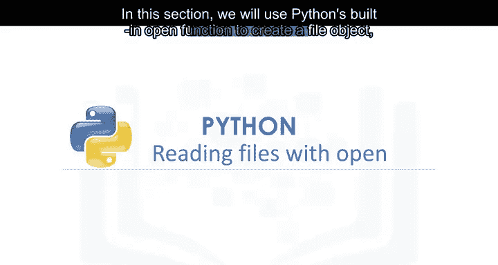

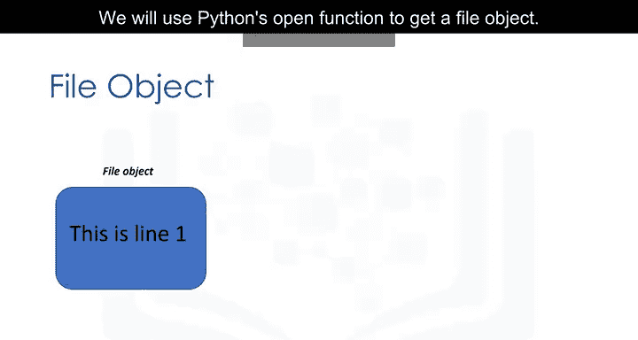

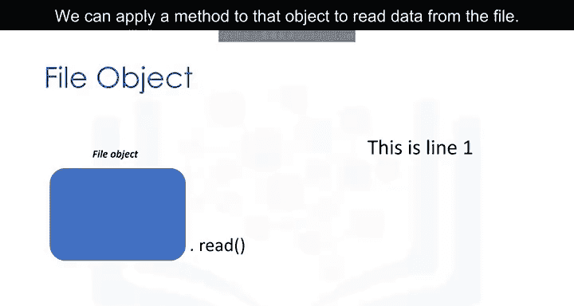

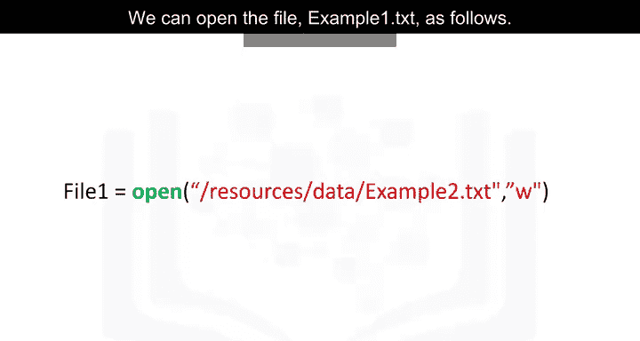

We use the open function。 The first argument is the file path。 This is made up of the file name。

 and the file directory。

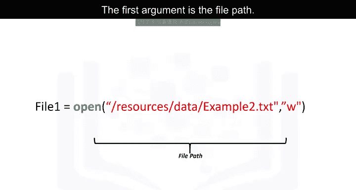

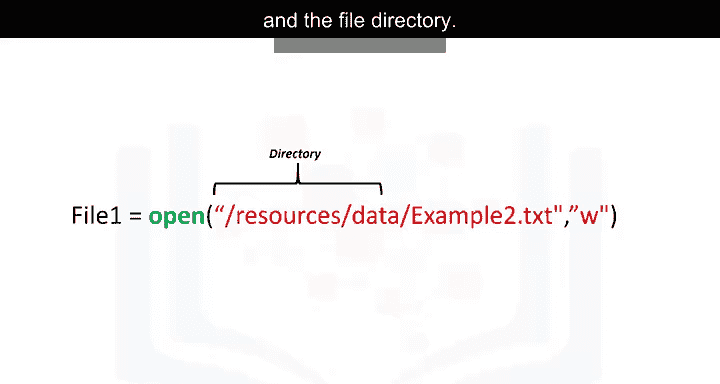

The second parameter is the mode。 Common values used include R for reading。

 W for writing and A for app。 We will use R for reading。 Finally， we have the file object。

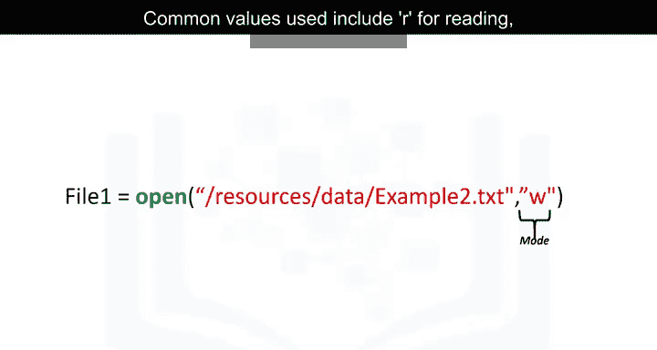

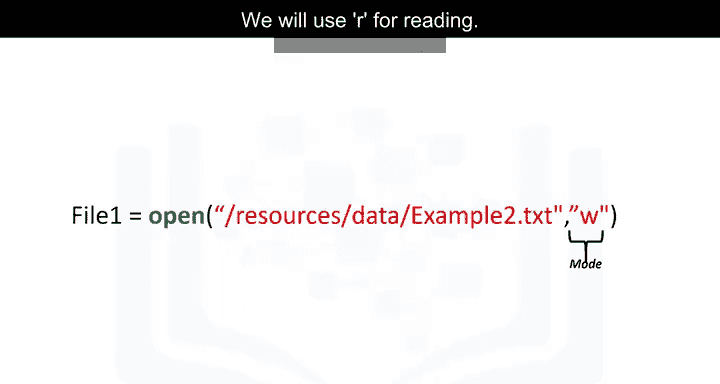

We can now use the file object to obtain information about the file。

 We can use the data attribute name to get the name of the file。

 The result is a string that contains the name of the file。

 We can see what mode the object is in using the data attribute mode。

 and R is shown representing read。 You should always close the file object using the method close。

 This may get tedious sometimes。 So let's use the width statement。

 using a width statement to open the file is better practice because it automatically closes the file。

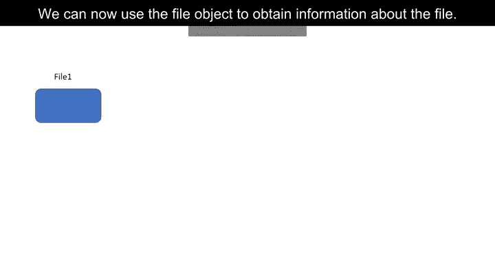

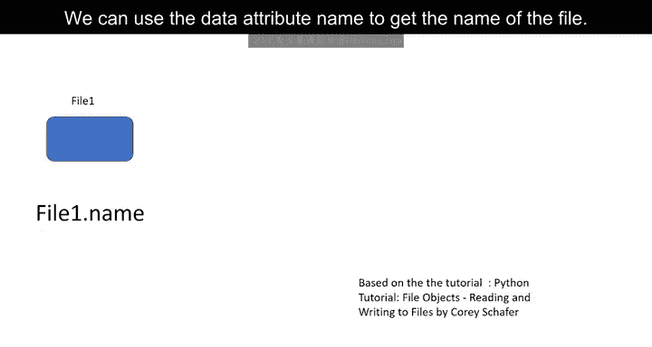

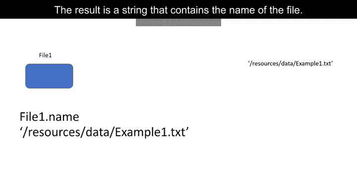

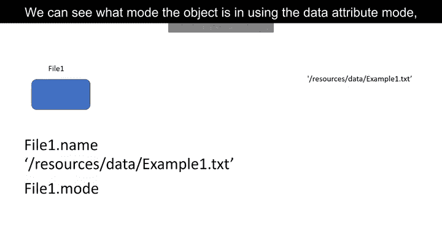

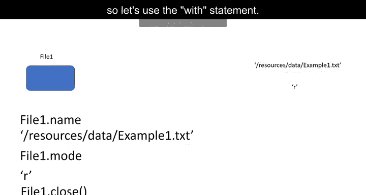

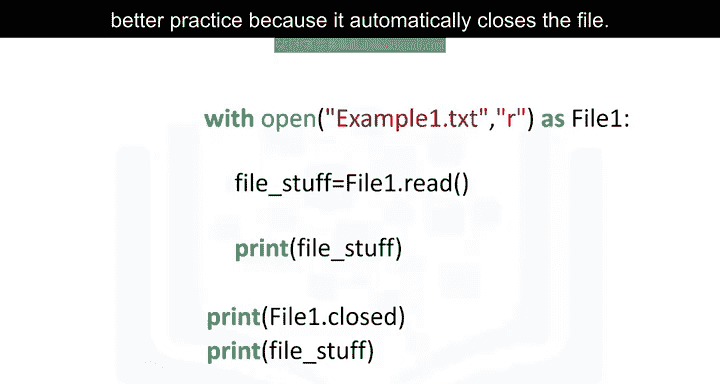

The code will run everything in the indent block， then closes the file。

 This code reads the file example 1 dot T， X， T。 We can use the file object file 1。

 The code will perform all operations in the indent block。

 Then close the file at the end of the indent。

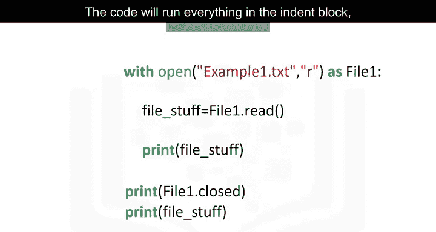

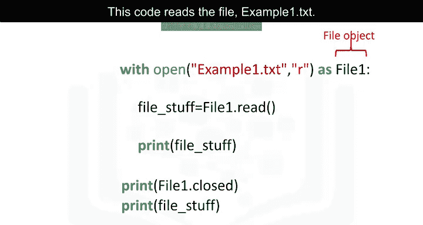

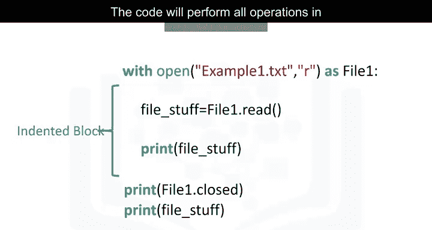

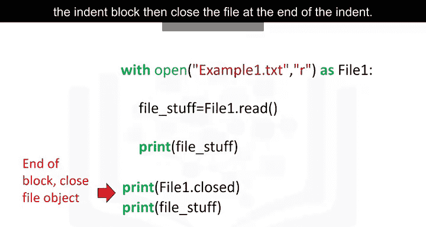

The method to read stores the values of the file in the variable file underscore stuff as a string。

 You can print the file content。 You can check if the file content is closed。

 but you cannot read from it outside the indent。 but you can print the file content outside the indent as well。

 We can print the file content。 We will see the following。 When we examine the raw string。

 We will see the slash N。 This is so Python knows to start a new line。

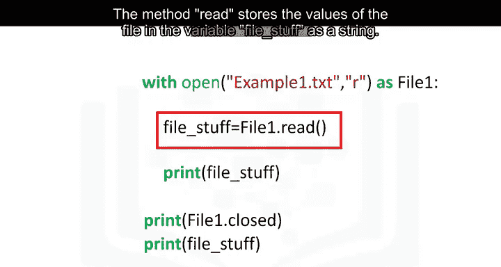

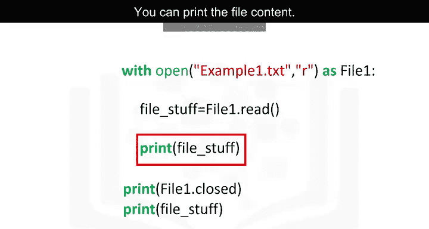

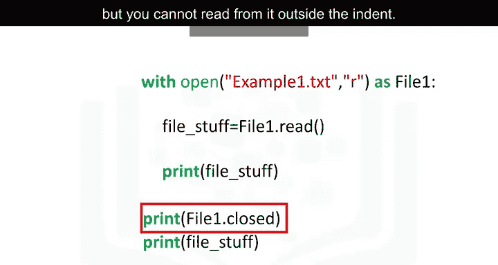

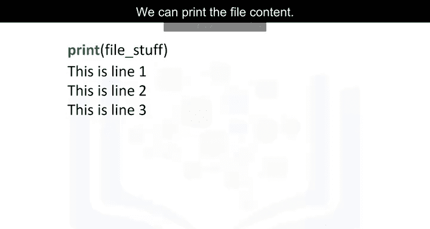

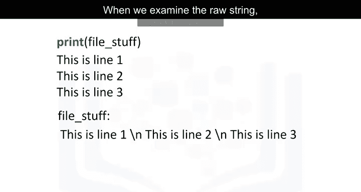

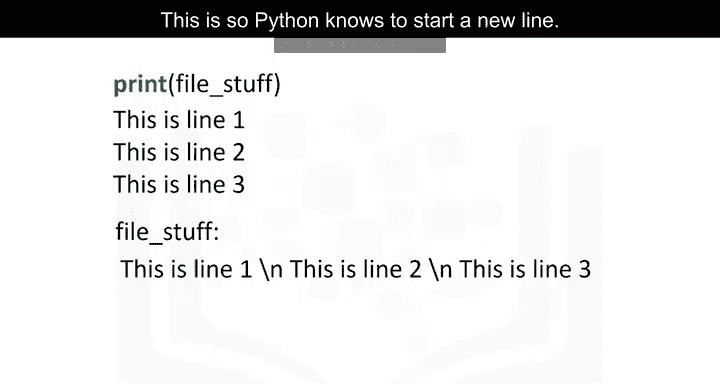

We can output every line as an element in a list using the method Read lines。

 The first line corresponds to the first element in the list。

 The second line corresponds to the second element in the list， and so on。

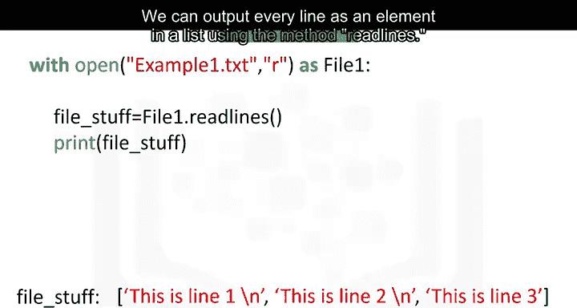

We can use the method read line to read the first line of the file。 If we run this command。

 it will store the first line in the variable file underscore stuff。 Then print the first line。

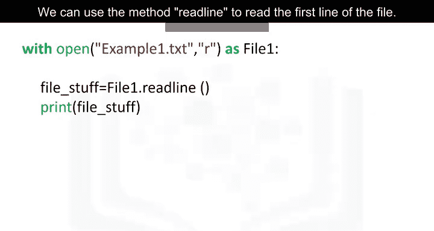

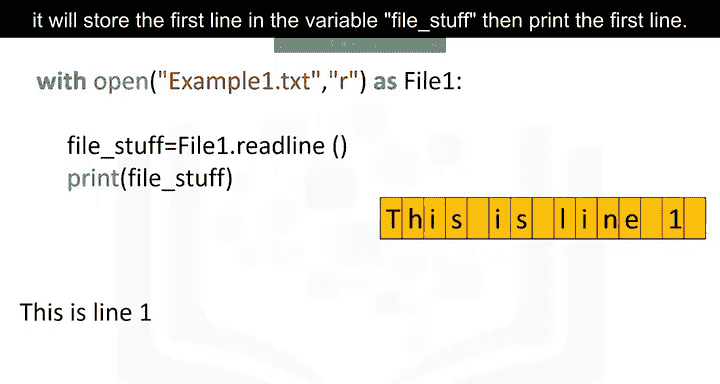

We can use the method read line twice。 The first time it's called。

 it will save the first line in the variable file underscore stuff， and then print the first line。

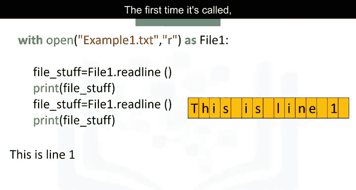

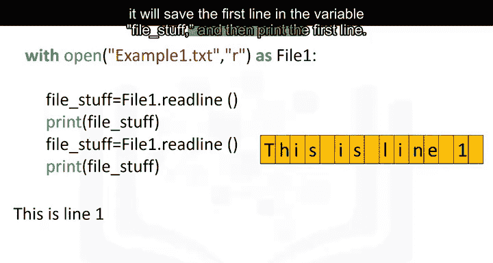

The second time it's called， it will save the second line in the variable file underscore stuff and then print the second line。

 We can use a loop to print out each line individually， as follows。

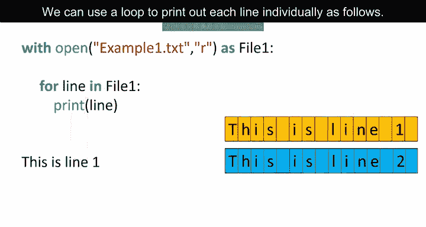

Let's represent every character in a string as a grid。

 We can specify the number of characters we would like to read from a string as an argument to the method read lines。

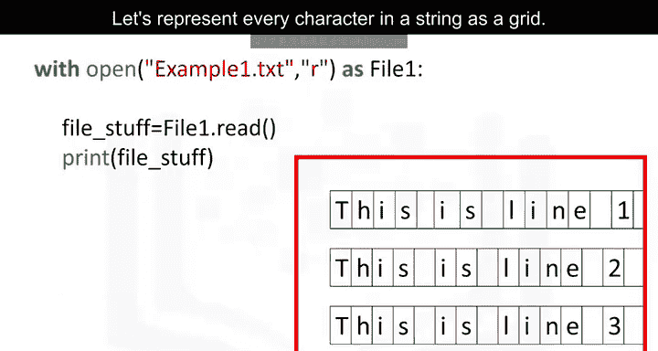

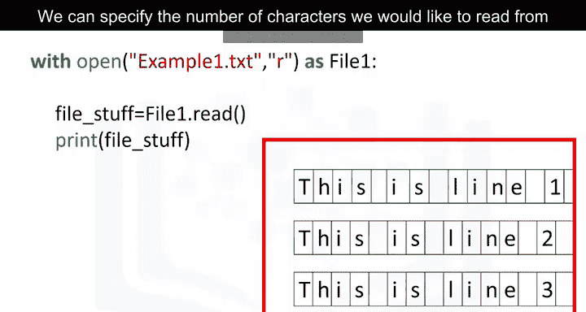

When we use a4 as an argument in the method read lines。

 we print out the first four characters in the file。

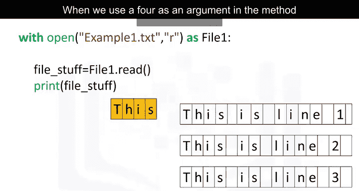

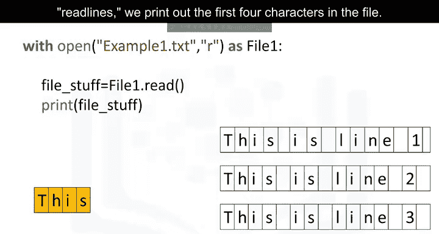

Each time we call the method。 we will progress through the text。

 If we call the method with the argument 16， the first 16 characters are printed out。

 and then the new line。 If we call the method a second time。

 the next five characters are printed out。 Finally。

 if we call the method the last time where the argument 9， the last9 characters are printed out。

 check out the labs for more examples of methods and other file types。😊。

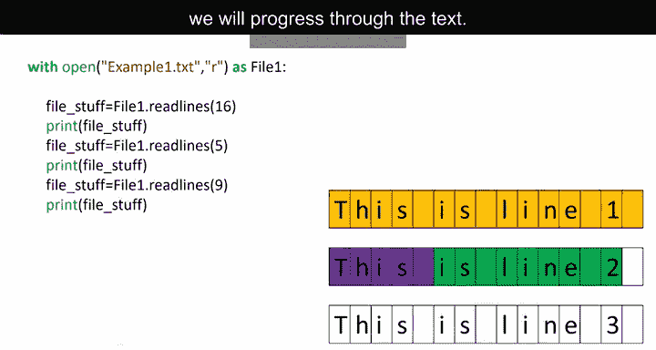