# IBM数据科学专业证书课程4：《Python应用于数据科学、人工智能和开发》python-for-applied-data-science-ai（中英字幕） - P15：14_Pandas数据处理与保存.zh_en - GPT中英字幕课程资源 - BV1AF411f7yv

When we have a data frame， we can work with the data and save the results in other formats。

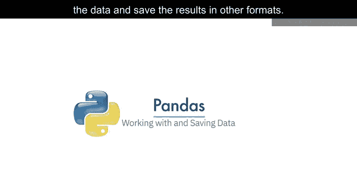

Consider the stack of 13 blocks of different colors。 We can see there are three unique colors。

 Let's say you would like to find out how many unique elements are in a column of a data frame。

 This may be much more difficult because instead of 13 elements， you may have millions。

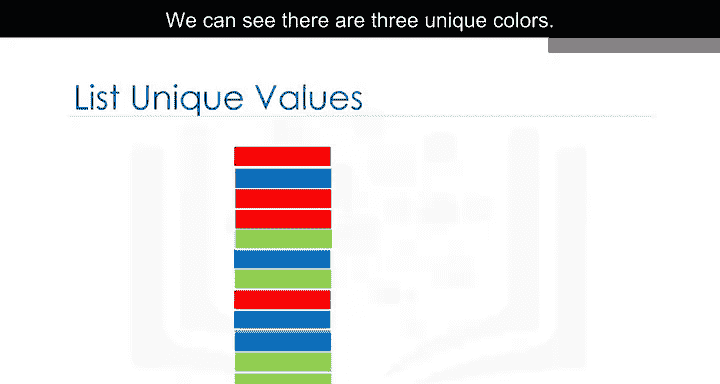

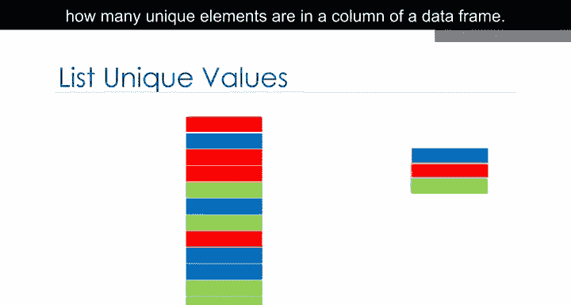

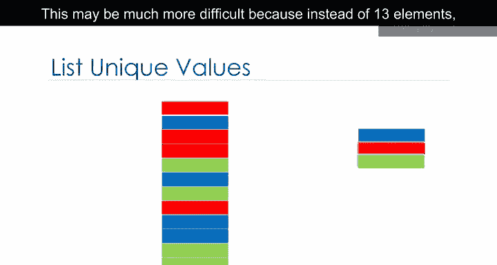

Pands has the method unique to determine the unique elements in a column of a data frame。

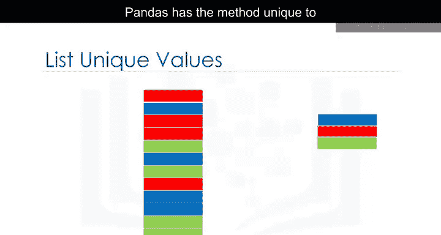

Let's say we would like to determine the unique year of the albums in the dataset set。

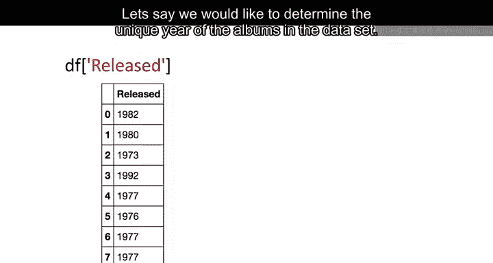

We enter the name of the data frame， then enter the name of a column released within brackets。

 Then we apply the method unique。 The result is all of the unique elements in the column released。

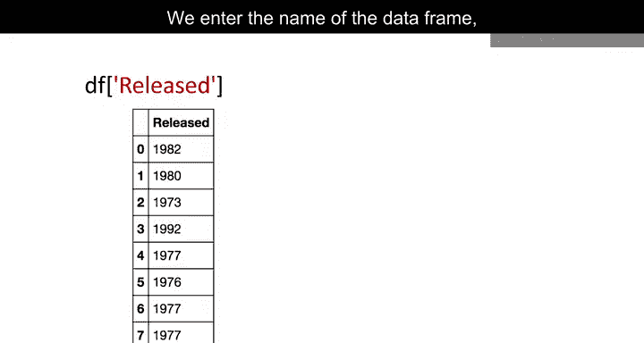

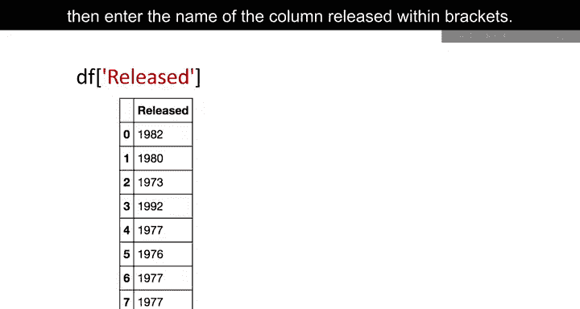

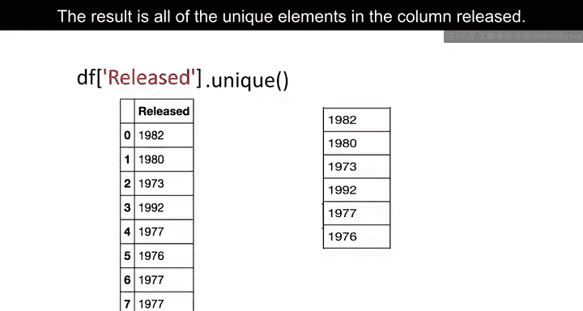

Let's say we would like to create a new database consisting of songs from the 1980s。

 and after we can look at the column released for songs made after 1979。

 Then select the corresponding rows。😊。

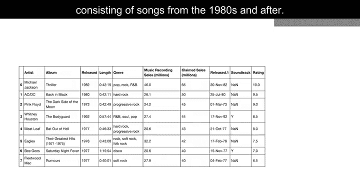

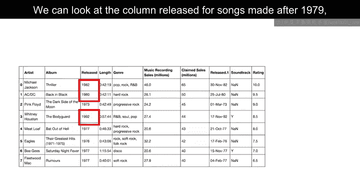

We could accomplish this within one line of code in pandas。 but let's break up the steps。

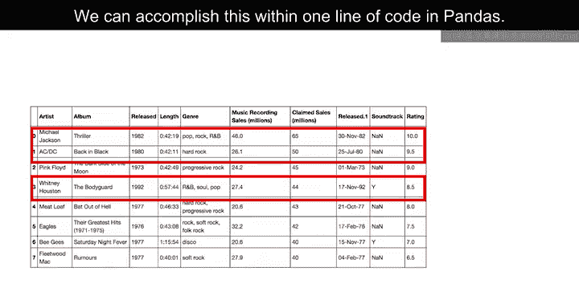

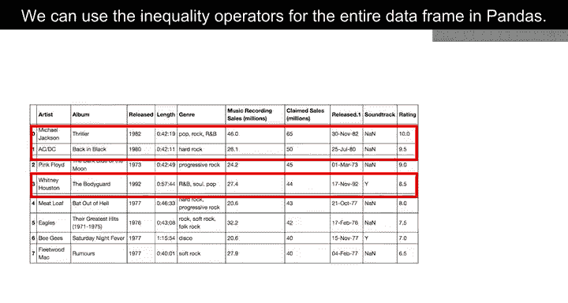

We can use the inequality operators for the entire data frame in pandas。

 The result is a series of Boolean values。 For our case。

 we simply specify the column released and the inequality for the albums After 1979。

 The result is a series of Boolean values。 The result is true when the condition is true and false Otherwise。

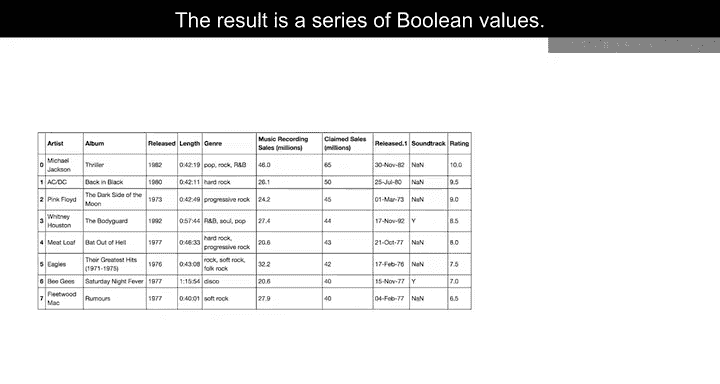

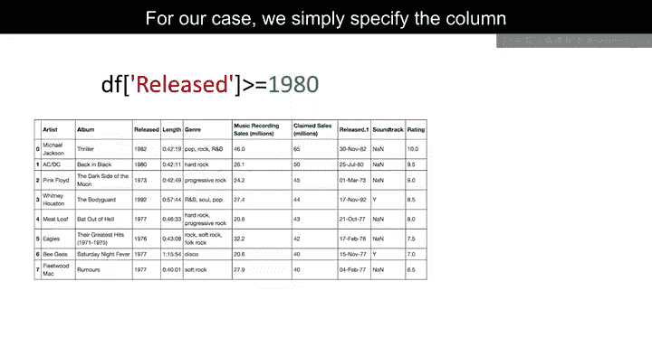

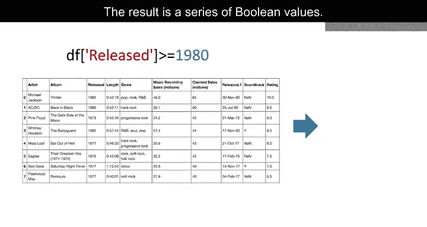

We can select the specified columns in one line。 We simply use the data frame's names。

 And in square brackets， we placed the previously mentioned inequality and assign it to the variable D F1。

 We now have a new data frame where each album was released after 1979。

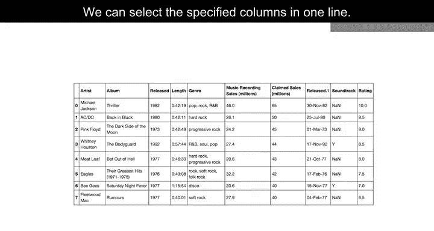

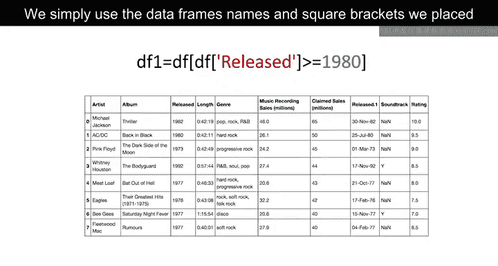

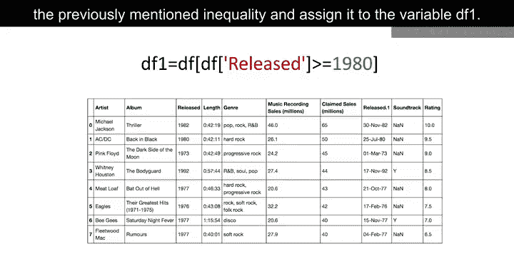

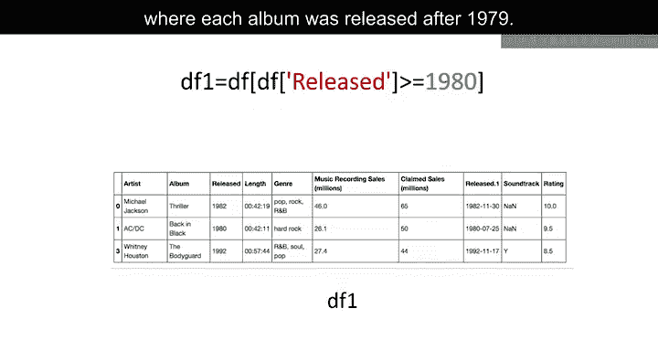

We can save the new data frame using the method to underscore CSV。

 The argument is the name of the CSV file。 Make sure you include a dot CSV extension。

 There are other functions to save the data frame in other formats。

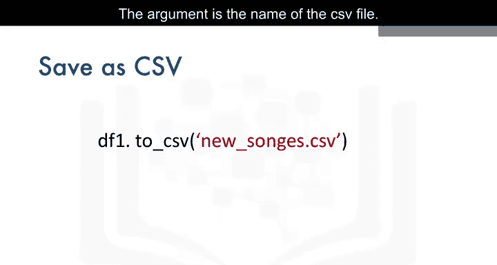

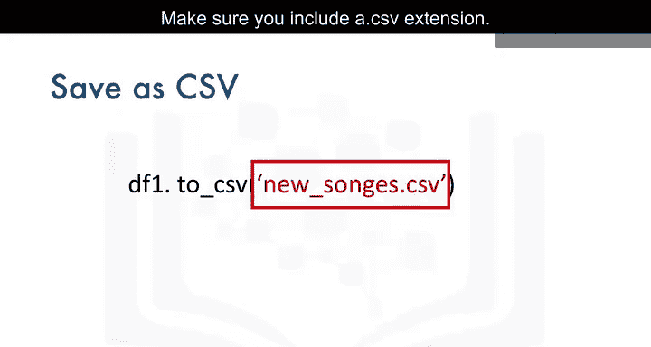

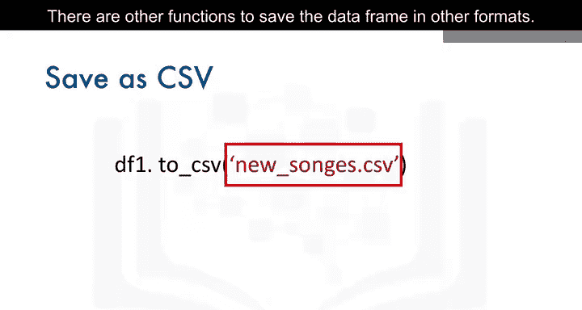