# IBM数据科学专业证书课程4：《Python应用于数据科学、人工智能和开发》python-for-applied-data-science-ai（中英字幕） - P1：0_数据类型.zh_en - GPT中英字幕课程资源 - BV1AF411f7yv

A type is how Python represents different types of data In this video。

 we will discuss some widely used types in Python。 You can have different types in Python。

 They can be integers like 11。 Real numbers like 21。213。 They can even be words。 integers。

 real numbers and words can be expressed as different data types。

 The following chart summarizes three data types for the last examples。

 The first column indicates the expression。 The second column indicates the data type。

 We can see the actual data type in Python by using the type command。 We can have int。

 which stands for an integer and float that stands for float essentially a real number。

 The type string is a sequence of characters。 Here are some integers。

 integers can be negative or positive。 It should be noted that there is a finite range of integers。

 but it is quite large。 Floats are real numbers。😊。

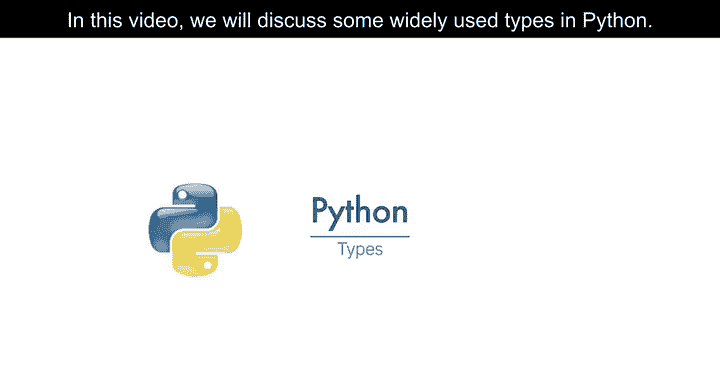

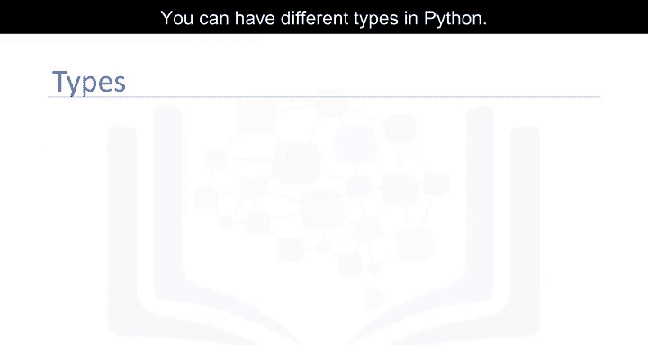

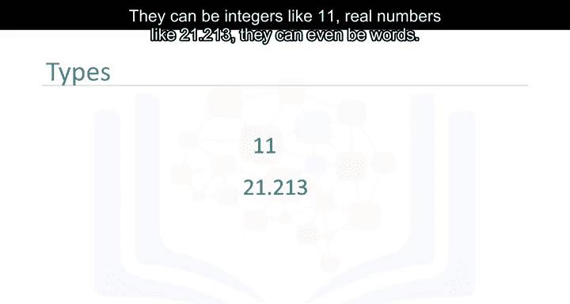

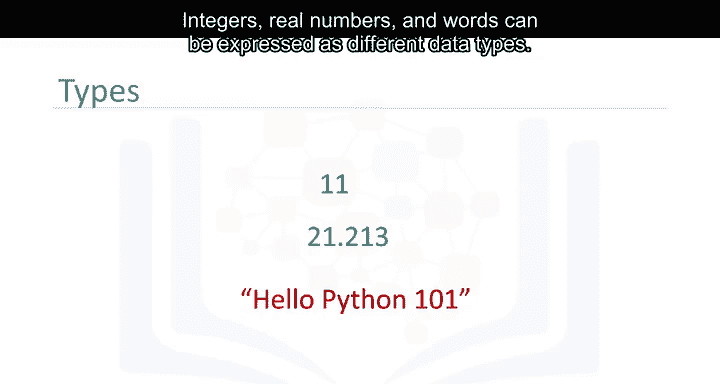

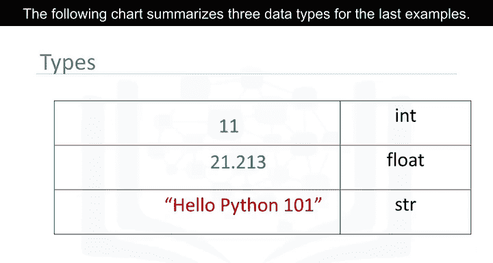

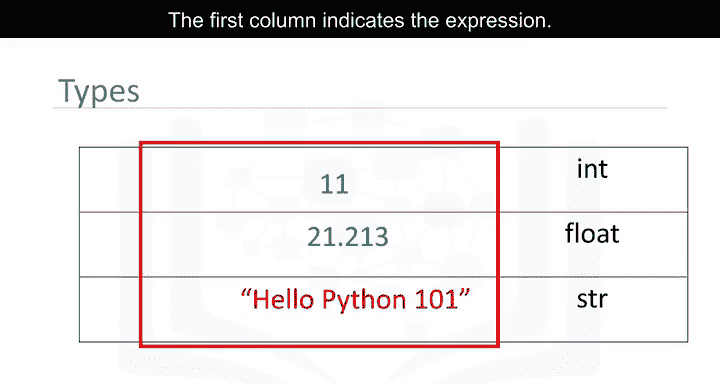

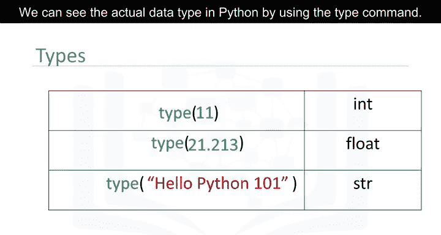

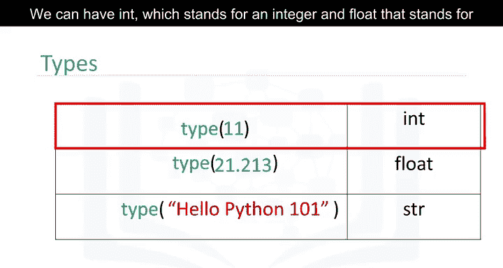

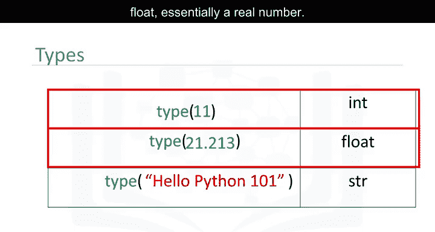

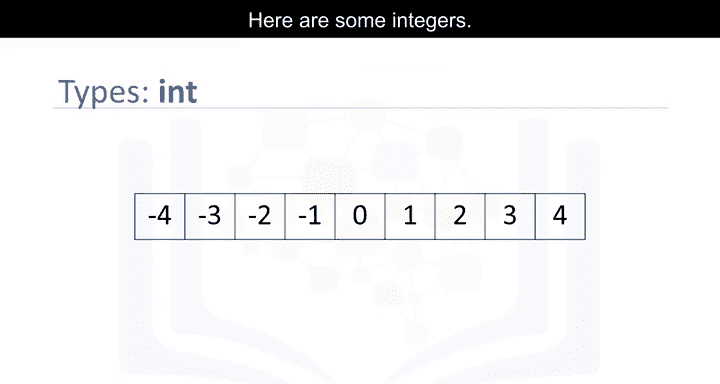

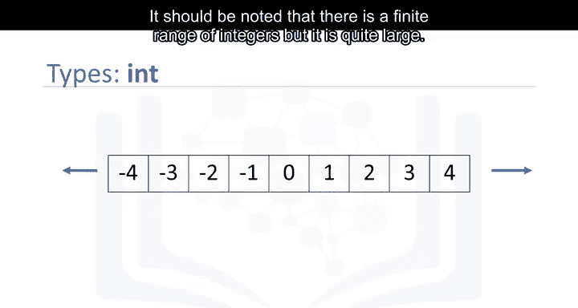

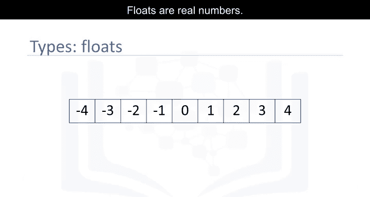

They include the integers， but also numbers in between the integers。

 Consider the numbers between 0 and 1。 We can select numbers in between them。

 These numbers are floats。 Similarlyly， consider the numbers between 0。5 and 0。6。

 We can select numbers in between them。 These are floats as well。

 We can continue the process zooming in for different numbers。 Of course， there is a limit。

 but it is quite small。 You can change the type of the expression in Python。

 This is called type casting。 You can convert an int to a float。 For example。

 you can convert or cast the integer 2 to a float 2。 Nothing really changes。

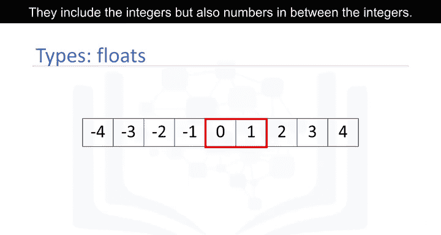

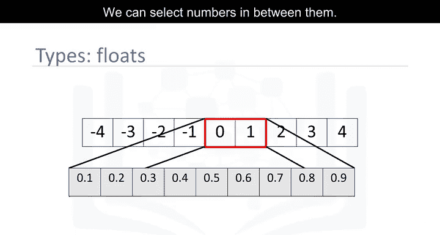

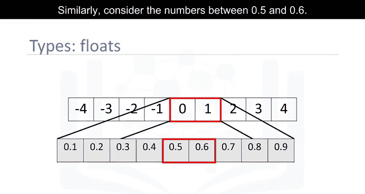

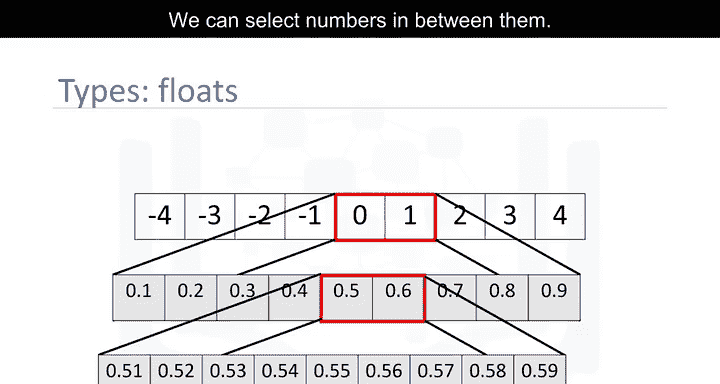

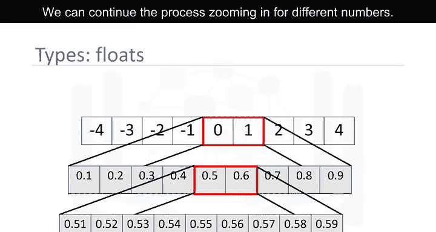

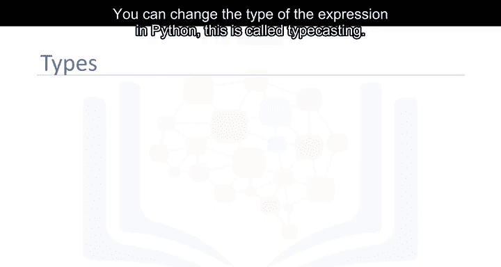

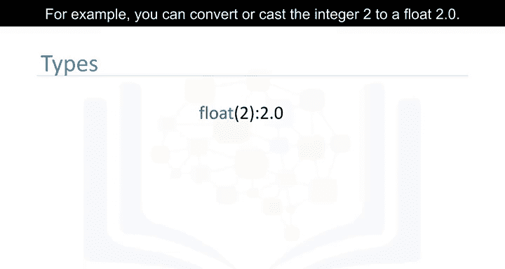

If you cast a float to an integer， you must be careful。 For example， if you cast the float 1。1 to 1。

 you will lose some information。

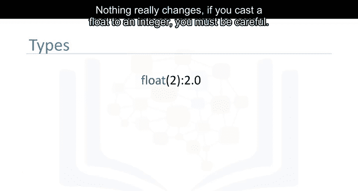

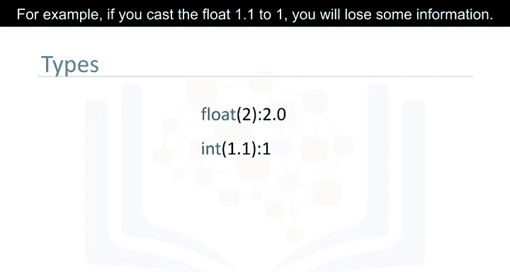

If a string contains an integer value， you can convert it to int。

 If we convert a string that contains a non integer value， we get an error。

 Check out more examples in the lab。 You can convert an int to a string or a float to a string。

 Boolean is another important type in Python。 A boolean can take on two values。

 The first value is true。 Just remember， we use an uppercase T。

 Boolean values can also be false with an uppercase F using the type command on a boolean value。

 We obtain the term bool。 This is short for boolean。

 If we cast a boolean true to an integer or float。 we will get a one。😊。

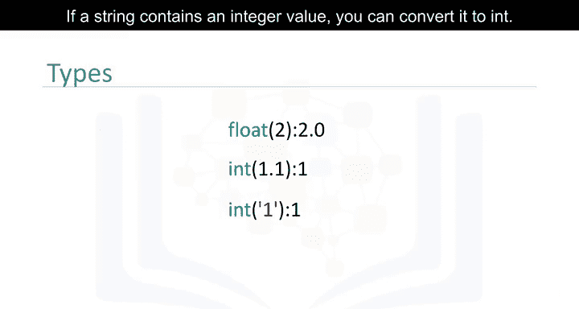

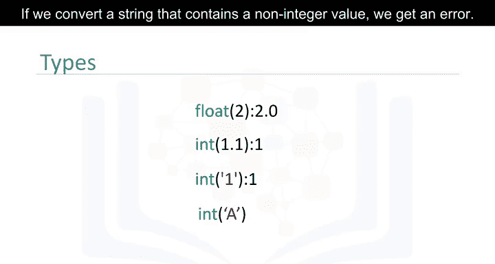

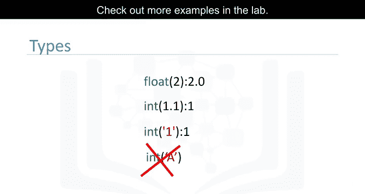

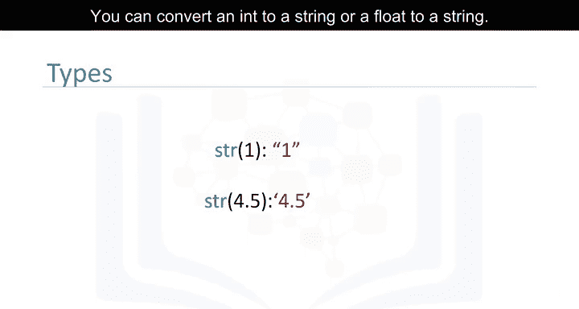

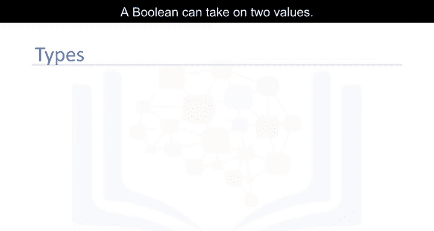

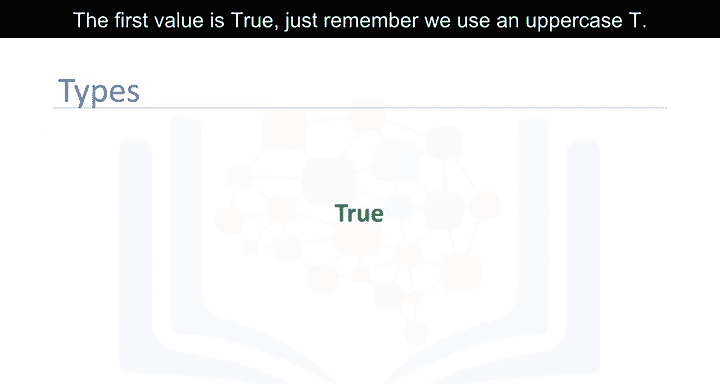

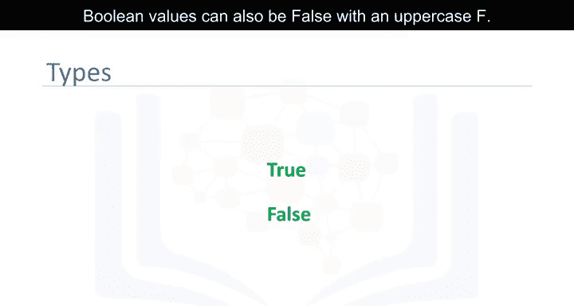

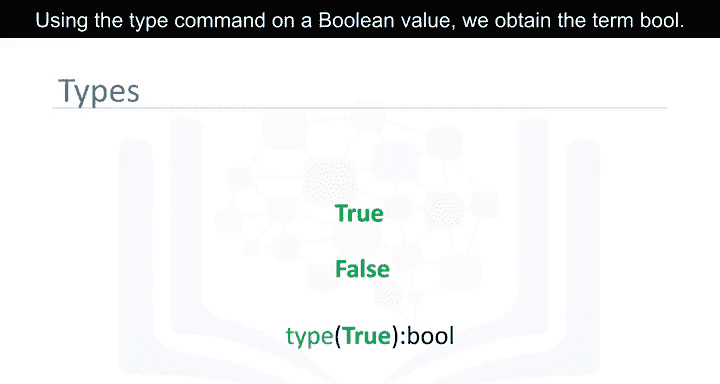

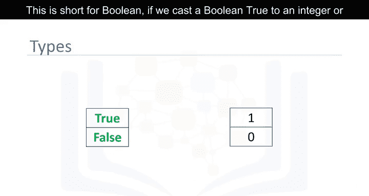

If we cast a boolean false to an integer or float， we get a0。 If you cast a one to a boolean。

 you get a true。 Similarly， if you cast a0 to a boolean， you get a false。

 Check the labs for more examples or check Python dot org for other kinds of types in Python。

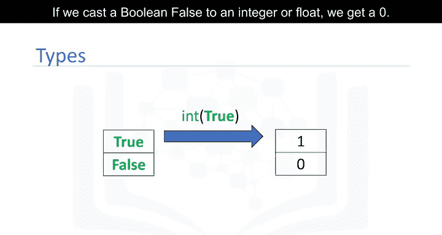

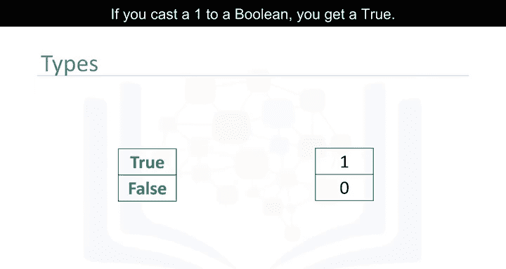

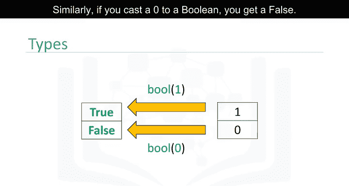

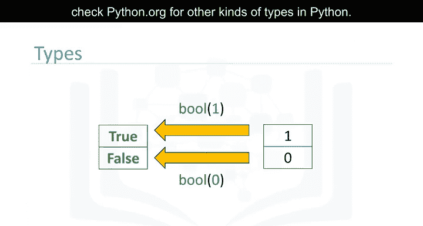