# IBM数据科学专业证书课程6：《数据库与SQL在数据科学中的应用（IBM）》sql-data-science（中英字幕） - P13：12_结果集排序.zh_en - GPT中英字幕课程资源 - BV1kP41147ce

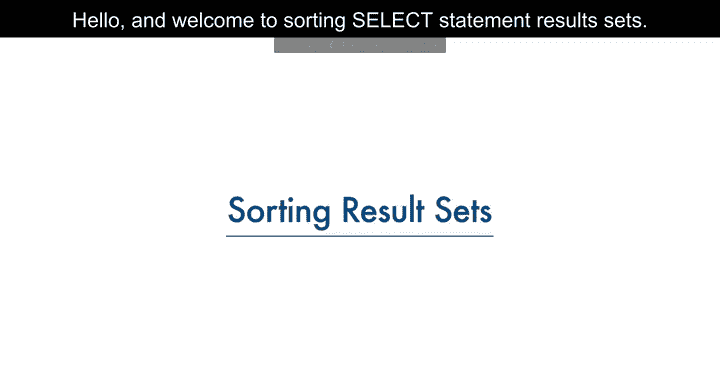

Hello and welcome to sorting Select statement result sets In this video。

 we will learn about some advanced techniques in retrieving data from a relational database table and sorting how the results set displays。

😊。

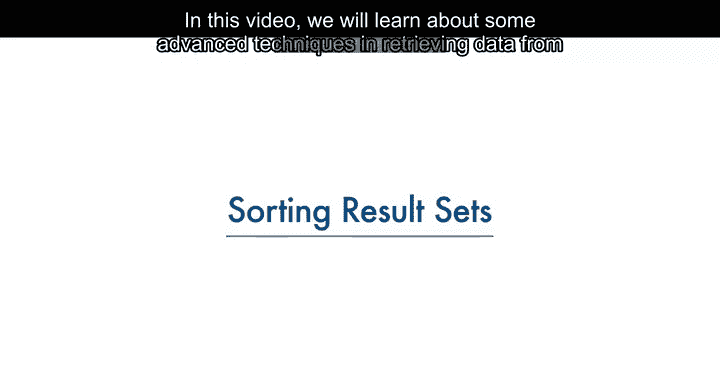

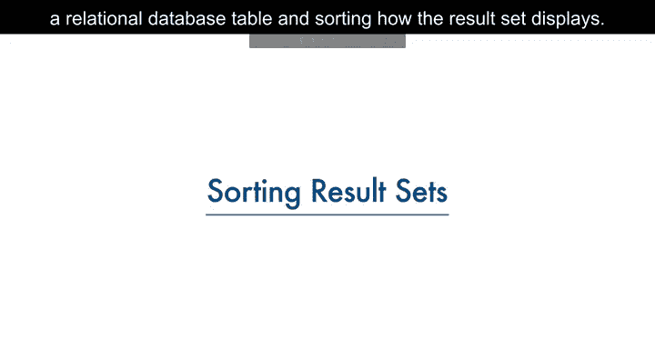

At the end of this lesson， you will be able to describe how to sort the results set by either ascending or descending order and explain how to indicate which column to use for the sorting order。

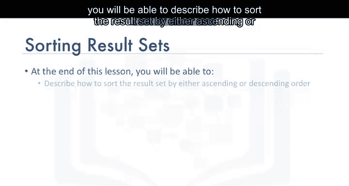

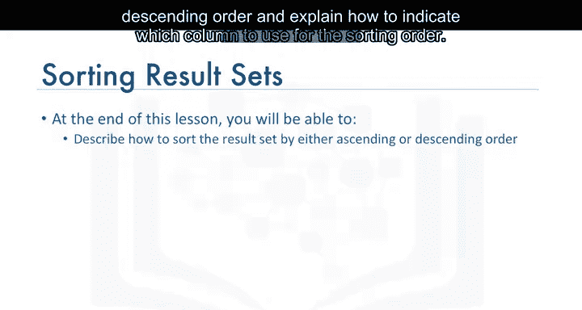

The main purpose of a database management system is not just to store the data。

 but also facilitate retrieval of the data。

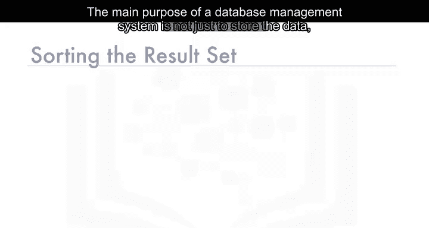

In its simplest form， a select statement is select star from table name。

Based on our simplified library database model and the table book select star from book gives a result set of four rows。

All the data rows for all columns in the table book are displayed。

We could choose to list the book titles only， as shown in this example， select title from book。

However， the order does not seem to be in any order displaying the results set in alphabetical order would make the result set more convenient to do this。

 we use the order by clause。To display the results set in alphabetical order。

 we add the order by clause to the select statement。

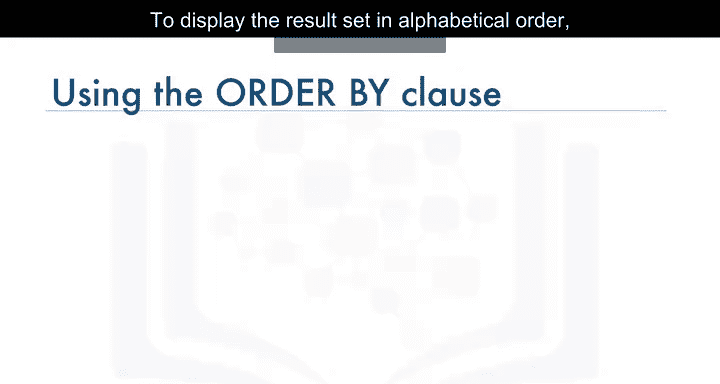

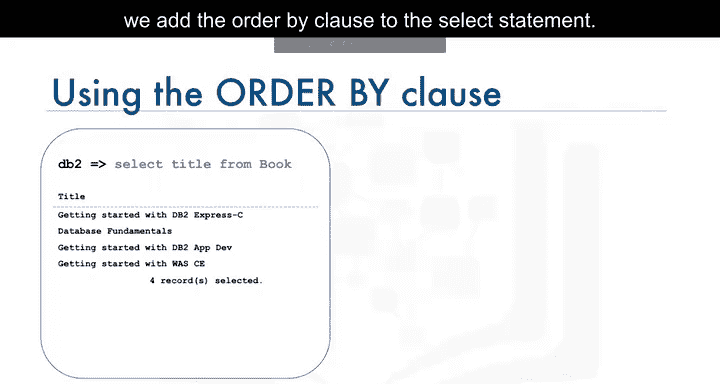

The order by clause is used in a query to sort the result set by a specified column。 In this example。

 we have used order by on the column title to sort the result set by default。

 The result set is sorted in ascending order。 In this example。

 the result set is sorted in alphabetical order by book title。To sort and descending order。

 use the keyword des。 The result set is now sorted according to the column specified。

 which is title and is sorted in descending order。 Notice the order of the first three rows。

 The first three words of the title are the same。

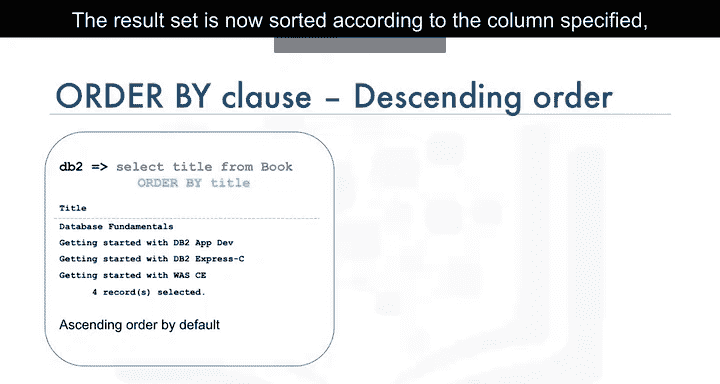

So the sorting starts from the point where the characters differ。

Another way of specifying the sort column is to indicate the column sequence number。

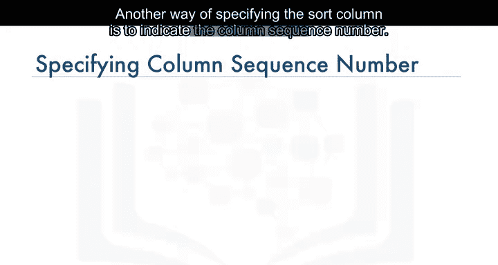

In this example， select title pages from book Order by two indicates the column sequence number in the query for the sorting order。

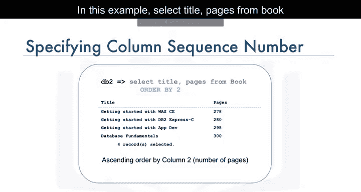

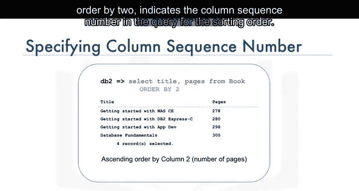

Instead of specifying the column name pages， the number two is used in the select statement。

 the second column specified in the column list is pages。

 So the sort order is based on the values in the pages column。

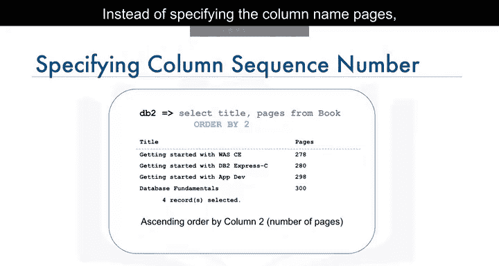

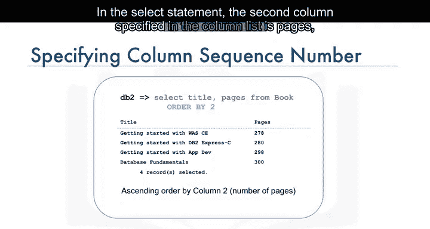

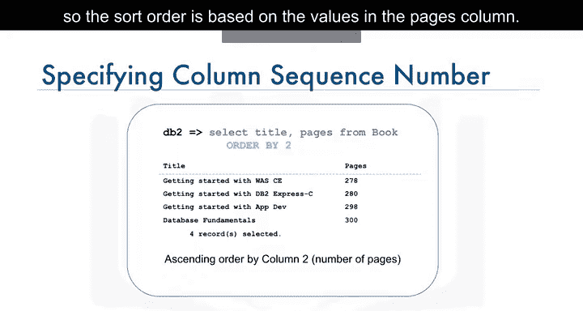

In this case， the pages column indicates the number of pages in the book。

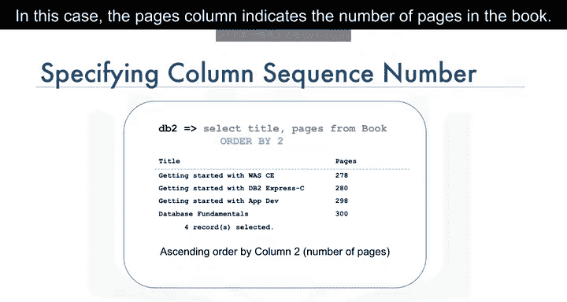

As you can see， the result set is an ascending order by number of pages。

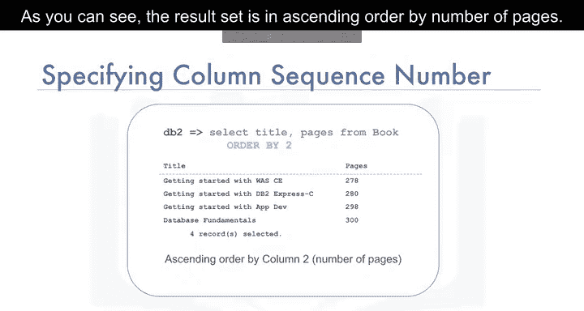

Now， you can describe how to sort the result set by either ascending or descendending order and explain how to indicate which column to use for the sorting order。

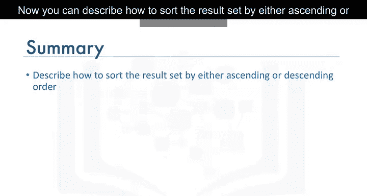

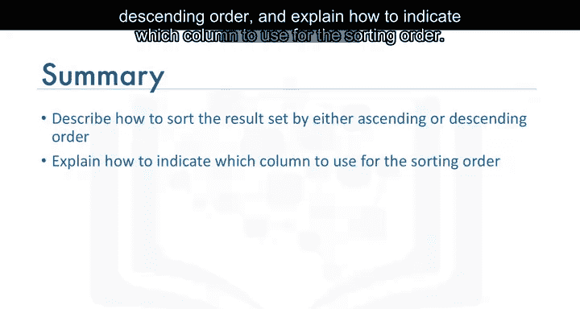

Thanks for watching this video。