# IBM数据科学专业证书课程6：《数据库与SQL在数据科学中的应用（IBM）》sql-data-science（中英字幕） - P18：17_多表联合操作.zh_en - GPT中英字幕课程资源 - BV1kP41147ce

。Hello and welcome In this video， you will learn how to write queries that access more than one table。

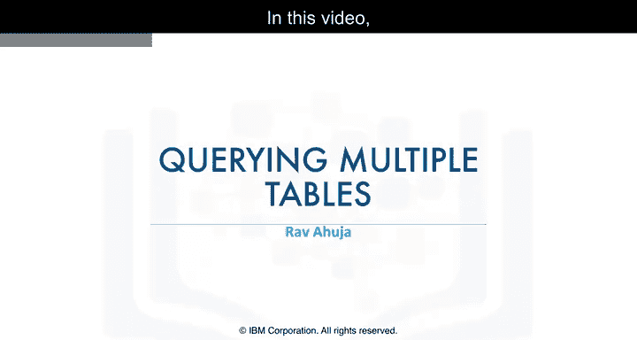

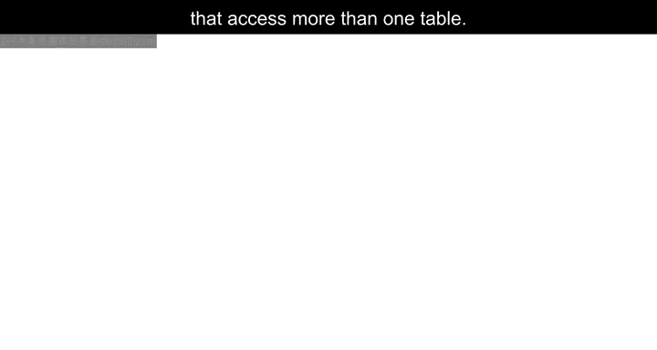

There are several ways to access multiple tables in the same query， namely using subqueries。

 implicit join and join operators， such as inner join and outer join。

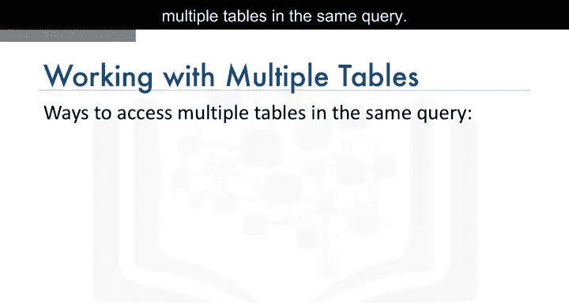

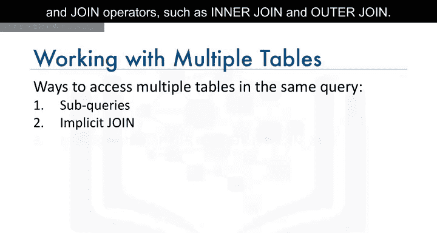

In this video， we'll examine the first two options。

 The third option is covered in more detail in other videos。

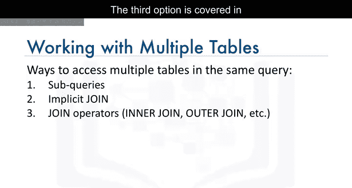

Let's consider the employees and departments tables from a previous video。

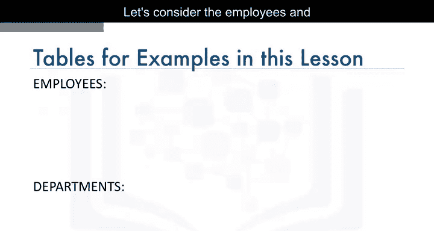

The employeess table contains several columns for categories such as employee I D， first name。

 last name and salary to name a few。The department's table contains a department ID， department name。

 manager ID， and location ID。Some sample data from these tables is shown here。

We will utilize these tables for the examples in this video。In a previous video。

 we learned how to use subqueries。 Now let's use subqueries to work with multiple tables。

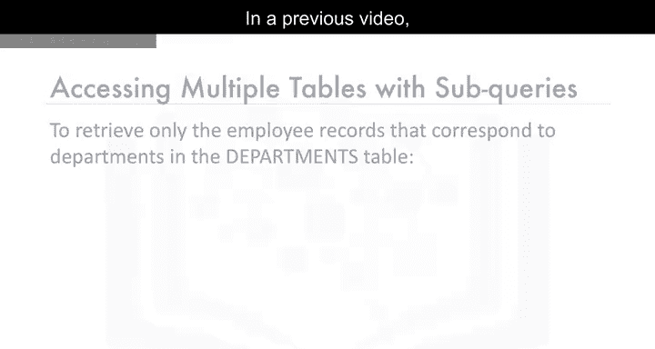

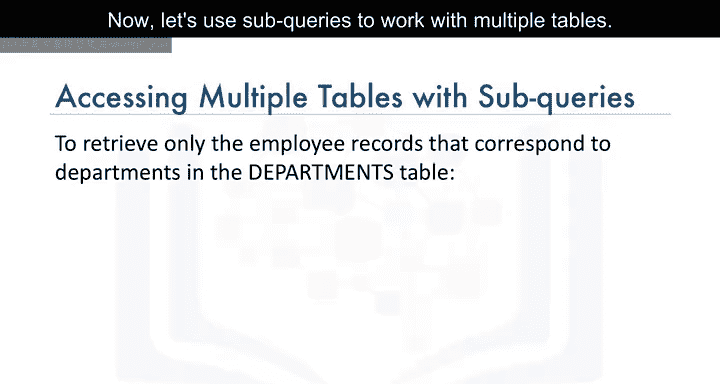

If we want to retrieve only the employee records from the employee table for which a department ID exists in the department's table。

 we can use a subquery as follows。

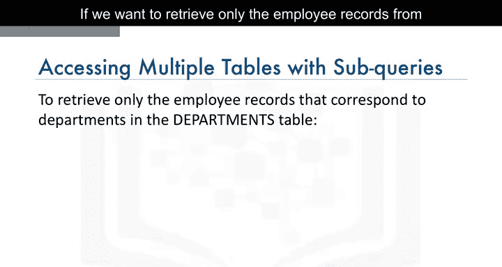

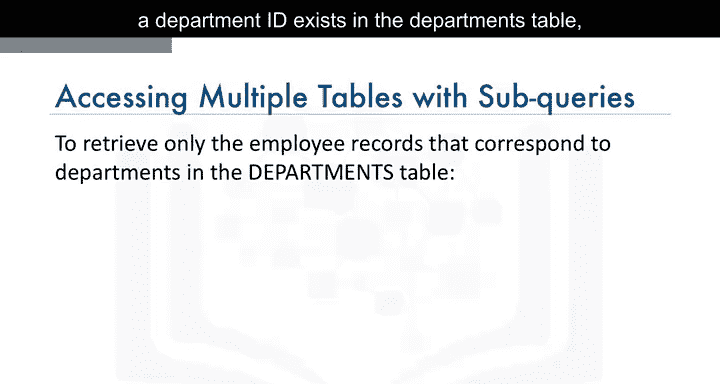

Select star from employees where Department ID in， select Department ID department from departments。

Here， the outer query accesses the employees table。

 and the subquery on the department's table is used for filtering the result set of the outer query。

Let's say we want to retrieve only the list of employees from a specific location。

 We do not have any location information in the employees table。

 but the department's table has a column called location I D。

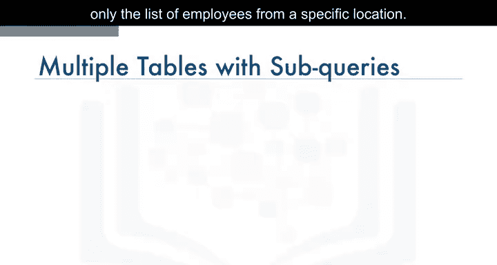

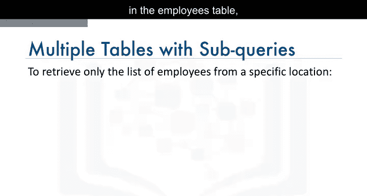

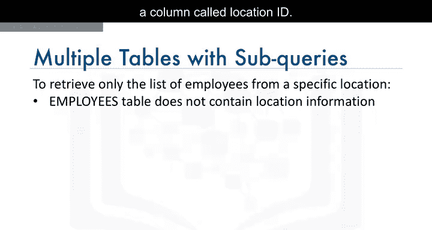

Therefore， we can use a sub queryry from the department's table as input to the employee table query as follows。

Select star from employees where department ID in， select Department ID department from departments。

 where location ID equals L0002。Now， let's retrieve the department ID and department name for employees who earn more than $70000。

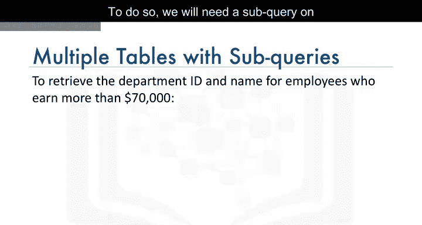

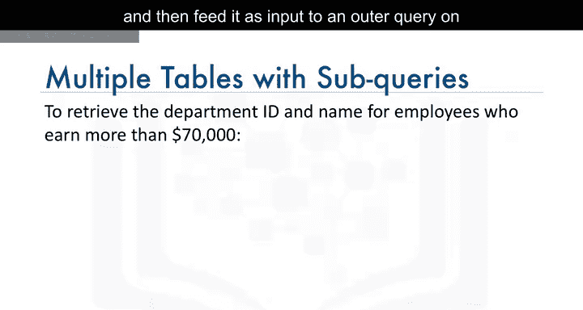

To do so， we will need a subquery on the employees's table to satisfy the salary criteria and then feed it as input to an outer query on the department's table in order to get the matching department info。

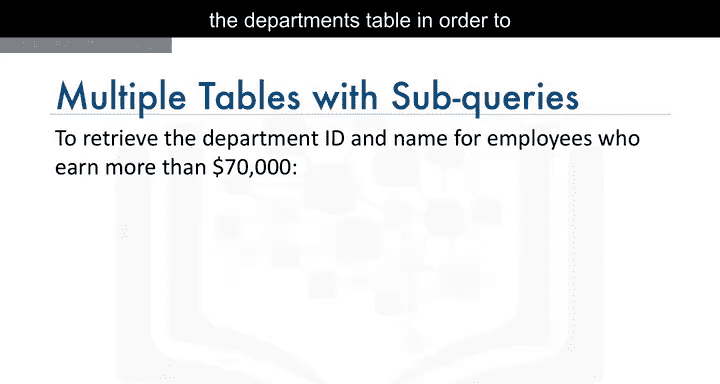

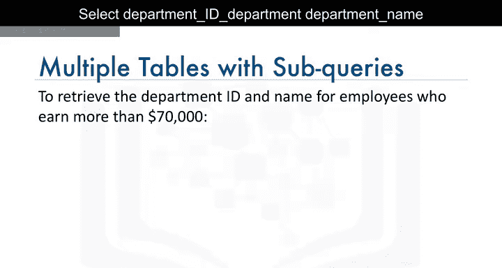

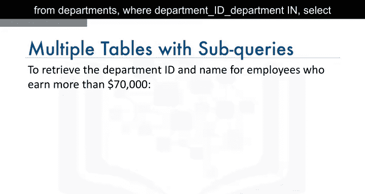

Select department ID， department， department name from departments。

 where department ID Department In， select Department ID from employees where salary is greater than 70。

000。

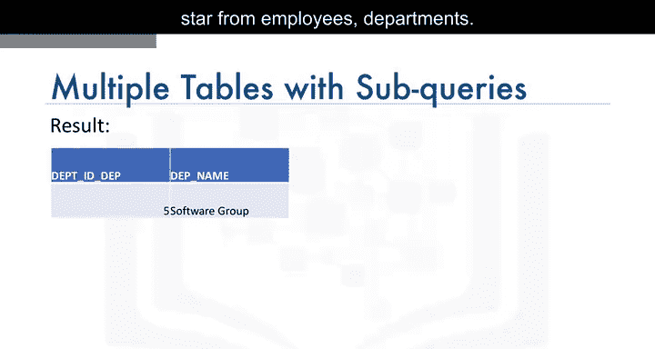

We can also access multiple tables by specifying them in the from clause of the query。

 Consider the example select star from employees， departments。

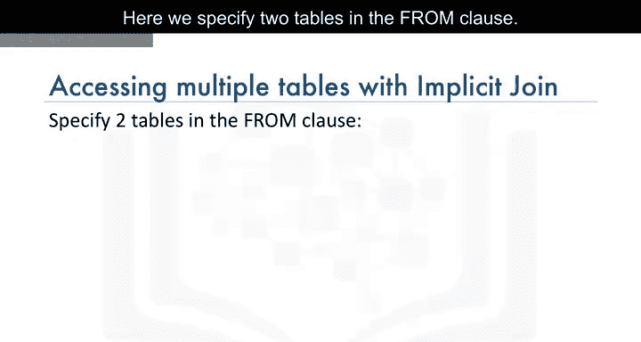

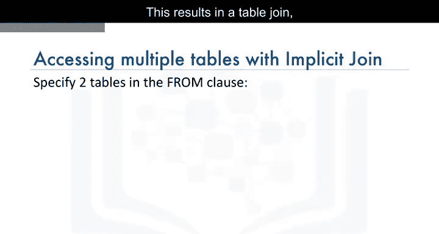

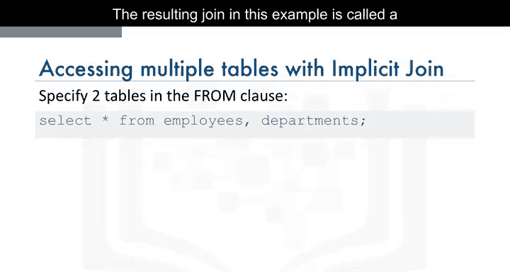

Here we specified two tables in the from clause。

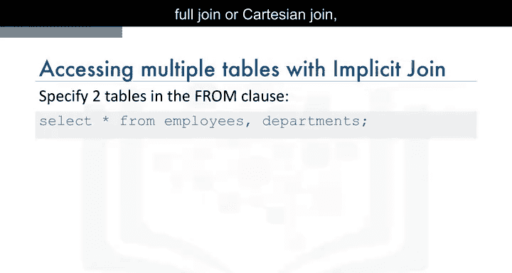

This results in a table join， but note we are not explicitly using the join operator。

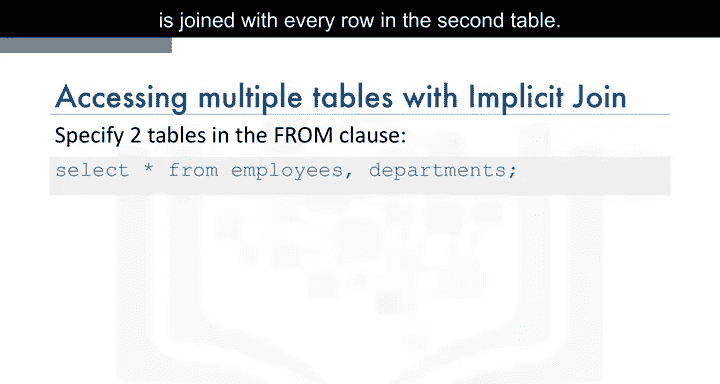

The resulting join in this example is called a full join or Cartesian join。

 because every row in the first table is joined with every row in the second table。

If you examine the results set， you will see more rows than in both tables individually。

We can use additional offerings to limit the results set。

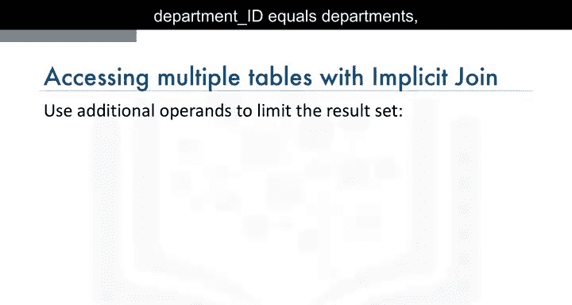

Let's look at an example where we limit the results set to only rows with matching department IDs。

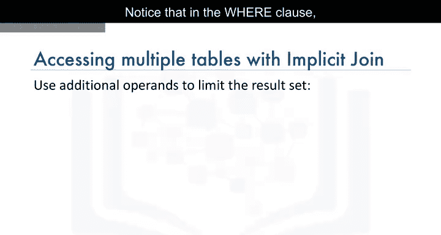

Select star fromEmploy departments， whereEmploy department ID equals departments。

 department ID department。Notice that in the wear clauses。

 we prefix the name of the column with the name of the table。

This is to fully qualify the column name， since it's possible that different tables could have some column names that are exactly the same。

Since the table names can sometimes be long， we can use shorter aliases for table names as shown here。

Select star fromEmploys E departments D， where E department ID equals D department ID department。

Here we define the alias E for employees table and D for departments table。

 and then use these aliases in the warehousecloth。

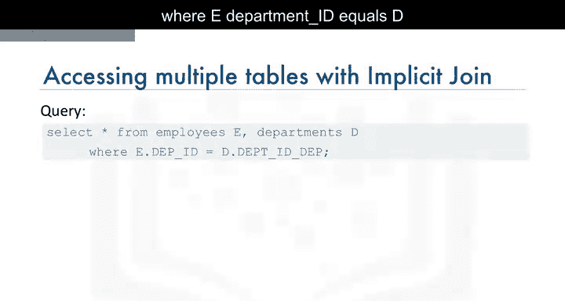

If we wanted to see the department name for each employee， we would enter the code as follows。

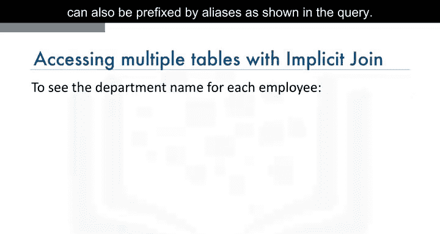

SelectEmployee ID Department name fromEmploy E departments D。

 where E department ID equals D department ID department。

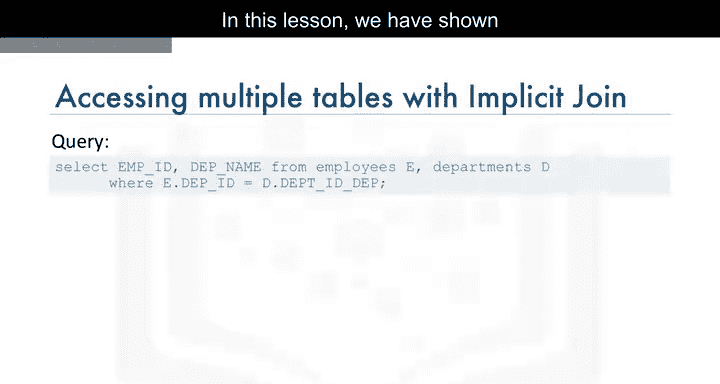

Similar to before， the column names in the select clause can also be prefixed by aliases as shown in the query。

 Select EEmployee ID D department ID department fromEmploy E departments D where E department ID equals D department ID department。

In this lesson， we have shown you how to work with multiple tables using subqueries and implicit joins。

Thanks for watching。