# IBM数据科学专业证书课程6：《数据库与SQL在数据科学中的应用（IBM）》sql-data-science（中英字幕） - P1：0_SQL数据科学入门.zh_en - GPT中英字幕课程资源 - BV1kP41147ce

Hello and welcome to SQL for data Science。 The demand for data scientists is high。

 Boing a median based salary of $1 hundred and $10000 and job satisfaction score of 4。4 out of 5。

 It's no wonder that it's the top spot on Glasdoor's best jobs in America。

 Glassdoor analyze data from data scientist job postings on Glasdoor。

 and found that SQL is listed as one of the top three skills for a data scientist。😊。

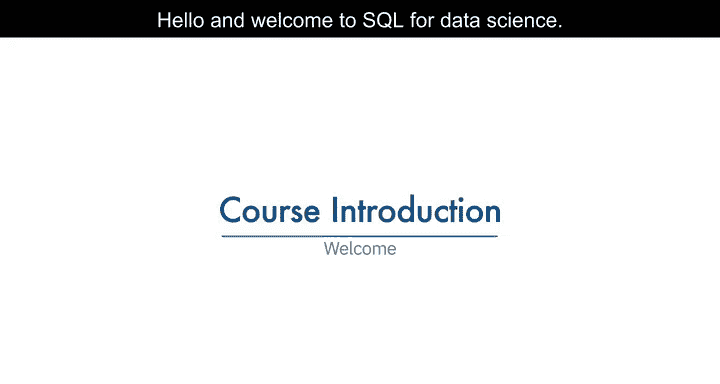

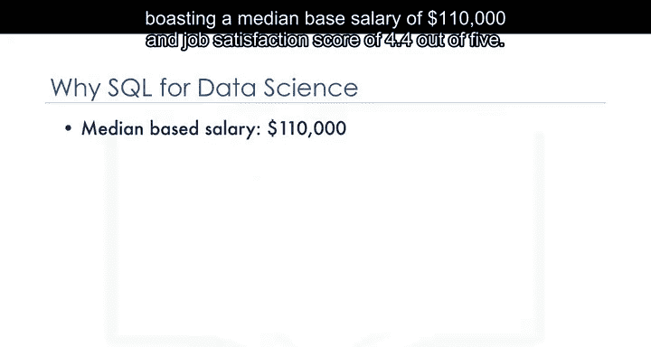

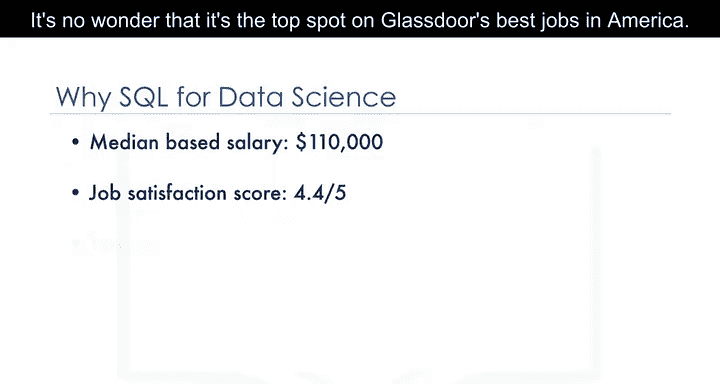

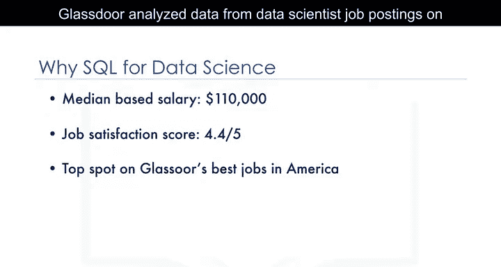

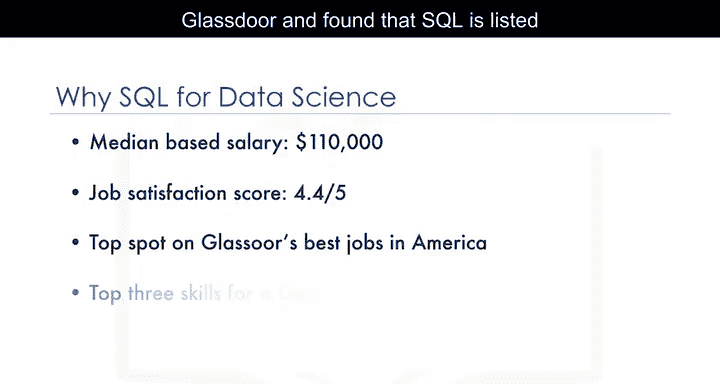

Before you step into the field of data science， it is vitally important that you set yourself apart by mastering the foundations of this field。

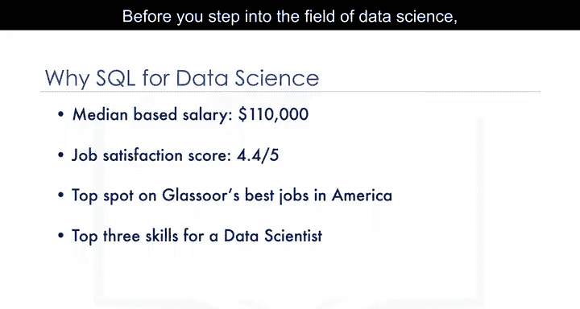

One of the foundational skills that you will require is SQL。

 SQL is a powerful language that's used for communicating with databases。

 Every application that manipulates any kind of data needs to store that data somewhere。

 whether it's big data or just a table with a few simple rows for government or a small startup or a big database that spans over multiple servers or a mobile phone that runs its own small database。

 Here are some of the advantages of learning SQL for someone interested in data science。

 SQL will boost a professional profile as a data scientist。

 as it is one of the most sought after skills by hiring employers。😊。

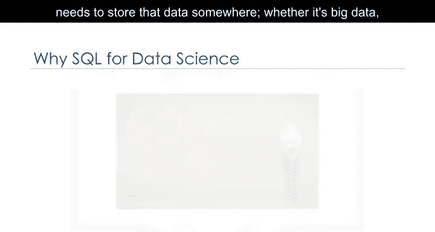

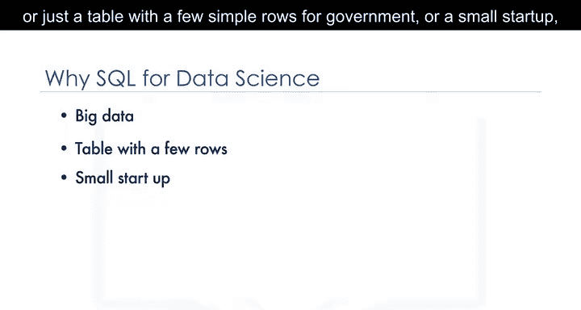

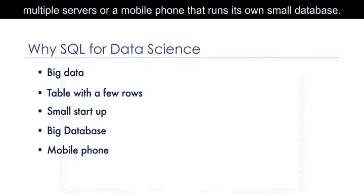

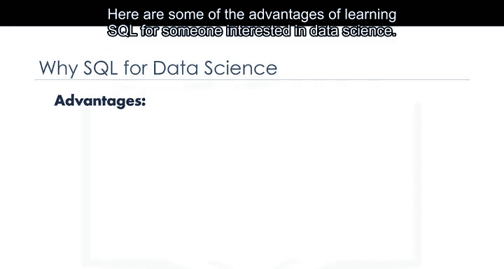

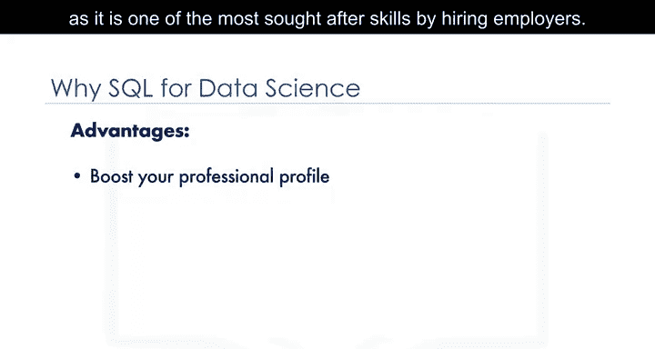

Learning SQL will give you a good understanding of relational databases。

 Tappping into all this information requires being able to communicate with the databases that store the data。

 Even if you work with reporting tools that generate SQL queries for you。

 it may be useful to write your own SQL statements so that you need not wait for other team members to create SQL statements for you。

😊。

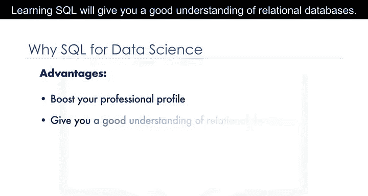

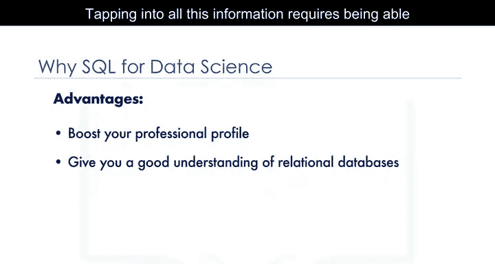

In this course， you will learn the basics of both the SQL language and relational databases。

 The course includes interesting quizzes and hands on lab assignments。

 where you can get experience working with databases In the first few modules。

 you work directly with the database and develop a working knowledge of SQL。😊。

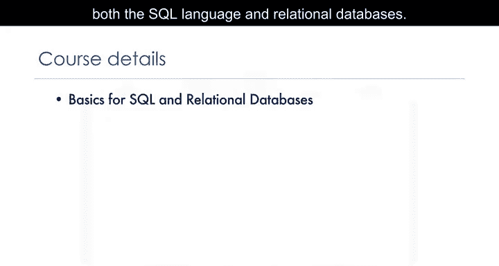

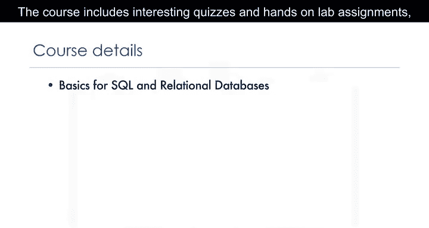

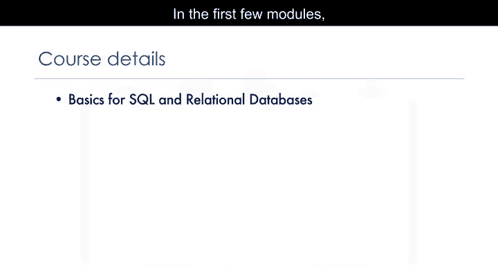

Then you will connect to a database and run SQL queries like a data scientist typically would。

 where you will use Python and Jupiter notebooks to connect to relational databases to access and analyze data。

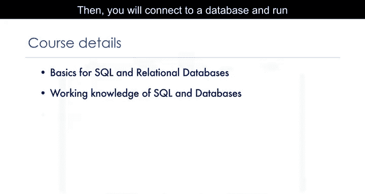

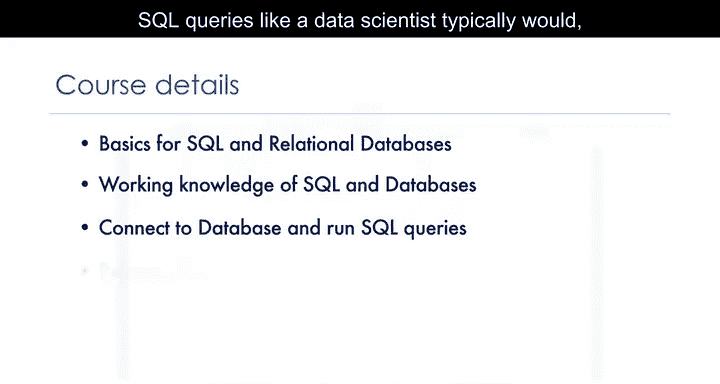

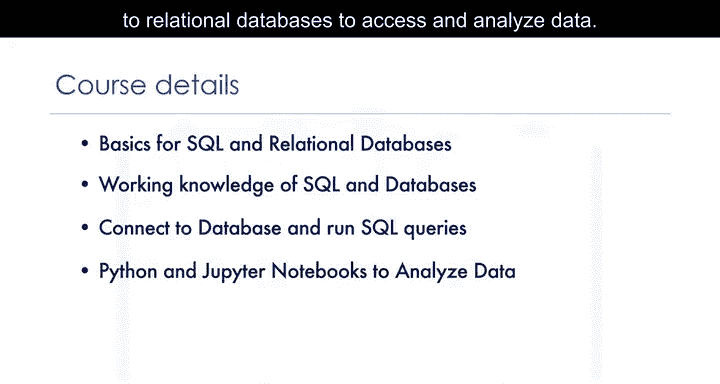

There is also an assignment included towards the end of the course。

 where you will get an opportunity to apply the concepts that you learned。

 So let's get started with SQL for data science。

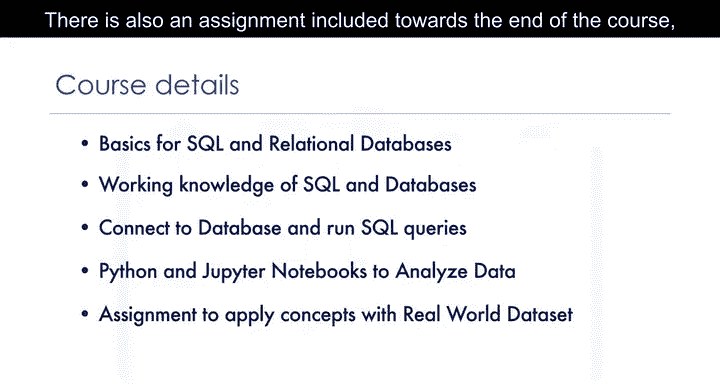

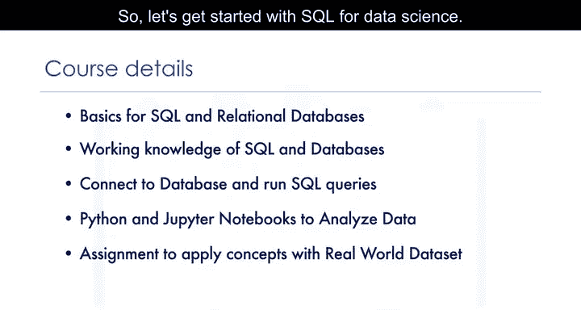