# IBM数据科学专业证书课程6：《数据库与SQL在数据科学中的应用（IBM）》sql-data-science（中英字幕） - P20：19_使用DB API编写代码.zh_en - GPT中英字幕课程资源 - BV1kP41147ce

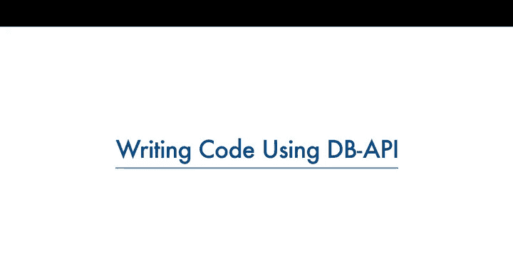

Hello and welcome to Writing Code using DB API。After completing this video。

 you will be able to explain the basic concepts related to the Python DB API and database cursors and also write code using DB APIpis As we saw in the beginning of this module。

 the user writes Python programs using a Jupiter notebook。

 There is a mechanism by which the Python code communicates with the DBMS。

 The Python code connects to the database using DB APIpi calls。

 DB APIpi is Python standard API for accessing relational databases。

 It is a standard that allows you to write a single program that works with multiple kinds of relational databases。

 Instead of writing a separate program for each one。

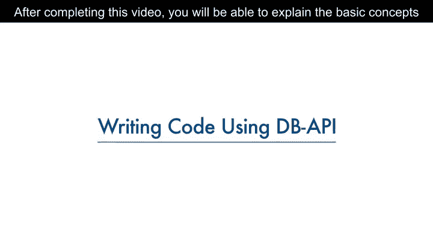

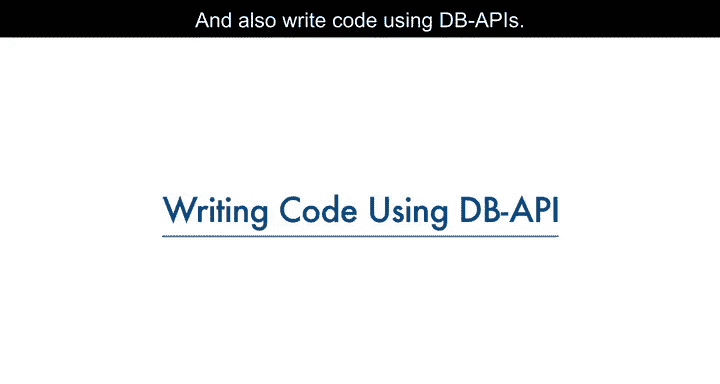

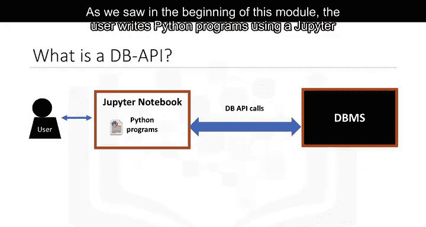

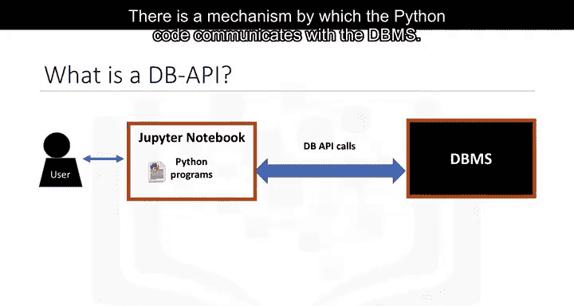

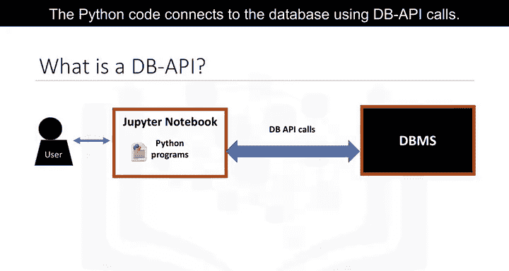

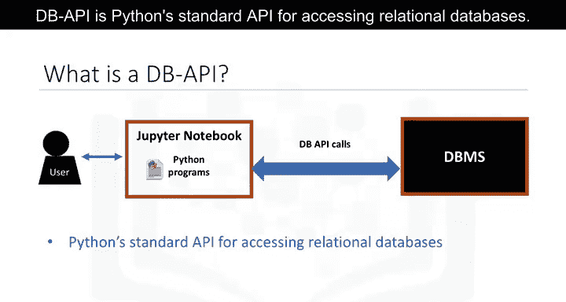

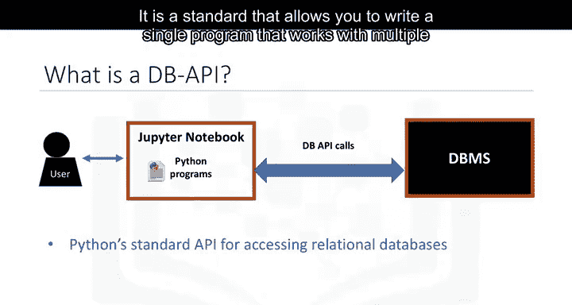

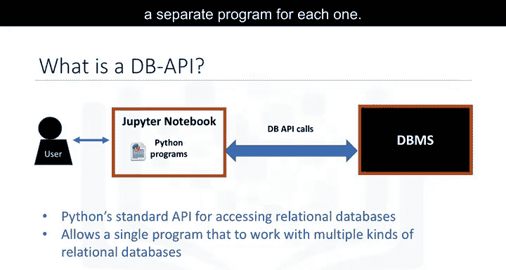

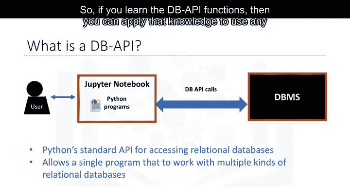

So if you learn the DB API functions， then you can apply that knowledge to use any database with Python。

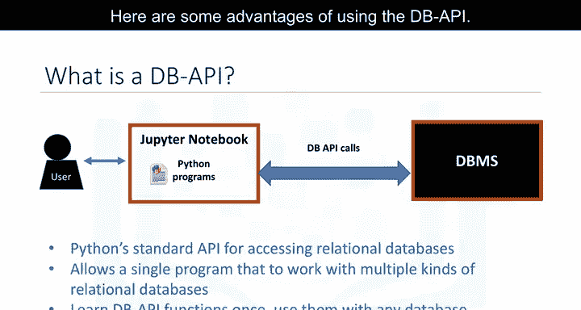

Here are some advantages of using the DB API。 It's easy to implement and understand。

 This API has been defined to encourage similarity between the Python modules that are used to access databases。

 It achieves consistency， which leads to more easily understood modules。

 The code is generally more portable across databases。

 and it has a broader reach of database connectivity from Python。

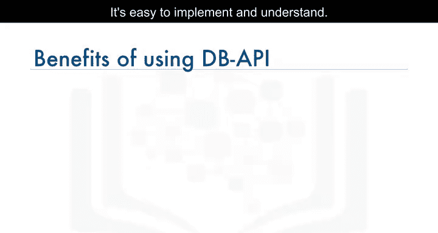

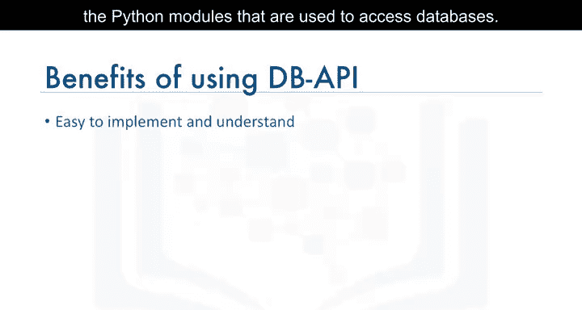

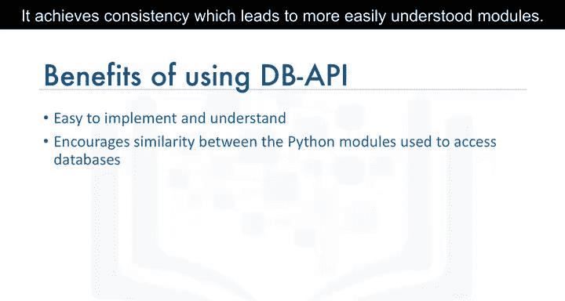

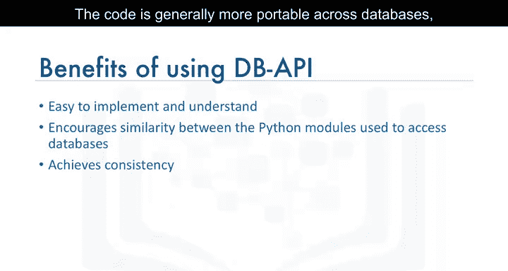

As we know， each database system has its own library， as you can see。

 the table shows a list of a few databases and corresponding DB APIs to connect to Python applications the IBM_ DB library is used to connect to an IBM DB2 database。

The MysQL connector Python library is used to connect to a compose for MysQL database。

 The psychopG2 library is used to connect to a compose from PostgresqL database and finally。

 the P Mongo library is used to connect to a compose from Mongo DB database。

 The two main concepts in the Python DB APIpi are connection objects and query objects。

 You use connection objects to connect to a database and manage your transaction。

 cursor objects are used to run queries。 You open a cursor objects and then run queries。

 The cursor works similar to a cursor in a text processing system where you scroll down in your results set and get your data into the application cursors are used to scan through the results of a database The DBAPpi includes a connect constructor for creating a connection to the database。

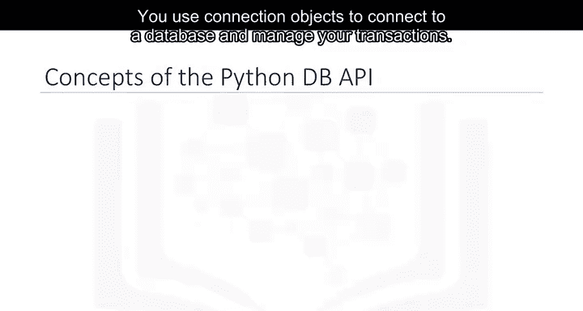

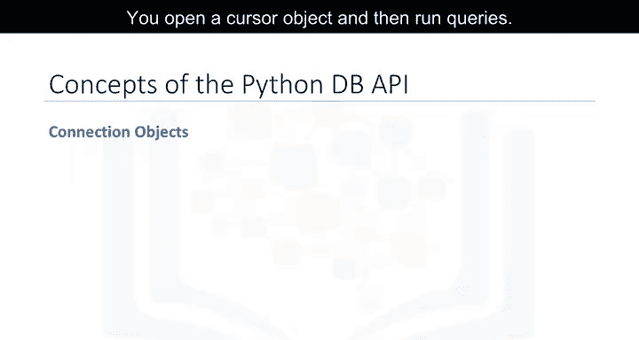

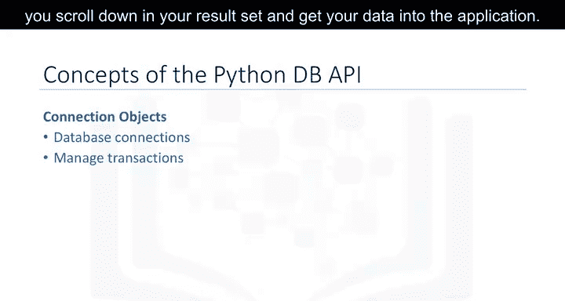

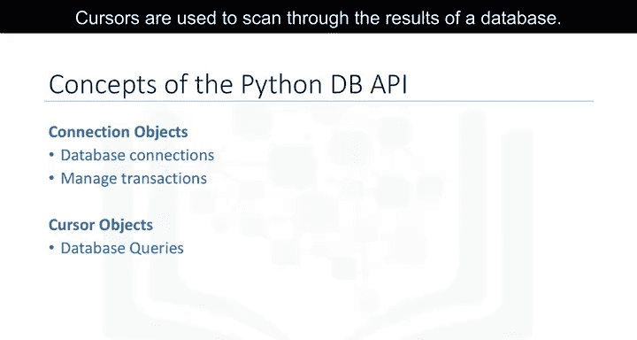

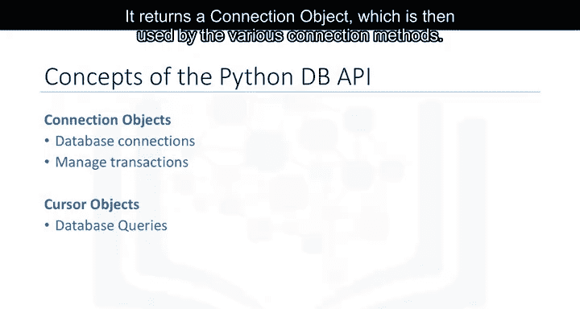

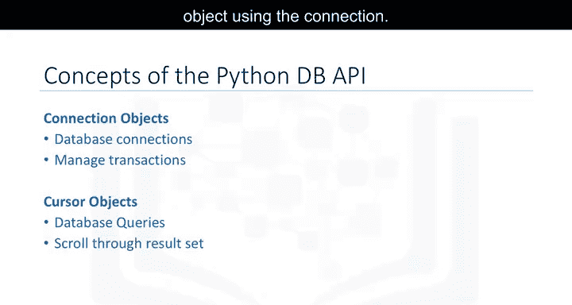

It returns a connection object which is then used by the various connection methods these connection methods are the cursor method。

 which returns a new cursor object using the connection， the commit method。

 which is used to commit any pending transaction to the database， the rollback method。

 which causes the database to roll back to the start of any pending transaction。

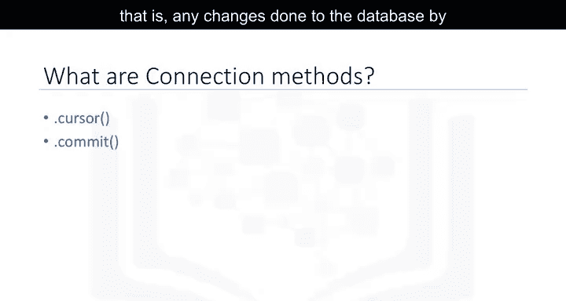

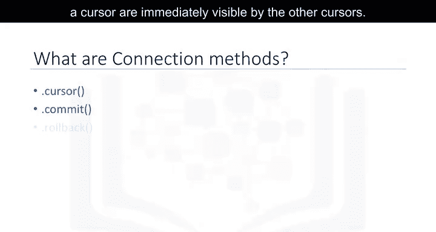

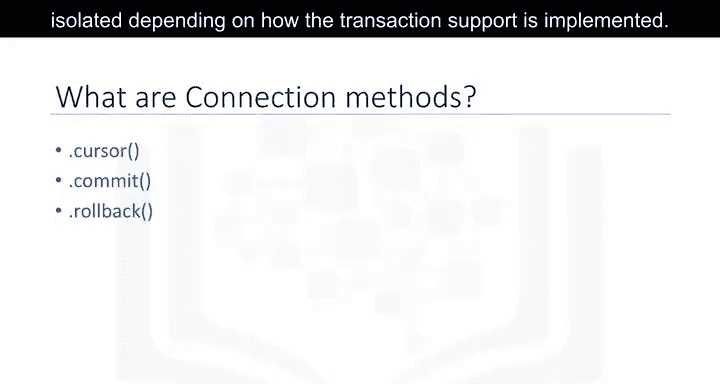

The close method， which is used to close a database connection。

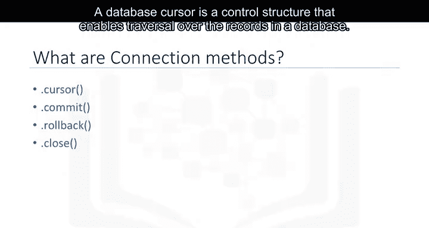

These objects represent a database cursor which is used to manage the content of a fetch operation。

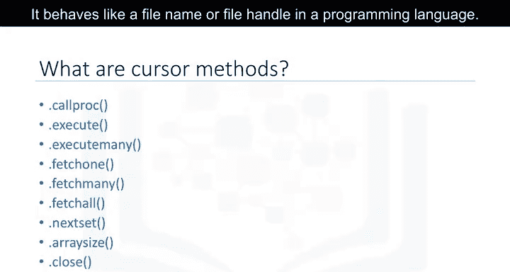

Cursors created from the same connection are not isolated。

 That is any changes done to the database by a cursor are immediately visible by the other cursors cursors created from different connections can or cannot be isolated depending on how the transaction support is implemented。

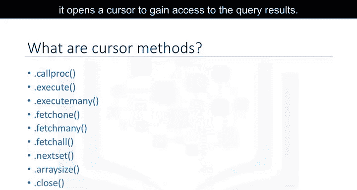

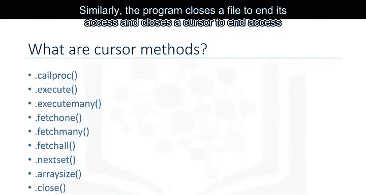

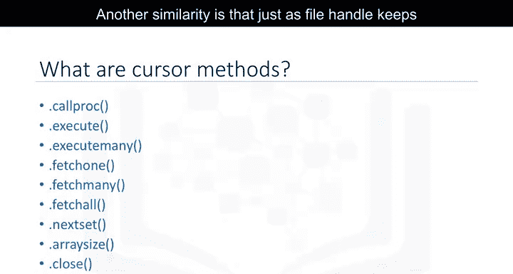

A database cursor is a control structure that enables transversal over the records in a database。

 it behaves like a file name or file handle in a programming language。

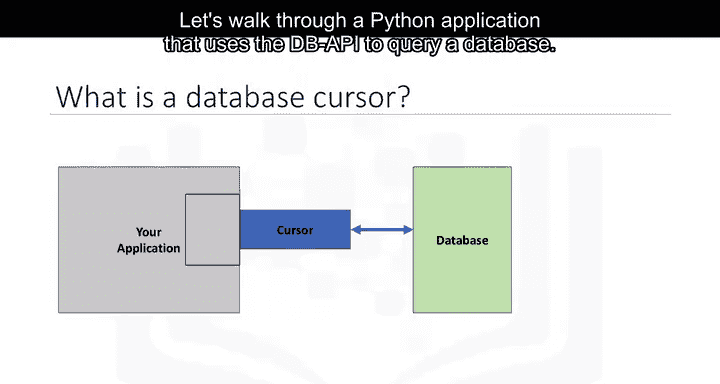

Just as a program opens a file to access its contents。

 it opens a cursor to gain access to the query results。

Similarly， the program closes a file to end its access and closes a cursor to end access to the query results。

 another similarity is that just as file handle keeps track of the program's current position within an open file。

 a cursor keeps track of the program's current position within the query results。

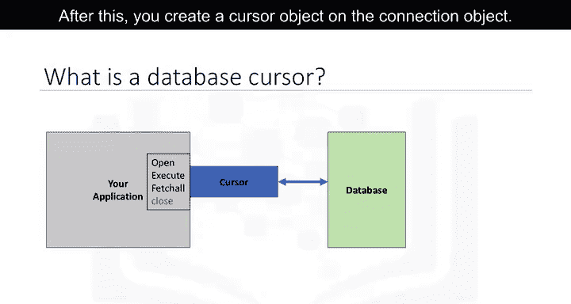

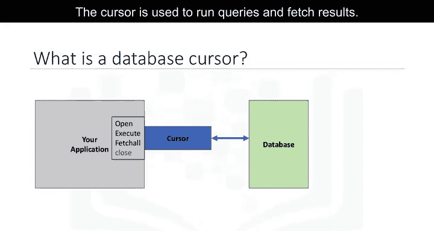

Let's walk through a Python application that uses the DB API to query a database。 First。

 you import your database module by using the Connect API from that module to open a connection to the database。

 you use the connect constructor and pass in the parameters that is the database name username and password the Connect function returns connection object After this。

 you create a cursor object on the connection object the cursor is used to run queries and fetch results After running the queries using the cursor。

 we also use the cursor to fetch the results of the query Finally。

 when the system is done running the queries， it frees all resources by closing the connection remember that it is always important to close connections to avoid unused connections taking up resources。

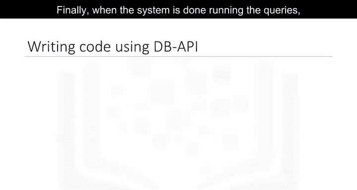

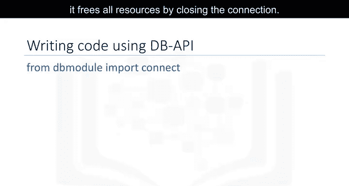

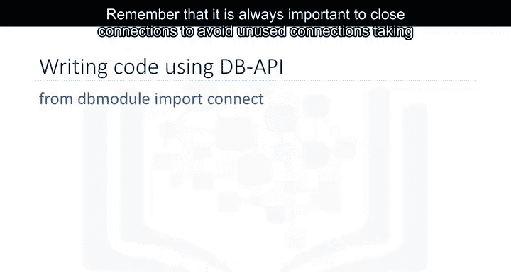

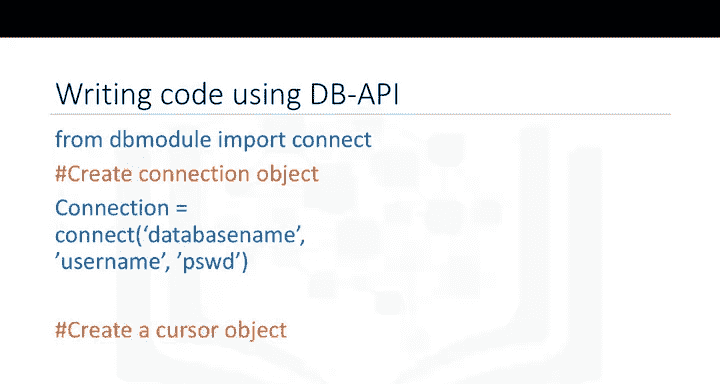

Thanks for watching this video。