# IBM数据科学专业证书课程6：《数据库与SQL在数据科学中的应用（IBM）》sql-data-science（中英字幕） - P23：22_Python数据分析实践.zh_en - GPT中英字幕课程资源 - BV1kP41147ce

Hello and welcome to analyzingly data with Python After completing this video。

 you will be able to understand basic concepts related to performing exploratory analysis on data。

 we will demonstrate an example of how to store data using the IBM DB2 on Cloud database and then use Python to do some basic data analysis on this data。

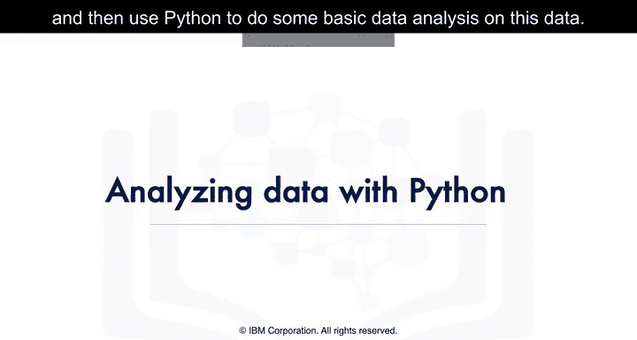

In this video， we will be using the McDonald's menu nutritional F data for popular menu items at McDonald's。

 while using Python to perform basic exploratory analysis。

McDonald's is an American fast food company and the world's largest restaurant chain by revenue。

 Although McDonald's is known for fast food items such as hamburgers， French fries， soft drinks。

 milkshakes and desserts， the company has added to its menus， salads， fish， smoothies and fruit。😊。

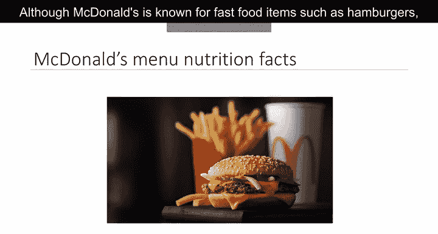

McDonald's provides nutrition analysis of their menu items to help you balance your McDonald's meal with other foods you eat。

 The dataset set used in this lesson has been obtained from the nutritional facts for McDonald's menu from Cale。

 We need to create a table on DB2 to store the McDonald's menu nutrition facts dataset set that we will be using。

 We will also be using the console provided by D B2 for this process。

 There are four steps involved in loading data into a table source， target， define and finalize。

 We first load the spreadsheet into the DB2 using the console。 We then select the target schema。

 and then you will be given an option to load the data into an existing table or create a new table。

😊。

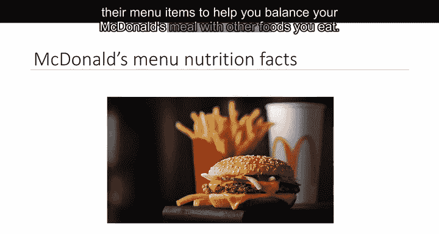

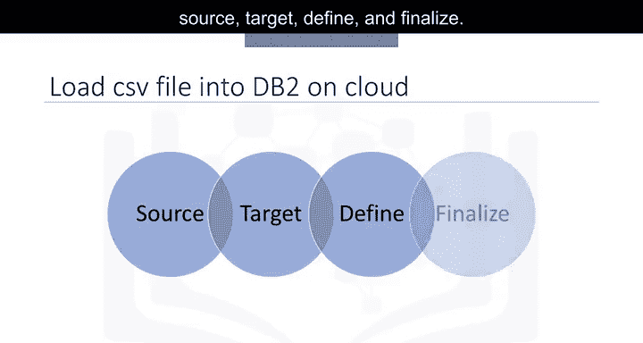

When you choose to create a new table， you have the option to specify the table name。 Next。

 you will see a preview of the data where you can also define the columns and data types。

 review the settings and begin the load。When the loading is complete。

 you can see the statistics on the loaded data。 Next， view the table to explore further。

DB2 allows you to analyze data using in database analytics APIs， ourSt or Python。

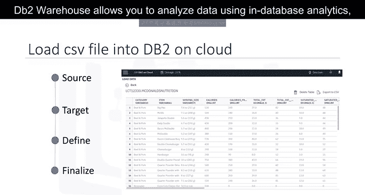

The data has been loaded into a relational database。

 You can run Python scripts that retrieve data from and write data to a DB2 database。

 Such scripts can be powerful tools to help you analyze your data。 For example。

 you can use them to generate statistical models based on data in your database and to plot the results of these models。

In this lesson， we will be using Python scripts that will be run within a Jupiter notebook。Now。

 after obtaining a connection resource by connecting to the database by using the connect method of the IBM underscore D B A P。

 we use the SQL select query to verify the number of rows that have been loaded in the table created。

 The figure shows a snapshot of the output。 The output obtained as 260。

 which is similar to the number of rows in the D B2 console。

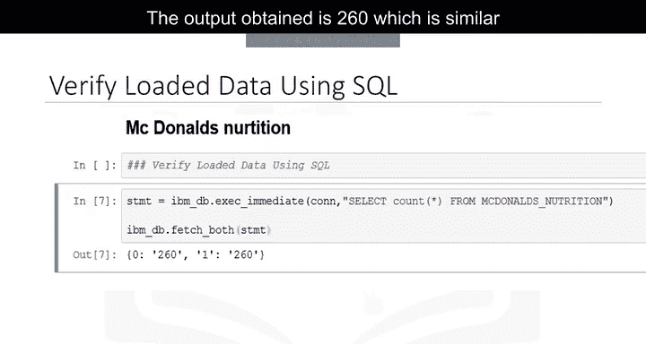

Now， let's see how we can use pandas to retrieve data from the database tables。

 We load data from the McDonald's underscore nutrition table into the data frame Df using the Read underscore SQL method。

 The SQL select query and the connection object are passed as parameters to the read underscore SQL method。

 We can view the first few rows of the data frame D F。 that we created using the head method。

 Now it's time to learn about your data。 Pada's methods are equipped with a set of common mathematical and statistical methods。

 Let's use the described method to view the summary。 Sta of the data in the data frame。

 Then explore the output of the described method。

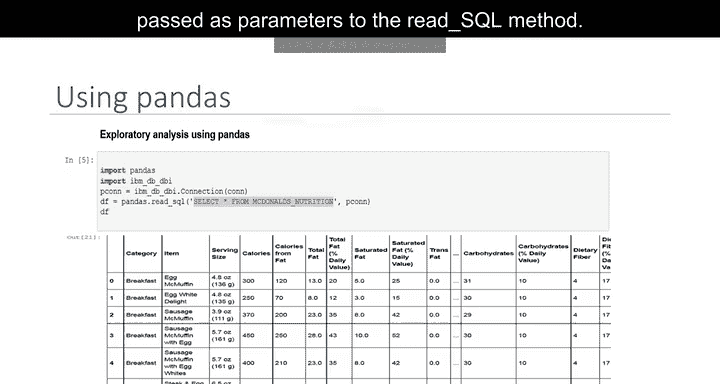

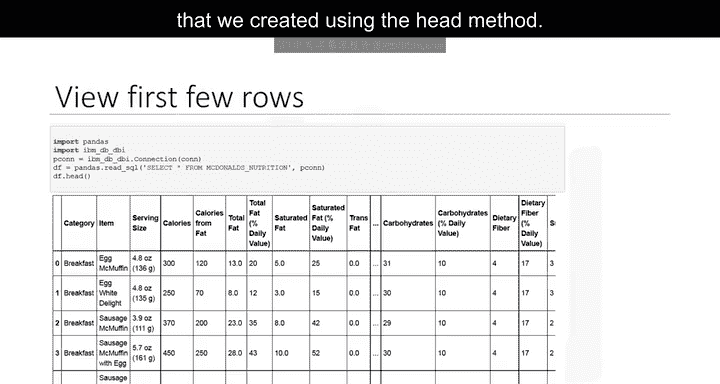

We see that there are 260 observations or food items in our data frame。

 We also see that there are 9 unique categories of food items in our data frame。

We can also see summary statistics， information such as frequency， mean， median， standard deviation。

 et cetera for the 260 food items across the different variables。 For example。

 the maximum value for total fat is 118。 Let's investigate this data further。

 Let's try to understand one of the nutrients in the food items， which is sodium。

 A main source of sodium is table salt。 The average American eats 5 or more teaspoons of salt each day。

 This is about 20 times as much as the body needs。 Sodium is found naturally in foods。

 but a lot of it is added during processing and preparation。 Many foods that do not taste salty。

 may still behind sodium。 Lage amounts of sodium can be hidden in canned。

 processed and convenience foods。Sodium controls fluid balance in our bodies and maintains blood volume and blood pressure。

 Eating too much sodium may raise blood pressure and cause fluid retention。

 which could lead to swelling of the legs and feet or other health issues。

 When limiting sodium in your diet。 A common target is to eat less than 2000 mg of sodium per day。

 Now， using the nutrition data set for McDonald's， Let's do some basic data analysis to answer the question。

 Which food item has the maximum sodium content， we first use visualization to explore the sodium content of food items。

 using the swarm plot method provided by the seaborne package。

 We create a categorical scatter plot as shown on the right。

Then give as the input category on the X axis， sodium on the Y axis。

 and the data will be the data frame D F that contains the nutritional data set from McDonald's。

 The plot shows the sodium values for the different food items by category。

Notice a high value of around 3600 for sodium on the scatter plot。

 We will be learning about visualizations later in this module。

 Let's further explore this high sodium value and identify which food items on the menu have this value for sodium。

 Let some basic data analysis using Python to find which food items on the menu have maximum sodium content to check the values of sodium levels in the food items within the data set。

 We use the code as shown in code 1。 The describe method is used to understand the summary statistics associated with sodium。

😊。

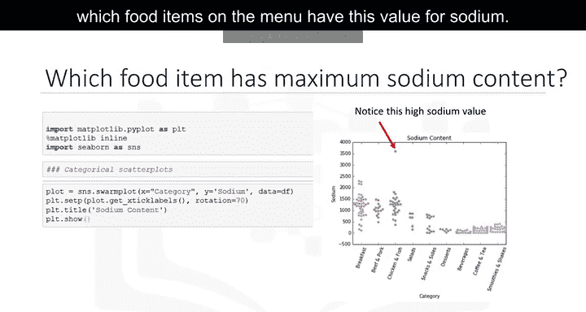

Notice that the maximum value of sodium is given us 3600。 Now。

 let's further explore the row associated with the maximum sodium variable， as shown in code 2。

 We use the IX max method to compute the index values at which the maximum value of sodium is obtained in the data frame。

 We see that the output is 82。 Now， let's find the item name associated with the 82 item in our data frame。

 As shown in code 3， we will use the dot at method to find the item name by passing the index of 82 and the column name item to be returned for the 82nd row。

Finally， we find that the food item on the menu that has the highest sodium content is chicken Mcnuggtets。

40 pieces。 Visualizations are very useful for initial data exploration。

 They can help us understand relationships， patterns and outliers in the data。

 Let's first create a scatter plot with protein on the X axis and total fat on the Y axis。

 scatter plots are very popular visualization tools and show the relationship between two variables with a point for each observation。

 To do this， we can use the joint plot function provided by the seaborne package and give as input protein on the X axis and total fat on the Y axis。

 And the data will be the data frame D F that contains the nutritional data set from McDonald's。

 The output scatter plot is shown on the right side。 The plot has an interesting shape。😊。

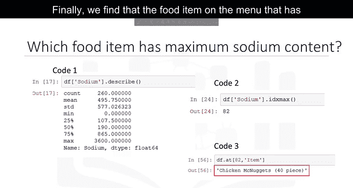

It shows the correlation between the two variables， Pro and fat。

 correlation is a measure of association between two variables and has a value of between negative 1 and plus1。

 We see that the points on the scatter plot are closer to a straight line in the positive direction。

 So we have a positive correlation between the two variables。

 on the top right corner of the scatter plot。 We have the values of the Pearson correlation，0。81。

 and the significance of the correlation denoted as P。

 which is a good value that shows the variables are certainly correlated。

 The plot also shows two histograms， One on the top and the other on the right side。

 The histogram on the top is that of the variable protein and the histogram on the right side is that of the variable total fat。

 We also notice that there is a point on the scatter plot outside the general pattern。

 This is a possible outlier。 Now， let's see how we can visualize data using box plots。

 Box plots are charts that indicate the distribution of one or more variables。😊。

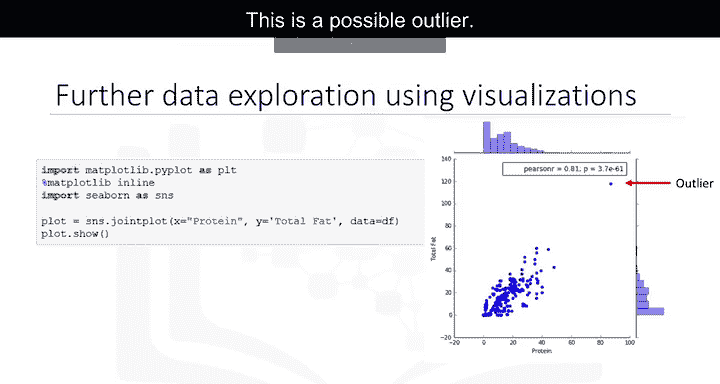

The box in a box plot captures the middle 50% of data。

 Line and points indicate possible skewness and outliers。 Let's create a box plot for sugar。

 The function we are going to use is box plot from the seedborn package。

 We give the column named sugars as input to the box plot function。

 The output is shown on the right side where we have the box plot with average values of sugar and food items around 30 G。

 We also notice a few outliers that indicate food items with extreme values of sugar。

 There exists food items in the data set that have sugar content of around 128 G。

 Candies may be among these high sugar content food items on the menu。

 Now that you know how to do basic exploratory data analysis using pandas and visualization tools proceed to the labs in this module where you can practice the concepts learned。

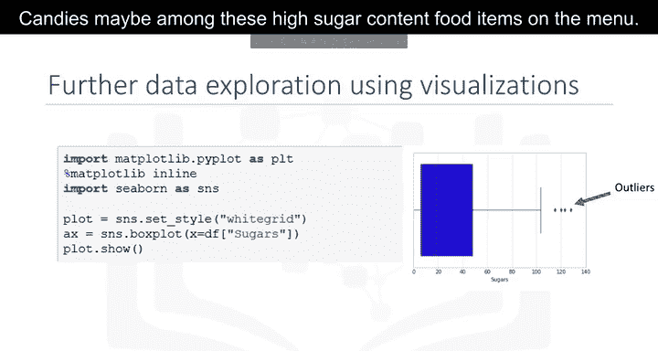

Thank you for watching this video。