# IBM数据科学专业证书课程6：《数据库与SQL在数据科学中的应用（IBM）》sql-data-science（中英字幕） - P27：26_存储过程使用.zh_en - GPT中英字幕课程资源 - BV1kP41147ce

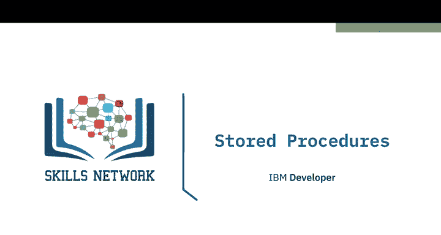

Welcome to stored procedures After watching this video。

 you will be able to explain what a stored procedure is list the benefits of using stored procedures and describe how to create and use a stored procedure a stored procedure is a set of SQL or SQL statements that are stored and executed on the database server So instead of sending multiple SQL statements from the client to the server。

 you encapsulate them in a stored procedure on the server and send one statement from the client to execute them you can write stored procedures in many different languages for example。

 for DB2 on cloud and DB2 you can write in SQL P P SQL。

 Java C or other languages they can accept information as parameters， perform， create， read。

 update and delete Cd operations and return results to the client application the benefits of stored procedures include reduction in network traffic because only one call is needed to。

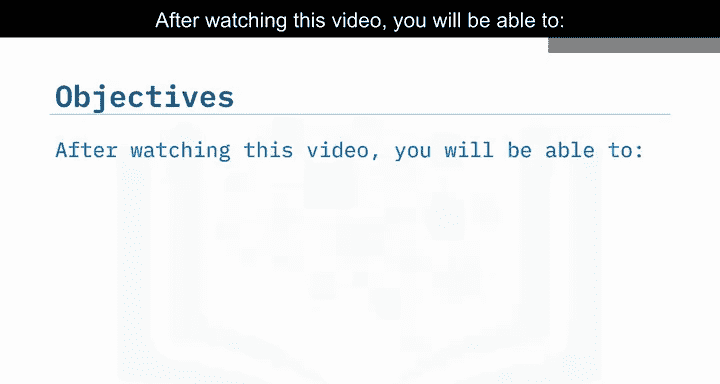

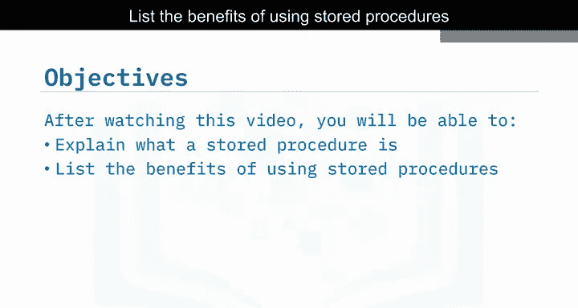

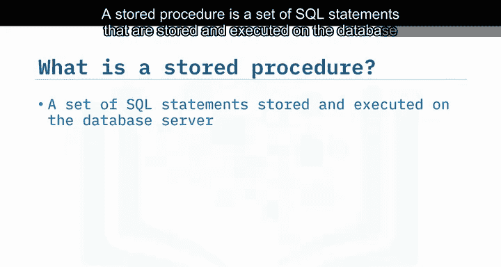

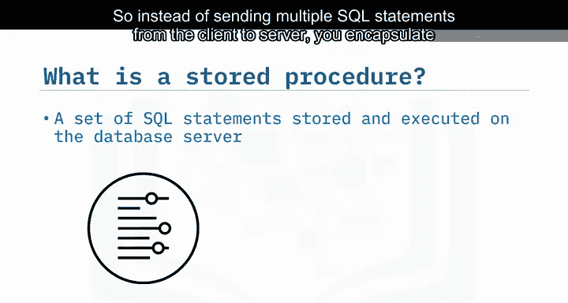

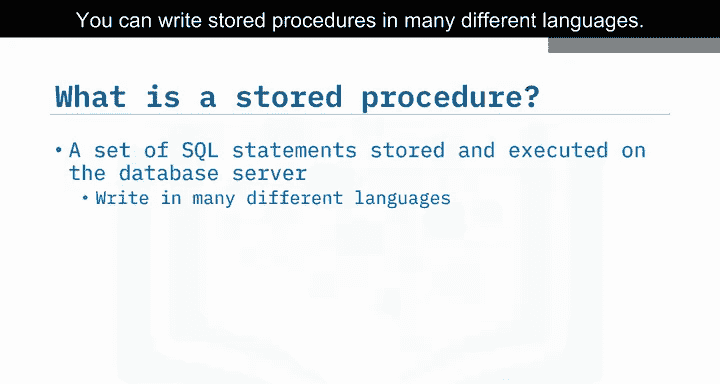

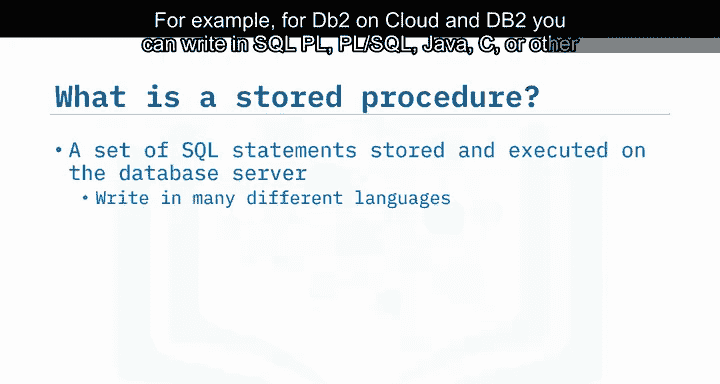

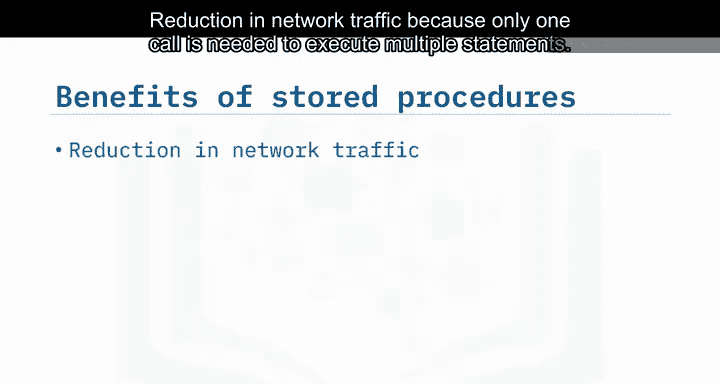

Sec multiple statements Impement in performance because the processing happens on the server where the data is stored with just the final result being passed back to the client reuse of code because multiple applications can use the same stored procedure for the same job and an increase in security because A you do not need to expose all of your table and column information to clientside developers and B you can use server-side logic to validate data before accepting it into the system remember though that SQL is not a fully fledged programming language so you should not try to write all of your business logic in your stored procedures So let us look at how to create a stored procedure on DB2 on cloud in SQL。

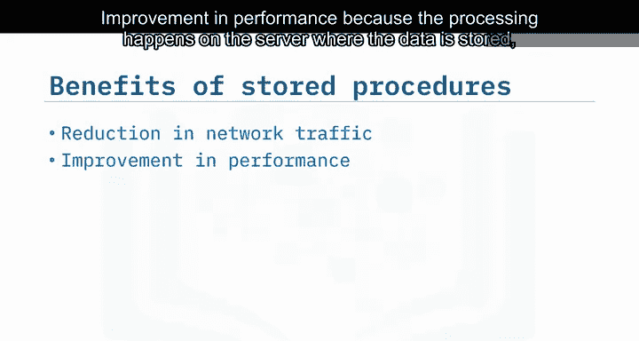

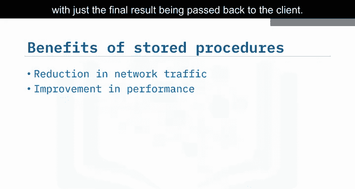

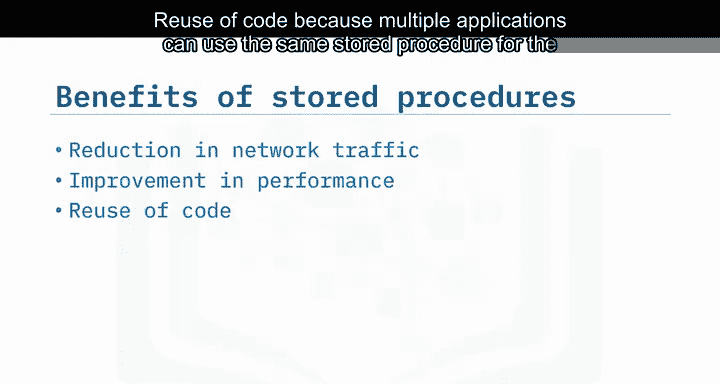

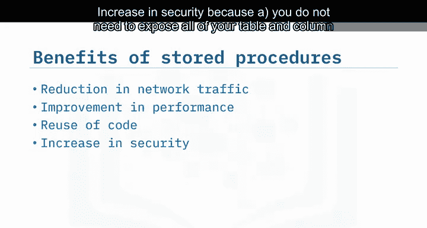

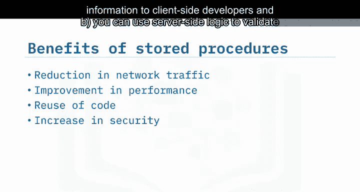

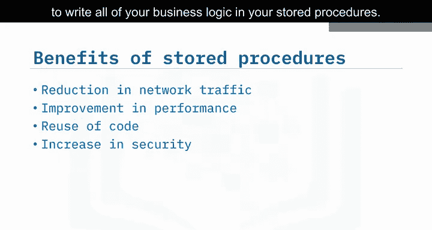

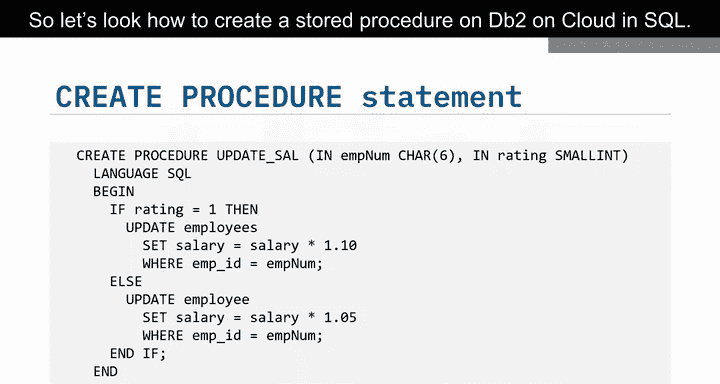

First， you use the Cate procedure statement specifying the name of the procedure and any parameters which it will take In this example。

 the update underscore Sal procedure will take an employee number and a rating which it will use to update an employee's salary by an amount depending on their rating then you declare the language you are using you then enclose your Proed a logic in the begin and statements In this case。

 giving employees who have a rating of one a 10% pay raise and all others a 5% pay raise noticeice that you can use the information passed to the procedure。

 the parameters directly in your procedure a logic you can call stored procedure from your external applications or from dynamic SQL statements to call the update underscore Sal stored procedure that we just created you use the call statement with the name of the stored procedure and pass the required parameters in this case。

 the employee ID and the rating for that employee。

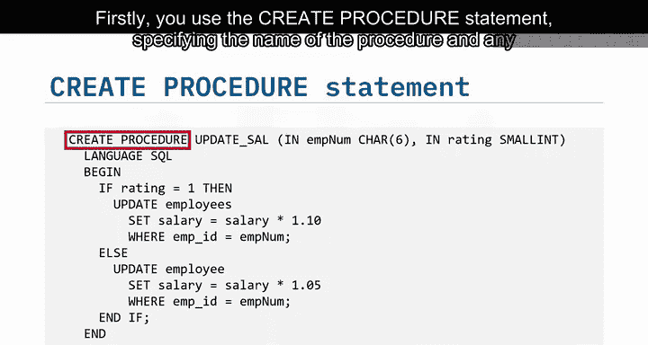

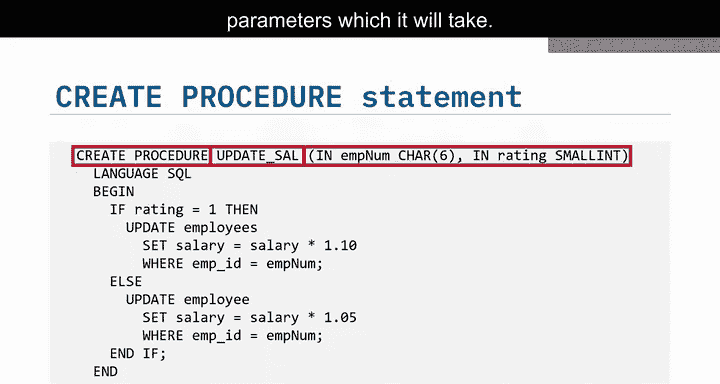

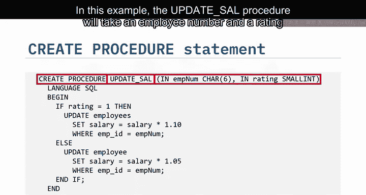

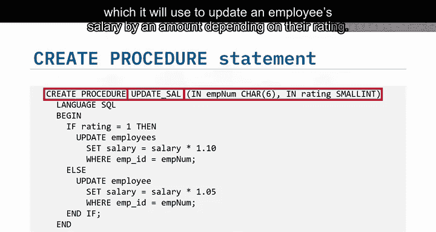

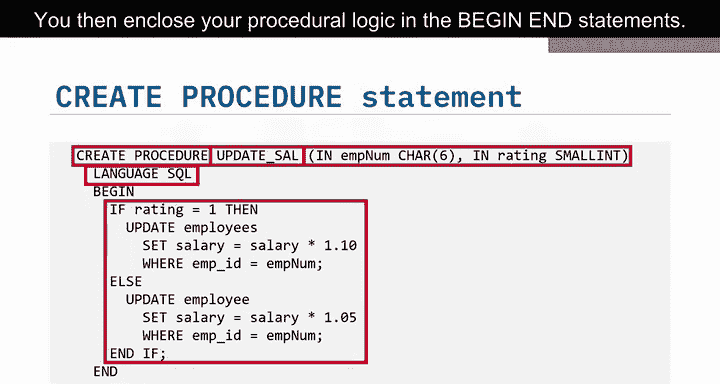

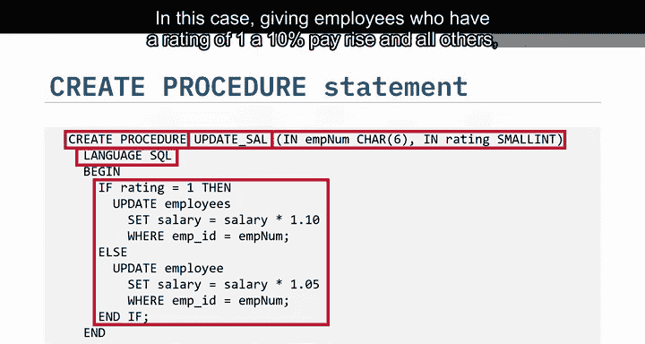

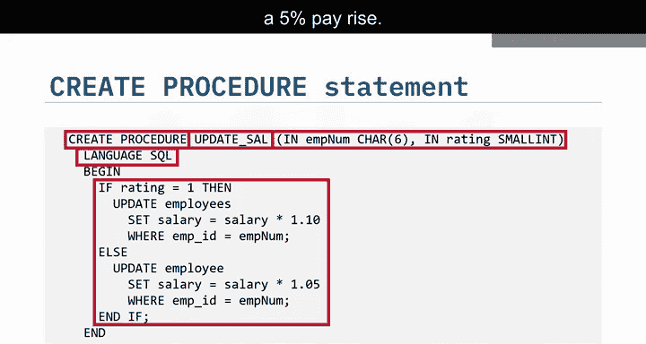

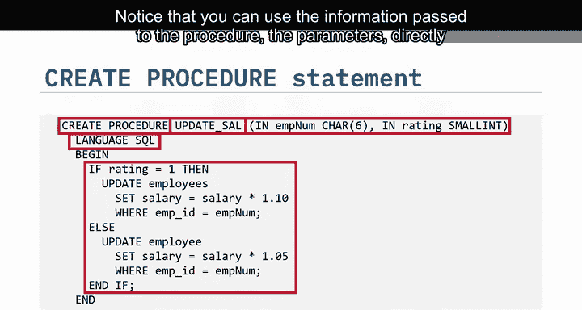

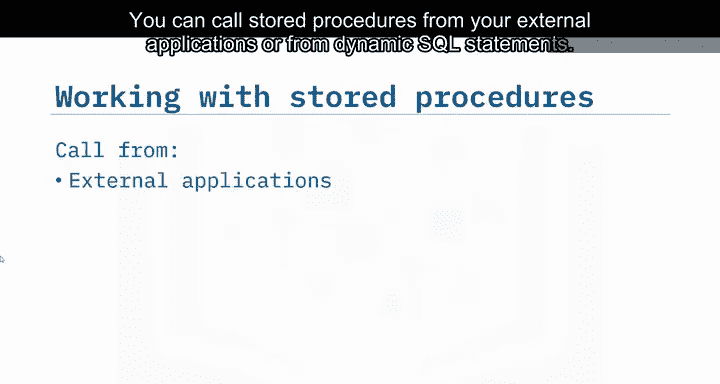

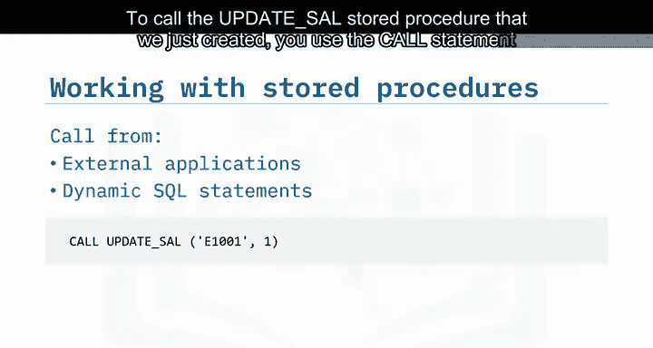

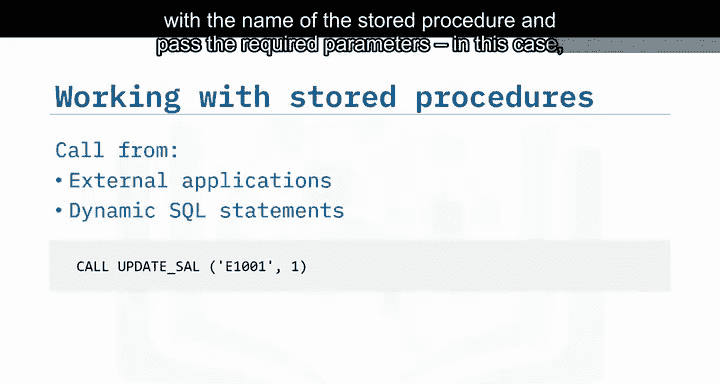

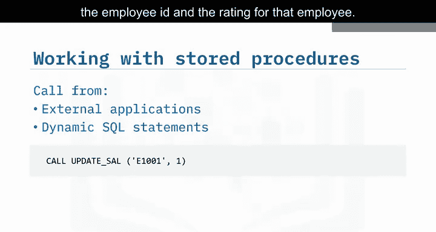

In this video you learned that stored procedures are a set of SQL statements that execute on the server。

 stored procedures offer many benefits over sending SQL statements to the server。

 and you can use stored procedures in dynamic SQL statements and external applications。

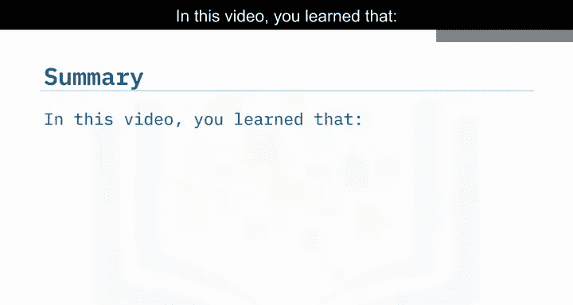