# IBM数据科学专业证书课程6：《数据库与SQL在数据科学中的应用（IBM）》sql-data-science（中英字幕） - P2：1_数据库系统导论.zh_en - GPT中英字幕课程资源 - BV1kP41147ce

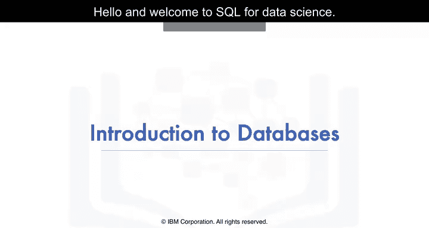

Hello and welcome to SQL for Data Science。 First， we will talk a little bit about what you'll learn in this course。

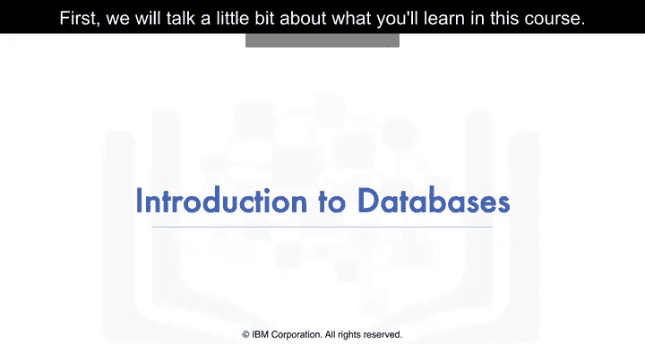

This course teaches you the basics of the SQL language and the relational database model。

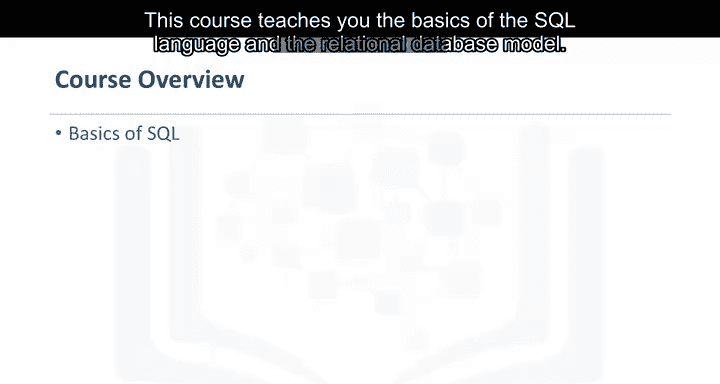

There will be some lab exercises， and at the end of each section， there are a few review questions。

 and at the end， there is a final exam。

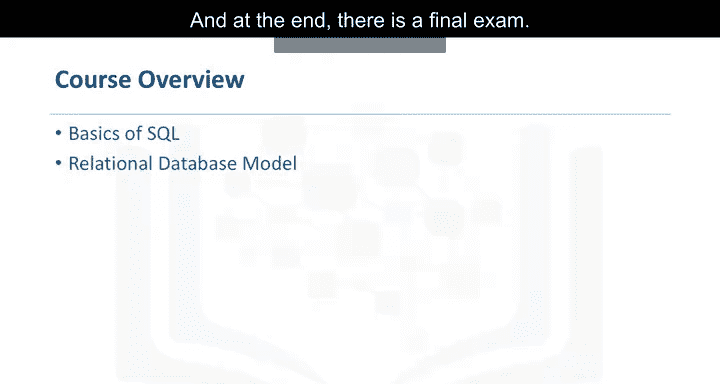

By the end of this course， you will be able to discuss SQL basics and explain various aspects of the relational database model。

 In this video， we will learn about SQL and relational databases。😊。

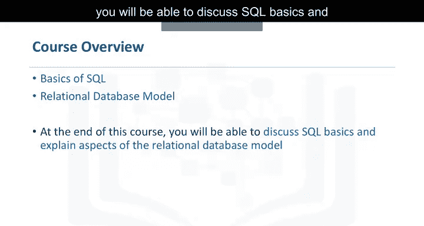

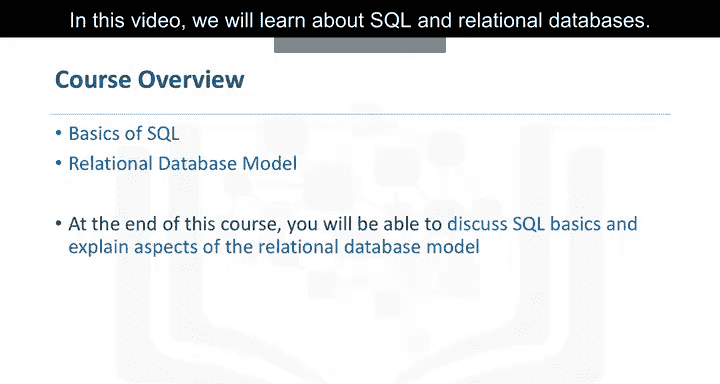

By the end of this video， you will be able to describe SQL data， database。

 a relational database and list  five basic SQL commands。 But wait。

 what is SQL and what is a relational database。😊，What is SQL。

 SQL is a language used for relational databases to query or get data out of a database。 S。

 Q L is also referred to as SQL and is short for its original name， Strd English query language。

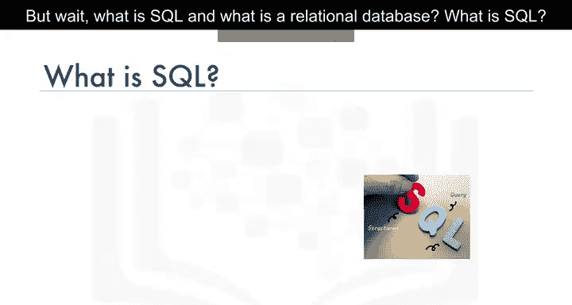

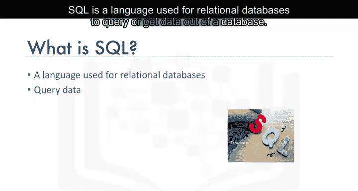

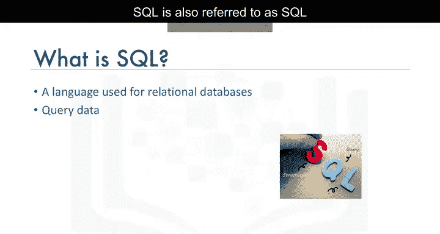

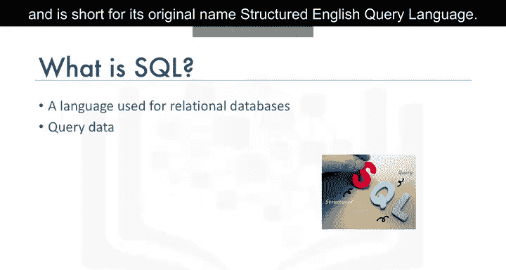

So SQL is a language used for a database to query data， but what is data and what is a database？

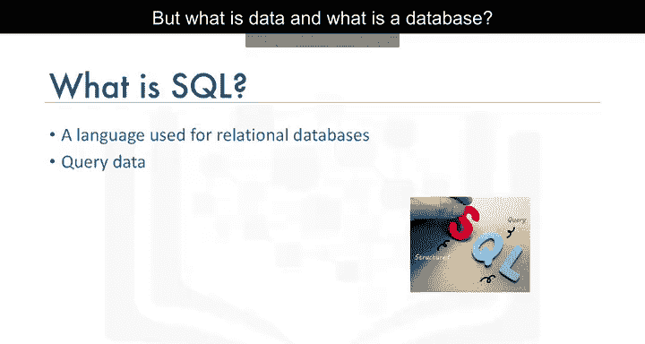

Data is a collection of facts in the form of words， numbers， or even pictures。

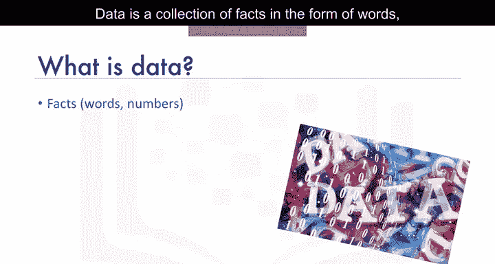

Data is one of the most critical assets of any business。

 It is used and collected practically everywhere。 Your bank stores data about you， your name。

 address， phone number， account numbers， et cetera。

 Your credit card company and your Paypal accounts also store data about you。Data is important。

 so it needs to be secure， and it needs to be stored in access quickly。 The answer is a database。

 So what is a database。Databases are everywhere and used every day。

 but they are largely taken for granted。 A database is a repository of data。

 It is a program that stores data。

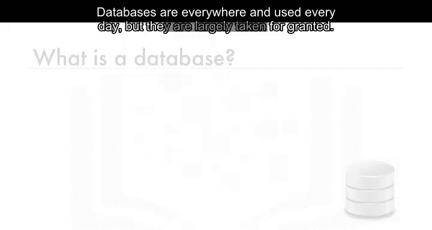

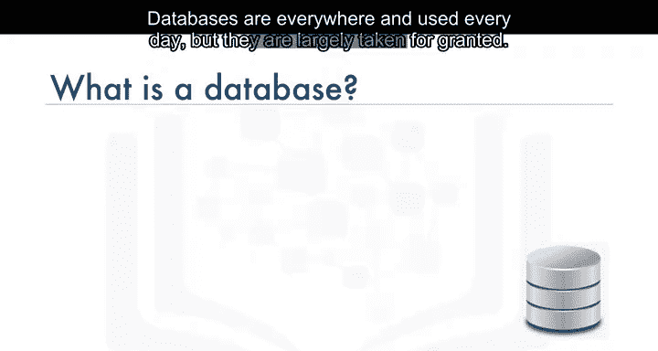

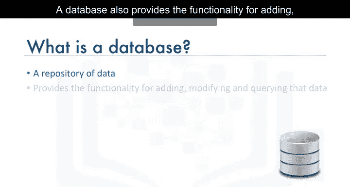

A database also provides the functionality for adding， modifying and querying that data。

 There are different kinds of databases of different requirements。

 The data can be stored in various forms。 When data is stored in tabular form。

 the data is organized in tables， like in a spreadsheet， which is columns and rows。

 that's the relational database。

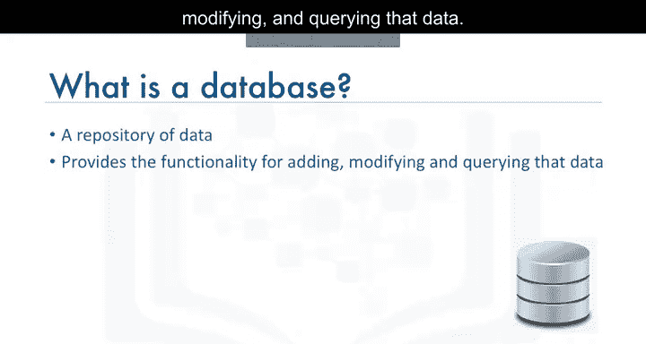

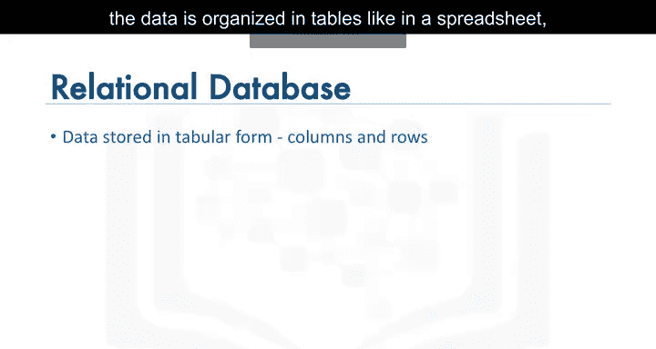

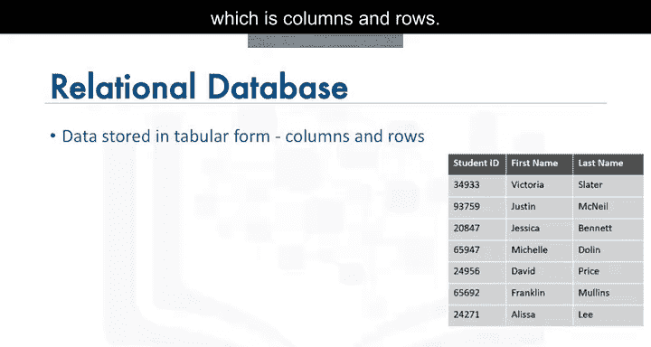

The columns contain properties about the item such as last name， first name， email address， city。

A table is a collection of related things， like a list of employees or a list of book authors in a relational database。

 you can form relationships between tables。So a database is a repository of data。

 a set of software tools for the data in the database is called a database management system or DBMS for short。

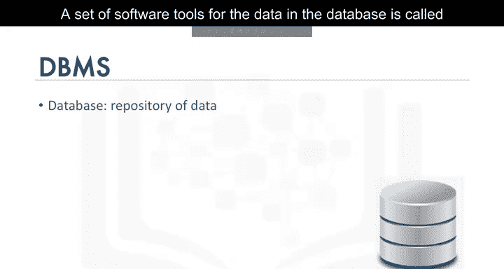

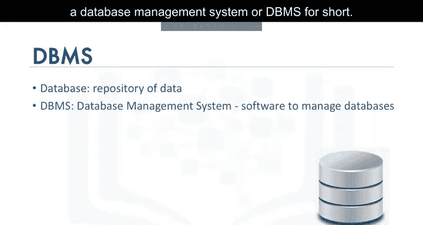

The terms database， database server， database system。

 Data server and database management systems are often used interchangeably。For relational databases。

 it's called a relational database management system， or RDBMS。

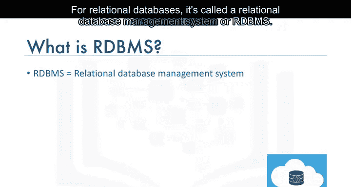

RDBMS is a set of software tools that controls the data such as access， organization and storage。

 And RDBMS S serves as the backbone of applications in many industries， including banking。

 transportation， health and so on。

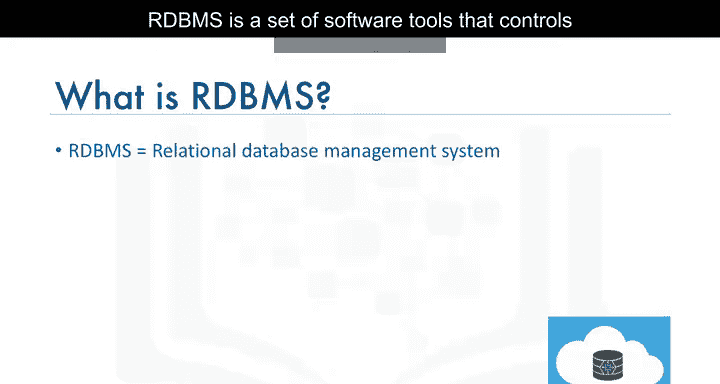

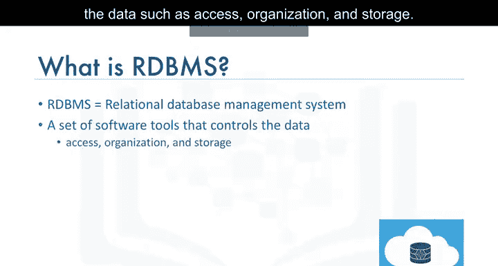

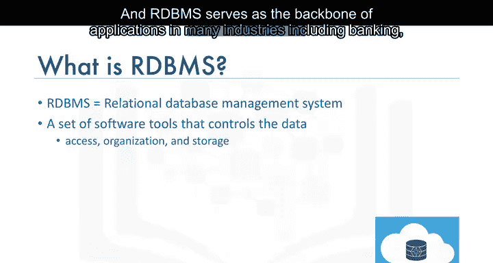

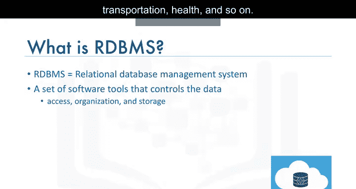

Examples of relational database management systems are MySqL， Oracle database。

 DB2 warehousehouse and DB2 on cloud。For the majority of people using a database。

 there are five simple commands to create a table， insert data to populate the table。

 select data from the table。

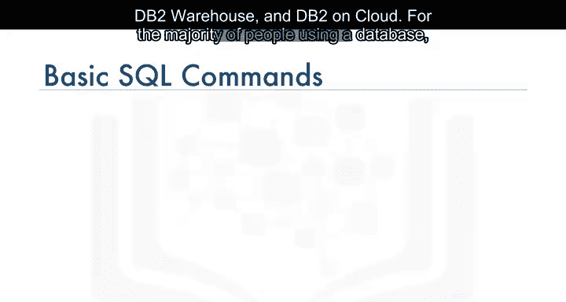

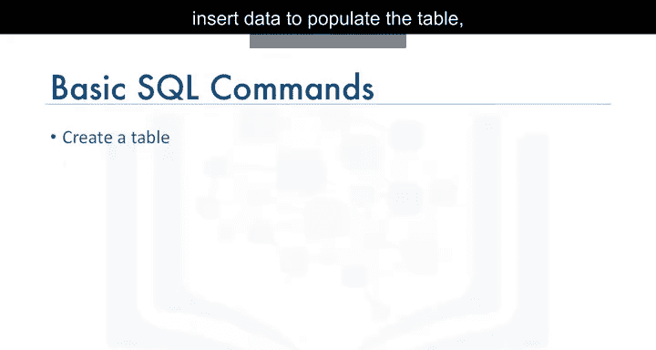

Update data in the table。 Delete data from the table。

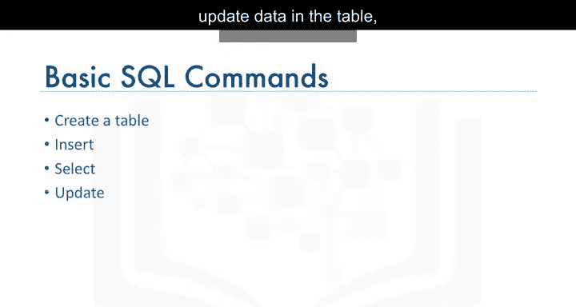

So those are the building blocks for SQL for data science。

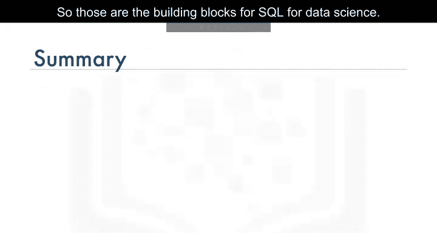

You can now describe what is SQL， What is data， What is a database and what is a relational database。

 You know that R DBMS S stands for relationlational Data management system。

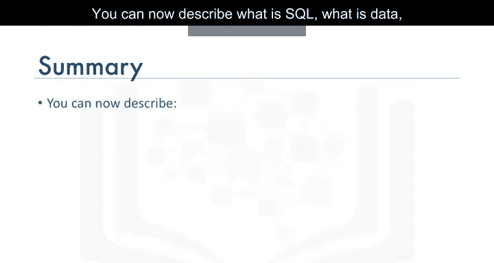

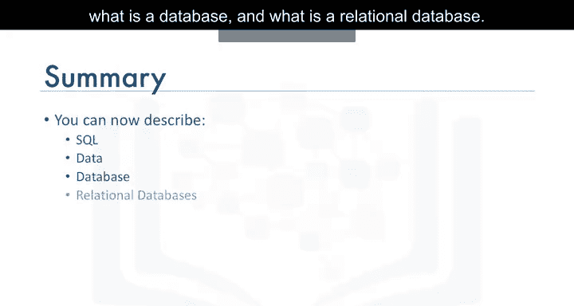

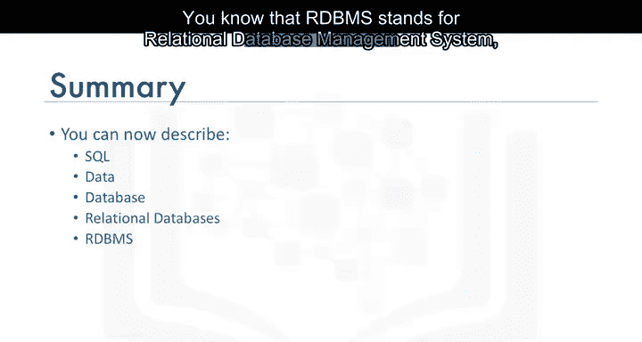

And you can list five basic SQL commands to create a table， insert data to populate the table。

 select data from the table， update data in the table， and delete data from the table。

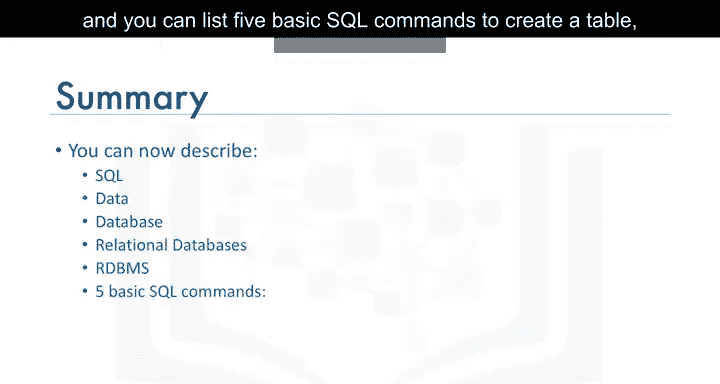

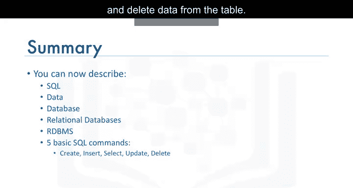

Thanks for watching this video。