# IBM数据科学专业证书课程6：《数据库与SQL在数据科学中的应用（IBM）》sql-data-science（中英字幕） - P4：3_COUNT-DISTINCT-LIMIT.zh_en - GPT中英字幕课程资源 - BV1kP41147ce

。Hello and welcome In this video， we'll briefly present a few useful expressions that are used with select statements。

😊。

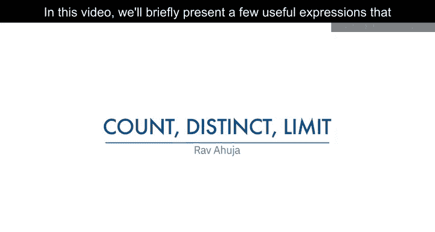

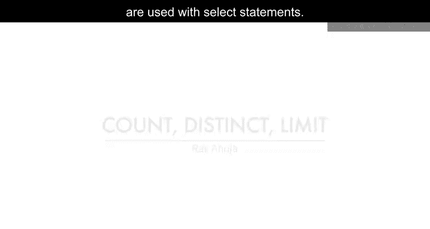

The first one is count。Cot is a built in database function that retrieves the number of rows that match the query criteria。

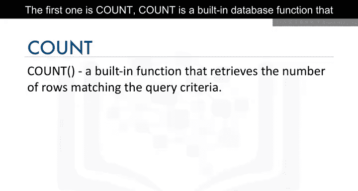

For example， get the total number of rows in a given table。Select cow star from table name。

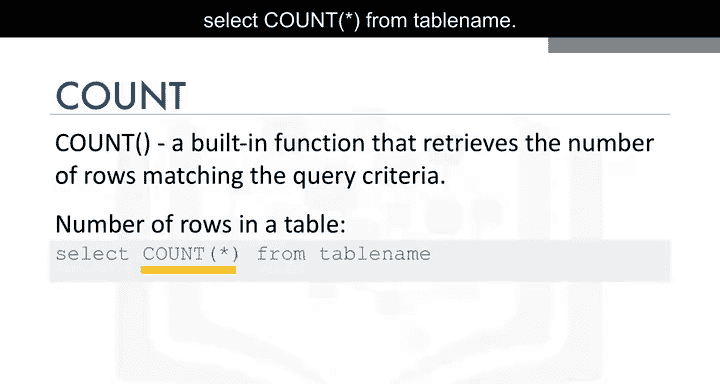

Let's say you create a table called Mes， which has a column called country。

 and you want to retrieve the number of rows where the metal recipient is from Canada。

 You can issue a query like this。 Select count country from medals where country equals Canada。

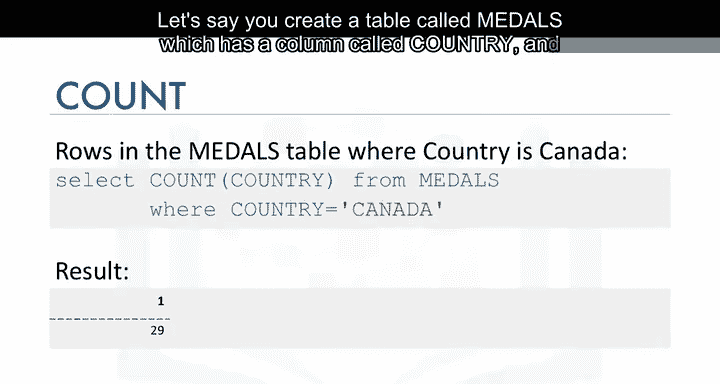

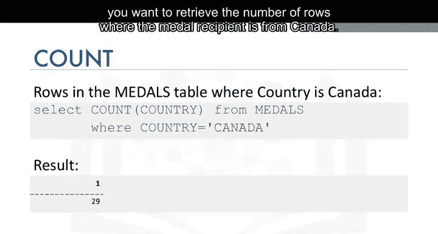

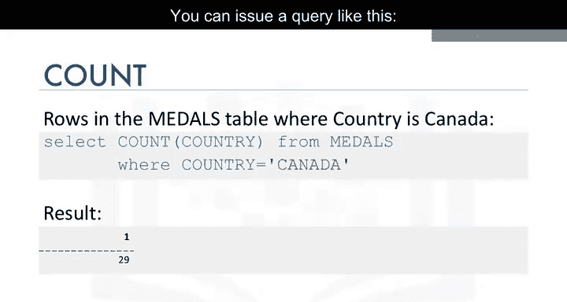

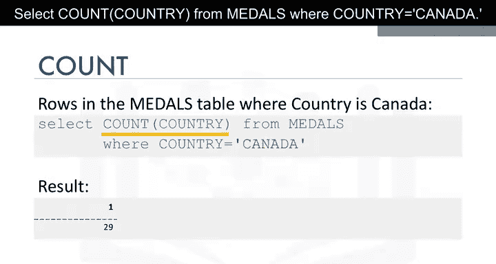

The second expression is distinct。 distinctct is used to remove duplicate values from a result set。

 example to retrieve unique values in a column。 Select distinct column name from table name。

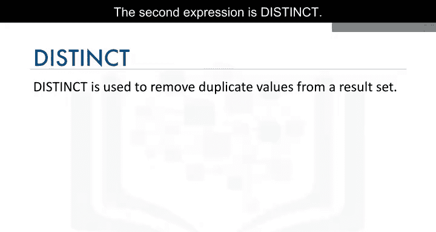

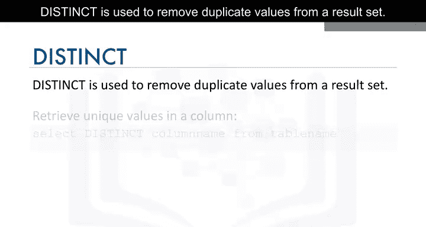

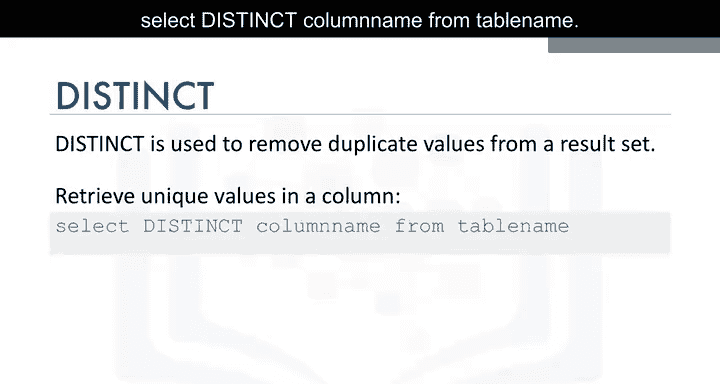

In the metals table mentioned earlier， a country may have received a gold medal multiple times。

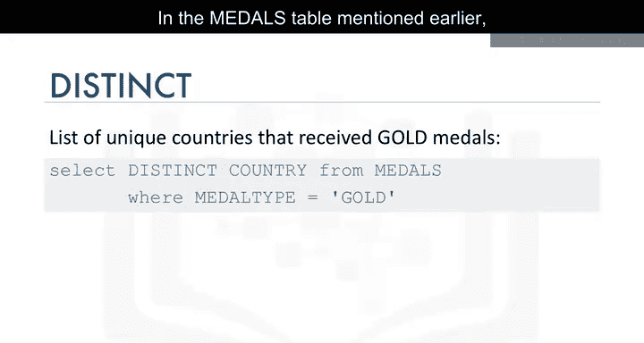

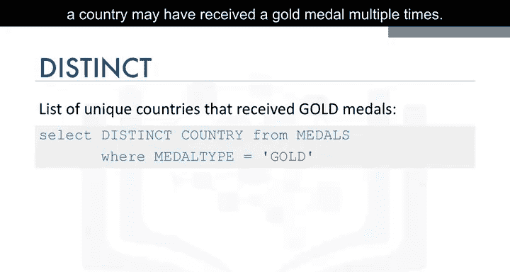

Example retrieved the list of unique countries that received gold medals。

 That is removing all duplicate values of the same country。

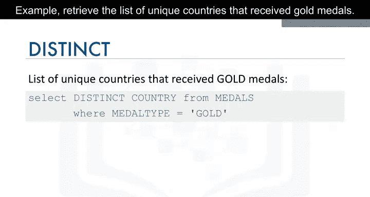

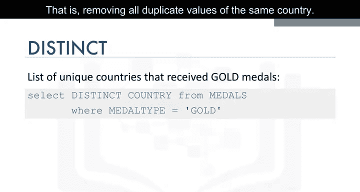

Select distinct country from metals where metal type equals gold。

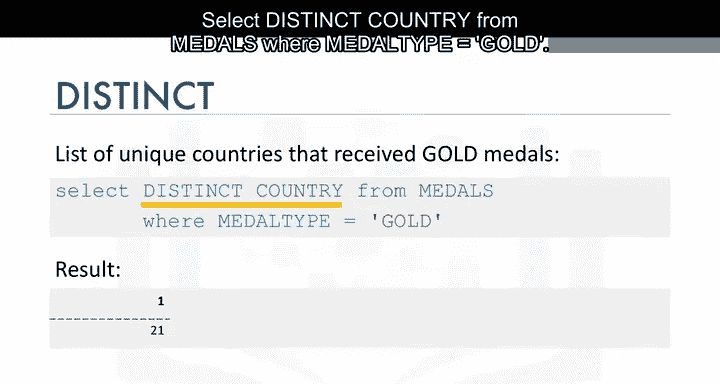

The third expression is limit。 Liit is used for restricting the number of rows retrieved from the database。

 examplele， retrieve just the first 10 rows in a table。

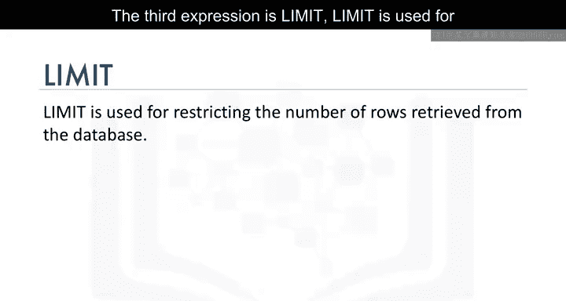

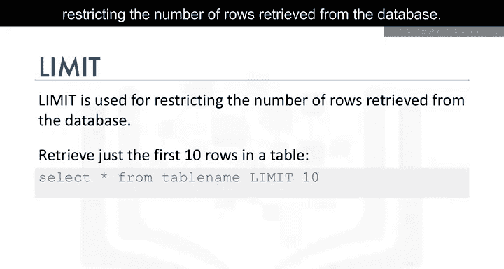

Select star from table name limitit 10。

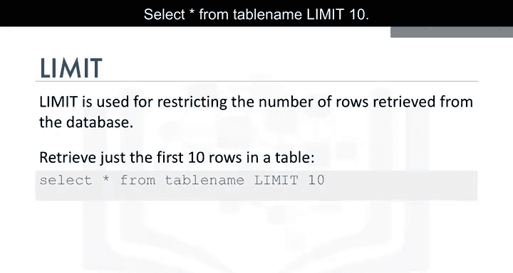

This can be very useful to examine the result set by looking at just a few rows instead of retrieving the entire result set。

 which may be very large。

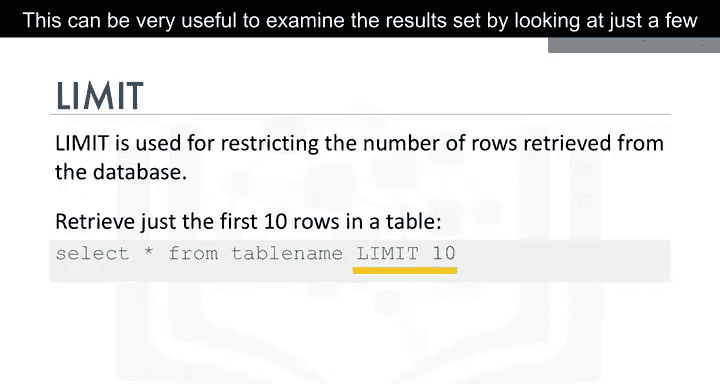

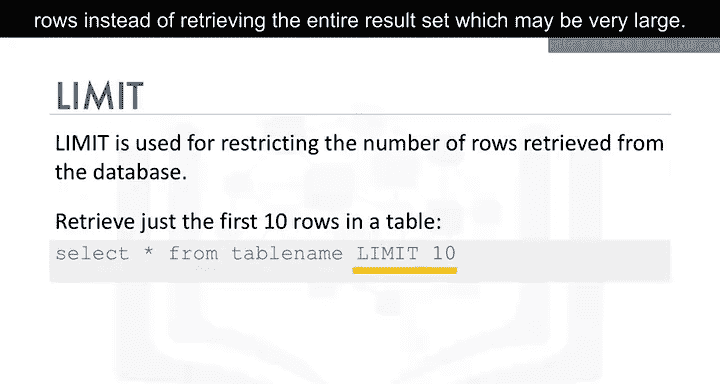

Example retrieved just a few rows in the metals table for a particular year。

Select star from Mes where year equals 2018， limit 5。

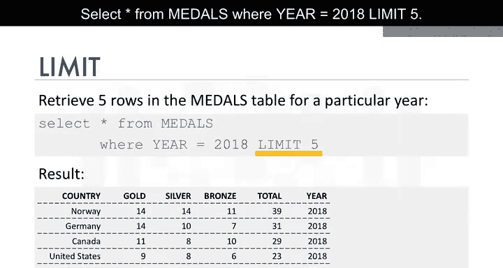

In this video， we looked at some useful expressions that are used with select statements。

 namely the count， distinct and limit built in functions。😊，Thanks for watching this video。

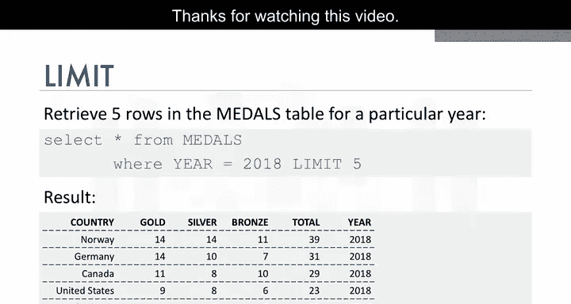