# IBM数据科学专业证书课程6：《数据库与SQL在数据科学中的应用（IBM）》sql-data-science（中英字幕） - P6：5_UPDATE与DELETE语句.zh_en - GPT中英字幕课程资源 - BV1kP41147ce

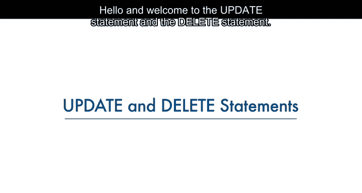

Hello and welcome to the update statement and the delete statement。 In this video。

 we will learn about altering and deleting data in a relational database table。

 At the end of this lesson， you will be able to identify the syntax of the update statement and delete statement and explain the importance of the where clause in these statements。

😊。

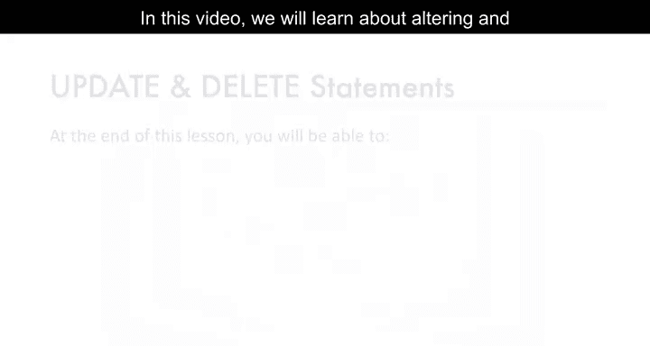

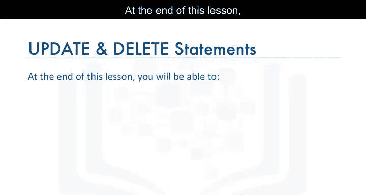

After a table is created and populated with data， the data in a table can be altered with the update statement。

 The update statement is one of the data manipulation， language， or D M， L statements。

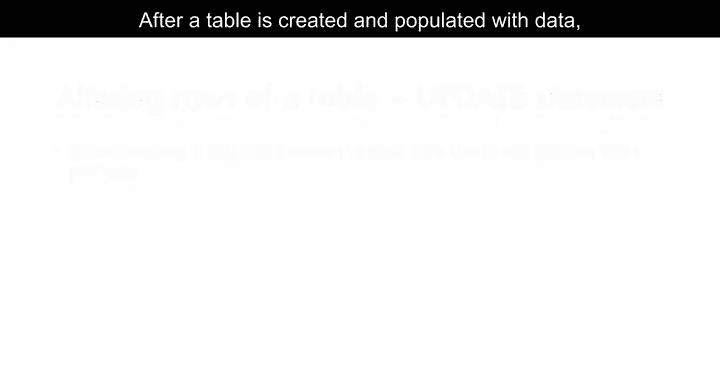

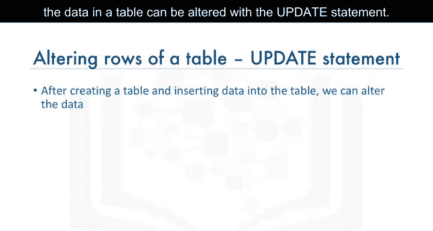

DML statements are used to read and modify data。Based on the author entity example。

 we created the table using the entity name， author and the entity attributes as the columns of the table。

Rs were added to the author table to populate the table。Sometime later。

 you want to alter the data in the table。To alter or modify the data in the author table。

 we use the update statement。 The syntax of the update statement looks like this update table name set。

 column name equal to value where condition。

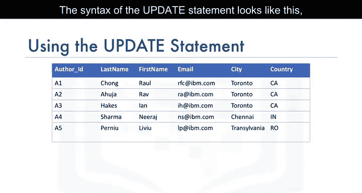

In this statement， table name identifies the table。

 The column name identifies the column value to be changed as specified in the where condition。

Let's look at an example。In this example， you want to update the first name and last name of the author with author underscore I D A2 from Raav Ahuja to Lakshmi Kata In this example。

 to see the update statement in action， we start by selecting all rows from the author table to see the values。

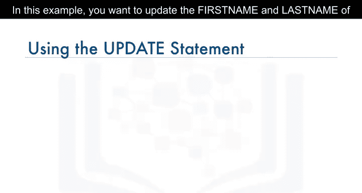

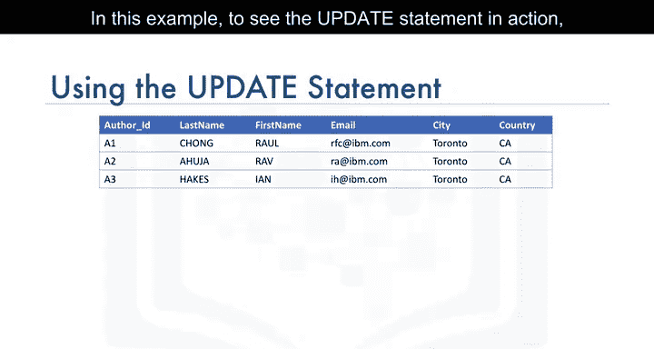

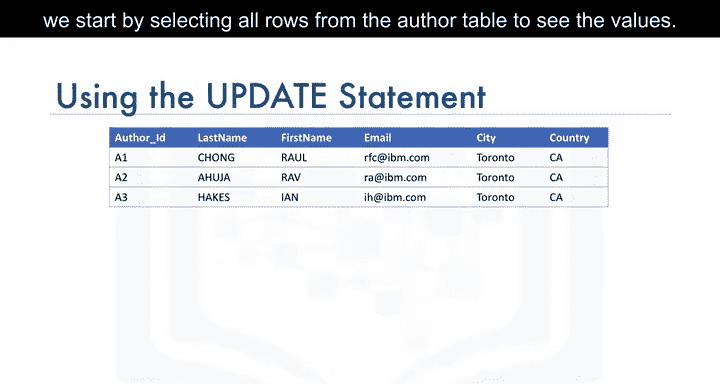

To change the first name and last name to Lukshmi Kata， where the author I D is equal to a2。

 enter the update statement as follows。 Up author set last name equal to Kata。

 first name equal to Lukshmi， where author I D is equal to a2。

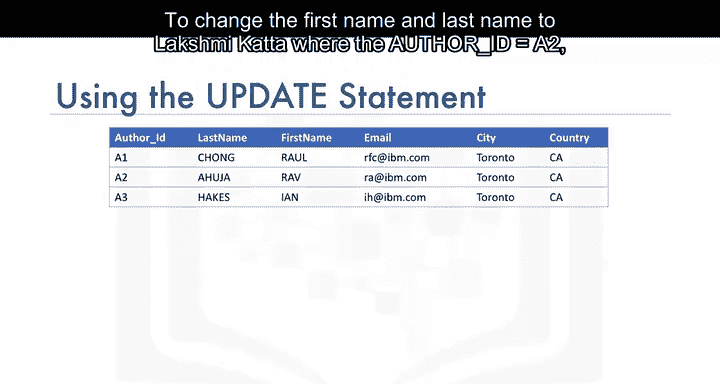

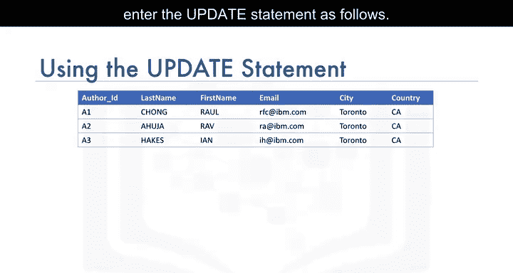

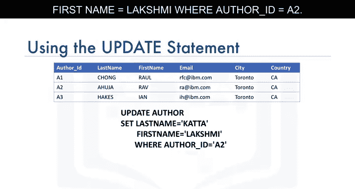

Now， to see the result of the update， select all rows again from the author table。

 And you will see that in row 2， the name changed from Rab Ahuja to Lakshmikata。

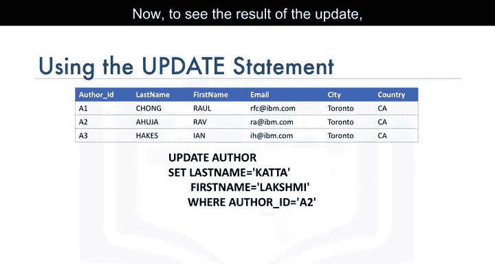

Note that if you do not specify the wear clauses， all the rows in the table will be updated。

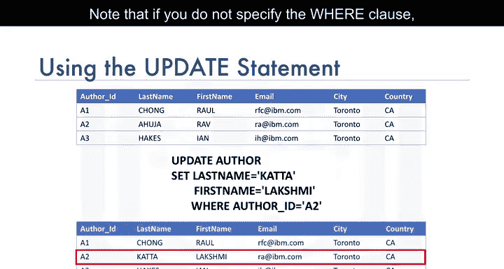

In this example， without specifying the war clauses。

 all row in the table would have changed the first and last names to Lashmikata。

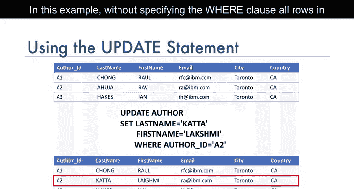

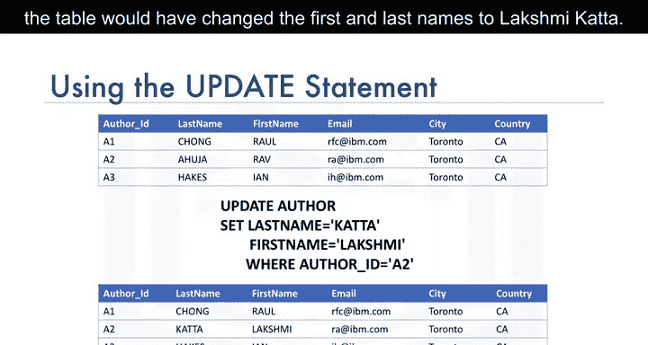

Some time later， there might be a need to remove one or more rows from a table。

 The rows are removed with the delete statement。 The delete statement is one of the data manipulation language statements used to read and modify data。

 The syntax of the delete statement looks like this。 Delete from table name， where condition。

 The rows to be removed are specified in the where condition。

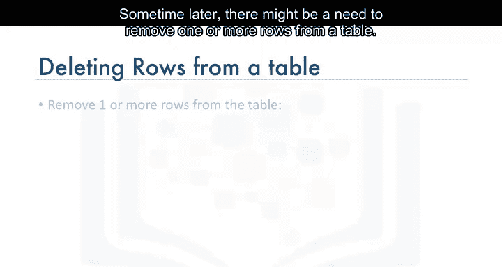

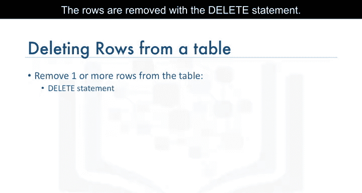

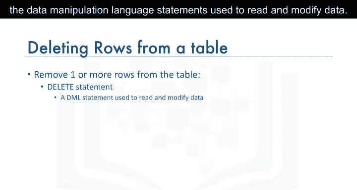

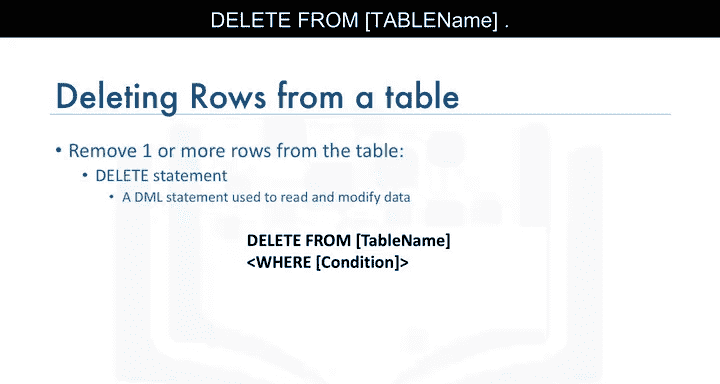

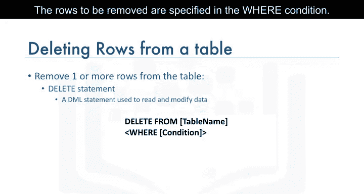

Based on the author entity example， we want to delete the rows for author ID A2 and A3。

 Let's look at an example。

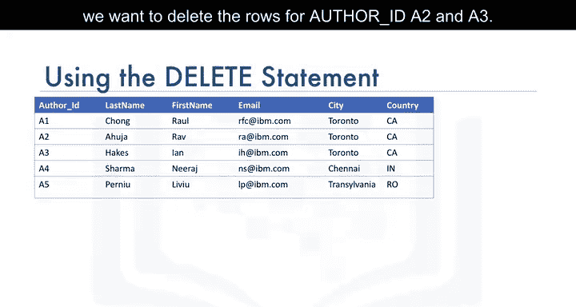

Delete from author where author I D in A2， A3。 Note that if you do not specify the wear clauses。

 all the rows in the table will be removed。

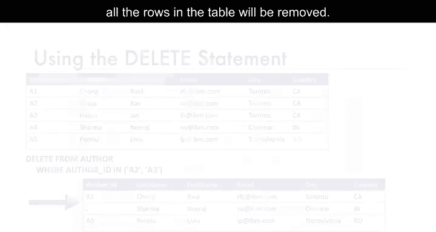

Now， you can identify the syntax of the update statement and delete statement and explain the importance of the where clause in these statements。

Thanks for watching this video。

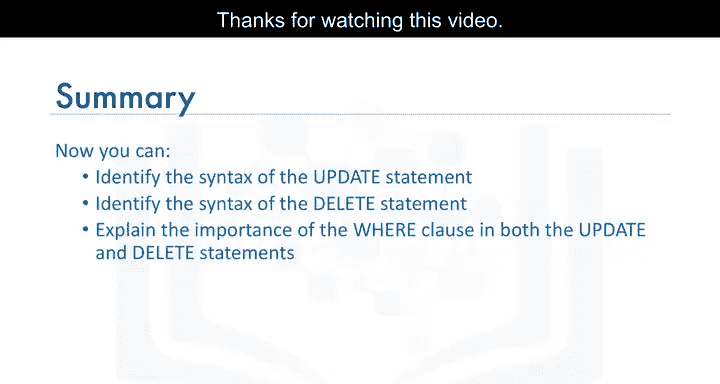