# IBM数据科学专业证书课程6：《数据库与SQL在数据科学中的应用（IBM）》sql-data-science（中英字幕） - P8：7_SQL语句分类（DDL vs DML）.zh_en - GPT中英字幕课程资源 - BV1kP41147ce

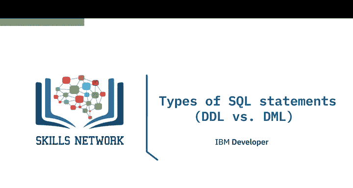

Welcome to Tys of SQL statements。

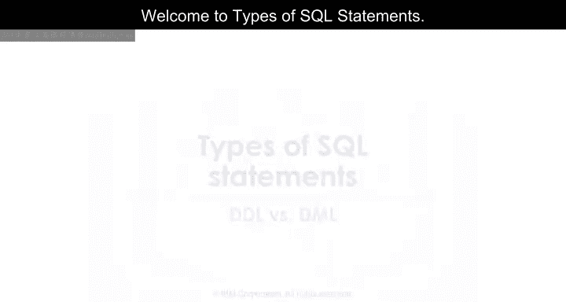

At the end of this video， you will be able to distinguish between data definition language statements and data manipulation language statements。

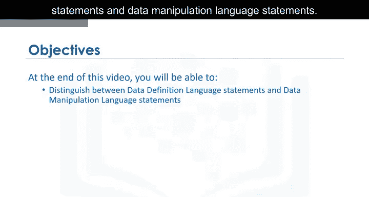

SQL statements are used for interacting with entities， that is tables， attributes， that is columns。

 and their tuples or rows with data values in relational databases。

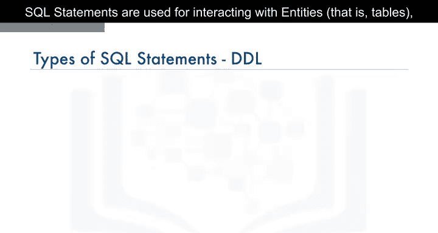

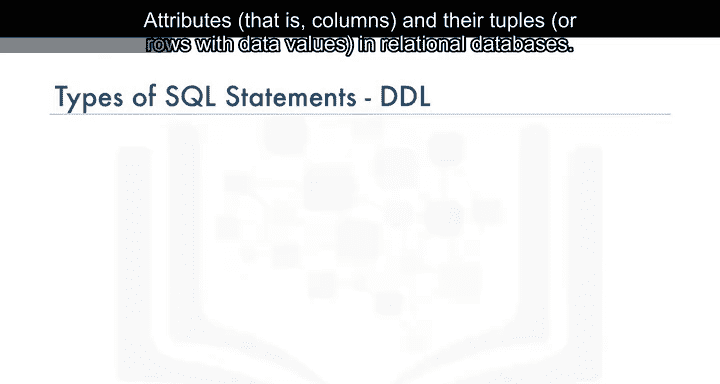

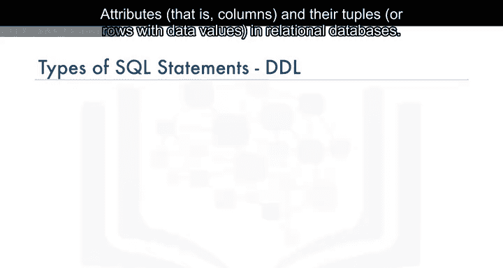

SQL statements fall into two different categories， data definition language statements。

 and data manipulation language statements。

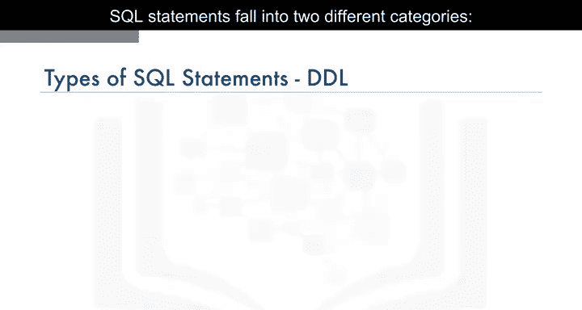

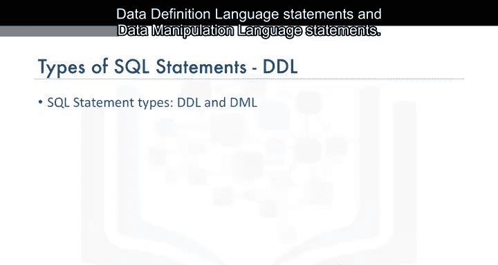

Data definition language or DDL statements are used to define。

 change or drop database objects such as tables。

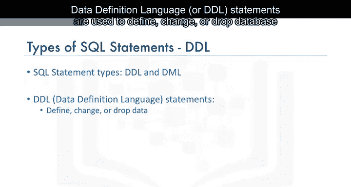

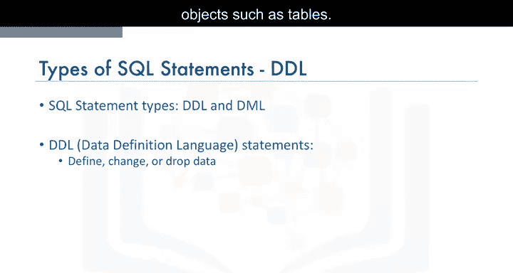

Common DDL statement types include createate， Al， truncate， and drop。

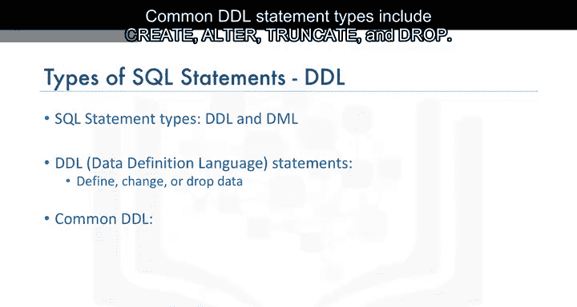

Create， which is used for creating tables and defining its columns。

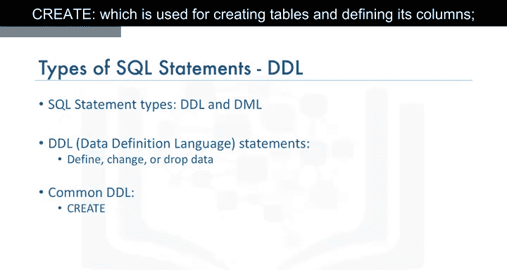

Allter is used for altering tables， including adding and dropping columns and modifying their data types。

 Trunccate is used for deleting data in a table， but not the table itself。

Drop is used for deleting tables。Data manipulation。

 language or DML statements are used to read and modify data in tables。

 These are also sometimes referred to as crud operations。 That is create， read。

 update and delete rows in a table。

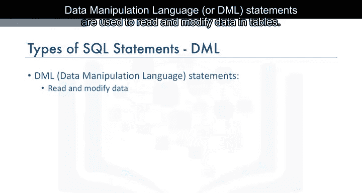

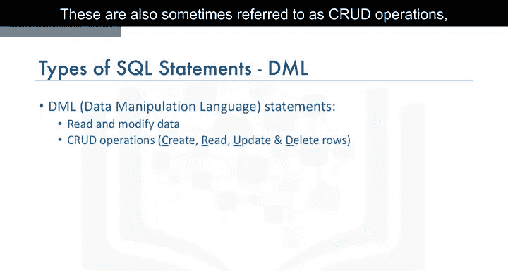

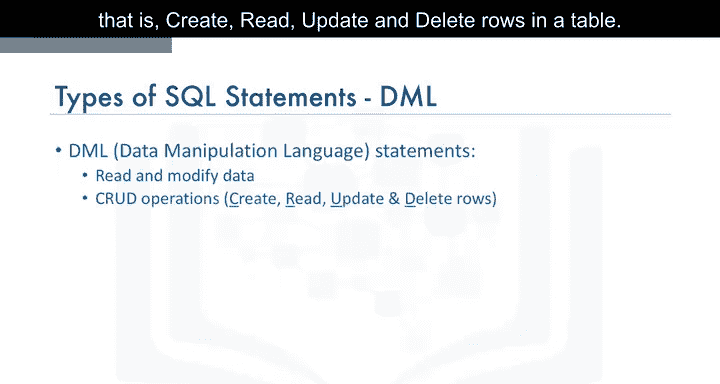

Common DL statement types include insert， select， update， and delete。

Insert is used for inserting a row or several rows of data into a table。 select。

 reads or selects row or rows from a table。 update， edits row or rows in a table and delete。

 removes a row or rows of data from a table。

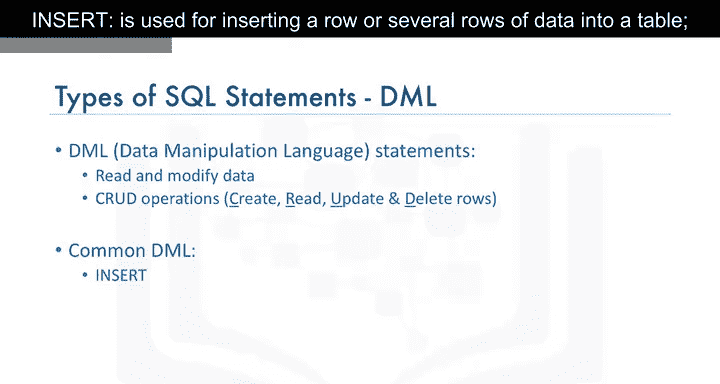

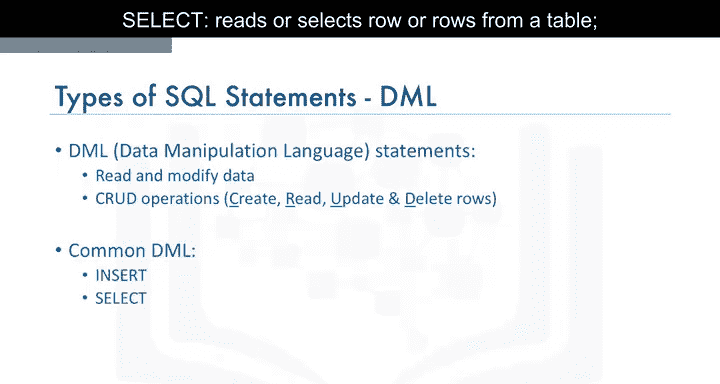

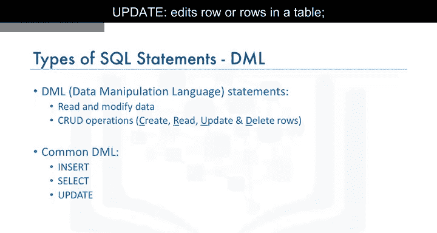

Now， you know that DDL or data definition language statements are used for defining or changing objects in a database such as tables and DL or data manipulation language statements are used for manipulating or working with data in tables。

 Thanks for watching this video。

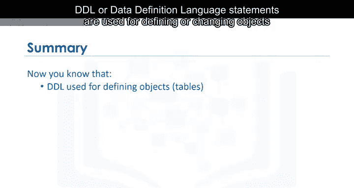

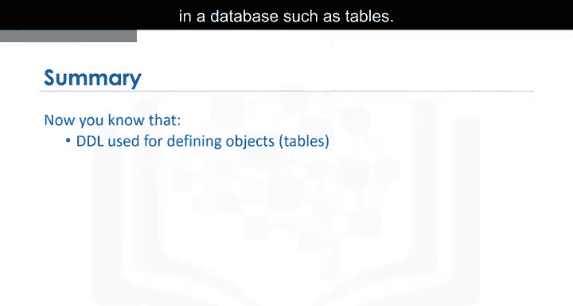

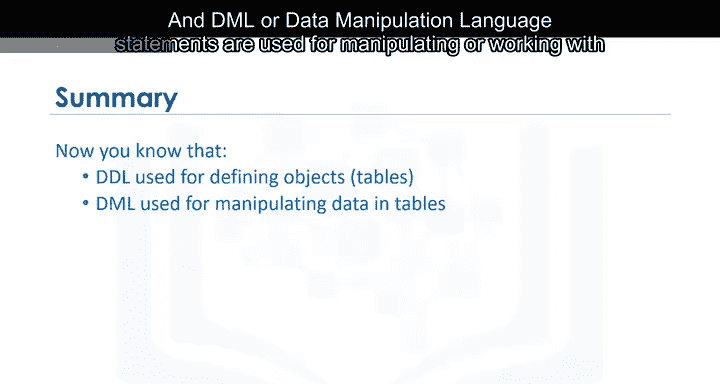

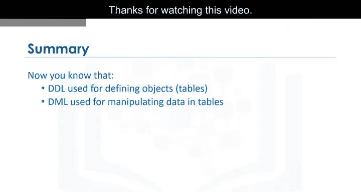