# IBM数据科学专业证书课程6：《数据库与SQL在数据科学中的应用（IBM）》sql-data-science（中英字幕） - P9：8_CREATE TABLE建表语句.zh_en - GPT中英字幕课程资源 - BV1kP41147ce

Welcome to create table statement。 At the end of this video。

 you will be able to explain how the entity name and attributes are used to create a relational database table。

 Now， let's look at the most common DDL statement。 C the syntax of the create table is shown here。

 You start with create table followed by the name of the table you want to create。

 Then enclose the rest of the statement inside of pair of parentheses or round brackets。😊。

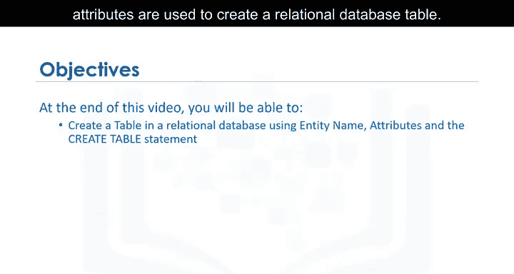

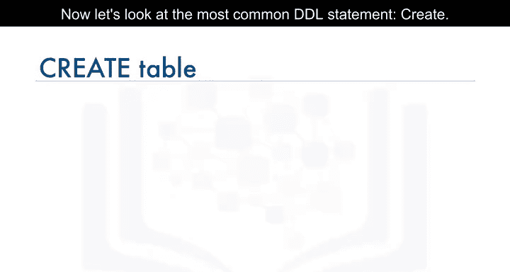

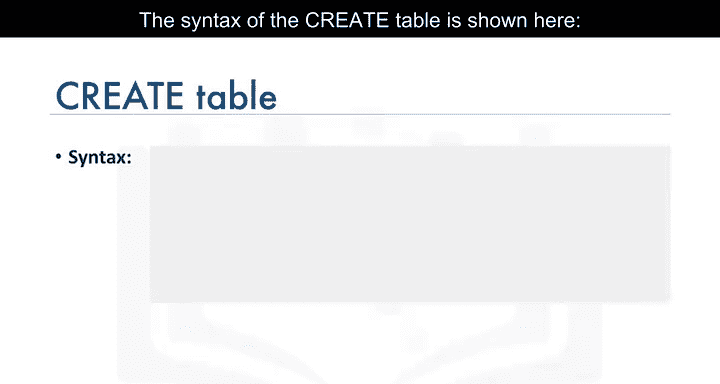

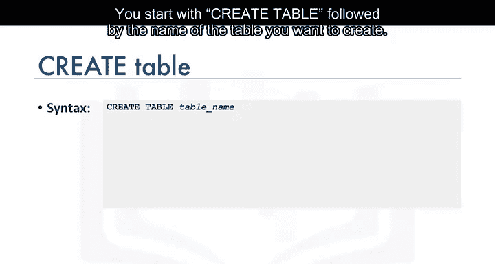

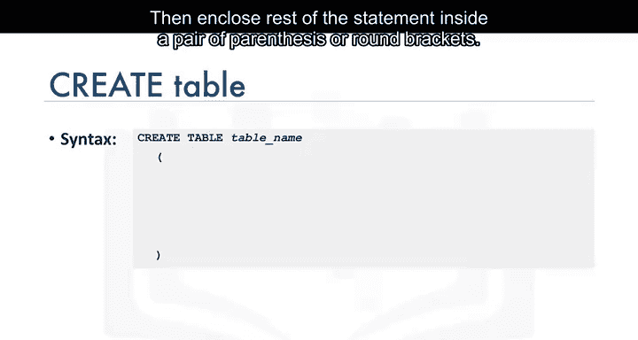

Each row inside the parentheses specifies the name of a column。

 followed by its data type and possibly some additional optional values that we will see later。

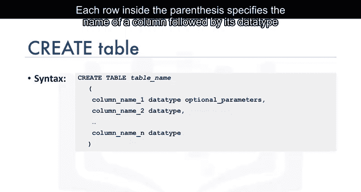

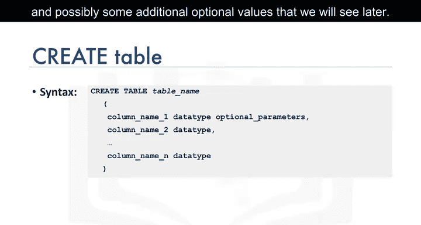

Each attribute or column definition is separated by a comma。

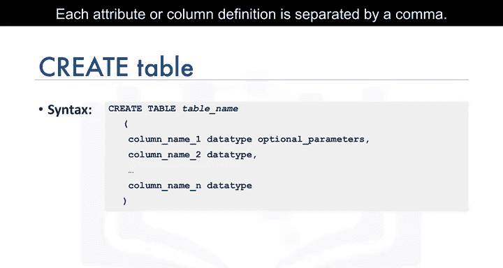

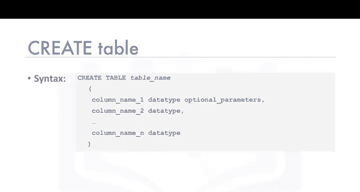

For example， if we want to create a table for provinces in Canada。

 you would specify createate T provinces， Open parentheses， ID Car2， primary key， not null， comma。

 name Var， 24 Close parentheses。

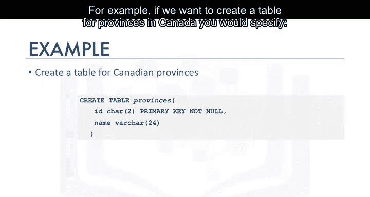

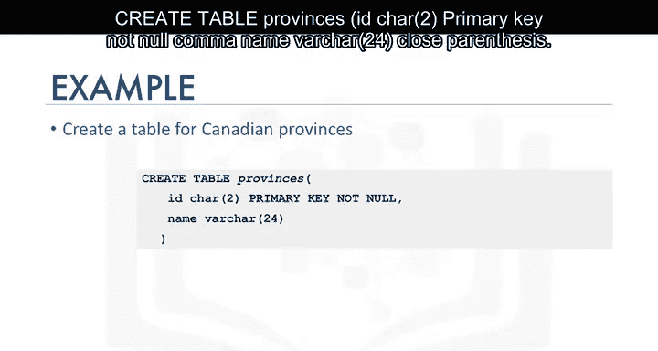

In this example， the data types used are car， which is a character string of a fixed length in this case。

2， and varar， which is a character string of a variable length。 In this case。

 the variable character field can be up to 24 characters long。

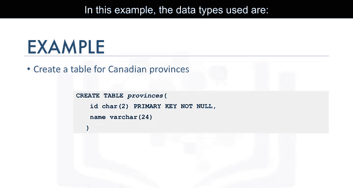

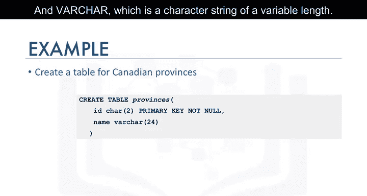

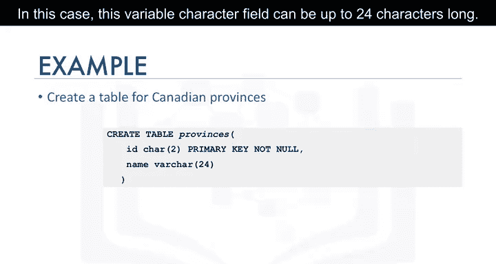

Issuing this statement would create a table in the database with two columns。

 the first column ID for storing the abbreviated two letter province short codes such as A B， BC。

 etc ce， and the second column called name for storing the full name of the province。

 such as Alberta， British Columbia， etc。

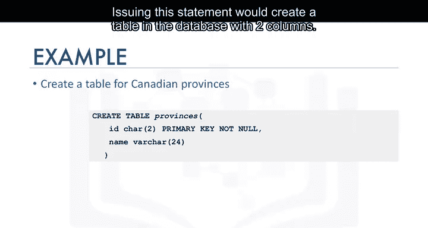

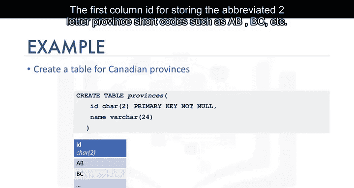

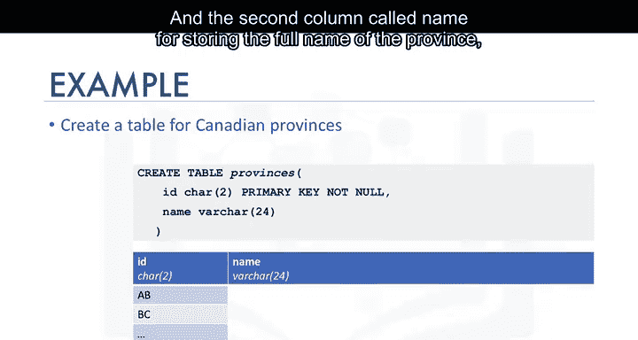

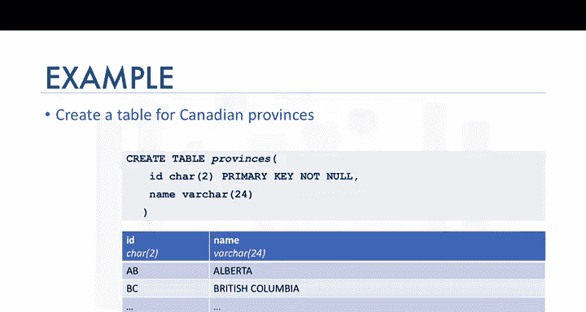

Now， let's look at a more elaborate example based on the library database。

 This database includes several entities such as author， book， borrower， etc。

 Let's start by creating the table for the author entity。

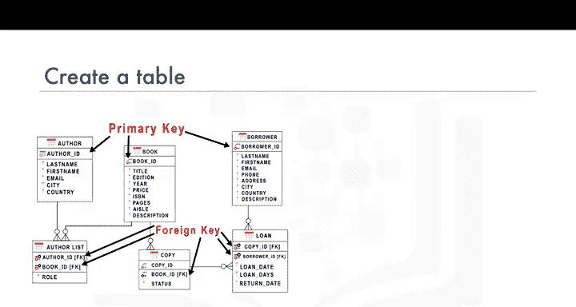

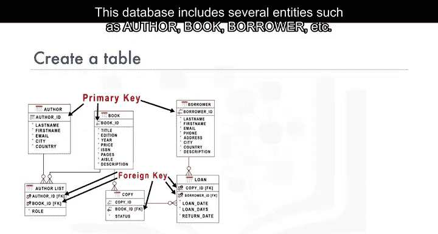

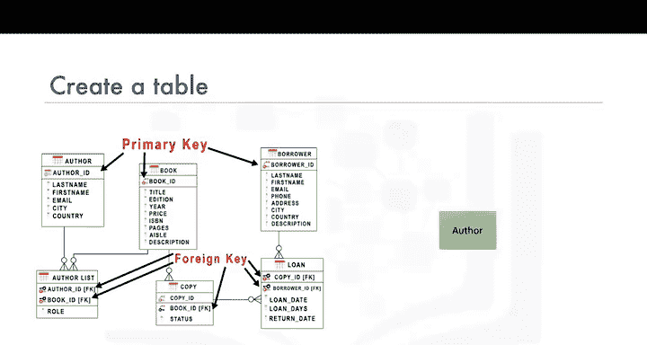

The name of the table will be author and its attributes such as author underscore ID， first name。

 last name， etc， will be the columns of the table。

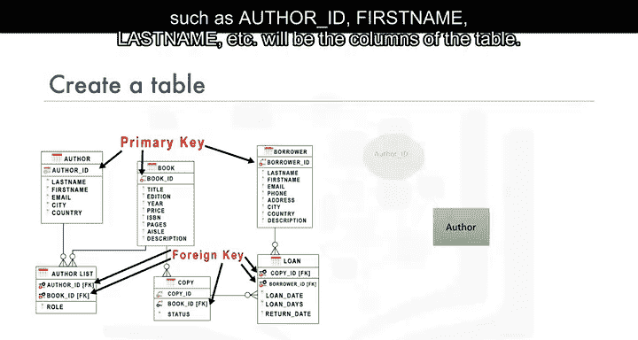

In this table， we will also assign the author underscore IDd attribute as the primary key so that no duplicate values can exist。

 Re， the primary key of a relational table uniquely identifies each tuple or row in a table。

To create the author table， issue the following command， create table author open parentheses。

 author underscore IDd Car2 primary key N null， last name Varar。

15 not null first name Var 15 N null email varar 40 City varar 15， country Car 2， close parentheses。

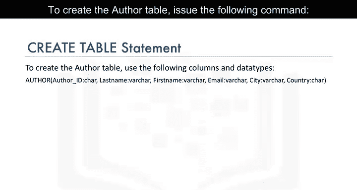

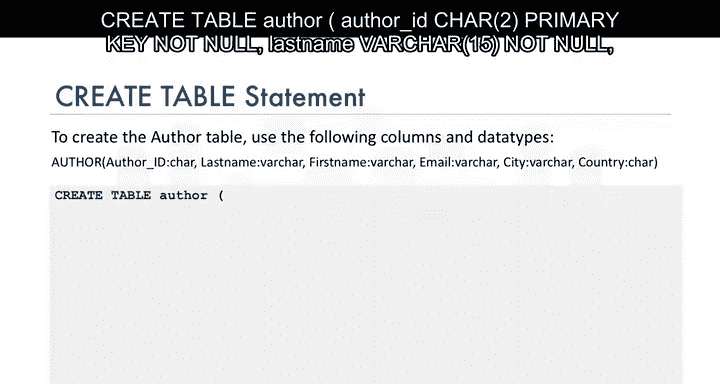

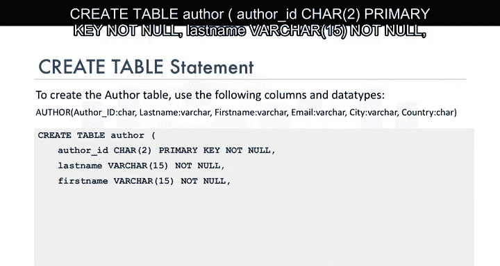

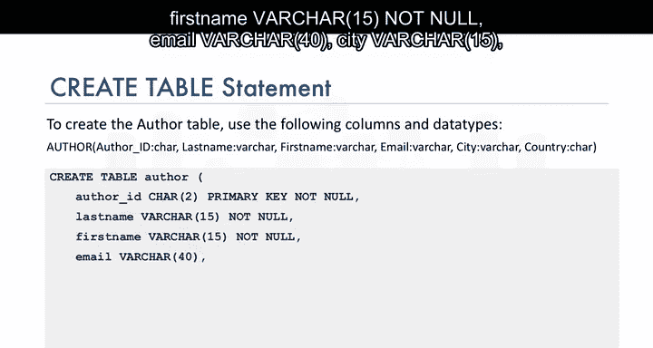

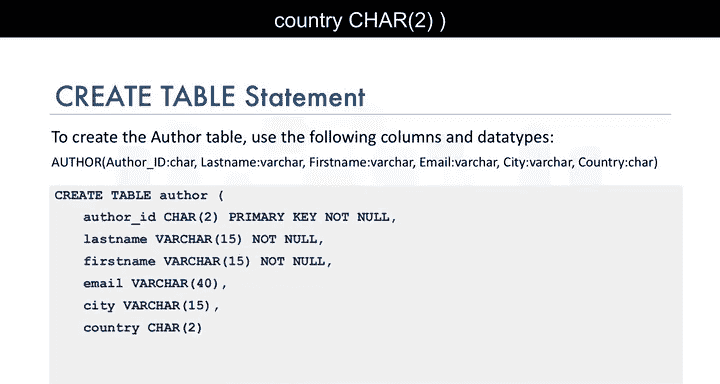

Note that the author underscore ID is the primary key。

 This constraint prevents duplicate values in the table。

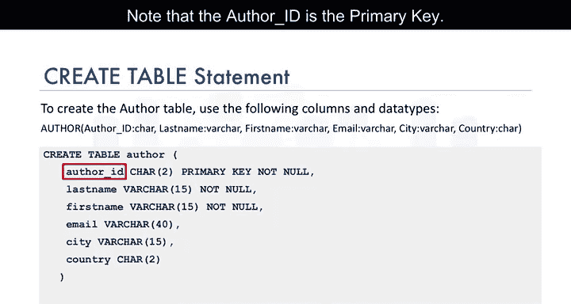

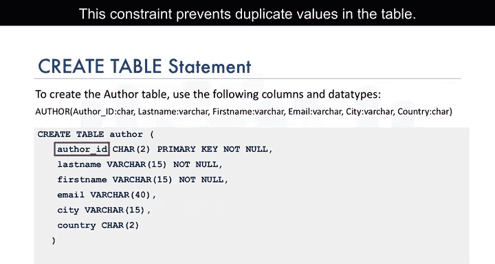

Also， note that the last name and first name have the constraint， not null。

 This ensures that these fields cannot contain a null value， Since an author must have a name。

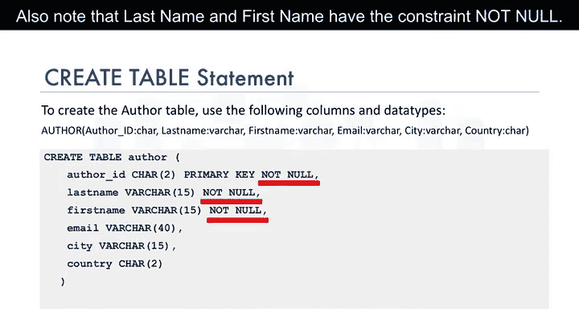

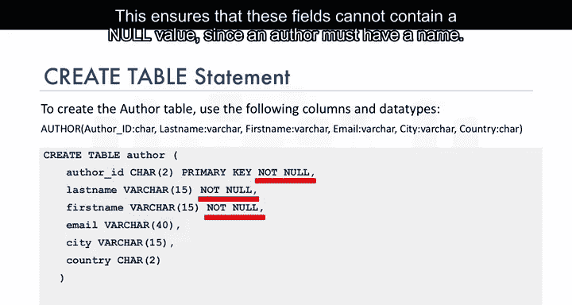

Now you know that Cate is a DDL statement for creating entities or tables in a database。

 and the Cate table statement includes definition of attributes of columns in the table。

 including names of columns， data types of columns and other optional values if required such as the primary key constraint thanks for watching this video。

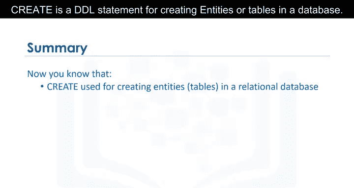

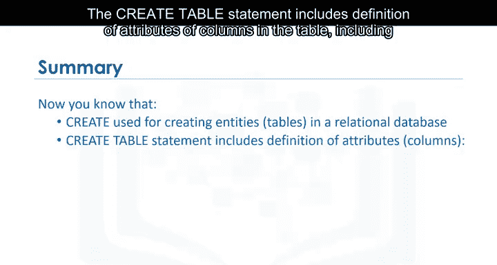

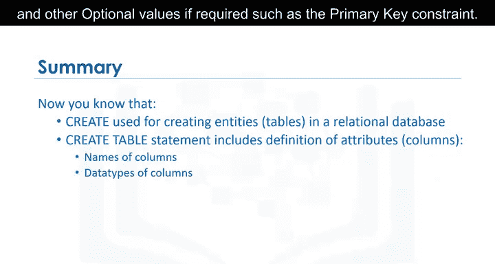

