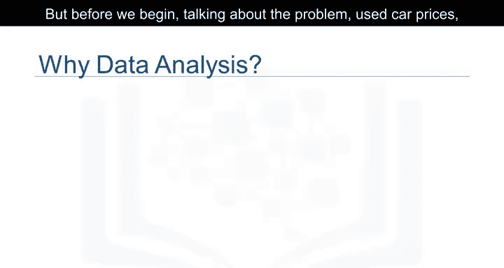
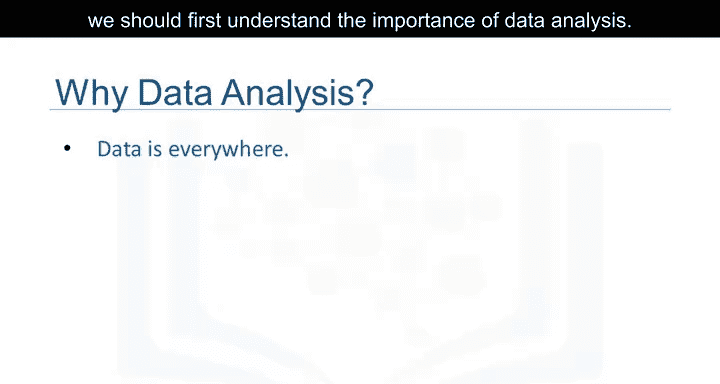
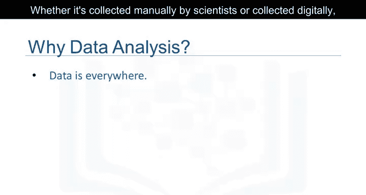
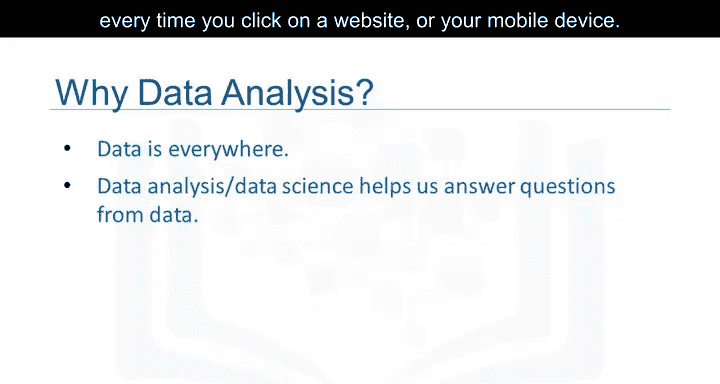
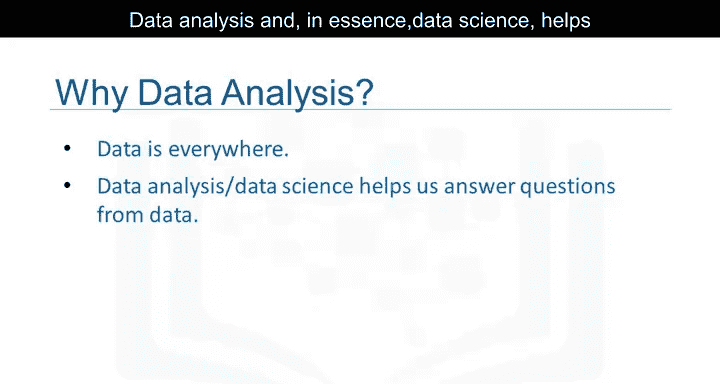
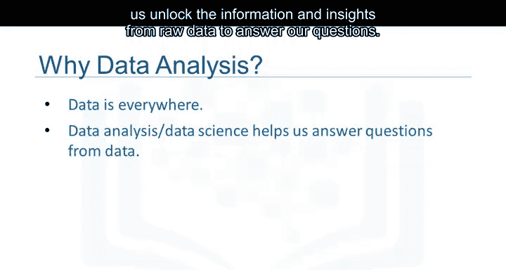
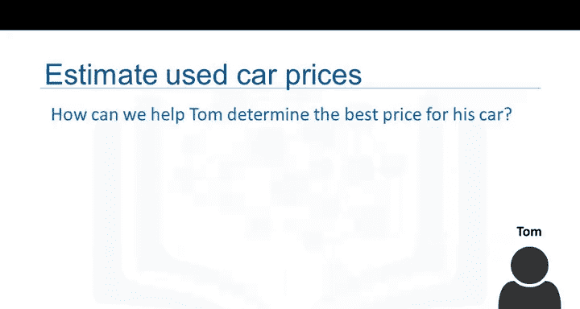
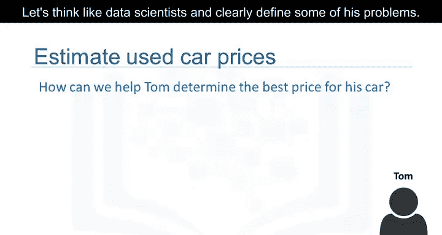

# IBM数据科学专业证书课程7：《使用Python进行数据分析》data-analysis-with-python（中英字幕） - P1：0_问题定义.zh_en - GPT中英字幕课程资源 - BV1sP41147Bz

In this video， we'll be talking about data analysis and the scenario in which we'll be playing the data analyst or data scientist。

But before we begin talking about the problem， use car prices。

 we should first understand the importance of data analysis。 As you know。

 data is collected everywhere around us， whether it's collected manually by scientists or collected digitally。

 every time you click on a website or your mobile device。

But data does not mean information， data analysis， and， in essence。

 data science helps us unlock the information and insights from raw data to answer our questions。

So data analysis plays an important role by helping us to discover useful information from the data。

 answer questions， and even predict the future or the unknown。So let's begin with our scenario。

 Let's say we have a friend named Tom。 and Tom wants to sell his car。 But the problem is。

 he doesn't know how much he should sell his car for。

Tom wants to sell his car for as much as he can。But he also wants to set the price reasonably so some one would want to purchase it。

 So the price he set should represent the value of the car。

How can we help Tom determine the best price for his car。

Let's think like data scientists and clearly define some of his problems。

For example， is there data on the prices of other cars and their characteristics？

What features of cars affect their prices， color， brand。

 Does horsepower also affect the selling price or perhaps something else As a data analyst or data scientist。

 These are some of the questions we can start thinking about。To answer these questions。

 we're going to need some data。In the next videos， we'll be going into how to understand the data。

 how to import it into Python and how to begin looking into some basic insights from the data。

