# IBM数据科学专业证书课程7：《使用Python进行数据分析》data-analysis-with-python（中英字幕） - P20：19_Python分类变量量化.zh_en - GPT中英字幕课程资源 - BV1sP41147Bz

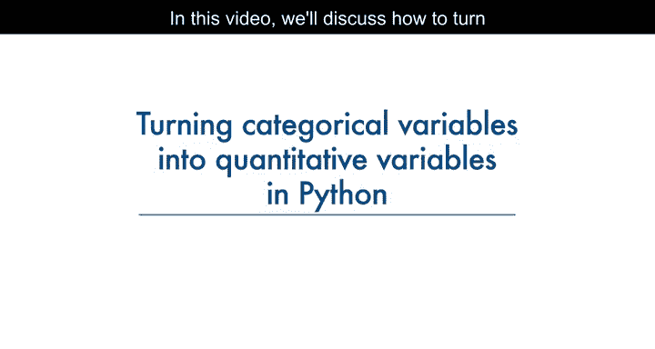

In this video， we'll discuss how to turn categorical variables into quantitative variables in Python。

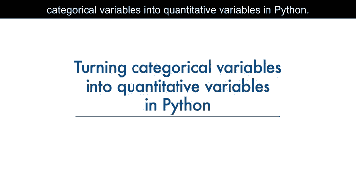

Most statistical models cannot take in objects or strings as input， and for model training。

 only take the numbers as inputs。

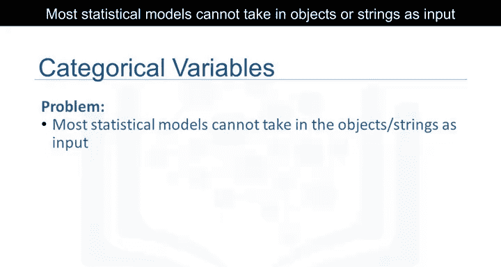

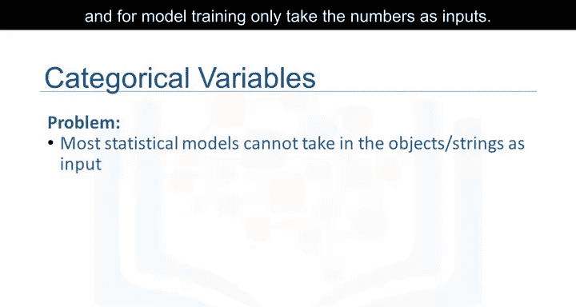

In the card data set， the fuel type feature as a categorical variable has two values， Ga or diesel。

 which are in string format for further analysis。 Jerry has to convert these variables into some form of numeric format。

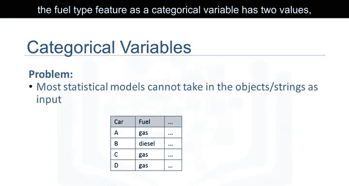

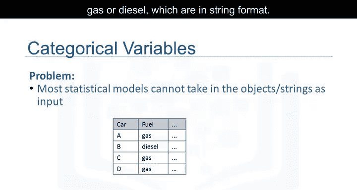

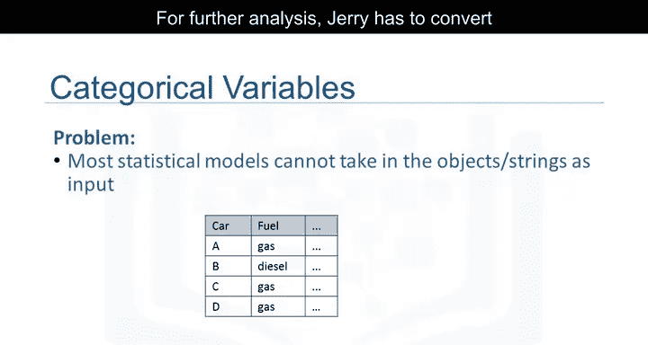

We encode the values by adding new features corresponding to each unique element in the original feature we would like to encode in the case where the feature fuel has two unique values。

 Ga and diesel。 We create two new features。 gas and diesel。

 When a value occurs in the original feature。 We set the corresponding value to one in the new feature。

 The rest of the feature are set to 0。 in the fuel example for car B。 the fuel value is diesel。

 Therefore， we set the feature diesel equal to one。 and the gas feature to 0。 Similarlyly， for car D。

 the fuel value is gas。 Therefore， we set the feature gas equal to one and the feature diesel equal to 0。

 This technique is often called one hot encoding in pandas。

 we can use get underscore dummies method to convert categorical variables to dummy variables。

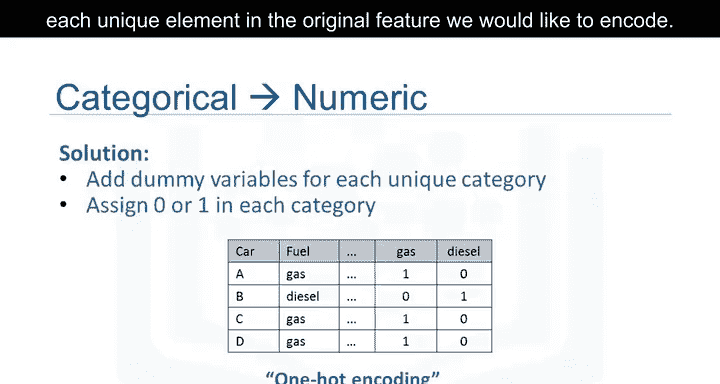

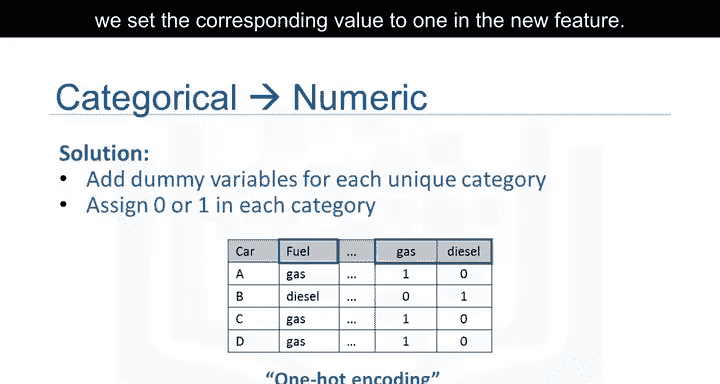

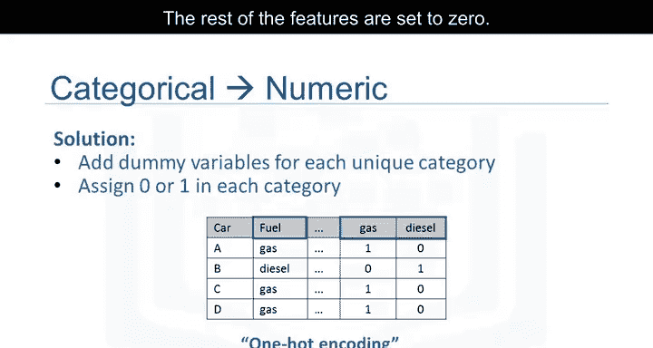

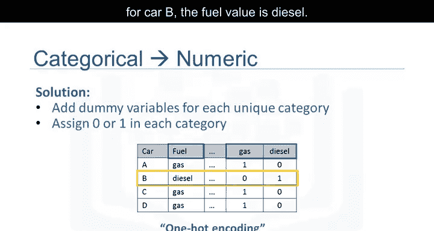

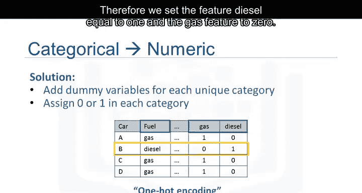

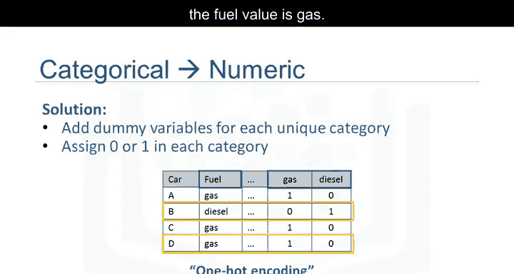

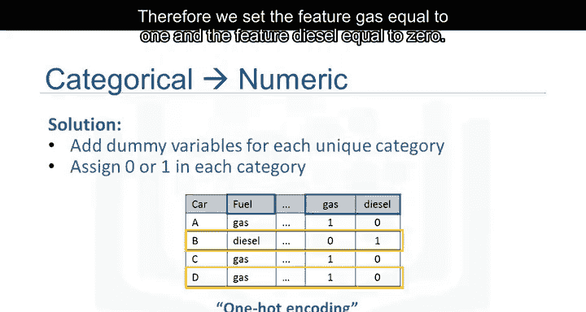

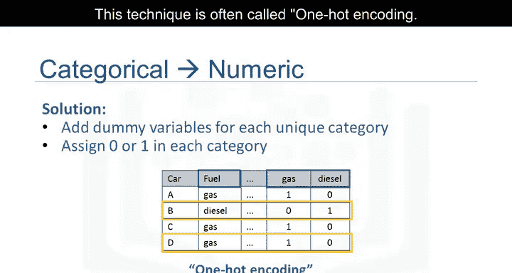

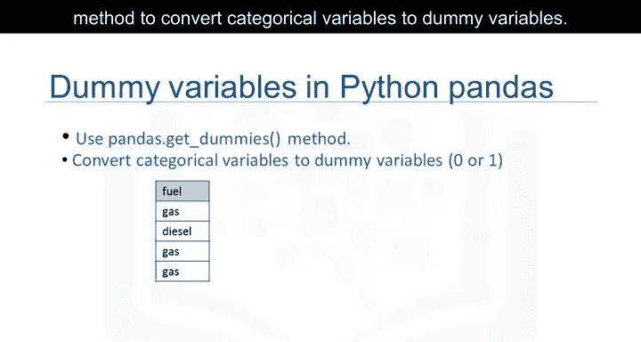

In Python， transforming categorical variables to dummy variables is simple。 Following the example。

 P D dot get， underscore dummies method gets the fuel type column and creates the data frame dummy underscore variable。

 underscore1。

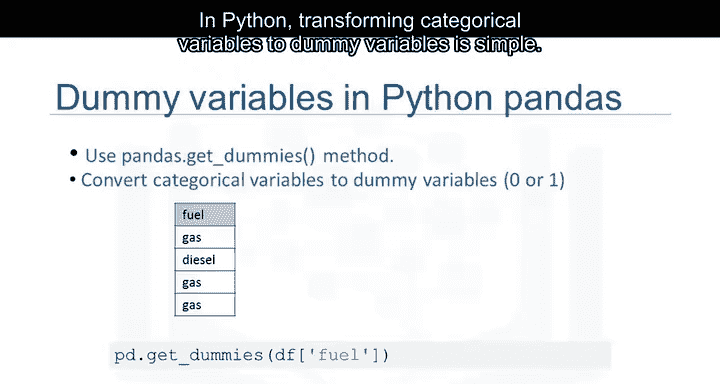

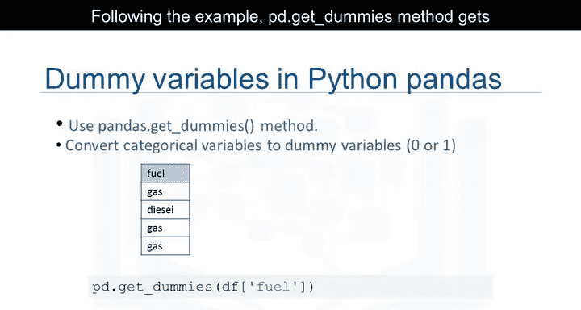

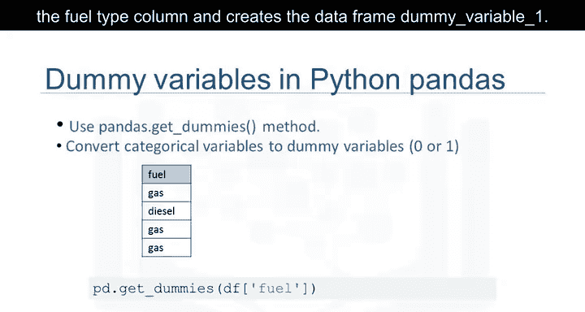

The get underscore dummies method automatically generates a list of numbers。

 each one corresponding to a particular category of the variable。

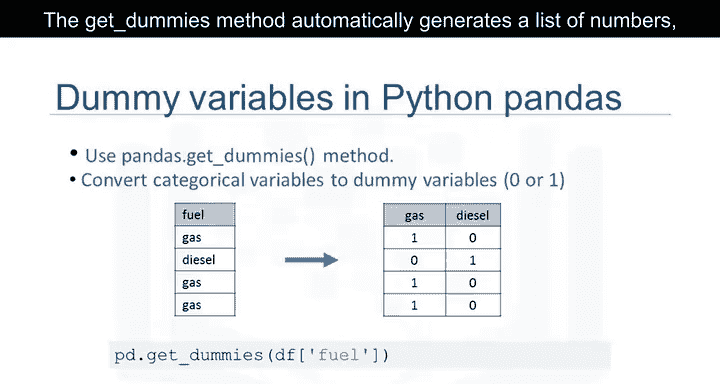

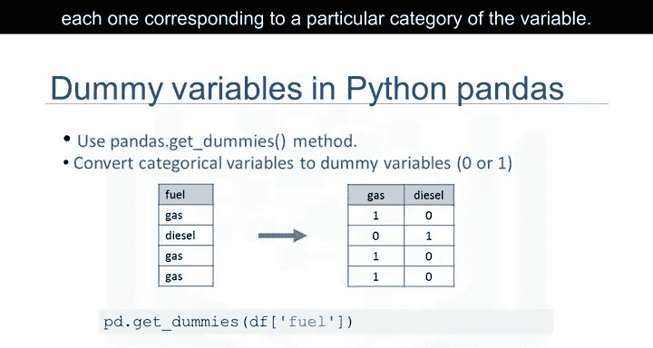