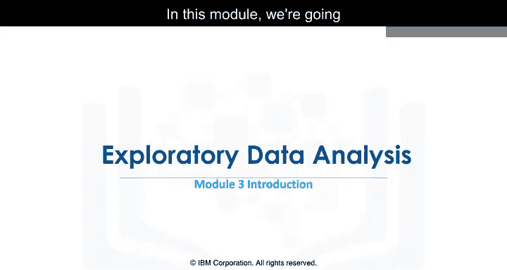
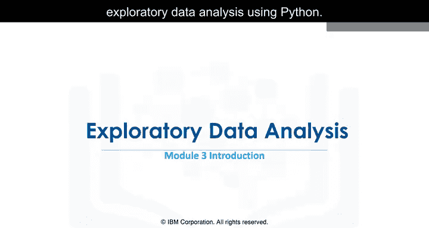
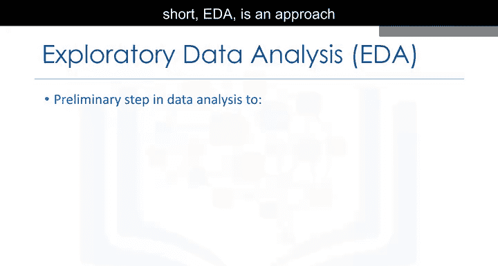
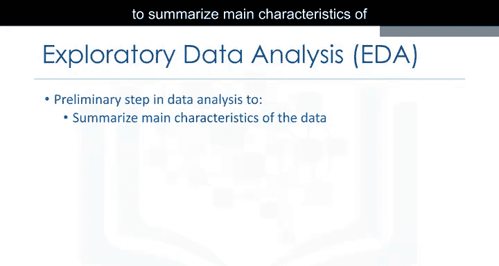
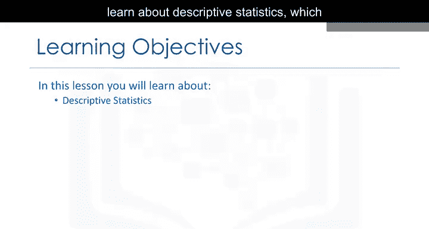
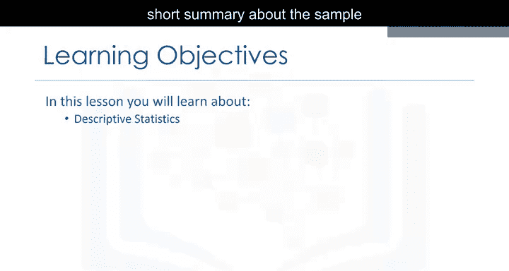
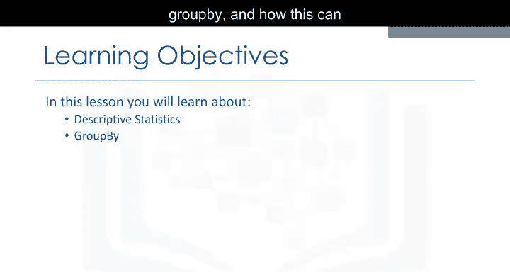
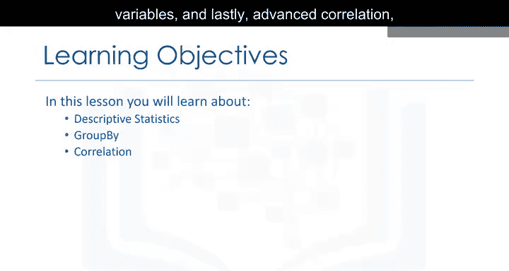
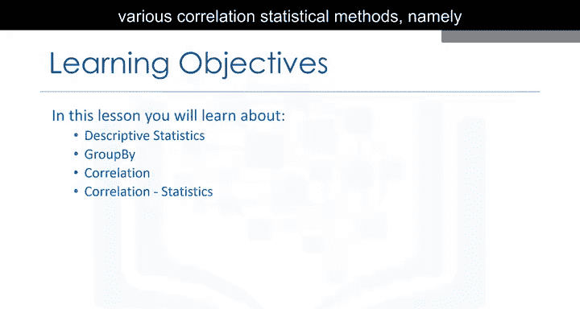
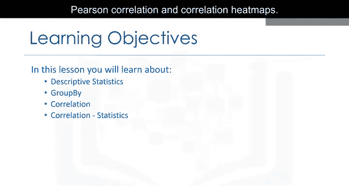

# IBM数据科学专业证书课程7：《使用Python进行数据分析》data-analysis-with-python（中英字幕） - P21：20_探索性数据分析.zh_en - GPT中英字幕课程资源 - BV1sP41147Bz

In this module， we're going to cover the basics of exploratory data analysis using Python。

Exploratory data analysis， or in short， E DA is an approach to analyze data in order to summarize main characteristics of the data。

 gain better understanding of the data set， uncover relationships between different variables and extract important variables for the problem we are trying to solve。

The main question we are trying to answer in this module is what are the characteristics that have the most impact on the car price。

 We will be going through a couple of different useful exploratory data analysis techniques in order to answer this question。

In this module， you will learn about descriptive statistics。

 which describe basic features of a data set and obtains a short summary about the sample and measures of the data。

Basic of grouping data using group by and how this can help to transform our data set。

 the correlation between different variables。 And lastly， advanced correlation。

 where we'll introduce you to various correlation， statistical methods。

 namely Pearson correlation and correlation heat maps。

