# IBM数据科学专业证书课程7：《使用Python进行数据分析》data-analysis-with-python（中英字幕） - P23：22_Python分组操作.zh_en - GPT中英字幕课程资源 - BV1sP41147Bz

In this video， we'll cover the basics of grouping and how this can help to transform our data set。

Assume you want to know。Is there any relationship between the different types of drive system。

 forward rear and four wheel drive and the price of the vehicles。

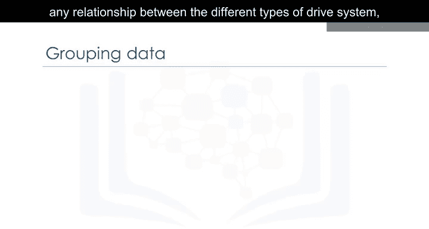

If so， which type of drive system adds the most value to a vehicle。

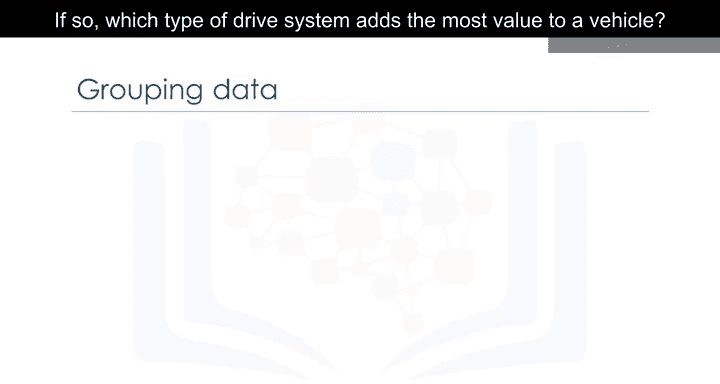

It would be nice if we could group all the data by the different types of drive wheels and compare the results of these different drive wheels against each other。

😊。

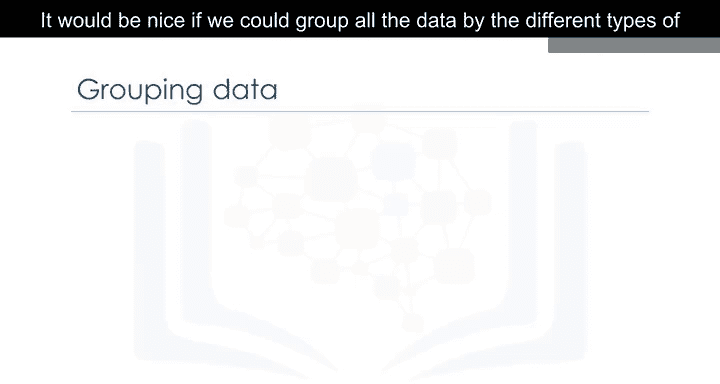

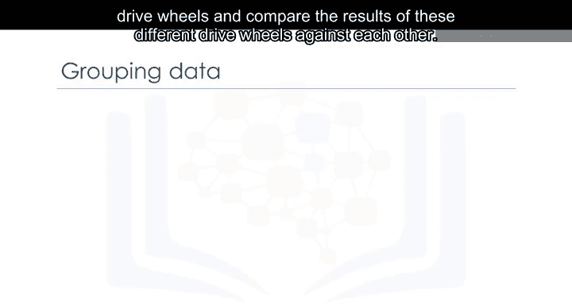

In pandas， this can be done using the group by method。

The group by a method， is used on categorical variables。Groups the data into subsets。

 according to the different categories of that variable， you can group by a single variable。

 or you can group by multiple variables by passing in multiple variable names。

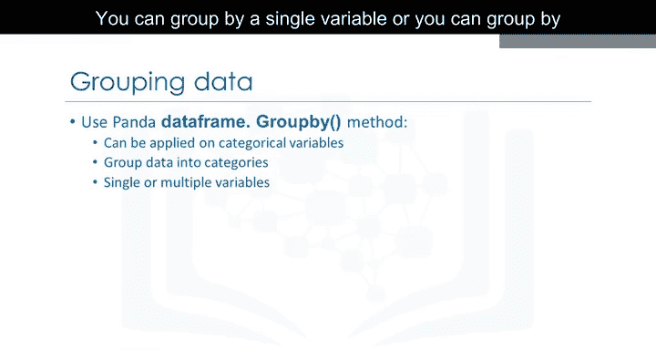

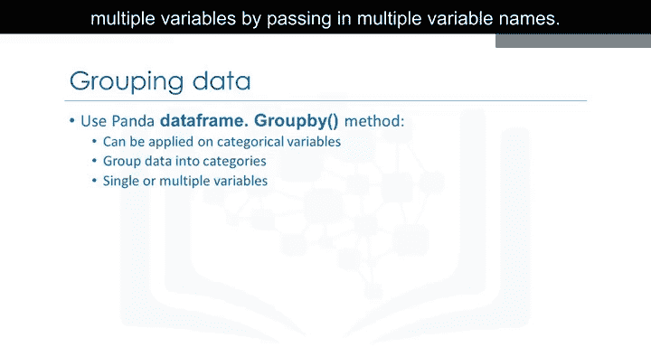

As an example， let's say we are interested in finding the average price of vehicles and observe how they differ between different types of body styles and drive wheels variables。

 To do this， We first pick out the three data columns we are interested in。

 which is done in the first line of code。

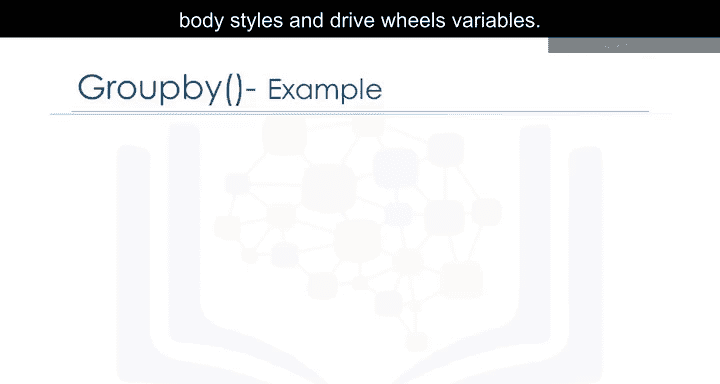

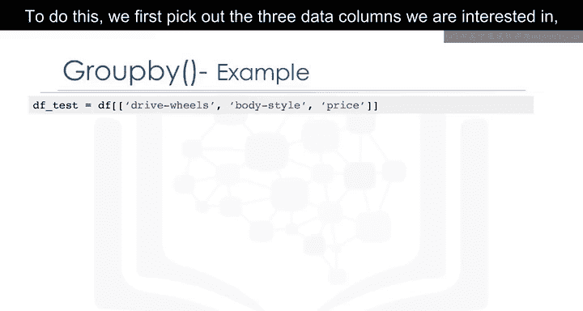

We then grouped the reduced data， according to drive wheels and body style in the second line。

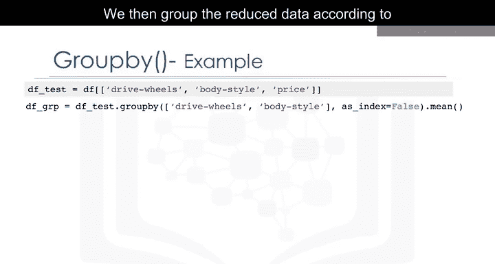

Since we are interested in knowing how the average price differs across the board。

 we can take the mean of each group and append it this bit at the very end of the line， too。

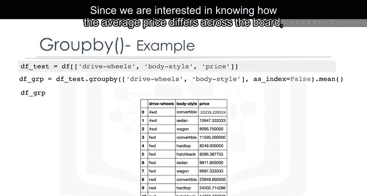

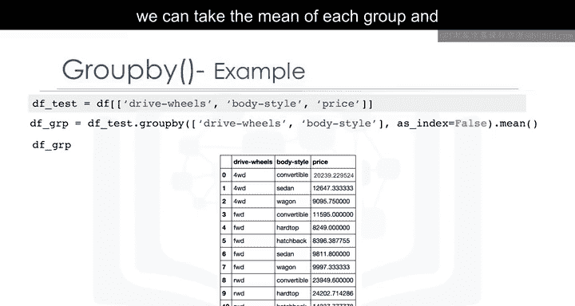

The data is now grouped into subcategories， and only the average price of each subcatego is shown。

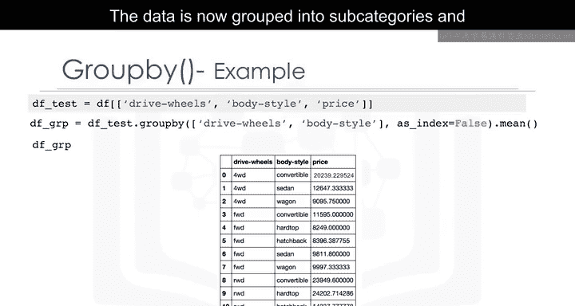

We can see that， according to our data， rear wheel drive convertibles and rear wheel drive hard tops have the highest value。

 While four wheel drive hatchbacks have the lowest value。

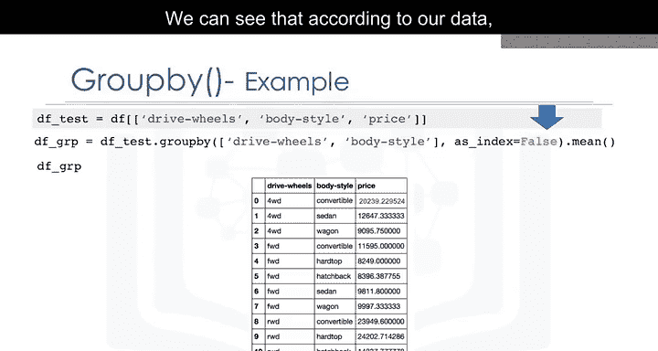

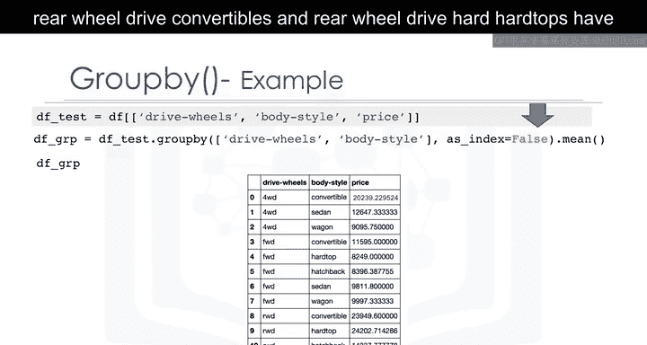

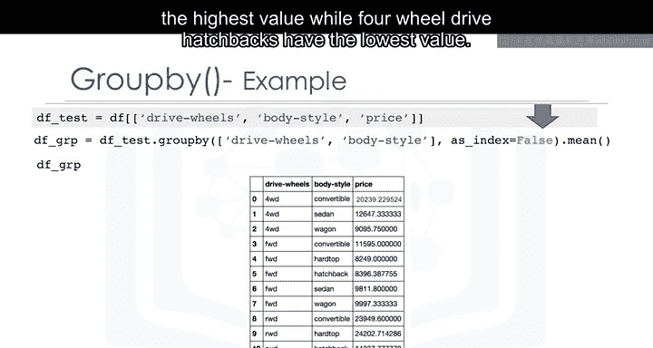

A table of this form isn't the easiest to read and also not very easy to visualize。

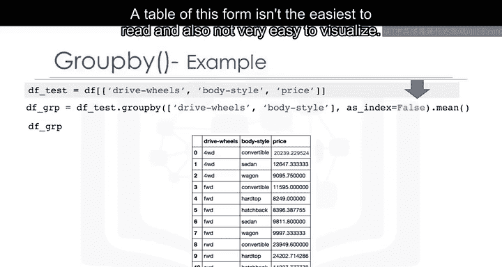

To make it easier to understand， we can transform this table to a pivot table by using the pivot method。

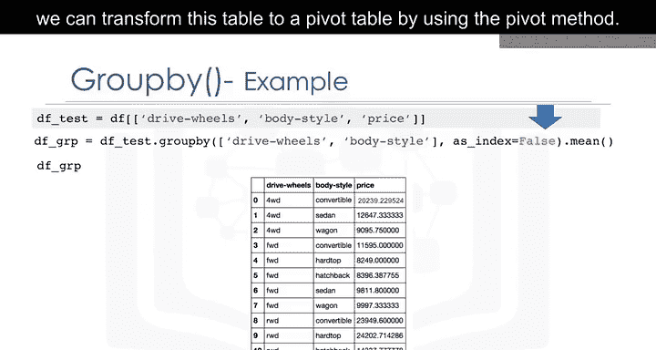

In the previous table， both with drive wheels and body style were list in columns。

 A pivot table has one variable displayed along the columns and the other variable displayed along the rows。

 just with one line of code。 and by using the panda as pivot method。

 We can pivot the body style variable。 So is displayed along the columns。

 and the drive wheels will be displayed along the rows。😊。

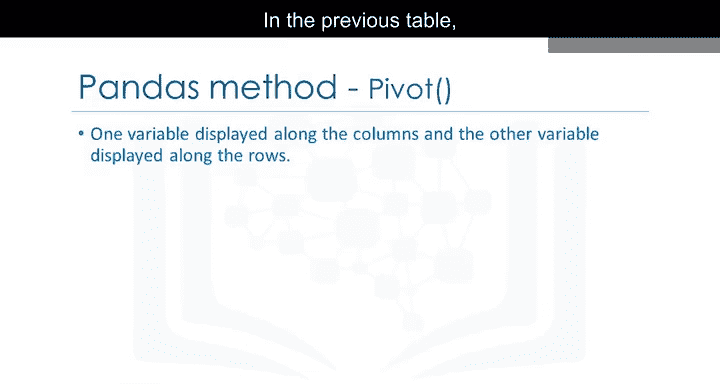

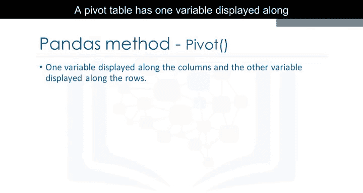

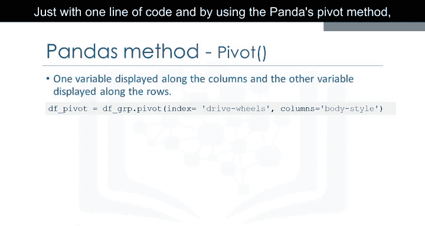

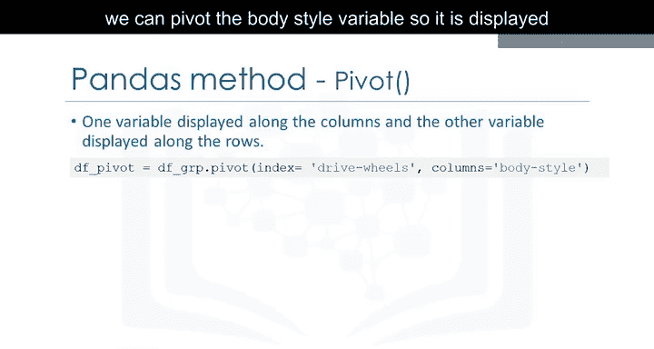

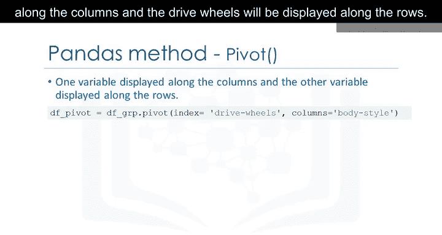

The price data now becomes a rectangular grid， which is easier to visualize。

 This is similar to what is usually done in Excel spreadsheets。

Another way to represent the pivot table is using a heat map plot。

Heat map takes a rectangular grid of data and assigns a color intensity based on the data value at the grid points。

 It is a great way to plot the target variable over multiple variables。

 And through this get visual clues with relationship between these variables and the target。😊。

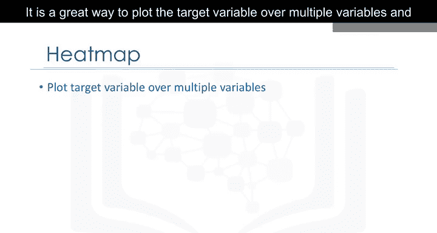

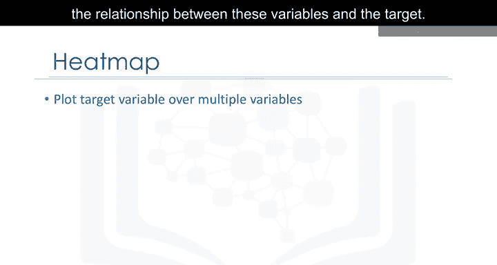

In this example， we use pie plot's P color method to plot heat map and convert the previous pivot table into a graphical form。

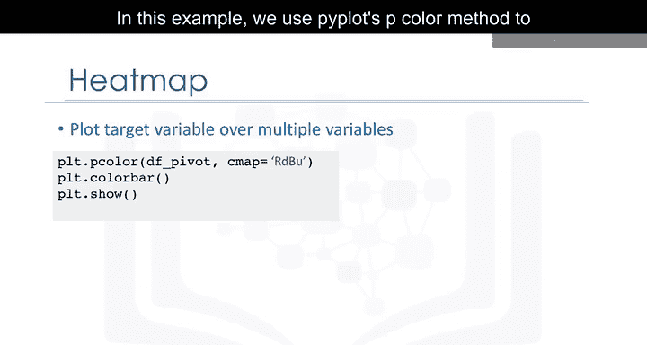

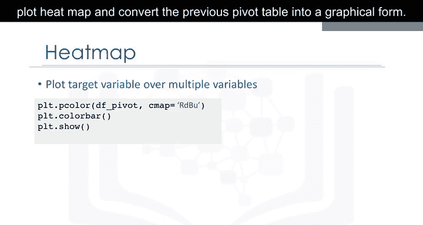

We specified the red， blue color scheme。

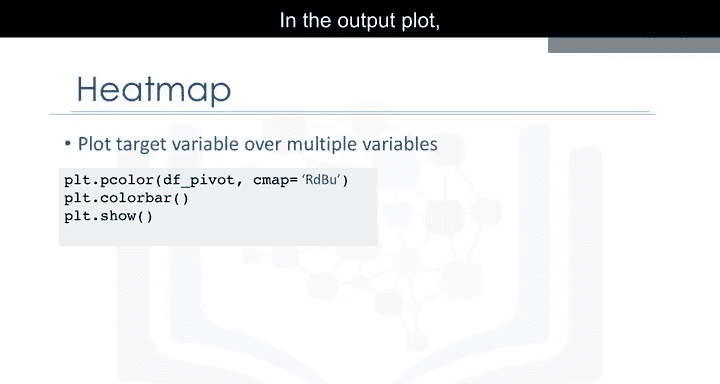

In the output plot， each type of body style is numbered along the X axis。

 and each type of drive wheels is numbered along the Y axis。

 The average prices are plotted with varying colors based on their values。

 According to the color bar。 We see that the top section of the heat map seems to have higher prices in the bottom section。

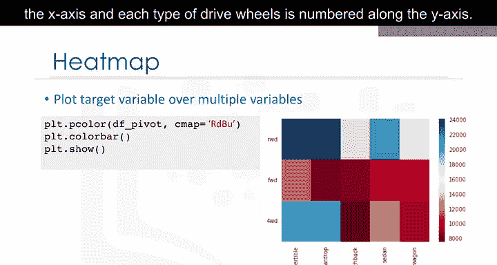

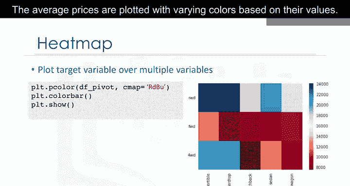

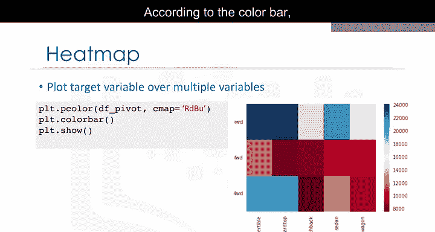

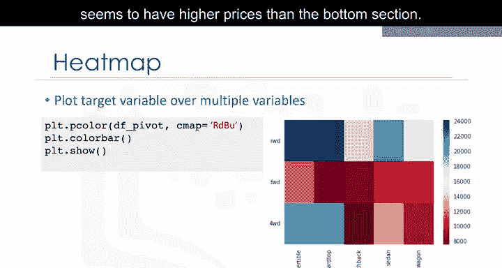