# IBM数据科学专业证书课程7：《使用Python进行数据分析》data-analysis-with-python（中英字幕） - P26：25_相关性统计.zh_en - GPT中英字幕课程资源 - BV1sP41147Bz

In this video， we'll introduce you to various correlation statistical methods。

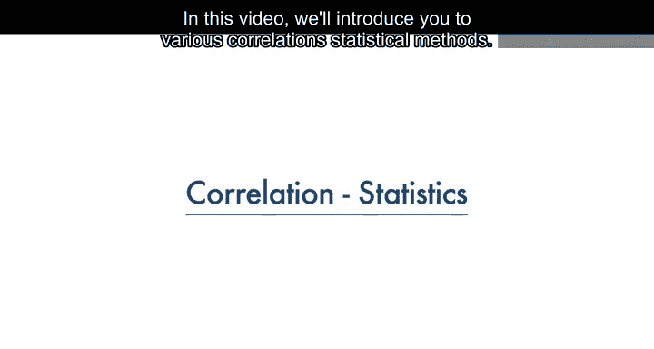

One way to measure the strength of the correlation between continuous numerical variables is by using a method called Pearson correlation。

 Pearson correlation method will give you two values。 The correlation coefficient and the P value。

 So how do we interpret these values。For the correlation coefficient。

 a value close to one implies a large positive correlation。

 While a value close to negative one implies a large negative correlation。

 and a value close to 0 implies no correlation between the variables。

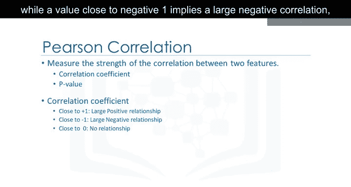

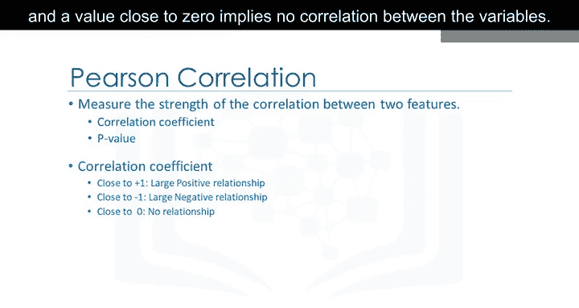

Next， the P value will tell us how certain we are about the correlation that we calculated。

For the P value， a value less than 0。001 gives us a strong certainty about the correlation coefficient that we calculated。

 A value between 0001 and 005 gives us moderate certainty。

 A value between 005 and 01 will give us a weak certainty。

 and a P value larger than 01 will give us no certainty of correlation at all。

We can say that there is a strong correlation when the correlation coefficient is close to 1 or negative 1。

 and the P value is less than 0。001。The following plot shows data with different correlation values。

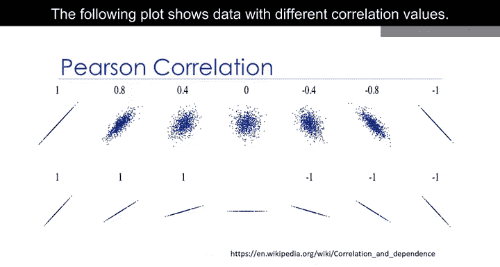

In this example， we want to look at the correlation between the variables， horsepower and car price。

 See how easy you can calculate the Pearson correlation using the s Pi stats package。

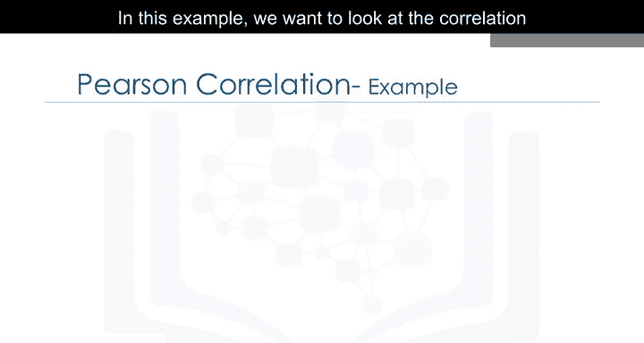

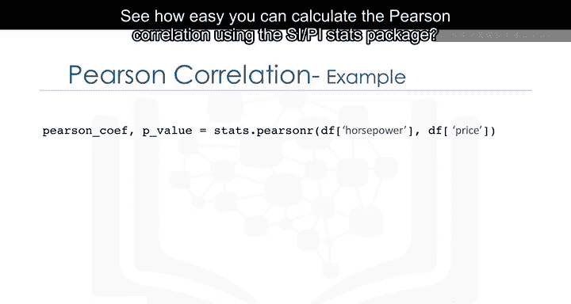

We can see that the correlation coefficient is approximately 08， and this is close to 1。

 So there is a strong positive correlation。 We can also see that the P value is very small。

 much smaller than 0001。 And so we can conclude that we are certain about the strong positive correlation。

😊。

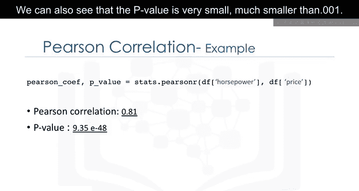

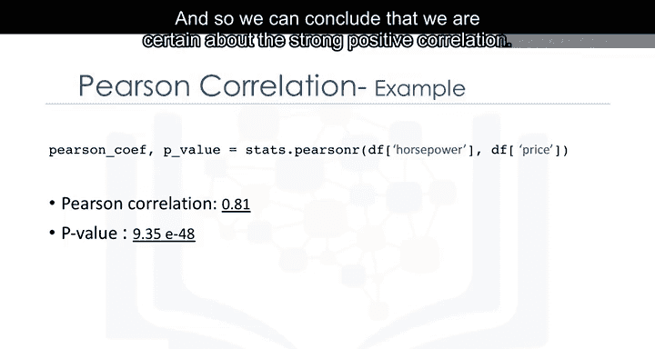

Taking all variables into account， we can now create a heat map that indicates the correlation between each of the variables with one another。

 The color scheme indicates the Pearson correlation coefficient。

 indicating the strength of the correlation between two variables。

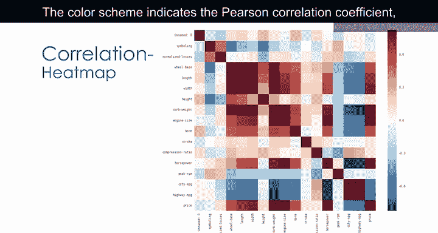

We can see a diagonal line with a dark red color， indicating that all the values on this diagonal are highly correlated。

 This makes sense because when you look closer， the values on the diagonal are the correlation of all variables with themselves。

 which will be always one。😊。

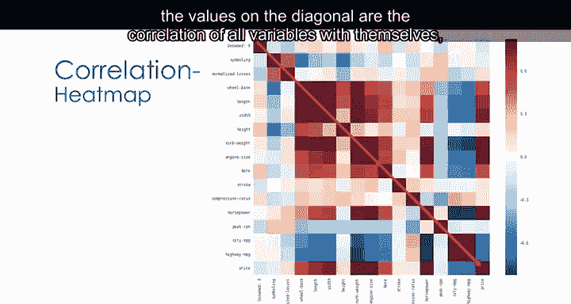

This correlation heat map gives us a good overview of how the different variables are related to one another。

 and most importantly， how these variables are related to price。

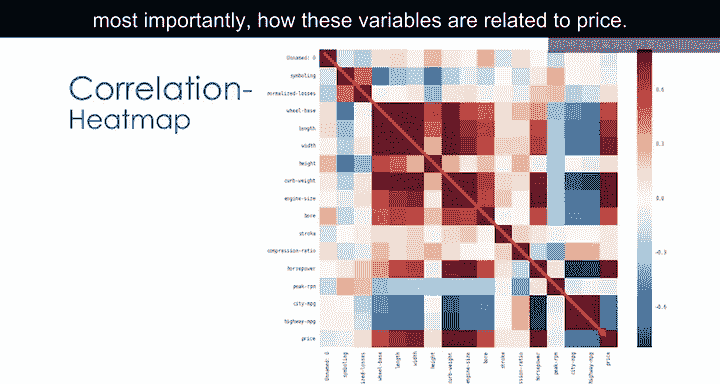