# IBM数据科学专业证书课程7：《使用Python进行数据分析》data-analysis-with-python（中英字幕） - P28：27_相关性分析.zh_en - GPT中英字幕课程资源 - BV1sP41147Bz

In this video， we'll talk about the correlation between different variables。

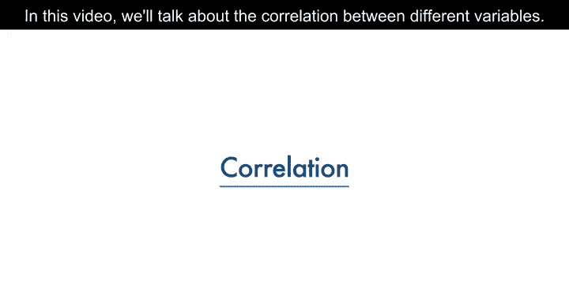

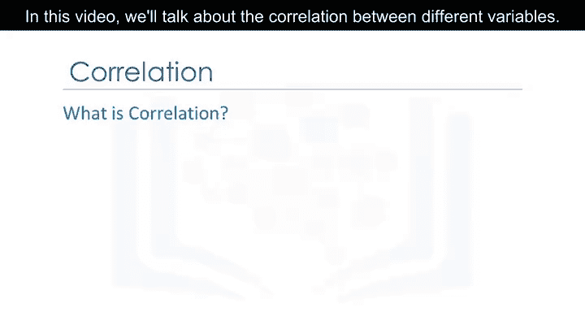

Correlation is a statistical metric for measuring to what extent different variables are interdependent。

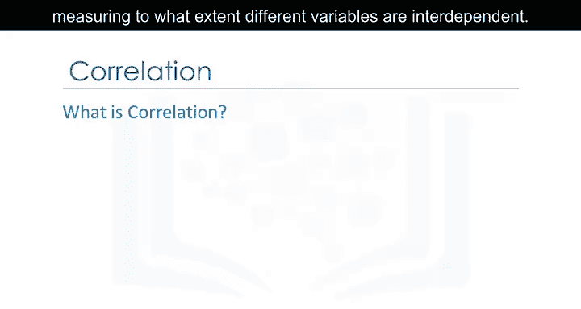

In other words， when we look at two variables over time， if one variable changes。

 how does this effect change in the other variable， For example。

 smoking is known to be correlated to lung cancer。 since you have a higher chance of getting lung cancer if you smoke。

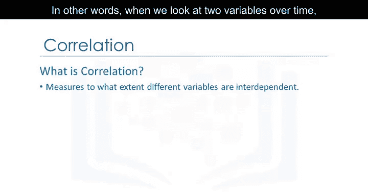

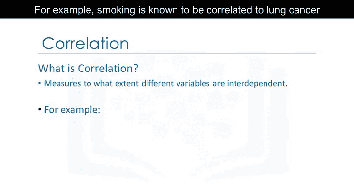

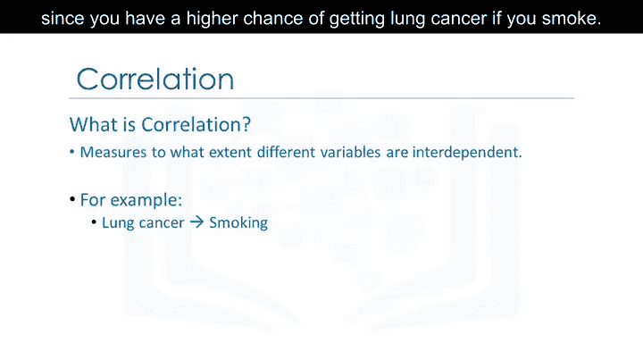

In another example， there is a correlation between umbrella and rain variables where more precipitation means more people use umbrellas。

 Also， if it doesn't rain， people would not carry umbrellas。 Therefore。

 we can say that umbrellas and rain are interdependent and by definition， they are correlated。

 It is important to know that correlation doesn't imply causation。 In fact。

 we can say that umbrella and rain are correlated。 but we would not have enough information to say whether the umbrella caused the rain or the rain caused the umbrella。

 in data science， we usually deal more with correlation。

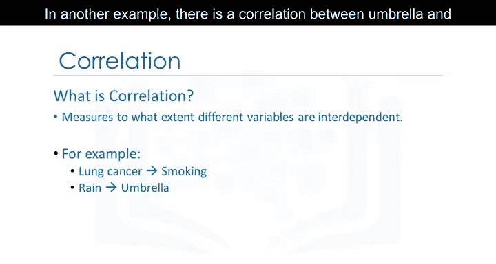

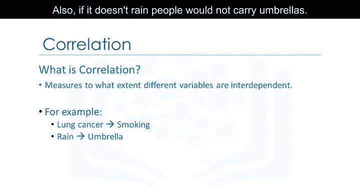

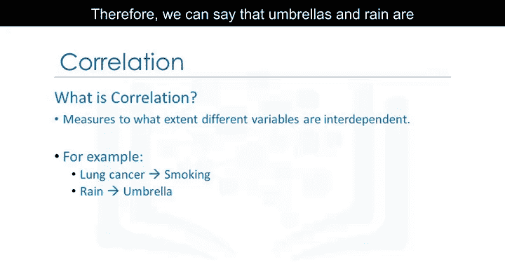

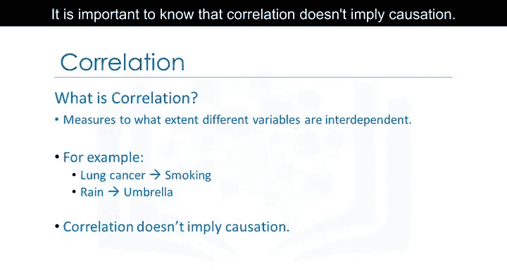

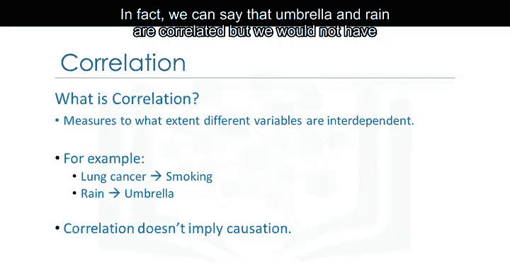

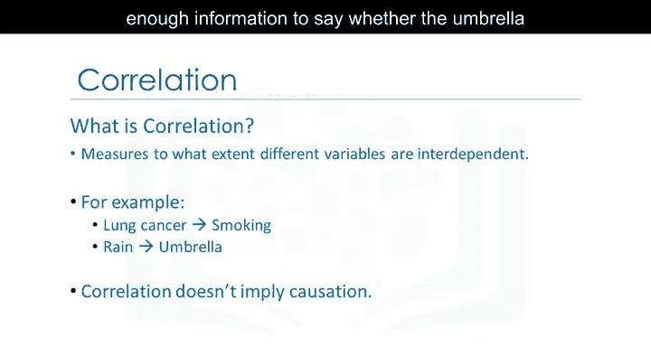

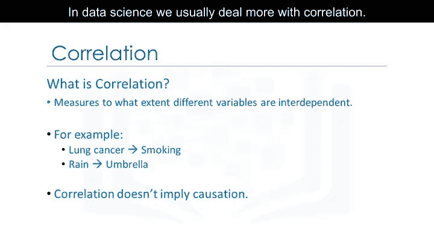

Let's look at the correlation between engine size and price。 This time。

 we'll visualize these two variables using a scatter plot and an added linear line called a regression line。

 which indicates the relationship between the two。

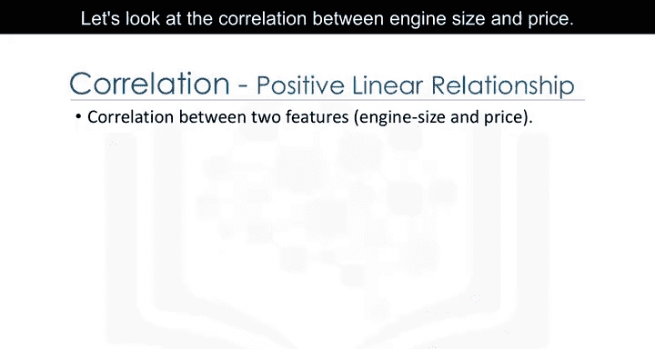

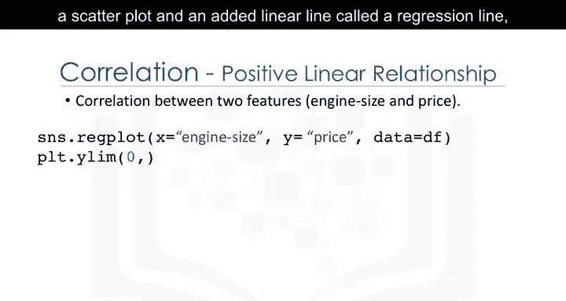

The main goal of this plot is to see whether the engine size has any impact on the price。

 In this example， you can see that the straight line through the data points is very steep。

 which shows that there is a positive， linear relationship between the two variables。

 with increase in values of engine size。 Val of price go up as well。

 and the slope of the line is positive， So there is a positive correlation between engine size and price。

We can use seaborn reddge plot to create the scatter plot。As another example， Now。

 let's look at the relationship between highway miles per gallon to see its impact on the car price。

 As we can see in this plot， when highway miles per gallon value goes up。

 the value of price goes down。 Therefore， there is a negative linear relationship between highway miles per gallon and price。

 Although this relationship is negative， the slope of the line is steep。

 which means that the highway miles per gallon is still a good predictor of price。

 These two variables are said to have a negative correlation。

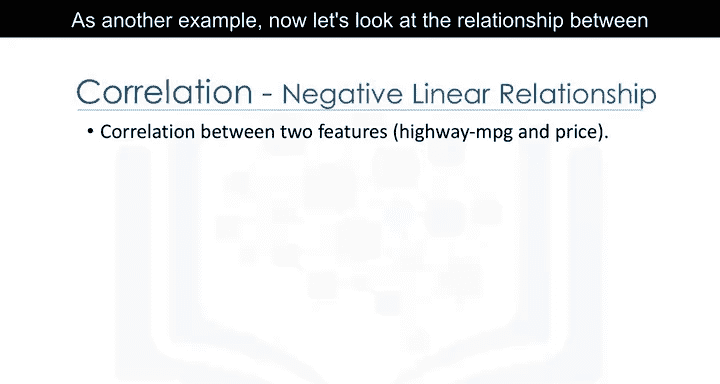

Finally， we have an example of a weak correlation。 For example。

 both low peak R PMM and high values of peak R PMM have low and high prices。 Therefore。

 we cannot use R PMM to predict the values。😊。