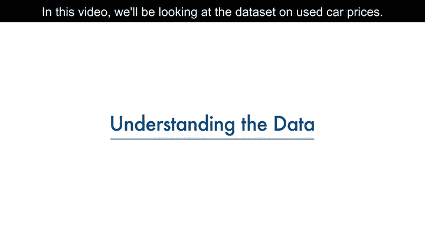

# IBM数据科学专业证书课程7：《使用Python进行数据分析》data-analysis-with-python（中英字幕） - P2：1_数据理解.zh_en - GPT中英字幕课程资源 - BV1sP41147Bz

In this video， we'll be looking at the dataset set on used car prices。

 The dataset set used in this course is an open dataset set by Jeffrey C。 Schlimmer。

 This dataset set is in CSV format， which separates each of the values with commas。

 making it very easy to import in most tools or applications。

 Each line represents a row in the dataset set in the handson lab for this module。

 you'll be able to download and use the CSV file， Do you notice anything different about the first row。

 Sometimes the first row is a header， which contains a column name for each of the 26 columns。

 But in this example is just another row of data。😊。

So here's the documentation on what each of the 26 columns represent。 There are a lot of columns。

 and I'll just go through a few of the column names。

 but you can also check out the link at the bottom of the slide to go through the descriptions yourself。

The first attribute， symboling corresponds to the insurance risk level of a car。

Cars were initially assigned a risk factor symbol associated with their price。

 Then if an automobile is more risky， this symbol is adjusted by moving it up the scale。

A value of plus 3 indicates that the auto is risky。-3， that is probably pretty safe。

The second attribute normalized losses is the relative average loss payment per insured vehicle year。

 This value is normalized for all autos within a particular size classification。

2 door small station wagons， sports specialty， et cetera。

 and represents the average loss per car per year。 The value is range from 65 to 256。

 The other attributes are easy to understand。 If you would like to check out more details。

 refer to the link at the bottom of the slide。Okay， after we understand the meaning of each feature。

 we'll notice that the 26th attribute is price。 This is our target value or label， in other words。

This means price is the value that we want to predict from the data set。

 and the predictors should be all the other variables listed like sing， normalized losses。

 make and so on。 Thus， the goal of this project is to predict price in terms of other car features。

 Just a quick note， this data set is actually from 1985。

 So the car prices for the models may seem a little low。

 But just bear in mind that the goal of this exercise is to learn how to analyze the data。

