# IBM数据科学专业证书课程7：《使用Python进行数据分析》data-analysis-with-python（中英字幕） - P31：30_模型开发.zh_en - GPT中英字幕课程资源 - BV1sP41147Bz

In this video， we will examine model development by trying to predict the price of a car using our data set。

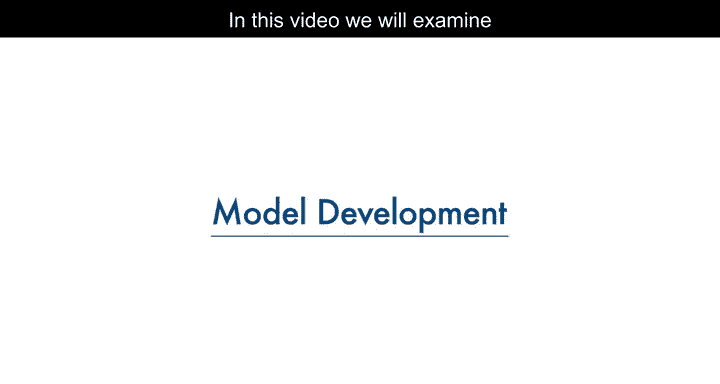

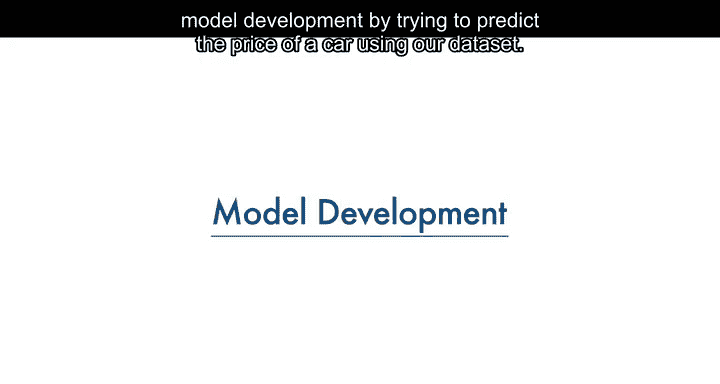

In this module， you will learn about simple and multiple linear regression。

 model evaluation using visualization， polynomial regression and pipelines are squared in MSE for in sample evaluation。

 prediction and decision making， and how you can determine a fair value for a used car。

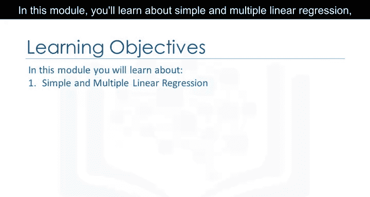

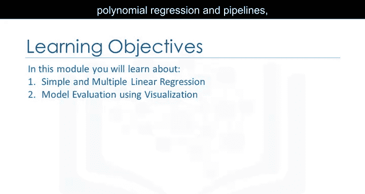

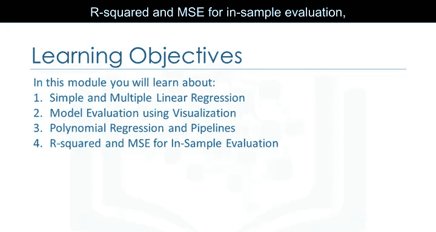

A model or estimator can be thought of as a mathematical equation used to predict a value given one or more other values。

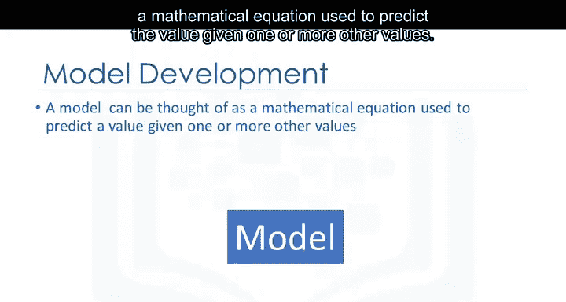

Relating one or more independent variables or features to dependent variables， For example。

 you input a car model's highway miles per gallon as the independent variable or feature。

 The output of the model or dependent variable is the price。Usually， the more relevant data you have。

 the more accurate your model is。

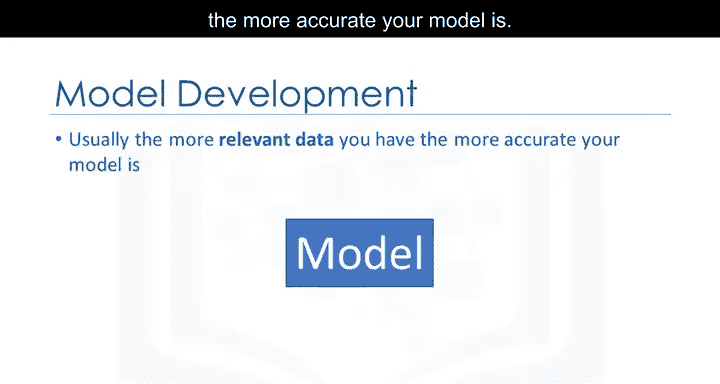

For example， you input multiple independent variables or features to your model。 Therefore。

 your model may predict a more accurate price for the car。To understand why more data is important。

 consider the following situation。 you have two almost identical cars。

 Pink cars sell for significantly less。

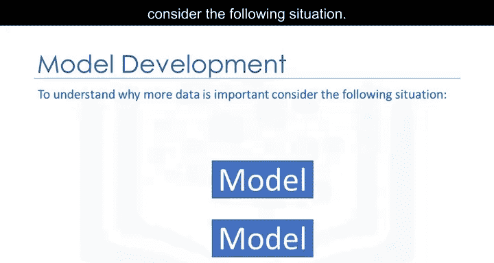

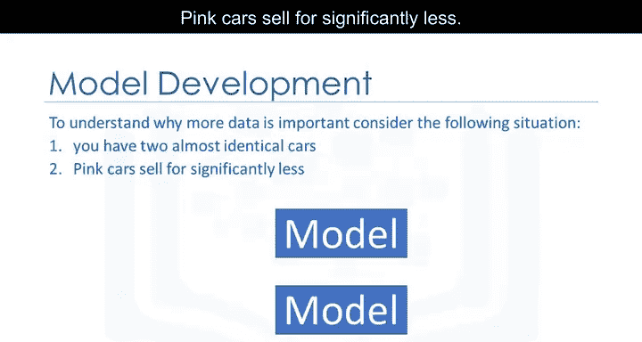

You want to use your model to determine the price of two cars，1 pink，1 red。

If your model's independent variables or features do not include color。

 your model will predict the same price for cars that may sell for much less。

In addition to getting more data， you can try different types of models In this course。

 you will learn about simple linear regression， multiple linear regression and polynomial regression。

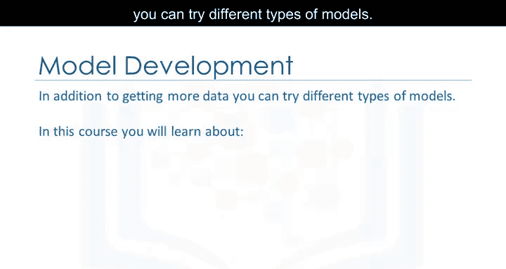

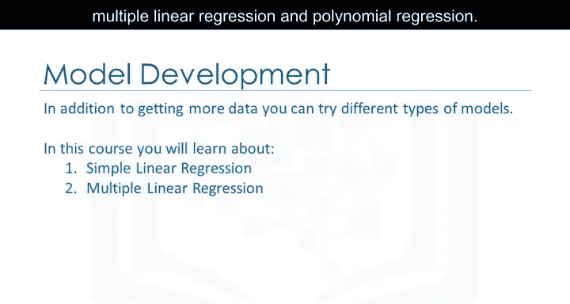