# IBM数据科学专业证书课程7：《使用Python进行数据分析》data-analysis-with-python（中英字幕） - P39：38_样本内评估指标.zh_en - GPT中英字幕课程资源 - BV1sP41147Bz

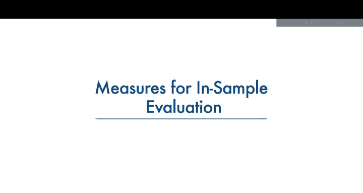

Now that we've seen how we can evaluate a model by using visualization。

 we want to numerically evaluate our models。 Let's look at some of the measures that we use for in sample evaluation。

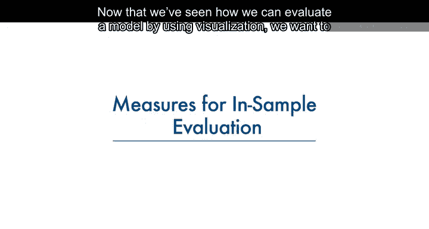

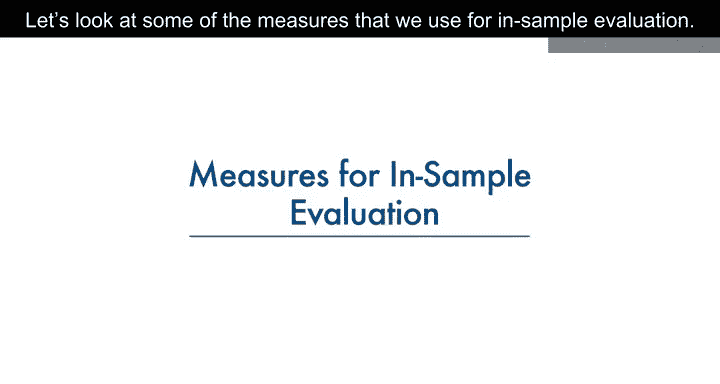

These measures are a way to numerically determine how good the model fits on our data。

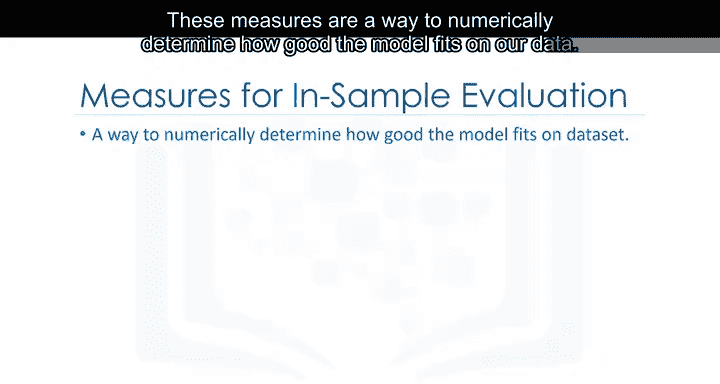

Two important measures that we often use to determine the fit of a model R mean square error， M， S。

 E and R squared。

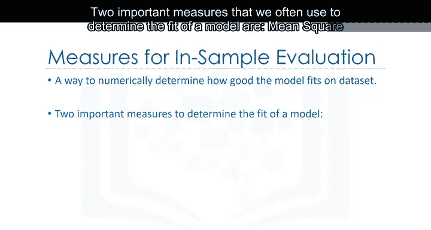

To measure the M S E， we find the difference between the actual value Y and the predicted value Y hat。

 Then square it。 In this case， the actual value is 1 hundred and 50。 The predicted value is 50。

 Subtracting these points。 we get 100。

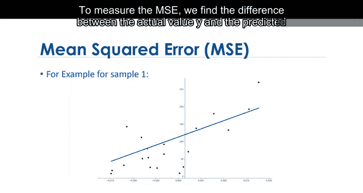

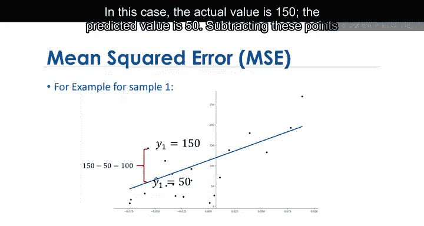

We then square the number。 We then take the mean or average of all the errors by adding them all together and dividing by the number of samples。

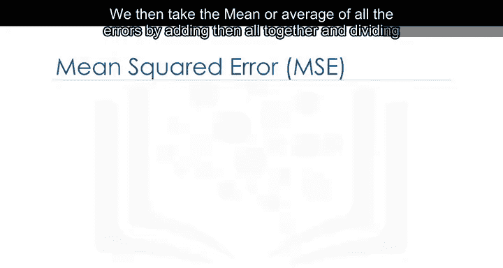

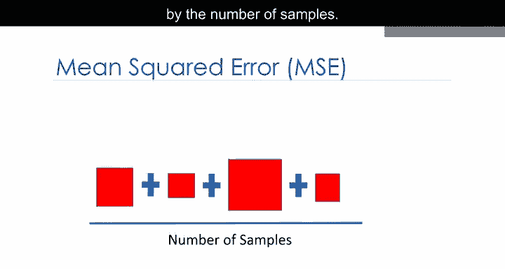

To find the MSE in Python， we can import the mean underscore squared underscore error from Psi Ki learn metrics。

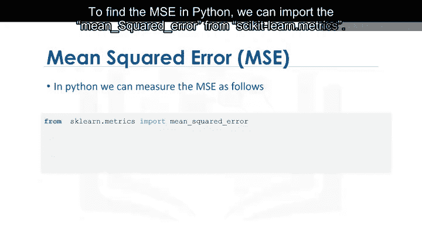

The mean underscore squared underscore error function gets two inputs。

 The actual value of target variable and the predicted value of target variable。

 R squared is also called the coefficient of determination。

 It's a measure to determine how close the data is to the fitted regression line。

 So how close is our actual data to our estimated model。

 Think about it as comparing a regression model to a simple model。 I。e。 the mean of the data points。

 If the variable X is a good predictor。 our model should perform much better than just the mean In this example。

 the average of the data points Y bar is 6。

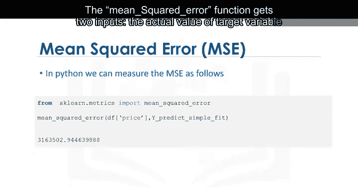

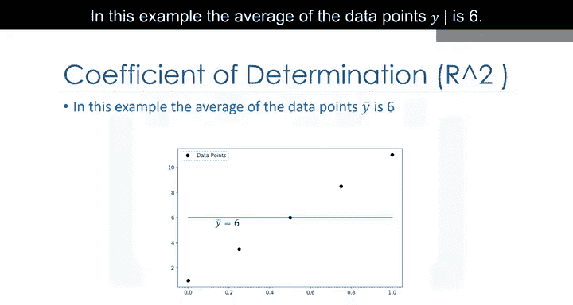

Coeicient of determination R squared is  one minus the ratio of the ME of the regression lined divided by the M SE of the average of the data points。

 For the most part， it takes values between 0 and 1。

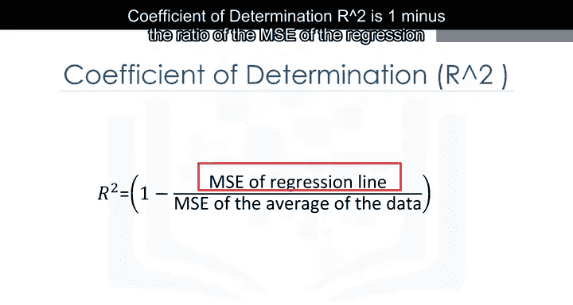

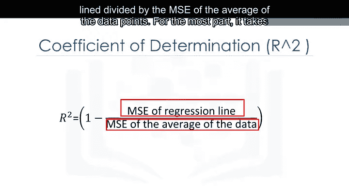

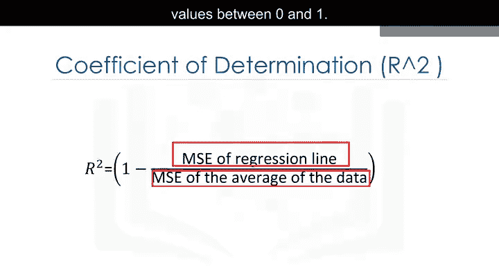

Let's look at a case where the line provides a relatively good fit。

 The blue line represents the regression line。 The blue squares represent the M S E of the regression line。

 The red line represents the average value of the data points。

 The red squares represent the M S E of the red line。

 We see the area of the blue squares is much smaller than the area of the red squares。In this case。

 because the line is a good fit， the mean squared error is small。 Therefore， the numerator is small。

 The mean squared error of the line is relatively large， as such， the numerator is large。

 A small number divided by a larger number is an even smaller number taken to an extreme。

 this value tends to 0。 If we plug in this value from the previous slide for R squared。

 We get a value near one。 This means the line is a good fit for the data。

 here is an example of a line that does not fit the data。 Well。

 If we just examine the area of the red squares compared to the blue squares。

 We see the area is almost identical。 The ratio of the areas is close to one。

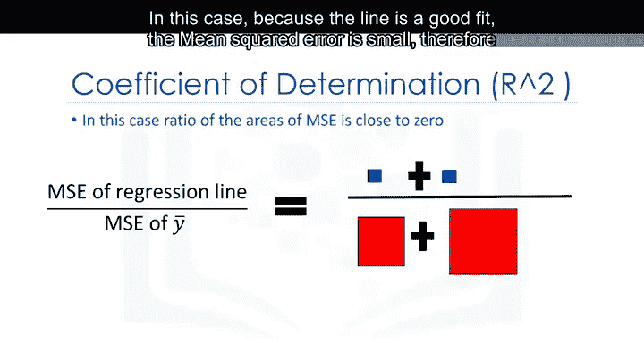

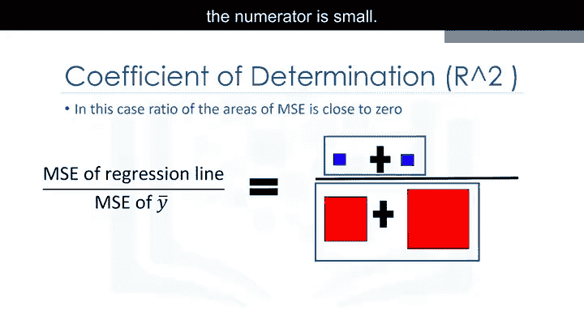

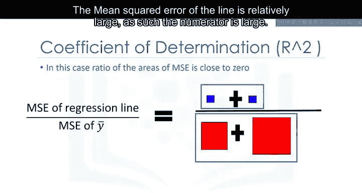

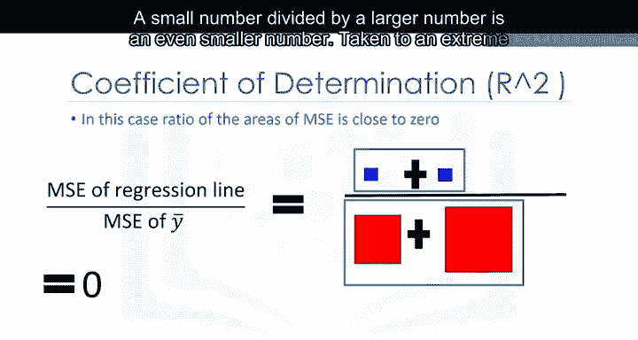

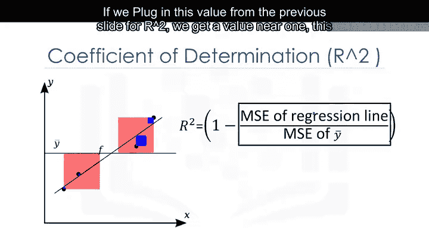

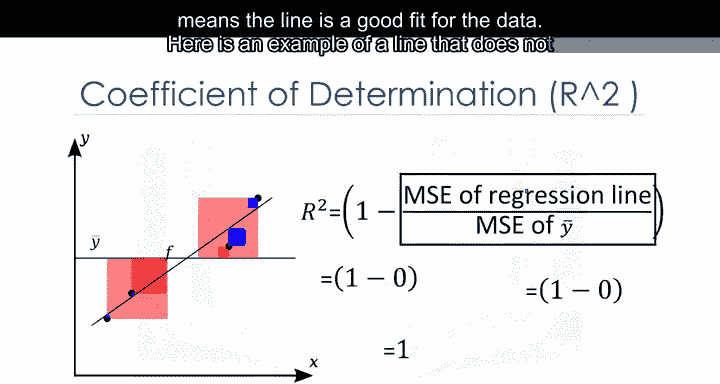

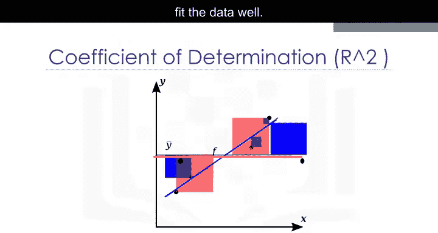

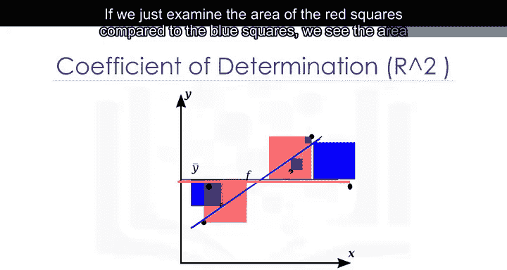

In this case， the R squared is near 0。 This line performs about the same as just using the average of the data points。

 Therefore， this line did not perform well。 We find the R squared value in Python by using the score method in the linear regression object from the value that we get from this example。

 we can say that approximately 49。695 per cent of the variation of price is explained by the simple linear model。

 Your R squared value is usually between 0 and1。 If your R squared is negative。

 It could be due to overfitting that we will discuss in the next module。

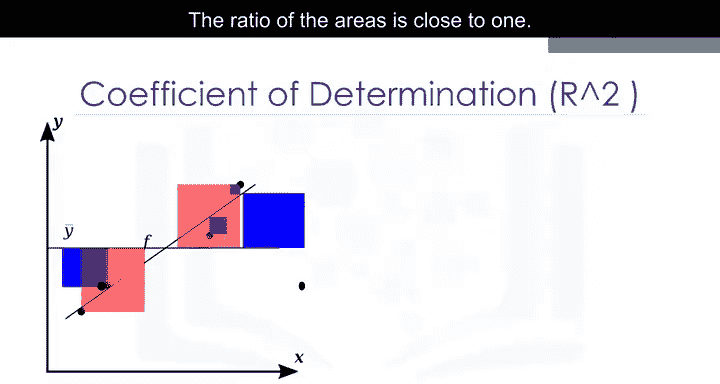

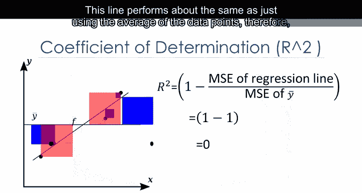

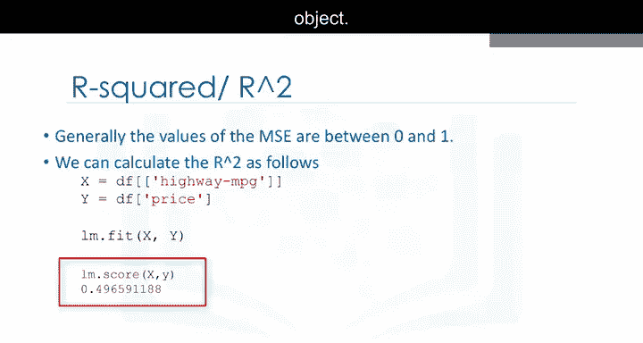

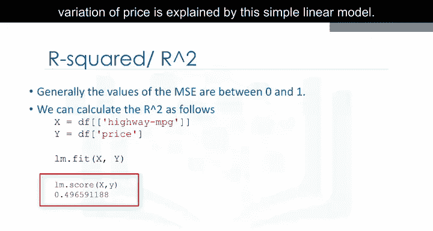

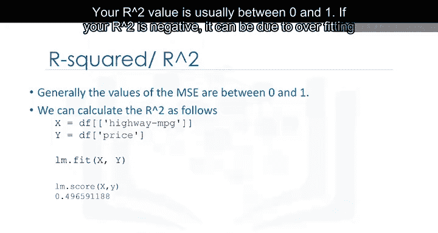

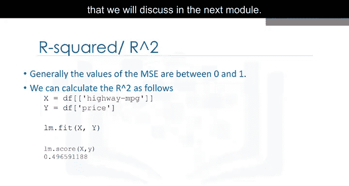