# IBM数据科学专业证书课程8：《Python数据可视化课程（IBM）》python-for-data-visualization（中英字幕） - P10：10_箱线图绘制.zh_en - GPT中英字幕课程资源 - BV19k4y1375E

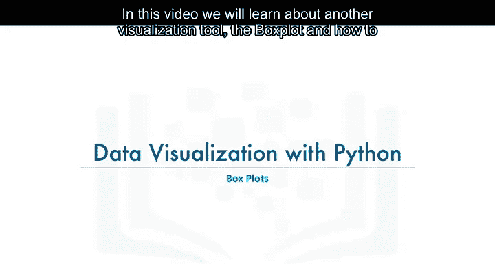

In this video， we will learn about another visualization tool， the box plot。

 and how to create one using MATplotLib。

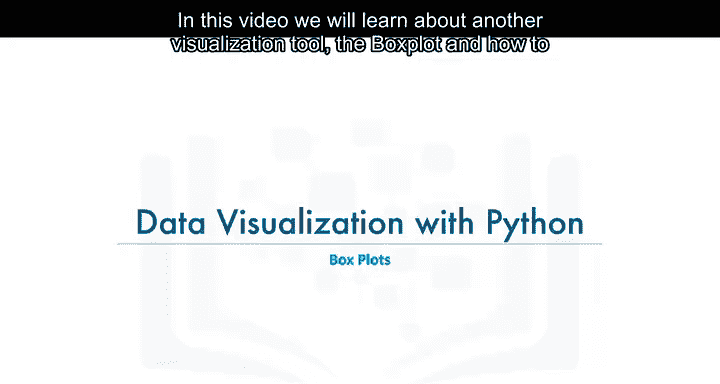

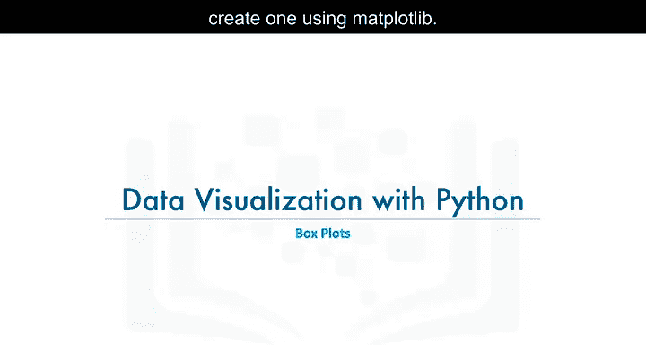

So what is a box plot， a box plot is a way of statistically representing the distribution of given data through five main dimensions。

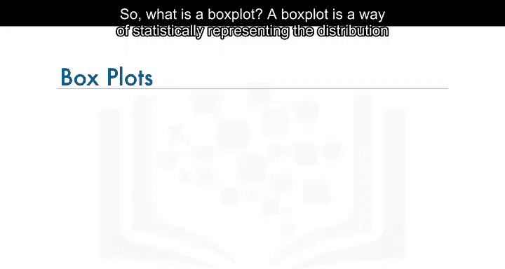

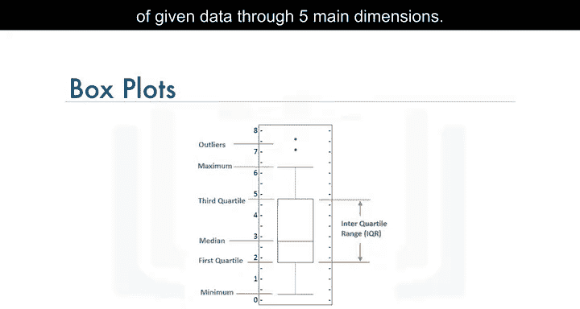

The first dimension is minimum， which is the smallest number in the sorted data。

 Its value can be obtained by subtracting 1。5 times the IQR。

 where IQR is inter quartile range from the first quartile。

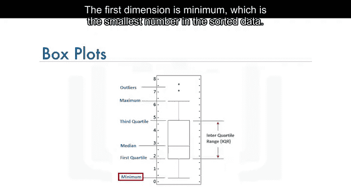

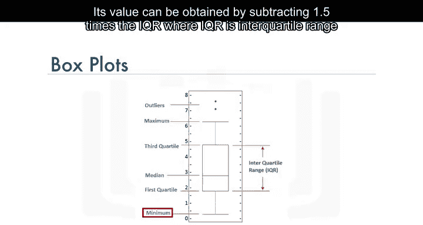

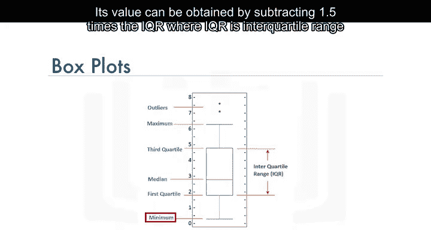

The second dimension is first quartile， which is 25% of the way through the sorted data。

 in other words， a quarter of the data points are less than this value。

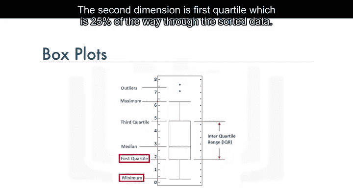

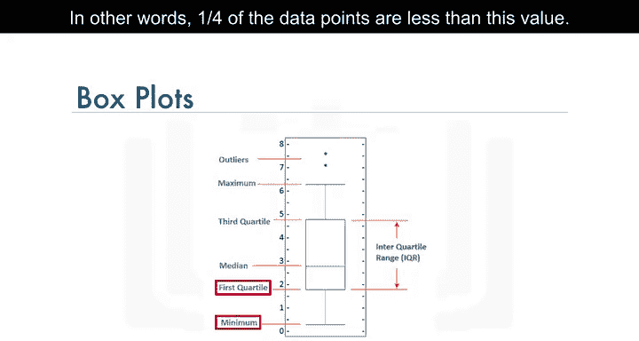

The third dimension is median， which is the median of the sorted data。

 The fourth dimension is third quartile， which is 75% of the way through the sorted data。

 In other words， three/ quarters of the data points are less than this value。

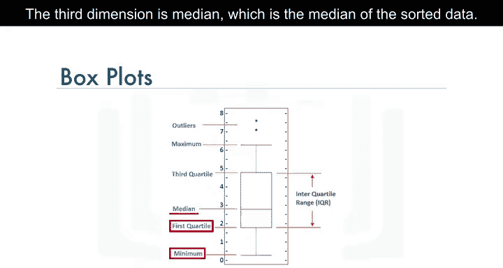

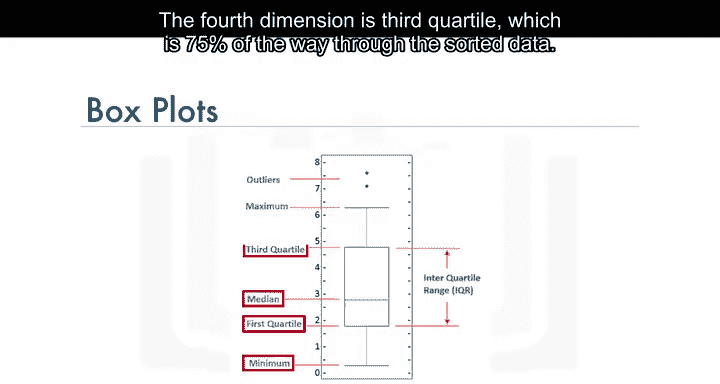

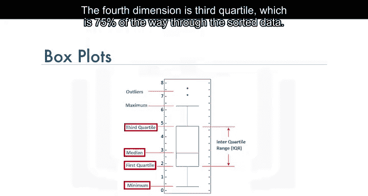

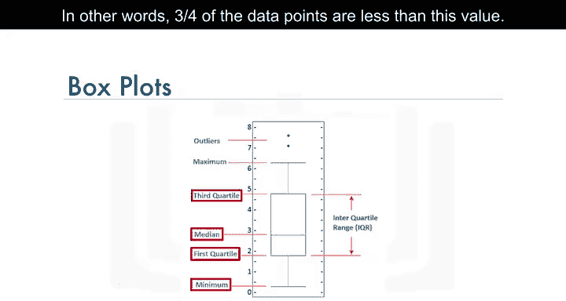

And the final dimension is maximum， which is the highest number in the sortded data where maximum equals third quartile summed with 1。

5 multiplied by IQR。

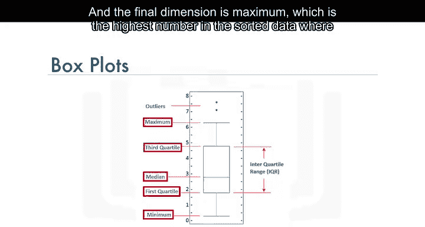

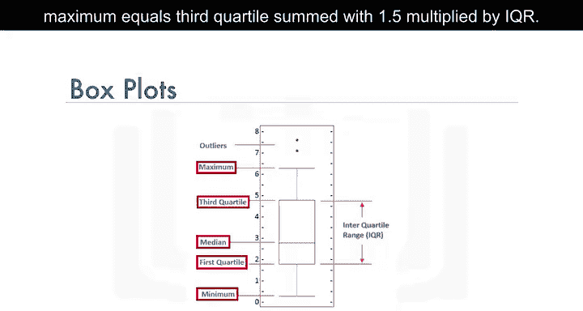

Finally， box plots also display outliers as individual dots that occur outside the upper and lower extremes。

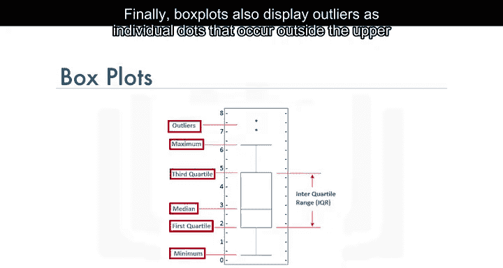

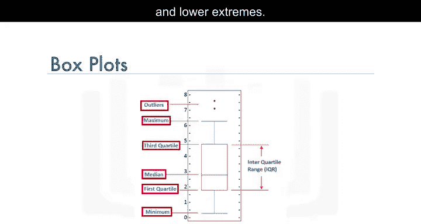

Now let's see how we can create a box plot with mattepllootlib。Before we go over the code to do that。

 let's do a quick recap of our data set。Recall that each row represents a country and contains metadata about the country。

 such as where it is located geographically and whether it is developing or developed。

Each row contains numerical figures of annual immigration from that country to Canada from 1980 to 2013。

Now， let's process the data frame so that the country name becomes the index of each row。

 This should make retrieving rows pertaining to specific countries a lot easier。Also。

 let's add an extra column， which represents the cumulative sum of annual immigration from each country from 1980 to 2013。

 So for Afghanistan， for example， it is 58639 total and for Albania。 It is 15699 and so on。

 And let's name our data frame。 D F underscore Canada。

So now that we know how our data is stored in the data frame。

 DF underscore Canada say we're interested in creating a box plot to visualize immigration from Japan to Canada。

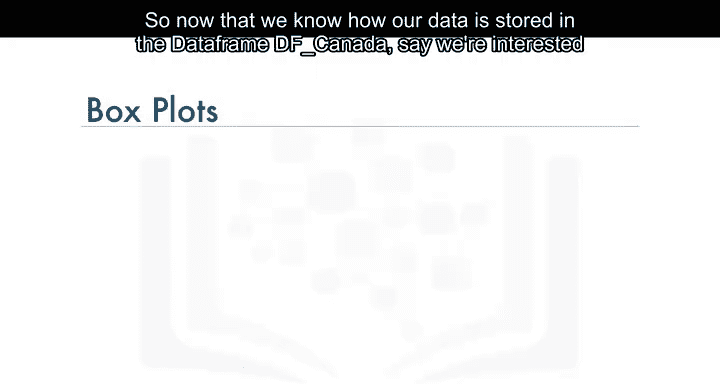

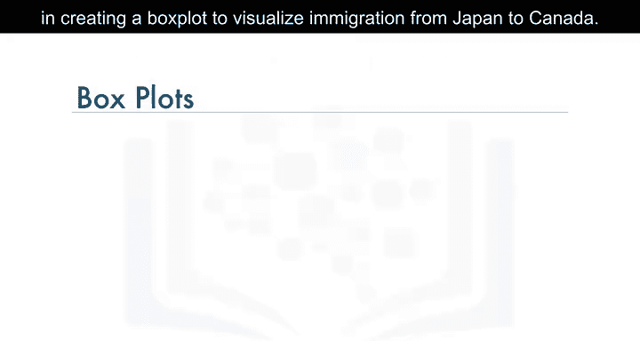

As with other tools that we learned so far， we start by importing MatpllootLiB as MPL and the PPloot interface as PLT。

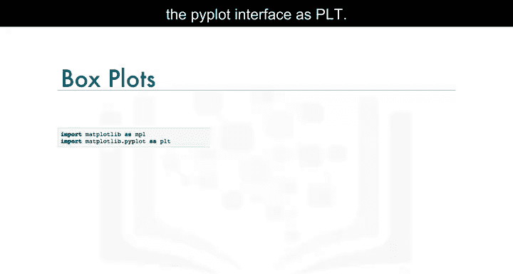

Then we create a new data frame of the data pertaining to Japan and we're excluding the column total using the year's variable。

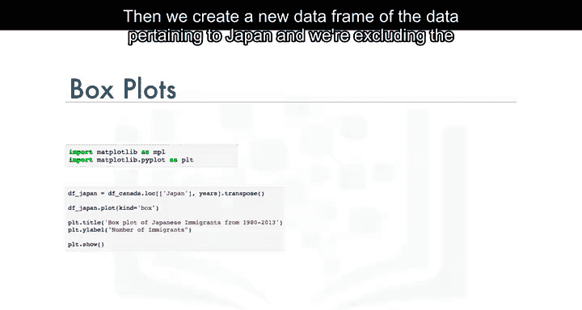

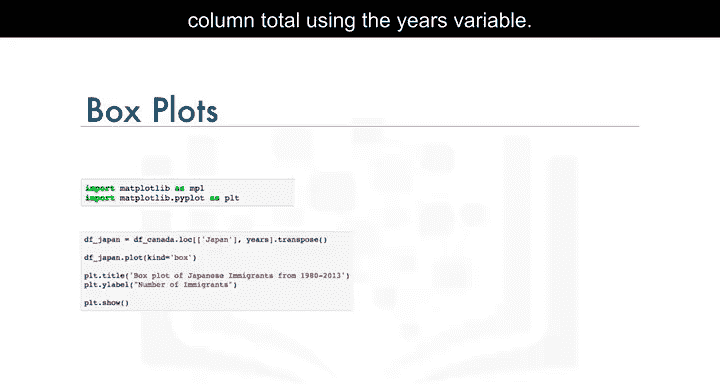

Then we transpose the resulting data frame to make it in the correct format to create the box plot。

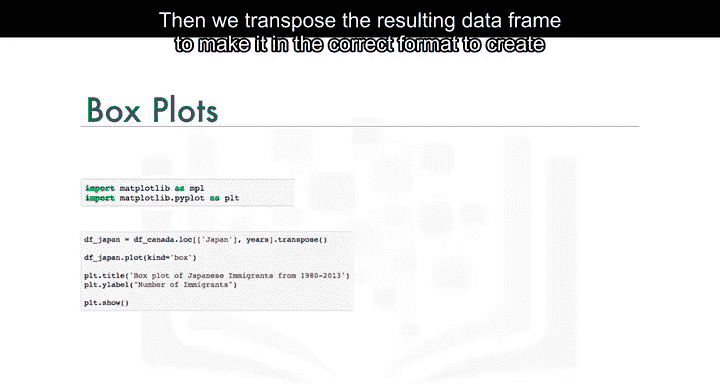

Let's name this new data frame， DF_ Japan。

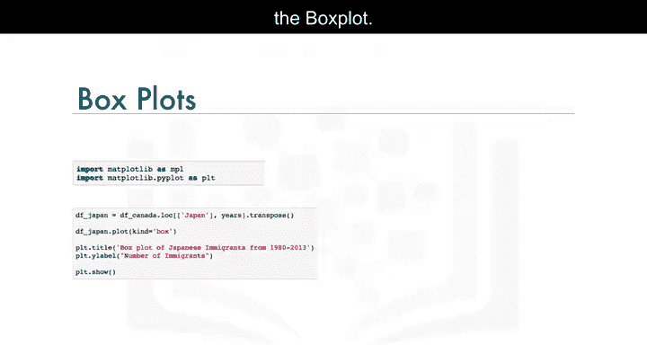

Following that， we call the plot function on DF_ Japan。

 and we set kind equals box to generate a box plot。

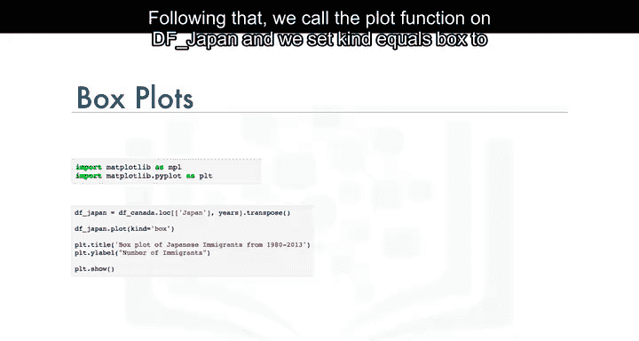

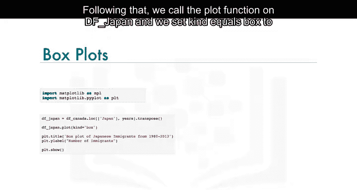

Then to complete the figure， we give it a title and we label the vertical axis。

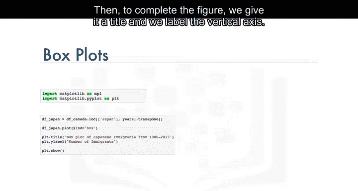

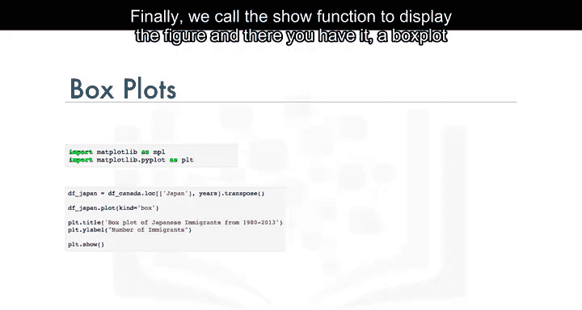

Finally， we call the show function to display the figure， and there you have it。

 a box plot that provides a pleasing distribution of Japanese immigration to Canada from 1980 to 2013。

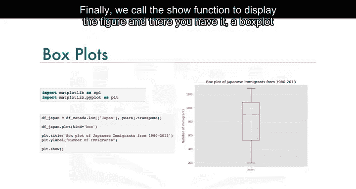

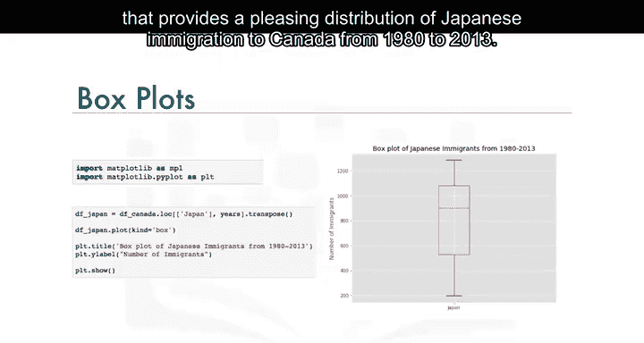

In the lab session， we explore box plots in more detail and learn how to create multiple box plots as well as horizontal box plots。

 so make sure to complete this module's lab session。

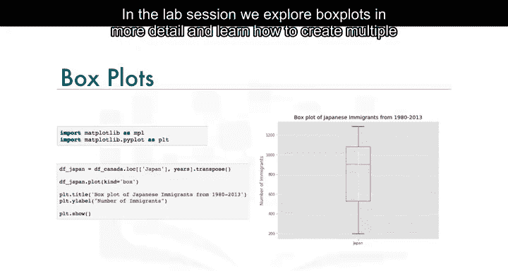

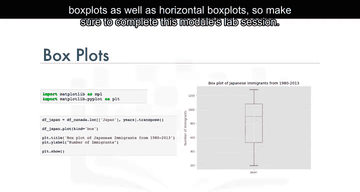

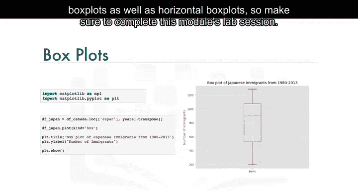

And with this， we conclude our video on box plots， see you in the next video。

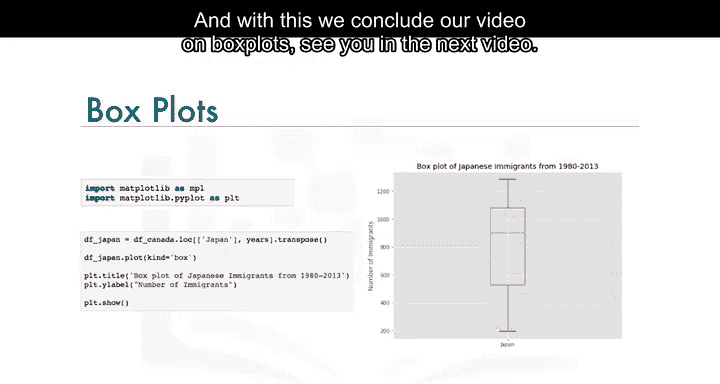